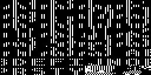
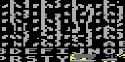
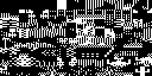
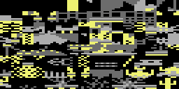
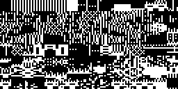
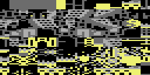
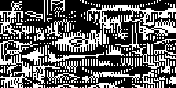
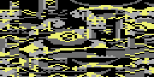
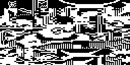
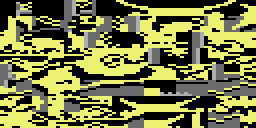

<!-- Generated by c64-docs from knowledge revision 20261018T152957.577-ll4gr6 and src/source-map.json. Do not edit: change the knowledge, generate the source again, then run docs.ts generate. -->
# Graphics

Each sprite, bitmap, charset and screen region of the knowledge. The knowledge gives no display mode and no colours, so a sprite, bitmap or charset shows in hires and in multicolour, in pattern colours: black is pixel value 0, white is 1 in hires; in multicolour light grey is 1, grey is 2 and yellow is 3. Index: [the reference](index.md).

## [`title_logo_chars` `$8400`](../../src/title_logo_charset.asm#L9) `$8400-$87FF`

*charset*

Characters $80-$FF of the charset at $8000 (D018 = $30), multicolour, 8 bytes each. The title screen rows 0-9 ("DATASOFT PRESENTS", "BRUCE LEE", "BY RON J FORTIER") use codes $84-$F8 of it; $DC is the empty character. Only the VIC reads it; no code reads or writes it. Characters $00-$7F of that charset ($8000-$83FF) are the end of room_map_19 and the sprite buffers, and the title does not use them.

## [`room_charset_a` `$9000`](../../src/room_charset_a.asm#L12) `$9000-$93FF`

*charset*

Room charset sources: 4 x 128 multicolour tiles of 8 bytes. In VIC bank 2 the VIC sees the character ROM at $9000-$9FFF, so this RAM holds data for the CPU only. cold_start calls build_double_height_font once per source: tile n row r (r = 0-3) becomes rows 2r and 2r+1 of character n of the expanded charset, rows 4-7 become character n+$80 (the lower half), giving double-height tiles. After that build_contact_masks overwrites $9000-$9FBF with the actor contact masks (96 bytes per pose, read through shift_mask_copy); only $9FC0-$9FFF keep their image bytes. Room charset source A: 128 tiles of 8 bytes for rooms 0-9 (expanded to charset_rooms_0_9, D018 $38).

## [`room_charset_b` `$9400`](../../src/room_charset_b.asm#L6) `$9400-$97FF`

*charset*

Room charset source B: 128 tiles of 8 bytes for rooms 10-17 and 19 (expanded to charset_rooms_10_19, D018 $3A).

## [`room_charset_c` `$9800`](../../src/room_charset_c.asm#L6) `$9800-$9BFF`

*charset*

Room charset source C: 128 tiles of 8 bytes for room 18 (expanded to charset_wizard, D018 $3C).

## [`room_charset_d` `$9C00`](../../src/room_charset_d.asm#L8) `$9C00-$9FFF`

*charset*

Room charset source D: 128 tiles of 8 bytes for room 18 after the wizard is defeated (expanded to charset_wizard_flash, D018 $3E): room18_wizard_defeated sets room_vmcsb = $3E, with random flashes back to $3C at the start.

