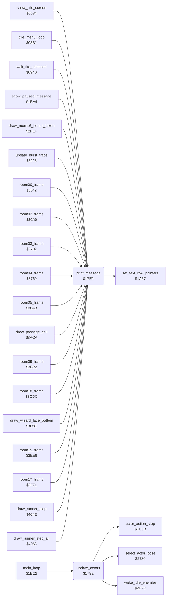

<!-- Generated by c64-docs from knowledge revision 20261029T162352.521-4j8tu8 and .c64-re-tools/local/generated/src/source-map.json. Do not edit: change the knowledge, generate the source again, then run docs.ts generate. -->
# actor/actor_driver_text.asm: Actor update driver and message printing

Range `$179E-$1817`. Source: [actor/actor_driver_text.asm](../../../../src/actor/actor_driver_text.asm). Index: [the reference](../../index.md).

## Routines

| Routine | Address | Reached from | Summary |
|---|---|---|---|
| [`update_actors`](actor_driver_text.md#update_actors) | `$179E` | [`main_loop`](../game/game_main_loop.md#main_loop) | Actor step of the main loop. |
| [`print_message`](actor_driver_text.md#print_message) | `$17E2` | [`show_title_screen`](../game/title_demo_start.md#show_title_screen), [`title_menu_loop`](../game/title_menu.md#title_menu_loop), [`wait_fire_released`](../game/title_menu.md#wait_fire_released), [`show_paused_message`](../game/status_and_keys.md#show_paused_message), [`draw_room16_bonus_taken`](touch_effects.md#draw_room16_bonus_taken), [`update_burst_traps`](../room/room_misc_support.md#update_burst_traps), [`room00_frame`](../room/room_frames_0_7.md#room00_frame), [`room02_frame`](../room/room_frames_0_7.md#room02_frame), [`room03_frame`](../room/room_frames_0_7.md#room03_frame), [`room04_frame`](../room/room_frames_0_7.md#room04_frame), [`room05_frame`](../room/room_frames_0_7.md#room05_frame), [`draw_passage_cell`](../room/passage_open.md#draw_passage_cell) and 15 more | Print message A (pointer table message_ptrs) on text row X at offset Y from the row start. |

## Call graph

A solid arrow is a call, a thick arrow a table entry. Rounded nodes are in this file.

## Details

### [`update_actors`](../../../../src/actor/actor_driver_text.asm#L10) `$179E`

*routine*

Actor step of the main loop. Calls wake_idle_enemies, then in the demo reads one byte of the demo stream (demo_input_ptr, from demo_input_stream): low nybble = joystick bits of Bruce (actor_joy_dir), high nybble = fire (actor_fire). Then for each active actor (X = 2 Ninja, 1 Yamo, 0 Bruce; bit 0 of actor_flags) it calls actor_action_step and select_actor_pose. In room 19 the joystick of Bruce is forced: up while the room_time high byte is below 2 (512 frames), then no input.

- **Called from:** [`main_loop`](../game/game_main_loop.md#main_loop)
- **Calls:** [`wake_idle_enemies`](actor_helpers.md#wake_idle_enemies), [`actor_action_step`](actor_step.md#actor_action_step), [`select_actor_pose`](actor_poses.md#select_actor_pose)
- **Reads:** [`game_mode`](../../memory-map.md#game_mode), [`demo_input_ptr`](../../memory-map.md#demo_input_ptr), [`actor_flags`](../../memory-map.md#actor_flags), [`room`](../../memory-map.md#room), [`room_time`](../../memory-map.md#room_time)
- **Writes:** [`actor_joy_dir`](../../memory-map.md#actor_joy_dir), [`actor_fire`](../../memory-map.md#actor_fire), [`demo_input_ptr`](../../memory-map.md#demo_input_ptr)
- **Refers to:** [`demo_input_ptr`](../../memory-map.md#demo_input_ptr), [`room_time`](../../memory-map.md#room_time)

| Label | Address | Comment |
|---|---|---|
| [`update_actors_start`](../../../../src/actor/actor_driver_text.asm#L27) | `$17BC` |  |
| [`update_actors_loop`](../../../../src/actor/actor_driver_text.asm#L29) | `$17BE` |  |
| [`update_actors_no_input`](../../../../src/actor/actor_driver_text.asm#L41) | `$17D4` | no direction |
| [`update_actors_store_input`](../../../../src/actor/actor_driver_text.asm#L43) | `$17D6` |  |
| [`update_actors_step`](../../../../src/actor/actor_driver_text.asm#L45) | `$17D8` |  |
| [`update_actors_next`](../../../../src/actor/actor_driver_text.asm#L48) | `$17DE` |  |

### [`print_message`](../../../../src/actor/actor_driver_text.asm#L59) `$17E2`

*routine*

Print message A (pointer table message_ptrs) on text row X at offset Y from the row start. Text row 0 = screen row 0, row 1 = screen row 1, row n >= 2 = screen rows 2n-1 and 2n (text_line_top_lo/hi and text_line_bottom_lo/hi, built by build_screen_row_tables). Each message byte b gives character c = b - $20: c AND $7F goes to the upper screen row and c OR $80 to the lower row, so text is two rows high. Byte $A0 ends the message. When text_single_height is nonzero the lower row goes to io1_dummy (lost), so the text is one row high. Rows 0 and 1 are always one row high. Uses row_ptr_top, data_ptr and row_ptr_bottom. Changes A, X, Y.

- **Called from:** [`show_title_screen`](../game/title_demo_start.md#show_title_screen), [`title_menu_loop`](../game/title_menu.md#title_menu_loop), [`wait_fire_released`](../game/title_menu.md#wait_fire_released), [`show_paused_message`](../game/status_and_keys.md#show_paused_message), [`draw_room16_bonus_taken`](touch_effects.md#draw_room16_bonus_taken), [`update_burst_traps`](../room/room_misc_support.md#update_burst_traps), [`room00_frame`](../room/room_frames_0_7.md#room00_frame), [`room02_frame`](../room/room_frames_0_7.md#room02_frame), [`room03_frame`](../room/room_frames_0_7.md#room03_frame), [`room04_frame`](../room/room_frames_0_7.md#room04_frame), [`room05_frame`](../room/room_frames_0_7.md#room05_frame), [`draw_passage_cell`](../room/passage_open.md#draw_passage_cell) and 7 more
- **Jumped to from:** [`blink_player_label`](../game/pause_status_line.md#blink_player_label), [`print_falls_label`](../game/pause_status_line.md#print_falls_label), [`draw_room16_bonus_taken`](touch_effects.md#draw_room16_bonus_taken), [`room01_frame`](../room/room_frames_0_7.md#room01_frame), [`room03_frame`](../room/room_frames_0_7.md#room03_frame), [`draw_wizard_face_top`](../room/wizard_room.md#draw_wizard_face_top), [`draw_wizard_face_bottom`](../room/wizard_room.md#draw_wizard_face_bottom), [`draw_runner_step`](../room/room_hazard_draw.md#draw_runner_step), [`draw_runner_step_alt`](../room/room_hazard_draw.md#draw_runner_step_alt), [`draw_slider0`](../room/room_hazard_draw.md#draw_slider0), [`draw_slider1`](../room/room_hazard_draw.md#draw_slider1), [`draw_slider2`](../room/room_hazard_draw.md#draw_slider2) and 1 more
- **Calls:** [`set_text_row_pointers`](../game/pause_status_line.md#set_text_row_pointers)
- **Reads:** [`message_ptrs`](../text/messages.md#message_ptrs), [`data_ptr`](../../memory-map.md#data_ptr), [`row_ptr_top`](../../memory-map.md#row_ptr_top), [`row_ptr_bottom`](../../memory-map.md#row_ptr_bottom)
- **Writes:** [`data_ptr`](../../memory-map.md#data_ptr), [`row_ptr_top`](../../memory-map.md#row_ptr_top), [`row_ptr_bottom`](../../memory-map.md#row_ptr_bottom)
- **Refers to:** [`message_ptrs`](../text/messages.md#message_ptrs), [`data_ptr`](../../memory-map.md#data_ptr), [`row_ptr_top`](../../memory-map.md#row_ptr_top), [`row_ptr_bottom`](../../memory-map.md#row_ptr_bottom)

| Label | Address | Comment |
|---|---|---|
| [`print_message_loop`](../../../../src/actor/actor_driver_text.asm#L73) | `$17FA` |  |
| [`print_message_done`](../../../../src/actor/actor_driver_text.asm#L90) | `$1817` |  |
