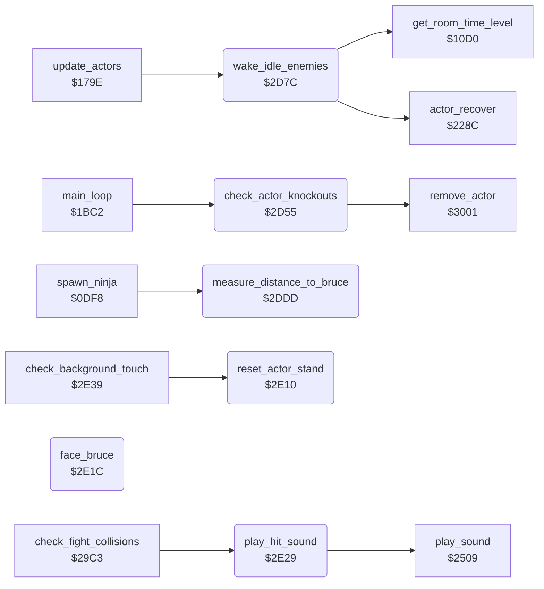

<!-- Generated by c64-docs from knowledge revision 20261025T141148.619-ij2l1b and .c64-re-tools/local/generated/src/source-map.json. Do not edit: change the knowledge, generate the source again, then run docs.ts generate. -->
# actor/actor_helpers.asm: Actor helpers: knock-out removal, waking enemies, distance and facing to Bruce

Range `$2D55-$2E38`. Source: [actor/actor_helpers.asm](../../../../src/actor/actor_helpers.asm). Index: [the reference](../../index.md).

## Routines

| Routine | Address | Reached from | Summary |
|---|---|---|---|
| [`check_actor_knockouts`](actor_helpers.md#check_actor_knockouts) | `$2D55` | [`main_loop`](../game/game_main_loop.md#main_loop) | Main loop: for each active actor whose actor_energy,X is below 0 (knocked out), except while the timer of state $13 (knocked down) or $19 (dying) still runs: an enemy is removed (remove_actor), Bruce loses a fall (lose_fall, does not return). |
| [`wake_idle_enemies`](actor_helpers.md#wake_idle_enemies) | `$2D7C` | [`update_actors`](actor_driver_text.md#update_actors) | update_actors calls it. |
| [`measure_distance_to_bruce`](actor_helpers.md#measure_distance_to_bruce) | `$2DDD` | [`spawn_ninja`](actor_spawn.md#spawn_ninja), [`$2300`](../../../../src/actor/enemy_ai_states.asm#L17) | For actor X: bruce_dist_y = \|Y - Bruce Y\| and bruce_dist_x = \|X - Bruce X\|, each at most $30. |
| [`reset_actor_stand`](actor_helpers.md#reset_actor_stand) | `$2E10` | [`check_background_touch`](background_touch.md#check_background_touch) | Sets actor X to state 0 (stand) with actor_timer,X = 0 and actor_step_delay,X = 0. |
| [`face_bruce`](actor_helpers.md#face_bruce) | `$2E1C` | [`spawn_ninja`](actor_spawn.md#spawn_ninja), [`$2366`](../../../../src/actor/enemy_ai_states.asm#L81) | Turns actor X toward Bruce from the sign bit of bruce_dist_x (measure_distance_to_bruce): actor_facing,X = 1 (right) when the actor is left of Bruce, else 0. |
| [`play_hit_sound`](actor_helpers.md#play_hit_sound) | `$2E29` | [`check_fight_collisions`](fight_hits.md#check_fight_collisions), [`launch_fireball0`](../room/wizard_fireballs.md#launch_fireball0), [`launch_fireball1`](../room/wizard_fireballs.md#launch_fireball1) | Starts sound effect $86 (hit). |

## Call graph

A solid arrow is a call, a thick arrow a table entry. Rounded nodes are in this file.

## Details

### [`check_actor_knockouts`](../../../../src/actor/actor_helpers.asm#L8) `$2D55`

*routine*

Main loop: for each active actor whose actor_energy,X is below 0 (knocked out), except while the timer of state $13 (knocked down) or $19 (dying) still runs: an enemy is removed (remove_actor), Bruce loses a fall (lose_fall, does not return).

- **Called from:** [`main_loop`](../game/game_main_loop.md#main_loop)
- **Calls:** [`remove_actor`](touch_effects.md#remove_actor)
- **Jumps to:** [`lose_fall`](../game/lose_fall_game_over.md#lose_fall)
- **Reads:** [`actor_flags`](../../memory-map.md#actor_flags), [`actor_state`](../../memory-map.md#actor_state), [`actor_timer`](../../memory-map.md#actor_timer), [`actor_energy`](../../memory-map.md#actor_energy)

| Label | Address | Comment |
|---|---|---|
| [`check_actor_knockouts_loop`](../../../../src/actor/actor_helpers.asm#L10) | `$2D57` |  |
| [`check_actor_knockouts_timer`](../../../../src/actor/actor_helpers.asm#L19) | `$2D67` |  |
| [`check_actor_knockouts_energy`](../../../../src/actor/actor_helpers.asm#L22) | `$2D6B` |  |
| [`check_actor_knockouts_next`](../../../../src/actor/actor_helpers.asm#L28) | `$2D75` |  |
| [`check_actor_knockouts_bruce`](../../../../src/actor/actor_helpers.asm#L33) | `$2D79` | Observed: the attract demo ends here, about 1714 frames after start_attract_demo, when Bruce is knocked out (lose_fall with game_mode = 0 goes to show_title_screen); demo_input_ptr was $F539 (569 bytes read). Bruce: lose a fall |

### [`wake_idle_enemies`](../../../../src/actor/actor_helpers.asm#L40) `$2D7C`

*routine*

update_actors calls it. For Yamo (only when option_yamo_player2 = 0) and the Ninja: when the enemy has energy left, stands (state 0, timer 0) and has terrain flag bit 0 or 2 (floor, ladder or vine), it starts state $14 (AI chase) with timer $14, unless its previous state actor_prev_state,X is a flying kick ($0C/$0D): then it recovers (actor_recover) and pauses: actor_timer = $18, or 3 (C) / 1 (V or game_loop_count nonzero) by get_room_time_level.

- **Called from:** [`update_actors`](actor_driver_text.md#update_actors)
- **Calls:** [`actor_recover`](actor_timed_actions.md#actor_recover), [`get_room_time_level`](../game/game_setup.md#get_room_time_level)
- **Reads:** [`actor_energy`](../../memory-map.md#actor_energy), [`option_yamo_player2`](../game/options_and_patterns.md#option_yamo_player2), [`actor_flags`](../../memory-map.md#actor_flags), [`actor_state`](../../memory-map.md#actor_state), [`actor_timer`](../../memory-map.md#actor_timer), [`actor_contact`](../../memory-map.md#actor_contact), [`actor_prev_state`](../../memory-map.md#actor_prev_state), [`game_loop_count`](../../memory-map.md#game_loop_count)
- **Writes:** [`actor_state`](../../memory-map.md#actor_state), [`actor_timer`](../../memory-map.md#actor_timer), [`actor_step_delay`](../../memory-map.md#actor_step_delay)

| Label | Address | Comment |
|---|---|---|
| [`wake_idle_enemies_loop`](../../../../src/actor/actor_helpers.asm#L42) | `$2D7E` |  |
| [`wake_idle_enemies_try_ninja`](../../../../src/actor/actor_helpers.asm#L51) | `$2D8F` |  |
| [`wake_idle_enemies_check`](../../../../src/actor/actor_helpers.asm#L56) | `$2D97` |  |
| [`wake_idle_enemies_next`](../../../../src/actor/actor_helpers.asm#L75) | `$2DBC` |  |
| [`wake_idle_enemies_kick`](../../../../src/actor/actor_helpers.asm#L80) | `$2DC0` | After a flying kick: recover and pause before the next chase. |
| [`wake_idle_enemies_pause_3`](../../../../src/actor/actor_helpers.asm#L90) | `$2DD3` |  |
| [`wake_idle_enemies_pause_1`](../../../../src/actor/actor_helpers.asm#L95) | `$2DD8` |  |

### [`measure_distance_to_bruce`](../../../../src/actor/actor_helpers.asm#L102) `$2DDD`

*routine*

For actor X: bruce_dist_y = |Y - Bruce Y| and bruce_dist_x = |X - Bruce X|, each at most $30. Bit 7 of bruce_dist_y is set when the actor is above Bruce, bit 7 of bruce_dist_x when it is left of Bruce. Used by the enemy AI. Changes A.

- **Called from:** [`spawn_ninja`](actor_spawn.md#spawn_ninja), [`$2300`](../../../../src/actor/enemy_ai_states.asm#L17)
- **Reads:** [`actor_y`](../../memory-map.md#actor_y), [`actor_x`](../../memory-map.md#actor_x)
- **Writes:** [`bruce_dist_y`](../../memory-map.md#bruce_dist_y), [`bruce_dist_x`](../../memory-map.md#bruce_dist_x)

| Label | Address | Comment |
|---|---|---|
| [`measure_distance_cap_y`](../../../../src/actor/actor_helpers.asm#L110) | `$2DE9` |  |
| [`measure_distance_sign_y`](../../../../src/actor/actor_helpers.asm#L114) | `$2DEF` |  |
| [`measure_distance_store_y`](../../../../src/actor/actor_helpers.asm#L118) | `$2DF4` |  |
| [`measure_distance_cap_x`](../../../../src/actor/actor_helpers.asm#L127) | `$2E02` |  |
| [`measure_distance_sign_x`](../../../../src/actor/actor_helpers.asm#L131) | `$2E08` |  |
| [`measure_distance_store_x`](../../../../src/actor/actor_helpers.asm#L135) | `$2E0D` |  |

### [`reset_actor_stand`](../../../../src/actor/actor_helpers.asm#L139) `$2E10`

*routine*

Sets actor X to state 0 (stand) with actor_timer,X = 0 and actor_step_delay,X = 0.

- **Called from:** [`check_background_touch`](background_touch.md#check_background_touch)
- **Writes:** [`actor_state`](../../memory-map.md#actor_state), [`actor_timer`](../../memory-map.md#actor_timer), [`actor_step_delay`](../../memory-map.md#actor_step_delay)

### [`face_bruce`](../../../../src/actor/actor_helpers.asm#L148) `$2E1C`

*routine*

Turns actor X toward Bruce from the sign bit of bruce_dist_x (measure_distance_to_bruce): actor_facing,X = 1 (right) when the actor is left of Bruce, else 0.

- **Called from:** [`$2366`](../../../../src/actor/enemy_ai_states.asm#L81)
- **Jumped to from:** [`spawn_ninja`](actor_spawn.md#spawn_ninja)
- **Reads:** [`bruce_dist_x`](../../memory-map.md#bruce_dist_x)
- **Writes:** [`actor_facing`](../../memory-map.md#actor_facing)

| Label | Address | Comment |
|---|---|---|
| [`face_bruce_left`](../../../../src/actor/actor_helpers.asm#L153) | `$2E24` |  |
| [`face_bruce_store`](../../../../src/actor/actor_helpers.asm#L155) | `$2E26` |  |

### [`play_hit_sound`](../../../../src/actor/actor_helpers.asm#L159) `$2E29`

*routine*

Starts sound effect $86 (hit). Keeps A, X and Y.

- **Called from:** [`check_fight_collisions`](fight_hits.md#check_fight_collisions)
- **Jumped to from:** [`launch_fireball0`](../room/wizard_fireballs.md#launch_fireball0), [`launch_fireball1`](../room/wizard_fireballs.md#launch_fireball1)
- **Calls:** [`play_sound`](../sfx/sound_request.md#play_sound)
