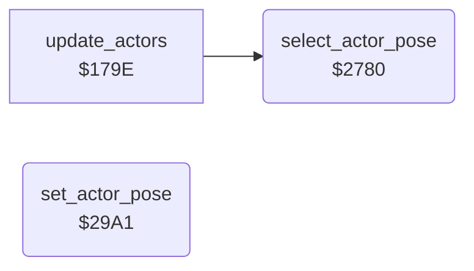

<!-- Generated by c64-docs from knowledge revision 20261025T214801.837-ucnw24 and .c64-re-tools/local/generated/src/source-map.json. Do not edit: change the knowledge, generate the source again, then run docs.ts generate. -->
# actor/actor_poses.asm: Actor poses: choose the animation frames from state, timer and facing

Range `$2780-$29C2`. Source: [actor/actor_poses.asm](../../../../src/actor/actor_poses.asm). Index: [the reference](../../index.md).

## Routines

| Routine | Address | Reached from | Summary |
|---|---|---|---|
| [`select_actor_pose`](actor_poses.md#select_actor_pose) | `$2780` | [`update_actors`](actor_driver_text.md#update_actors) | Chooses the pose (pair of animation frames) of actor X from actor_state,X, actor_timer,X and actor_facing,X (1 = right), then sets it with set_actor_pose (Y = pose). |
| [`set_actor_pose`](actor_poses.md#set_actor_pose) | `$29A1` |  | Sets the pose Y of actor X: actor_pose,X = pose, actor_pose_b,X = pose + 1, actor_frame_a,X = first frame = frame base of the actor type + pose, actor_frame_b,X = first frame + 1. |

## Call graph

A solid arrow is a call, a thick arrow a table entry. Rounded nodes are in this file.

## Details

### [`select_actor_pose`](../../../../src/actor/actor_poses.asm#L18) `$2780`

*routine*

Chooses the pose (pair of animation frames) of actor X from actor_state,X, actor_timer,X and actor_facing,X (1 = right), then sets it with set_actor_pose (Y = pose). update_actors_step calls it. It runs once for each tick of the actor animation: actor_pose_done,X <> 0 means the pose is already chosen. The previous pose is kept in actor_prev_pose,X so walking and climbing alternate between two poses. State: pose (left facing / right facing): $00 stand $00/$02          $03/$04 walk $0E<->$10 / $12<->$14     $05 jump up $08,$1E,$20 by timer $06/$07 jump $22,$24 / $26,$28                                   $0C/$0D flying kick $16,$18 / $1A,$1C $0E fall $44 ($08 inside a wall)    $0F recoil $00/$02         $10 Yamo appears $2A $11 punch $04/$06          $12 Yamo pose $2C/$2E              $13 knocked down $3C,$3E / $38,$3A $14/$15 AI walk (as $03/$04 by facing)                        $16 Ninja strike $30,$32 / $34,$36 $17 ride (climbing poses)  $18 wall bump (previous pose, else $08)    $19 dying $08 $1A duck $40/$42           $1B hit by a fall attack $3C,$3E / $38,$3A On a ladder or vine (actor_contact,X bit 2) the walk and stand states use the climbing poses $0A<->$0C.

- **Called from:** [`update_actors`](actor_driver_text.md#update_actors)
- **Jumps to:** [`setup_sprite_frame_done`](actor_sprites.md#setup_sprite_frame_done), [`set_actor_pose`](actor_poses.md#set_actor_pose)
- **Reads:** [`actor_pose_done`](../../memory-map.md#actor_pose_done), [`actor_pose`](../../memory-map.md#actor_pose), [`actor_facing`](../../memory-map.md#actor_facing), [`actor_state`](../../memory-map.md#actor_state), [`actor_contact`](../../memory-map.md#actor_contact), [`actor_prev_pose`](../../memory-map.md#actor_prev_pose), [`actor_main_wide`](../../memory-map.md#actor_main_wide), [`actor_overlay_wide`](../../memory-map.md#actor_overlay_wide), [`actor_timer`](../../memory-map.md#actor_timer), [`actor_ride_hold`](../../memory-map.md#actor_ride_hold)
- **Writes:** [`actor_pose_done`](../../memory-map.md#actor_pose_done), [`actor_prev_pose`](../../memory-map.md#actor_prev_pose)

| Label | Address | Comment |
|---|---|---|
| [`select_pose_fall`](../../../../src/actor/actor_poses.asm#L34) | `$27A1` |  |
| [`select_pose_try_crouch`](../../../../src/actor/actor_poses.asm#L37) | `$27A6` | state $1a: crouch |
| [`select_pose_crouch_left`](../../../../src/actor/actor_poses.asm#L44) | `$27B3` |  |
| [`select_pose_try_dying`](../../../../src/actor/actor_poses.asm#L47) | `$27B8` | state $19: dying |
| [`select_pose_try_wall_bump`](../../../../src/actor/actor_poses.asm#L52) | `$27C1` | state $18 wall bump: keep the previous pose; pose $08 after $44 or for wide frames |
| [`select_pose_wall_bump_default`](../../../../src/actor/actor_poses.asm#L62) | `$27D5` |  |
| [`select_pose_try_fall_knockdown`](../../../../src/actor/actor_poses.asm#L65) | `$27DA` | state $1B: hit by a fall attack |
| [`select_pose_fall_knockdown_right_late`](../../../../src/actor/actor_poses.asm#L75) | `$27ED` |  |
| [`select_pose_fall_knockdown_left`](../../../../src/actor/actor_poses.asm#L78) | `$27F2` |  |
| [`select_pose_fall_knockdown_left_late`](../../../../src/actor/actor_poses.asm#L83) | `$27FB` |  |
| [`select_pose_try_knockdown`](../../../../src/actor/actor_poses.asm#L86) | `$2800` | state $13: knocked down |
| [`select_pose_knockdown_right`](../../../../src/actor/actor_poses.asm#L96) | `$2813` |  |
| [`select_pose_knockdown_late`](../../../../src/actor/actor_poses.asm#L99) | `$2818` |  |
| [`select_pose_knockdown_right_late`](../../../../src/actor/actor_poses.asm#L104) | `$2821` |  |
| [`select_pose_try_yamo_appear`](../../../../src/actor/actor_poses.asm#L107) | `$2826` | state $10 Yamo appears: pose $2A |
| [`select_pose_try_punch`](../../../../src/actor/actor_poses.asm#L112) | `$282F` | state $11: punch |
| [`select_pose_punch_left`](../../../../src/actor/actor_poses.asm#L119) | `$283C` |  |
| [`select_pose_try_yamo_pose`](../../../../src/actor/actor_poses.asm#L122) | `$2841` | state $12 Yamo pose: pose $2C (left) / $2E (right) |
| [`select_pose_yamo_pose_left`](../../../../src/actor/actor_poses.asm#L129) | `$284E` |  |
| [`select_pose_try_enemy_strike`](../../../../src/actor/actor_poses.asm#L132) | `$2853` | state $16: Ninja strike |
| [`select_pose_strike_left`](../../../../src/actor/actor_poses.asm#L142) | `$2866` |  |
| [`select_pose_strike_late`](../../../../src/actor/actor_poses.asm#L145) | `$286B` |  |
| [`select_pose_strike_left_late`](../../../../src/actor/actor_poses.asm#L150) | `$2874` |  |
| [`select_pose_try_recoil`](../../../../src/actor/actor_poses.asm#L153) | `$2879` | state $0f: hit recoil |
| [`select_pose_recoil_left`](../../../../src/actor/actor_poses.asm#L160) | `$2886` |  |
| [`select_pose_try_kick_left`](../../../../src/actor/actor_poses.asm#L163) | `$288B` | state $0c: flying kick left |
| [`select_pose_kick_left_late`](../../../../src/actor/actor_poses.asm#L171) | `$289A` |  |
| [`select_pose_try_kick_right`](../../../../src/actor/actor_poses.asm#L174) | `$289F` | state $0d: flying kick right |
| [`select_pose_kick_right_late`](../../../../src/actor/actor_poses.asm#L182) | `$28AE` |  |
| [`select_pose_try_enemy_walk_a`](../../../../src/actor/actor_poses.asm#L185) | `$28B3` | state $14 AI chase: walk poses by facing |
| [`select_pose_try_enemy_walk_b`](../../../../src/actor/actor_poses.asm#L191) | `$28BD` | state $15 AI back off: walk poses by facing |
| [`select_pose_try_walk_left`](../../../../src/actor/actor_poses.asm#L197) | `$28C7` | state $03: walk left |
| [`select_pose_walk_left`](../../../../src/actor/actor_poses.asm#L200) | `$28CB` | terrain flag bit 2: climbing poses |
| [`select_pose_walk_left_step`](../../../../src/actor/actor_poses.asm#L205) | `$28D4` |  |
| [`select_pose_walk_left_other`](../../../../src/actor/actor_poses.asm#L211) | `$28E0` |  |
| [`select_pose_try_walk_right`](../../../../src/actor/actor_poses.asm#L214) | `$28E5` | state $04: walk right |
| [`select_pose_walk_right`](../../../../src/actor/actor_poses.asm#L217) | `$28E9` |  |
| [`select_pose_walk_right_step`](../../../../src/actor/actor_poses.asm#L222) | `$28F2` |  |
| [`select_pose_walk_right_other`](../../../../src/actor/actor_poses.asm#L228) | `$28FE` |  |
| [`select_pose_try_jump_up`](../../../../src/actor/actor_poses.asm#L231) | `$2903` | state $05: jump up, timer counts down from $0f |
| [`select_pose_jump_up_rising`](../../../../src/actor/actor_poses.asm#L239) | `$2912` |  |
| [`select_pose_jump_up_air`](../../../../src/actor/actor_poses.asm#L244) | `$291B` |  |
| [`select_pose_jump_up_landing`](../../../../src/actor/actor_poses.asm#L249) | `$2924` |  |
| [`select_pose_jump_up_end`](../../../../src/actor/actor_poses.asm#L254) | `$292D` |  |
| [`select_pose_try_jump_left`](../../../../src/actor/actor_poses.asm#L257) | `$2932` | state $06: jump left |
| [`select_pose_jump_left_ground`](../../../../src/actor/actor_poses.asm#L263) | `$293C` |  |
| [`select_pose_jump_left_air`](../../../../src/actor/actor_poses.asm#L266) | `$2941` |  |
| [`select_pose_try_jump_right`](../../../../src/actor/actor_poses.asm#L271) | `$294A` | state $07: jump right |
| [`select_pose_jump_right_ground`](../../../../src/actor/actor_poses.asm#L277) | `$2954` |  |
| [`select_pose_jump_right_air`](../../../../src/actor/actor_poses.asm#L280) | `$2959` |  |
| [`select_pose_try_ride`](../../../../src/actor/actor_poses.asm#L285) | `$2962` | state $17 ride (moving character $62) |
| [`select_pose_try_stand`](../../../../src/actor/actor_poses.asm#L292) | `$2970` | state $00: stand; other states use the climbing poses |
| [`select_pose_climb_step`](../../../../src/actor/actor_poses.asm#L304) | `$2985` | Climbing: alternate between poses $0a and $0c. |
| [`select_pose_store`](../../../../src/actor/actor_poses.asm#L309) | `$298E` |  |
| [`select_pose_climb_other`](../../../../src/actor/actor_poses.asm#L311) | `$2991` |  |
| [`select_pose_stand`](../../../../src/actor/actor_poses.asm#L314) | `$2996` |  |
| [`select_pose_stand_right`](../../../../src/actor/actor_poses.asm#L319) | `$299F` |  |

### [`set_actor_pose`](../../../../src/actor/actor_poses.asm#L324) `$29A1`

*routine*

Sets the pose Y of actor X: actor_pose,X = pose, actor_pose_b,X = pose + 1, actor_frame_a,X = first frame = frame base of the actor type + pose, actor_frame_b,X = first frame + 1. The actor type is bits 7-6 of actor_flags,X (0 Bruce, 1 Ninja, 2 Yamo) and indexes the frame base table actor_frame_base. Changes A, Y.

- **Jumped to from:** [`select_actor_pose`](actor_poses.md#select_actor_pose)
- **Reads:** [`actor_flags`](../../memory-map.md#actor_flags), [`actor_frame_base`](actor_frame_tables.md#actor_frame_base), [`actor_pose`](../../memory-map.md#actor_pose)
- **Writes:** [`actor_pose`](../../memory-map.md#actor_pose), [`actor_pose_b`](../../memory-map.md#actor_pose_b), [`actor_frame_a`](../../memory-map.md#actor_frame_a), [`actor_frame_b`](../../memory-map.md#actor_frame_b)
