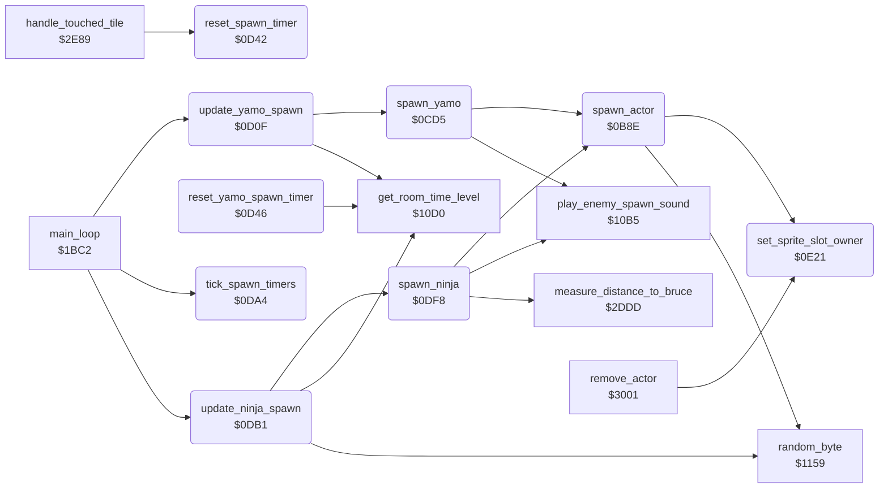

<!-- Generated by c64-docs from knowledge revision 20261025T214801.837-ucnw24 and .c64-re-tools/local/generated/src/source-map.json. Do not edit: change the knowledge, generate the source again, then run docs.ts generate. -->
# actor/actor_spawn.asm: Actor spawning: Bruce, Yamo and Ninja placement, sprites and spawn timers

Range `$0B8E-$0E2D`. Source: [actor/actor_spawn.asm](../../../../src/actor/actor_spawn.asm). Index: [the reference](../../index.md).

## Routines

| Routine | Address | Reached from | Summary |
|---|---|---|---|
| [`spawn_actor`](actor_spawn.md#spawn_actor) | `$0B8E` | [`spawn_yamo`](actor_spawn.md#spawn_yamo), [`spawn_ninja`](actor_spawn.md#spawn_ninja), [`reset_play_state`](../game/play_init.md#reset_play_state) | Spawn (initialise) actor X. |
| [`spawn_yamo`](actor_spawn.md#spawn_yamo) | `$0CD5` | [`update_yamo_spawn`](actor_spawn.md#update_yamo_spawn) | Spawn Yamo (actor 1, type $80). |
| [`update_yamo_spawn`](actor_spawn.md#update_yamo_spawn) | `$0D0F` | [`main_loop`](../game/game_main_loop.md#main_loop) | Yamo spawn timer (main loop, every pass when the room has enemies). |
| [`reset_spawn_timer`](actor_spawn.md#reset_spawn_timer) | `$0D42` | [`handle_touched_tile`](background_touch.md#handle_touched_tile), [`remove_actor`](touch_effects.md#remove_actor) | Reload the spawn timer of actor X without spawning: X = 1 Yamo (yamo_spawn_timer from yamo_respawn_delay[room]), X = 2 Ninja (ninja_spawn_timer from ninja_respawn_delay[room]), other X both. |
| [`reset_yamo_spawn_timer`](actor_spawn.md#reset_yamo_spawn_timer) | `$0D46` |  | Load yamo_spawn_timer with yamo_respawn_delay[room]: builds the address in the operand of reset_yamo_timer_load. |
| [`reset_yamo_timer_src`](actor_spawn.md#reset_yamo_timer_src) | `$0D56` |  |  |
| [`reset_yamo_timer_src_hi`](actor_spawn.md#reset_yamo_timer_src_hi) | `$0D57` |  |  |
| [`reset_ninja_timer_src`](actor_spawn.md#reset_ninja_timer_src) | `$0D86` |  |  |
| [`reset_ninja_timer_src_hi`](actor_spawn.md#reset_ninja_timer_src_hi) | `$0D87` |  |  |
| [`tick_spawn_timers`](actor_spawn.md#tick_spawn_timers) | `$0DA4` | [`main_loop`](../game/game_main_loop.md#main_loop) | Count down ninja_spawn_timer and yamo_spawn_timer once per main loop pass; they stop at 0. |
| [`update_ninja_spawn`](actor_spawn.md#update_ninja_spawn) | `$0DB1` | [`main_loop`](../game/game_main_loop.md#main_loop) | Ninja spawn timer (main loop). |
| [`spawn_ninja`](actor_spawn.md#spawn_ninja) | `$0DF8` | [`update_ninja_spawn`](actor_spawn.md#update_ninja_spawn) | Spawn the Ninja (actor 2, type $40). |
| [`set_sprite_slot_owner`](actor_spawn.md#set_sprite_slot_owner) | `$0E21` | [`spawn_actor`](actor_spawn.md#spawn_actor), [`remove_actor`](touch_effects.md#remove_actor) | Record actor X as the owner of a hardware sprite. |

## Call graph

A solid arrow is a call, a thick arrow a table entry. Rounded nodes are in this file.

## Details

### [`spawn_actor`](../../../../src/actor/actor_spawn.asm#L20) `$0B8E`

*routine*

Spawn (initialise) actor X. Input: X = actor (0 Bruce, 1 Yamo, 2 Ninja), A = type in bits 7-6 (0 Bruce, $40 Ninja, $80 Yamo). Called by reset_play_state (Bruce), spawn_yamo and spawn_ninja. - actor_flags = A OR 1 (bit 0 = active); temp_y = type 0-2. - Records the actor as owner of its sprite slots (set_sprite_slot_owner) with the collision codes of the type from actor_collision_code_first / actor_collision_code_second (also kept in actor_collision_code_a/b). - Resets the actor fields: actor_state, actor_timer, actor_step_delay = 0; actor_joy_dir = $0F (no direction); actor_fire = 1 (not pressed); actor_contact = 1; actor_facing = 1 (right); actor_pose and actor_frame_a = 2, actor_pose_b and actor_frame_b = 3; actor_energy = $24; current_actor = X. - Position (actor_x, actor_y): Bruce, and every actor in the demo, use start point A of the room (spawn_a_x/y). An enemy that followed Bruce from the last room (enemy_follow_x nonzero) takes the saved position and energy. Otherwise Yamo/Ninja take start point A or B (spawn_b_x/y): the side byte of the room (yamo_spawn_side; for the Ninja ninja_spawn_side decides only the zero test) zero gives a random side; else 3 times in 4 its sign picks the side (plus = A, minus = B) and 1 time in 4 the side is random. - Sets the sprite pointers, the sprite positions (X*2 with bit 8 in MSIGX, Y + 29) of the actor's main and overlay sprites and enables them.

- **Called from:** [`spawn_yamo`](actor_spawn.md#spawn_yamo), [`spawn_ninja`](actor_spawn.md#spawn_ninja)
- **Jumped to from:** [`reset_play_state`](../game/play_init.md#reset_play_state)
- **Calls:** [`set_sprite_slot_owner`](actor_spawn.md#set_sprite_slot_owner), [`random_byte`](../irq/interrupt_entry_1131.md#random_byte)
- **Reads:** [`actor_collision_code_first`](actor_frame_tables.md#actor_collision_code_first), [`temp_y`](../../memory-map.md#temp_y), [`actor_collision_code_second`](actor_frame_tables.md#actor_collision_code_second), [`game_mode`](../../memory-map.md#game_mode), [`room`](../../memory-map.md#room), [`spawn_a_y`](../room/room_tables.md#spawn_a_y), [`spawn_a_x`](../room/room_tables.md#spawn_a_x), [`current_actor`](../../memory-map.md#current_actor), [`yamo_idle_time`](../../memory-map.md#yamo_idle_time), [`yamo_spawn_side`](../room/room_enemy_tables.md#yamo_spawn_side), [`spawn_b_y`](../room/room_tables.md#spawn_b_y), [`spawn_b_x`](../room/room_tables.md#spawn_b_x) and 13 more
- **Writes:** [`actor_flags`](../../memory-map.md#actor_flags), [`temp_y`](../../memory-map.md#temp_y), [`actor_collision_code_a`](../../memory-map.md#actor_collision_code_a), [`actor_collision_code_b`](../../memory-map.md#actor_collision_code_b), [`actor_state`](../../memory-map.md#actor_state), [`actor_timer`](../../memory-map.md#actor_timer), [`actor_step_delay`](../../memory-map.md#actor_step_delay), [`actor_joy_dir`](../../memory-map.md#actor_joy_dir), [`actor_fire`](../../memory-map.md#actor_fire), [`actor_contact`](../../memory-map.md#actor_contact), [`actor_facing`](../../memory-map.md#actor_facing), [`actor_pose`](../../memory-map.md#actor_pose) and 13 more
- **Refers to:** [`enemy_follow_x`](../../memory-map.md#enemy_follow_x), [`enemy_follow_y`](../../memory-map.md#enemy_follow_y), [`enemy_follow_energy`](../../memory-map.md#enemy_follow_energy)

| Label | Address | Comment |
|---|---|---|
| [`spawn_actor_init_fields`](../../../../src/actor/actor_spawn.asm#L38) | `$0BAE` | Reset the actor fields. |
| [`spawn_actor_use_start_a`](../../../../src/actor/actor_spawn.asm#L66) | `$0BE7` | Start point A of the room. |
| [`spawn_actor_set_position`](../../../../src/actor/actor_spawn.asm#L71) | `$0BF0` |  |
| [`spawn_actor_enemy`](../../../../src/actor/actor_spawn.asm#L78) | `$0BFA` | Yamo or the Ninja: follow Bruce from the last room, or pick a start point. nonzero: carried-over X position from the last room |
| [`spawn_actor_random_side`](../../../../src/actor/actor_spawn.asm#L92) | `$0C17` |  |
| [`spawn_actor_use_start_b`](../../../../src/actor/actor_spawn.asm#L96) | `$0C1E` |  |
| [`spawn_actor_ninja_side`](../../../../src/actor/actor_spawn.asm#L103) | `$0C2A` | Ninja: ninja_spawn_side decides only the zero test; the side comes from yamo_spawn_side. |
| [`spawn_actor_follow_bruce`](../../../../src/actor/actor_spawn.asm#L114) | `$0C3F` | Follow Bruce: X position (A), Y position and energy saved by change_room, then clear the carry-over. X from the carried-over position |
| [`spawn_actor_set_sprites`](../../../../src/actor/actor_spawn.asm#L124) | `$0C4D` | Sprite pointers: sprite_buffer_pointers[actor_main_sprite + 5*sprite_buffer_select] for the main sprite and that block + 1 for the next hardware sprite (the overlay sprite). first hardware sprite of the actor |
| [`spawn_actor_set_pointers`](../../../../src/actor/actor_spawn.asm#L130) | `$0C58` |  |
| [`spawn_actor_clear_msb`](../../../../src/actor/actor_spawn.asm#L148) | `$0C7A` |  |
| [`spawn_actor_store_msb`](../../../../src/actor/actor_spawn.asm#L150) | `$0C7D` |  |
| [`spawn_actor_clear_msb2`](../../../../src/actor/actor_spawn.asm#L172) | `$0CA5` |  |
| [`spawn_actor_store_msb2`](../../../../src/actor/actor_spawn.asm#L174) | `$0CA8` |  |
| [`spawn_actor_enable_sprites`](../../../../src/actor/actor_spawn.asm#L186) | `$0CBA` | Enable the main sprite and the overlay sprite. |
| [`spawn_actor_done`](../../../../src/actor/actor_spawn.asm#L196) | `$0CD4` |  |

### [`spawn_yamo`](../../../../src/actor/actor_spawn.asm#L203) `$0CD5`

*routine*

Spawn Yamo (actor 1, type $80). Plays the entry sound (play_enemy_spawn_sound), stores the protection key prot_key_yamo XOR prot_key_yamo_pair in protection_result, calls spawn_actor and sets Yamo's fields: actor_state = $10, actor_pose/actor_pose_b = $2A/$2B, actor_frame_a/actor_frame_b = $6C/$6D, actor_timer = $0A, actor_energy at most $14. While protection_result is zero (a cracked key), actor_play_step_sound increments the low bytes of the two operands below. Called by update_yamo_spawn.

- **Called from:** [`update_yamo_spawn`](actor_spawn.md#update_yamo_spawn)
- **Calls:** [`play_enemy_spawn_sound`](../game/game_setup.md#play_enemy_spawn_sound), [`spawn_actor`](actor_spawn.md#spawn_actor)
- **Reads:** [`prot_key_yamo`](../protection/protection_key_page.md#prot_key_yamo), [`prot_key_yamo_pair`](../protection/protection_key_page.md#prot_key_yamo_pair), [`actor_energy`](../../memory-map.md#actor_energy)
- **Writes:** [`protection_result`](../room/room_enemy_tables.md#protection_result), [`actor_state`](../../memory-map.md#actor_state), [`actor_pose`](../../memory-map.md#actor_pose), [`actor_pose_b`](../../memory-map.md#actor_pose_b), [`actor_frame_a`](../../memory-map.md#actor_frame_a), [`actor_frame_b`](../../memory-map.md#actor_frame_b), [`actor_timer`](../../memory-map.md#actor_timer), [`actor_energy`](../../memory-map.md#actor_energy)

| Label | Address | Comment |
|---|---|---|
| [`spawn_yamo_protection_xor`](../../../../src/actor/actor_spawn.asm#L205) | `$0CD8` | operand low byte = spawn_yamo_prot_key_lo, incremented by actor_play_step_sound while protection_result is 0 |
| [`spawn_yamo_prot_key_lo`](../../../../src/actor/actor_spawn.asm#L206) | `$0CD9` |  |
| [`spawn_yamo_protection_eor`](../../../../src/actor/actor_spawn.asm#L208) | `$0CDB` | operand low byte = spawn_yamo_prot_pair_lo, incremented by actor_play_step_sound while protection_result is 0 |
| [`spawn_yamo_prot_pair_lo`](../../../../src/actor/actor_spawn.asm#L209) | `$0CDC` |  |
| [`spawn_yamo_done`](../../../../src/actor/actor_spawn.asm#L232) | `$0D0E` |  |

### [`update_yamo_spawn`](../../../../src/actor/actor_spawn.asm#L238) `$0D0F`

*routine*

Yamo spawn timer (main loop, every pass when the room has enemies). When yamo_spawn_timer is zero and Yamo is not active: spawn Yamo and load the next delay from yamo_respawn_delay[room] ($30 when player 2 controls Yamo). get_room_time_level then halves the delay after 6400 frames in the room (room_time high byte >= $19) and sets 3 after 8192 frames (>= $20) or when game_loop_count is nonzero.

- **Called from:** [`main_loop`](../game/game_main_loop.md#main_loop)
- **Calls:** [`spawn_yamo`](actor_spawn.md#spawn_yamo), [`get_room_time_level`](../game/game_setup.md#get_room_time_level)
- **Reads:** [`yamo_spawn_timer`](../../memory-map.md#yamo_spawn_timer), [`actor_flags`](../../memory-map.md#actor_flags), [`room`](../../memory-map.md#room), [`yamo_respawn_delay`](../room/room_enemy_tables.md#yamo_respawn_delay), [`option_yamo_player2`](../game/options_and_patterns.md#option_yamo_player2), [`game_loop_count`](../../memory-map.md#game_loop_count)
- **Writes:** [`yamo_spawn_timer`](../../memory-map.md#yamo_spawn_timer)

| Label | Address | Comment |
|---|---|---|
| [`update_yamo_spawn_adjust`](../../../../src/actor/actor_spawn.asm#L254) | `$0D2E` | V set: >= 8192 frames in the room; C set: >= 6400 frames |
| [`yamo_timer_halve`](../../../../src/actor/actor_spawn.asm#L261) | `$0D3A` |  |
| [`yamo_spawn_return`](../../../../src/actor/actor_spawn.asm#L264) | `$0D3C` |  |
| [`yamo_timer_short`](../../../../src/actor/actor_spawn.asm#L266) | `$0D3D` |  |

### [`reset_spawn_timer`](../../../../src/actor/actor_spawn.asm#L274) `$0D42`

*routine*

Reload the spawn timer of actor X without spawning: X = 1 Yamo (yamo_spawn_timer from yamo_respawn_delay[room]), X = 2 Ninja (ninja_spawn_timer from ninja_respawn_delay[room]), other X both. The same halving/shortening rules as update_yamo_spawn apply. Called by remove_actor_restart_timer and by change_room (X = 0).

- **Called from:** [`handle_touched_tile`](background_touch.md#handle_touched_tile)
- **Jumped to from:** [`remove_actor`](touch_effects.md#remove_actor)
- **Jumps to:** [`reset_spawn_timer_check_ninja`](actor_spawn.md#reset_spawn_timer_check_ninja)

### [`reset_yamo_spawn_timer`](../../../../src/actor/actor_spawn.asm#L279) `$0D46`

*routine*

Load yamo_spawn_timer with yamo_respawn_delay[room]: builds the address in the operand of reset_yamo_timer_load.

- **Calls:** [`get_room_time_level`](../game/game_setup.md#get_room_time_level)
- **Jumps to:** [`yamo_timer_short`](actor_spawn.md#yamo_timer_short)
- **Reads:** [`room`](../../memory-map.md#room), [`option_yamo_player2`](../game/options_and_patterns.md#option_yamo_player2), [`game_loop_count`](../../memory-map.md#game_loop_count), [`yamo_spawn_timer`](../../memory-map.md#yamo_spawn_timer), [`ninja_spawn_timer`](../../memory-map.md#ninja_spawn_timer)
- **Writes:** [`yamo_spawn_timer`](../../memory-map.md#yamo_spawn_timer), [`ninja_spawn_timer`](../../memory-map.md#ninja_spawn_timer)
- **Refers to:** [`yamo_respawn_delay`](../room/room_enemy_tables.md#yamo_respawn_delay), [`ninja_respawn_delay`](../room/room_enemy_tables.md#ninja_respawn_delay)

| Label | Address | Comment |
|---|---|---|
| [`reset_yamo_timer_load`](../../../../src/actor/actor_spawn.asm#L287) | `$0D55` | operand written above: LDA yamo_respawn_delay+room ($E000 in the image is a placeholder) |
| [`reset_yamo_timer_adjust`](../../../../src/actor/actor_spawn.asm#L296) | `$0D63` |  |
| [`reset_yamo_timer_halve`](../../../../src/actor/actor_spawn.asm#L303) | `$0D6F` |  |
| [`reset_spawn_timer_check_ninja`](../../../../src/actor/actor_spawn.asm#L307) | `$0D72` |  |
| [`reset_ninja_spawn_timer`](../../../../src/actor/actor_spawn.asm#L311) | `$0D76` | Load ninja_spawn_timer with ninja_respawn_delay[room], by the same operand trick. |
| [`reset_ninja_timer_load`](../../../../src/actor/actor_spawn.asm#L319) | `$0D85` | operand written above: LDA ninja_respawn_delay+room ($E000 in the image is a placeholder) |
| [`reset_ninja_timer_halve`](../../../../src/actor/actor_spawn.asm#L330) | `$0D96` |  |
| [`ninja_timer_short`](../../../../src/actor/actor_spawn.asm#L333) | `$0D99` |  |
| [`reset_spawn_timer_both`](../../../../src/actor/actor_spawn.asm#L337) | `$0D9E` |  |

### [`reset_yamo_timer_src`](../../../../src/actor/actor_spawn.asm#L288) `$0D56`

*label*

- **Written by:** [`reset_yamo_spawn_timer`](actor_spawn.md#reset_yamo_spawn_timer)

### [`reset_yamo_timer_src_hi`](../../../../src/actor/actor_spawn.asm#L289) `$0D57`

*label*

- **Written by:** [`reset_yamo_spawn_timer`](actor_spawn.md#reset_yamo_spawn_timer)

### [`reset_ninja_timer_src`](../../../../src/actor/actor_spawn.asm#L320) `$0D86`

*label*

- **Written by:** [`reset_yamo_spawn_timer`](actor_spawn.md#reset_yamo_spawn_timer)

### [`reset_ninja_timer_src_hi`](../../../../src/actor/actor_spawn.asm#L321) `$0D87`

*label*

- **Written by:** [`reset_yamo_spawn_timer`](actor_spawn.md#reset_yamo_spawn_timer)

### [`tick_spawn_timers`](../../../../src/actor/actor_spawn.asm#L341) `$0DA4`

*routine*

Count down ninja_spawn_timer and yamo_spawn_timer once per main loop pass; they stop at 0.

- **Called from:** [`main_loop`](../game/game_main_loop.md#main_loop)
- **Reads:** [`ninja_spawn_timer`](../../memory-map.md#ninja_spawn_timer), [`yamo_spawn_timer`](../../memory-map.md#yamo_spawn_timer)
- **Writes:** [`ninja_spawn_timer`](../../memory-map.md#ninja_spawn_timer), [`yamo_spawn_timer`](../../memory-map.md#yamo_spawn_timer)

| Label | Address | Comment |
|---|---|---|
| [`tick_spawn_timers_yamo`](../../../../src/actor/actor_spawn.asm#L345) | `$0DAA` |  |
| [`tick_spawn_timers_done`](../../../../src/actor/actor_spawn.asm#L349) | `$0DB0` |  |

### [`update_ninja_spawn`](../../../../src/actor/actor_spawn.asm#L355) `$0DB1`

*routine*

Ninja spawn timer (main loop). When ninja_spawn_timer is zero and the Ninja is not active: spawn the Ninja and load the next delay from ninja_respawn_delay[room], with the same halving/shortening rules as Yamo. While a computer Yamo is active, in the first game loop and before 6400 frames in the room, the Ninja waits $10 more passes when random_byte gives $19 or more (about 9 times in 10).

- **Called from:** [`main_loop`](../game/game_main_loop.md#main_loop)
- **Calls:** [`get_room_time_level`](../game/game_setup.md#get_room_time_level), [`random_byte`](../irq/interrupt_entry_1131.md#random_byte), [`spawn_ninja`](actor_spawn.md#spawn_ninja)
- **Jumps to:** [`ninja_timer_short`](actor_spawn.md#ninja_timer_short)
- **Reads:** [`ninja_spawn_timer`](../../memory-map.md#ninja_spawn_timer), [`actor_flags`](../../memory-map.md#actor_flags), [`game_loop_count`](../../memory-map.md#game_loop_count), [`option_yamo_player2`](../game/options_and_patterns.md#option_yamo_player2), [`room`](../../memory-map.md#room), [`ninja_respawn_delay`](../room/room_enemy_tables.md#ninja_respawn_delay)
- **Writes:** [`ninja_spawn_timer`](../../memory-map.md#ninja_spawn_timer)
- **Refers to:** [`actor_flags`](../../memory-map.md#actor_flags)

| Label | Address | Comment |
|---|---|---|
| [`update_ninja_spawn_now`](../../../../src/actor/actor_spawn.asm#L376) | `$0DD7` | Spawn the Ninja when he is not active and reload ninja_spawn_timer. |
| [`update_ninja_timer_halve`](../../../../src/actor/actor_spawn.asm#L391) | `$0DF5` |  |
| [`update_ninja_spawn_done`](../../../../src/actor/actor_spawn.asm#L393) | `$0DF7` |  |

### [`spawn_ninja`](../../../../src/actor/actor_spawn.asm#L398) `$0DF8`

*routine*

Spawn the Ninja (actor 2, type $40). Input: X = 2. Plays the entry sound, calls spawn_actor, sets actor_frame_a = $82 and actor_pose_b = actor_frame_b = 0 (no second sprite), actor_energy at most 7, actor_timer = $10, then turns him toward Bruce (measure_distance_to_bruce, face_bruce).

- **Called from:** [`update_ninja_spawn`](actor_spawn.md#update_ninja_spawn)
- **Calls:** [`play_enemy_spawn_sound`](../game/game_setup.md#play_enemy_spawn_sound), [`spawn_actor`](actor_spawn.md#spawn_actor), [`measure_distance_to_bruce`](actor_helpers.md#measure_distance_to_bruce)
- **Jumps to:** [`face_bruce`](actor_helpers.md#face_bruce)
- **Reads:** [`actor_energy`](../../memory-map.md#actor_energy)
- **Writes:** [`actor_frame_a`](../../memory-map.md#actor_frame_a), [`actor_pose_b`](../../memory-map.md#actor_pose_b), [`actor_frame_b`](../../memory-map.md#actor_frame_b), [`actor_energy`](../../memory-map.md#actor_energy), [`actor_timer`](../../memory-map.md#actor_timer)

| Label | Address | Comment |
|---|---|---|
| [`spawn_ninja_set_timer`](../../../../src/actor/actor_spawn.asm#L412) | `$0E17` |  |

### [`set_sprite_slot_owner`](../../../../src/actor/actor_spawn.asm#L420) `$0E21`

*routine*

Record actor X as the owner of a hardware sprite. Input: A = collision code 3-7, X = actor. The sprite is collision_code_to_sprite[A-3] (code 3 -> sprite 4, codes 4-7 -> sprites 0-3); sprite_owner[sprite] = X. Output: Y = sprite. Called by spawn_actor and by remove_actor (to find the sprite that it frees).

- **Called from:** [`spawn_actor`](actor_spawn.md#spawn_actor), [`remove_actor`](touch_effects.md#remove_actor)
- **Reads:** [`collision_code_to_sprite`](actor_frame_tables.md#collision_code_to_sprite)
- **Writes:** [`sprite_owner`](../../memory-map.md#sprite_owner)
