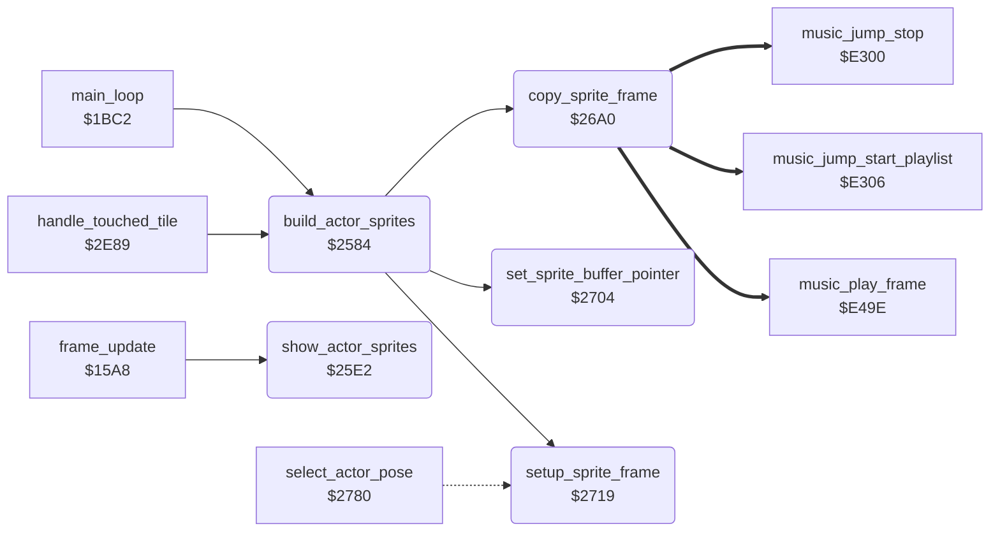

<!-- Generated by c64-docs from knowledge revision 20261023T151738.098-ndlxeh and .c64-re-tools/local/generated/src/source-map.json. Do not edit: change the knowledge, generate the source again, then run docs.ts generate. -->
# actor/actor_sprites.asm: Actor sprites: double-buffered sprite images, hardware positions and colours

Range `$2584-$277F`. Source: [actor/actor_sprites.asm](../../../../src/actor/actor_sprites.asm). Index: [the reference](../../index.md).

## Call graph

A solid arrow is a call, a thick arrow a table entry, a dotted arrow a jump. Rounded nodes are in this file.

## Data

| Range | Type | Name | Read by | Written by |
|---|---|---|---|---|
| [`$2703`](../../../../src/actor/actor_sprites.asm#L256) | unused |  |  |  |
| [`$274F`](../../../../src/actor/actor_sprites.asm#L310)-`$2762` | addresses | [`sprite_buffer_addresses`](../../../../src/actor/actor_sprites.asm#L309) | [`set_sprite_buffer_pointer`](actor_sprites.md#set_sprite_buffer_pointer) |  |
| [`$2763`](../../../../src/actor/actor_sprites.asm#L316)-`$276C` | bytes | [`sprite_buffer_pointers`](../../../../src/actor/actor_sprites.asm#L315) | [`spawn_actor`](actor_spawn.md#spawn_actor), [`show_actor_sprites`](actor_sprites.md#show_actor_sprites) |  |
| [`$276D`](../../../../src/actor/actor_sprites.asm#L320)-`$276F` | bytes | [`actor_main_sprite`](../../../../src/actor/actor_sprites.asm#L319) | [`spawn_actor`](actor_spawn.md#spawn_actor), [`build_actor_sprites`](actor_sprites.md#build_actor_sprites), [`show_actor_sprites`](actor_sprites.md#show_actor_sprites), [`remove_actor`](touch_effects.md#remove_actor) |  |
| [`$2770`](../../../../src/actor/actor_sprites.asm#L323)-`$2772` | bytes | [`actor_overlay_sprite`](../../../../src/actor/actor_sprites.asm#L322) | [`spawn_actor`](actor_spawn.md#spawn_actor), [`build_actor_sprites`](actor_sprites.md#build_actor_sprites), [`show_actor_sprites`](actor_sprites.md#show_actor_sprites), [`remove_actor`](touch_effects.md#remove_actor) |  |
| [`$2773`](../../../../src/actor/actor_sprites.asm#L326)-`$2777` | bytes | [`sprite_set_bit`](../../../../src/actor/actor_sprites.asm#L325) | [`spawn_actor`](actor_spawn.md#spawn_actor), [`show_actor_sprites`](actor_sprites.md#show_actor_sprites) |  |
| [`$2778`](../../../../src/actor/actor_sprites.asm#L329)-`$277C` | bytes | [`sprite_clear_bit`](../../../../src/actor/actor_sprites.asm#L328) | [`spawn_actor`](actor_spawn.md#spawn_actor), [`show_actor_sprites`](actor_sprites.md#show_actor_sprites), [`remove_actor`](touch_effects.md#remove_actor) |  |
| [`$277D`](../../../../src/actor/actor_sprites.asm#L332)-`$277E` | bytes | [`sprite_buffer_select`](../../../../src/actor/actor_sprites.asm#L331) | [`spawn_actor`](actor_spawn.md#spawn_actor), [`show_actor_sprites`](actor_sprites.md#show_actor_sprites), [`set_sprite_buffer_pointer`](actor_sprites.md#set_sprite_buffer_pointer) | [`build_actor_sprites`](actor_sprites.md#build_actor_sprites), [`show_actor_sprites`](actor_sprites.md#show_actor_sprites) |
| [`$277F`](../../../../src/actor/actor_sprites.asm#L336) | workspace | [`sprite_copy_counter`](../../../../src/actor/actor_sprites.asm#L335) | [`copy_sprite_frame`](actor_sprites.md#copy_sprite_frame) | [`copy_sprite_frame`](actor_sprites.md#copy_sprite_frame) |

## Names

### [`build_actor_sprites`](../../../../src/actor/actor_sprites.asm#L12) `$2584`

*routine*

Builds the sprite images of the three actors for the next frame (main loop, and once after a room change). Actor 0 is Bruce (sprites 0+1), actor 1 is Yamo (sprites 2+3), actor 2 is the Ninja (sprite 4 only). For each active actor (actor_flags,X bit 0) it copies frame actor_frame_a,X into the main sprite and frame actor_frame_a,X + 1 into the overlay sprite, in the sprite buffer that sprite_buffer_select does not show now. It also stores the width flags (actor_main_wide/actor_overlay_wide), the colours (actor_main_colour/ actor_overlay_colour) and the height (actor_frame_height) of the frames. At the end it clears sprite_images_shown, so show_actor_sprites (raster interrupt) shows the new images.
actor 2 first, then 1, then 0

- **Called from:** [`main_loop`](../game/game_main_loop.md#main_loop) [`$1C2C`](../../../../src/game/game_main_loop.asm#L80), [`handle_touched_tile`](background_touch.md#handle_touched_tile) [`$2FCF`](../../../../src/actor/background_touch.asm#L265)
- **Calls:** [`set_sprite_buffer_pointer`](actor_sprites.md#set_sprite_buffer_pointer), [`setup_sprite_frame`](actor_sprites.md#setup_sprite_frame), [`copy_sprite_frame`](actor_sprites.md#copy_sprite_frame)
- **Reads:** [`actor_flags`](../../memory-map.md#actor_flags), [`actor_main_sprite`](actor_sprites.md#actor_main_sprite), [`actor_frame_a`](../../memory-map.md#actor_frame_a), [`current_actor`](../../memory-map.md#current_actor), [`actor_frame_height`](../../memory-map.md#actor_frame_height), [`actor_main_wide`](../../memory-map.md#actor_main_wide), [`actor_overlay_sprite`](actor_sprites.md#actor_overlay_sprite), [`actor_overlay_wide`](../../memory-map.md#actor_overlay_wide)
- **Writes:** [`current_actor`](../../memory-map.md#current_actor), [`actor_main_wide`](../../memory-map.md#actor_main_wide), [`actor_main_colour`](../../memory-map.md#actor_main_colour), [`actor_overlay_wide`](../../memory-map.md#actor_overlay_wide), [`actor_overlay_colour`](../../memory-map.md#actor_overlay_colour), [`sprite_images_shown`](actor_sprites.md#sprite_images_shown)

### [`build_actor_sprites_loop`](../../../../src/actor/actor_sprites.asm#L14) `$2586`

*label*

current_actor = actor being built

- **Jumped to from:** [`build_actor_sprites`](actor_sprites.md#build_actor_sprites) [`$25DA`](../../../../src/actor/actor_sprites.asm#L62)

### [`build_actor_sprites_next`](../../../../src/actor/actor_sprites.asm#L59) `$25D7`

*label*

- **Jumped to from:** [`build_actor_sprites`](actor_sprites.md#build_actor_sprites) [`$258C`](../../../../src/actor/actor_sprites.asm#L18), [`build_actor_sprites`](actor_sprites.md#build_actor_sprites) [`$25B2`](../../../../src/actor/actor_sprites.asm#L39), [`build_actor_sprites`](actor_sprites.md#build_actor_sprites) [`$25B7`](../../../../src/actor/actor_sprites.asm#L41)

### [`show_actor_sprites`](../../../../src/actor/actor_sprites.asm#L75) `$25E2`

*routine*

Raster interrupt part (frame_update calls it every frame): shows the images that build_actor_sprites made. It does nothing until build_actor_sprites has cleared sprite_images_shown, then sets it to 1. For each active actor it writes the X position (9 bits; actor_x,X is in 2-pixel units), the Y position (actor_y,X + $1D) and the colour of the main sprite and of the overlay sprite to the VIC-II. A 16-pixel-wide frame that faces left (actor_facing,X <> 1) moves 8 units (16 pixels) left. The overlay sprite moves 8 units left for the poses $04, $3E, $42 and $18. It copies actor_x,X to actor_shown_x,X (the X position that is on the screen). Then it points sprites 0-4 to the buffer just built (sprite_pointers of game_screen) and toggles sprite_buffer_select, so the next build uses the other buffer.

- **Called from:** [`frame_update`](../game/frame_update.md#frame_update) [`$15BA`](../../../../src/game/frame_update.asm#L29)
- **Reads:** [`sprite_images_shown`](actor_sprites.md#sprite_images_shown), [`actor_flags`](../../memory-map.md#actor_flags), [`actor_x`](../../memory-map.md#actor_x), [`actor_main_wide`](../../memory-map.md#actor_main_wide), [`actor_facing`](../../memory-map.md#actor_facing), [`actor_main_sprite`](actor_sprites.md#actor_main_sprite), [`MSIGX`](../../memory-map.md#MSIGX), [`sprite_set_bit`](actor_sprites.md#sprite_set_bit), [`sprite_clear_bit`](actor_sprites.md#sprite_clear_bit), [`actor_y`](../../memory-map.md#actor_y), [`actor_main_colour`](../../memory-map.md#actor_main_colour), [`actor_pose_b`](../../memory-map.md#actor_pose_b), [`actor_overlay_sprite`](actor_sprites.md#actor_overlay_sprite), [`actor_overlay_colour`](../../memory-map.md#actor_overlay_colour), [`current_actor`](../../memory-map.md#current_actor), [`sprite_buffer_select`](actor_sprites.md#sprite_buffer_select), [`sprite_buffer_pointers`](actor_sprites.md#sprite_buffer_pointers)
- **Writes:** [`sprite_images_shown`](actor_sprites.md#sprite_images_shown), [`current_actor`](../../memory-map.md#current_actor), [`actor_shown_x`](../../memory-map.md#actor_shown_x), [`MSIGX`](../../memory-map.md#MSIGX), [`SP0X`](../../memory-map.md#SP0X), [`SP0Y`](../../memory-map.md#SP0Y), [`SP0COL`](../../memory-map.md#SP0COL), [`sprite_pointers`](../../memory-map.md#sprite_pointers), [`sprite_buffer_select`](actor_sprites.md#sprite_buffer_select)

### [`show_actor_sprites_start`](../../../../src/actor/actor_sprites.asm#L79) `$25E8`

*label*

- **Jumped to from:** [`show_actor_sprites`](actor_sprites.md#show_actor_sprites) [`$25E5`](../../../../src/actor/actor_sprites.asm#L77)

### [`show_actor_sprites_loop`](../../../../src/actor/actor_sprites.asm#L82) `$25ED`

*label*

- **Jumped to from:** [`show_actor_sprites`](actor_sprites.md#show_actor_sprites) [`$267F`](../../../../src/actor/actor_sprites.asm#L166)

### [`show_actor_sprites_x_ready`](../../../../src/actor/actor_sprites.asm#L96) `$2606`

*label*

X*2: carry = bit 8 of the sprite X

- **Jumped to from:** [`show_actor_sprites`](actor_sprites.md#show_actor_sprites) [`$25FB`](../../../../src/actor/actor_sprites.asm#L90), [`show_actor_sprites`](actor_sprites.md#show_actor_sprites) [`$2601`](../../../../src/actor/actor_sprites.asm#L93)

### [`show_actor_sprites_msb_clear`](../../../../src/actor/actor_sprites.asm#L104) `$2615`

*label*

- **Jumped to from:** [`show_actor_sprites`](actor_sprites.md#show_actor_sprites) [`$260E`](../../../../src/actor/actor_sprites.asm#L101)

### [`show_actor_sprites_msb_store`](../../../../src/actor/actor_sprites.asm#L106) `$2618`

*label*

- **Jumped to from:** [`show_actor_sprites`](actor_sprites.md#show_actor_sprites) [`$2613`](../../../../src/actor/actor_sprites.asm#L103)

### [`show_actor_sprites_overlay`](../../../../src/actor/actor_sprites.asm#L121) `$2634`

*label*

also reached with Z=1 from an inactive actor: skips

- **Jumped to from:** [`show_actor_sprites`](actor_sprites.md#show_actor_sprites) [`$25F3`](../../../../src/actor/actor_sprites.asm#L86)

### [`show_actor_sprites_overlay_shift`](../../../../src/actor/actor_sprites.asm#L135) `$264B`

*label*

- **Jumped to from:** [`show_actor_sprites`](actor_sprites.md#show_actor_sprites) [`$263D`](../../../../src/actor/actor_sprites.asm#L128), [`show_actor_sprites`](actor_sprites.md#show_actor_sprites) [`$2641`](../../../../src/actor/actor_sprites.asm#L130), [`show_actor_sprites`](actor_sprites.md#show_actor_sprites) [`$2645`](../../../../src/actor/actor_sprites.asm#L132)

### [`show_actor_sprites_overlay_x`](../../../../src/actor/actor_sprites.asm#L138) `$264E`

*label*

- **Jumped to from:** [`show_actor_sprites`](actor_sprites.md#show_actor_sprites) [`$2649`](../../../../src/actor/actor_sprites.asm#L134)

### [`show_actor_sprites_overlay_msb_clear`](../../../../src/actor/actor_sprites.asm#L146) `$265D`

*label*

- **Jumped to from:** [`show_actor_sprites`](actor_sprites.md#show_actor_sprites) [`$2656`](../../../../src/actor/actor_sprites.asm#L143)

### [`show_actor_sprites_overlay_msb_store`](../../../../src/actor/actor_sprites.asm#L148) `$2660`

*label*

- **Jumped to from:** [`show_actor_sprites`](actor_sprites.md#show_actor_sprites) [`$265B`](../../../../src/actor/actor_sprites.asm#L145)

### [`show_actor_sprites_next`](../../../../src/actor/actor_sprites.asm#L162) `$267A`

*label*

- **Jumped to from:** [`show_actor_sprites`](actor_sprites.md#show_actor_sprites) [`$2634`](../../../../src/actor/actor_sprites.asm#L122)

### [`show_actor_sprites_pointers`](../../../../src/actor/actor_sprites.asm#L168) `$2682`

*label*

Point sprites 0-4 to the buffer that build_actor_sprites filled: pointers $06-$0a (buffer 0) or $0b-$0f (buffer 1).

- **Jumped to from:** [`show_actor_sprites`](actor_sprites.md#show_actor_sprites) [`$267D`](../../../../src/actor/actor_sprites.asm#L165)

### [`show_actor_sprites_pointer_loop`](../../../../src/actor/actor_sprites.asm#L174) `$268D`

*label*

- **Jumped to from:** [`show_actor_sprites`](actor_sprites.md#show_actor_sprites) [`$2689`](../../../../src/actor/actor_sprites.asm#L172), [`show_actor_sprites`](actor_sprites.md#show_actor_sprites) [`$2695`](../../../../src/actor/actor_sprites.asm#L179)

### [`copy_sprite_frame`](../../../../src/actor/actor_sprites.asm#L190) `$26A0`

*routine*

Copies one frame image into the 64-byte sprite image at (sprite_dest_ptr),Y and clears the rest of it. Input: Z flag from the width flag (Z=1: 8 pixels wide, one byte per row; Z=0: 16 pixels wide, two bytes per row), X = actor, actor_frame_height,X = height, Y = 3*height; setup_sprite_frame has written the source address into the operands copy_sprite_frame_narrow_src / _wide_src_a / _wide_src_b. The rows are copied from the last row up to row 0; the unused bytes of each row are 0. sprite_copy_counter counts the 64 bytes, so the bytes after the frame are cleared.

- **Called from:** [`build_actor_sprites`](actor_sprites.md#build_actor_sprites) [`$25AB`](../../../../src/actor/actor_sprites.asm#L35), [`build_actor_sprites`](actor_sprites.md#build_actor_sprites) [`$25D4`](../../../../src/actor/actor_sprites.asm#L58)
- **Reads:** [`actor_frame_height`](../../memory-map.md#actor_frame_height), [`music_api_stop`](../music/music_player_state.md#music_api_stop), [`sprite_dest_ptr`](../../memory-map.md#sprite_dest_ptr), [`sprite_copy_counter`](actor_sprites.md#sprite_copy_counter)
- **Writes:** [`sprite_copy_counter`](actor_sprites.md#sprite_copy_counter)

### [`copy_sprite_frame_narrow_loop`](../../../../src/actor/actor_sprites.asm#L196) `$26AA`

*label*

frame graphics; operand copy_sprite_frame_narrow_src/_hi, written by setup_sprite_frame ($E000 is a placeholder)

- **Jumped to from:** [`copy_sprite_frame`](actor_sprites.md#copy_sprite_frame) [`$26C4`](../../../../src/actor/actor_sprites.asm#L212)

### [`copy_sprite_frame_narrow_src`](../../../../src/actor/actor_sprites.asm#L197) `$26AB`

*label*

- **Written by:** [`setup_sprite_frame`](actor_sprites.md#setup_sprite_frame) [`$271C`](../../../../src/actor/actor_sprites.asm#L280)

### [`copy_sprite_frame_narrow_src_hi`](../../../../src/actor/actor_sprites.asm#L198) `$26AC`

*label*

- **Written by:** [`setup_sprite_frame`](actor_sprites.md#setup_sprite_frame) [`$2728`](../../../../src/actor/actor_sprites.asm#L284)

### [`copy_sprite_frame_clear_rest`](../../../../src/actor/actor_sprites.asm#L213) `$26C6`

*label*

- **Jumped to from:** [`copy_sprite_frame`](actor_sprites.md#copy_sprite_frame) [`$26B3`](../../../../src/actor/actor_sprites.asm#L203), [`copy_sprite_frame`](actor_sprites.md#copy_sprite_frame) [`$26F6`](../../../../src/actor/actor_sprites.asm#L248)

### [`copy_sprite_frame_clear_loop`](../../../../src/actor/actor_sprites.asm#L218) `$26CE`

*label*

- **Jumped to from:** [`copy_sprite_frame`](actor_sprites.md#copy_sprite_frame) [`$26D4`](../../../../src/actor/actor_sprites.asm#L222)

### [`copy_sprite_frame_wide`](../../../../src/actor/actor_sprites.asm#L225) `$26D7`

*label*

16-pixel-wide frame: two source bytes for each row (columns 0 and 1), column 2 is cleared.

- **Jumped to from:** [`copy_sprite_frame`](actor_sprites.md#copy_sprite_frame) [`$26A0`](../../../../src/actor/actor_sprites.asm#L191)

### [`copy_sprite_frame_wide_loop`](../../../../src/actor/actor_sprites.asm#L234) `$26E3`

*label*

right byte; operand copy_sprite_frame_wide_src_a/_hi, written by setup_sprite_frame ($E000 is a placeholder)

- **Jumped to from:** [`copy_sprite_frame`](actor_sprites.md#copy_sprite_frame) [`$2701`](../../../../src/actor/actor_sprites.asm#L254)

### [`copy_sprite_frame_wide_src_a`](../../../../src/actor/actor_sprites.asm#L235) `$26E4`

*label*

- **Written by:** [`setup_sprite_frame`](actor_sprites.md#setup_sprite_frame) [`$271F`](../../../../src/actor/actor_sprites.asm#L281)

### [`copy_sprite_frame_wide_src_a_hi`](../../../../src/actor/actor_sprites.asm#L236) `$26E5`

*label*

- **Written by:** [`setup_sprite_frame`](actor_sprites.md#setup_sprite_frame) [`$272B`](../../../../src/actor/actor_sprites.asm#L285)

### [`copy_sprite_frame_wide_src_b`](../../../../src/actor/actor_sprites.asm#L242) `$26EE`

*label*

- **Written by:** [`setup_sprite_frame`](actor_sprites.md#setup_sprite_frame) [`$2722`](../../../../src/actor/actor_sprites.asm#L282)

### [`copy_sprite_frame_wide_src_b_hi`](../../../../src/actor/actor_sprites.asm#L243) `$26EF`

*label*

- **Written by:** [`setup_sprite_frame`](actor_sprites.md#setup_sprite_frame) [`$272E`](../../../../src/actor/actor_sprites.asm#L286)

### [`set_sprite_buffer_pointer`](../../../../src/actor/actor_sprites.asm#L260) `$2704`

*routine*

Sets sprite_dest_ptr to the 64-byte image of sprite A (0-4) in the buffer that is not shown now: buffer 0 = sprite_buf_a_spr0..sprite_buf_a_spr4 ($8180-$82BF) when sprite_buffer_select = 0, buffer 1 = sprite_buf_b_spr0..sprite_buf_b_spr4 ($82C0-$83FF) when it is 1. Changes A, Y.

- **Called from:** [`build_actor_sprites`](actor_sprites.md#build_actor_sprites) [`$2591`](../../../../src/actor/actor_sprites.asm#L20), [`build_actor_sprites`](actor_sprites.md#build_actor_sprites) [`$25B9`](../../../../src/actor/actor_sprites.asm#L42)
- **Reads:** [`sprite_buffer_select`](actor_sprites.md#sprite_buffer_select), [`sprite_buffer_addresses`](actor_sprites.md#sprite_buffer_addresses), [`sprite_buffer_addresses+1`](actor_sprites.md#sprite_buffer_addresses)
- **Writes:** [`sprite_dest_ptr`](../../memory-map.md#sprite_dest_ptr), [`sprite_dest_ptr+1`](../../memory-map.md#sprite_dest_ptr)
- **Refers to:** [`sprite_buffer_addresses`](actor_sprites.md#sprite_buffer_addresses), [`sprite_dest_ptr`](../../memory-map.md#sprite_dest_ptr)

### [`set_sprite_buffer_pointer_index`](../../../../src/actor/actor_sprites.asm#L266) `$270D`

*label*

- **Jumped to from:** [`set_sprite_buffer_pointer`](actor_sprites.md#set_sprite_buffer_pointer) [`$2708`](../../../../src/actor/actor_sprites.asm#L263)

### [`setup_sprite_frame`](../../../../src/actor/actor_sprites.asm#L278) `$2719`

*routine*

Prepares the copy of frame X for actor current_actor. It writes the source address of the frame (frame_gfx_lo/frame_gfx_hi,X) into the operands of copy_sprite_frame, stores the frame height (frame_last_row,X) in actor_frame_height of the actor and returns A = colour (frame_colour,X; always $F0 = black for the Ninja, actor 2), X = width flag (frame_is_wide,X) and Y = height.

- **Called from:** [`build_actor_sprites`](actor_sprites.md#build_actor_sprites) [`$2598`](../../../../src/actor/actor_sprites.asm#L23), [`build_actor_sprites`](actor_sprites.md#build_actor_sprites) [`$25C1`](../../../../src/actor/actor_sprites.asm#L46)
- **Reads:** [`frame_gfx_lo`](actor_frame_gfx_tables.md#frame_gfx_lo), [`frame_gfx_hi`](actor_frame_gfx_tables.md#frame_gfx_hi), [`frame_last_row`](actor_frame_gfx_tables.md#frame_last_row), [`current_actor`](../../memory-map.md#current_actor), [`frame_colour`](actor_frame_gfx_tables.md#frame_colour), [`frame_is_wide`](actor_frame_gfx_tables.md#frame_is_wide)
- **Writes:** [`copy_sprite_frame_narrow_src`](actor_sprites.md#copy_sprite_frame_narrow_src), [`copy_sprite_frame_wide_src_a`](actor_sprites.md#copy_sprite_frame_wide_src_a), [`copy_sprite_frame_wide_src_b`](actor_sprites.md#copy_sprite_frame_wide_src_b), [`copy_sprite_frame_narrow_src_hi`](actor_sprites.md#copy_sprite_frame_narrow_src_hi), [`copy_sprite_frame_wide_src_a_hi`](actor_sprites.md#copy_sprite_frame_wide_src_a_hi), [`copy_sprite_frame_wide_src_b_hi`](actor_sprites.md#copy_sprite_frame_wide_src_b_hi), [`actor_frame_height`](../../memory-map.md#actor_frame_height)

### [`setup_sprite_frame_colour`](../../../../src/actor/actor_sprites.asm#L293) `$273E`

*label*

- **Jumped to from:** [`setup_sprite_frame`](actor_sprites.md#setup_sprite_frame) [`$2738`](../../../../src/actor/actor_sprites.asm#L290)

### [`setup_sprite_frame_push`](../../../../src/actor/actor_sprites.asm#L295) `$2741`

*label*

- **Jumped to from:** [`setup_sprite_frame`](actor_sprites.md#setup_sprite_frame) [`$273C`](../../../../src/actor/actor_sprites.asm#L292)

### [`setup_sprite_frame_done`](../../../../src/actor/actor_sprites.asm#L305) `$274E`

*label*

also the early exit of select_actor_pose

- **Jumped to from:** [`select_actor_pose`](actor_poses.md#select_actor_pose) [`$2783`](../../../../src/actor/actor_poses.asm#L20)

### [`sprite_buffer_addresses`](../../../../src/actor/actor_sprites.asm#L309) `$274F-$2762`

*data*

Sprite image addresses, 10 words: entries 0-4 = sprites 0-4 in buffer 0 (sprite_buf_a_spr0..4), entries 5-9 = sprites 0-4 in buffer 1 (sprite_buf_b_spr0..4). Indexed by 2*(sprite + 5*buffer).

- **Read by:** [`set_sprite_buffer_pointer`](actor_sprites.md#set_sprite_buffer_pointer) [`$270E`](../../../../src/actor/actor_sprites.asm#L268), [`set_sprite_buffer_pointer`](actor_sprites.md#set_sprite_buffer_pointer) [`$2713`](../../../../src/actor/actor_sprites.asm#L270) (+1)

### [`sprite_buffer_pointers`](../../../../src/actor/actor_sprites.asm#L315) `$2763-$276C`

*data*

VIC-II sprite pointer values of the same 10 images ($06-$0A buffer 0, $0B-$0F buffer 1), pointer = (address - $8000) / 64 in VIC bank 2.

- **Read by:** [`spawn_actor`](actor_spawn.md#spawn_actor) [`$0C59`](../../../../src/actor/actor_spawn.asm#L132), [`show_actor_sprites`](actor_sprites.md#show_actor_sprites) [`$268D`](../../../../src/actor/actor_sprites.asm#L175)

### [`actor_main_sprite`](../../../../src/actor/actor_sprites.asm#L319) `$276D-$276F`

*data*

Main sprite number of each actor, indexed by actor (0 Bruce, 1 Yamo, 2 Ninja).

- **Read by:** [`spawn_actor`](actor_spawn.md#spawn_actor) [`$0C4D`](../../../../src/actor/actor_spawn.asm#L125), [`spawn_actor`](actor_spawn.md#spawn_actor) [`$0C5C`](../../../../src/actor/actor_spawn.asm#L133), [`spawn_actor`](actor_spawn.md#spawn_actor) [`$0C6D`](../../../../src/actor/actor_spawn.asm#L143), [`spawn_actor`](actor_spawn.md#spawn_actor) [`$0CBA`](../../../../src/actor/actor_spawn.asm#L187), [`build_actor_sprites`](actor_sprites.md#build_actor_sprites) [`$258E`](../../../../src/actor/actor_sprites.asm#L19), [`show_actor_sprites`](actor_sprites.md#show_actor_sprites) [`$2608`](../../../../src/actor/actor_sprites.asm#L99), [`show_actor_sprites`](actor_sprites.md#show_actor_sprites) [`$262A`](../../../../src/actor/actor_sprites.asm#L117), [`remove_actor`](touch_effects.md#remove_actor) [`$3009`](../../../../src/actor/touch_effects.asm#L43)

### [`actor_overlay_sprite`](../../../../src/actor/actor_sprites.asm#L322) `$2770-$2772`

*data*

Overlay sprite number of each actor, $ff = no overlay sprite (Ninja).

- **Read by:** [`spawn_actor`](actor_spawn.md#spawn_actor) [`$0C8F`](../../../../src/actor/actor_spawn.asm#L162), [`spawn_actor`](actor_spawn.md#spawn_actor) [`$0C98`](../../../../src/actor/actor_spawn.asm#L167), [`spawn_actor`](actor_spawn.md#spawn_actor) [`$0CC6`](../../../../src/actor/actor_spawn.asm#L191), [`build_actor_sprites`](actor_sprites.md#build_actor_sprites) [`$25B4`](../../../../src/actor/actor_sprites.asm#L40), [`show_actor_sprites`](actor_sprites.md#show_actor_sprites) [`$2650`](../../../../src/actor/actor_sprites.asm#L141), [`show_actor_sprites`](actor_sprites.md#show_actor_sprites) [`$2672`](../../../../src/actor/actor_sprites.asm#L159), [`remove_actor`](touch_effects.md#remove_actor) [`$3015`](../../../../src/actor/touch_effects.asm#L47)

### [`sprite_set_bit`](../../../../src/actor/actor_sprites.asm#L325) `$2773-$2777`

*data*

Bit mask of sprites 0-4, indexed by sprite number.

- **Read by:** [`spawn_actor`](actor_spawn.md#spawn_actor) [`$0C75`](../../../../src/actor/actor_spawn.asm#L146), [`spawn_actor`](actor_spawn.md#spawn_actor) [`$0CA0`](../../../../src/actor/actor_spawn.asm#L170), [`spawn_actor`](actor_spawn.md#spawn_actor) [`$0CC0`](../../../../src/actor/actor_spawn.asm#L189), [`spawn_actor`](actor_spawn.md#spawn_actor) [`$0CCE`](../../../../src/actor/actor_spawn.asm#L194), [`show_actor_sprites`](actor_sprites.md#show_actor_sprites) [`$2610`](../../../../src/actor/actor_sprites.asm#L102), [`show_actor_sprites`](actor_sprites.md#show_actor_sprites) [`$2658`](../../../../src/actor/actor_sprites.asm#L144)

### [`sprite_clear_bit`](../../../../src/actor/actor_sprites.asm#L328) `$2778-$277C`

*data*

Inverted bit mask of sprites 0-4, indexed by sprite number.

- **Read by:** [`spawn_actor`](actor_spawn.md#spawn_actor) [`$0C7A`](../../../../src/actor/actor_spawn.asm#L149), [`spawn_actor`](actor_spawn.md#spawn_actor) [`$0CA5`](../../../../src/actor/actor_spawn.asm#L173), [`show_actor_sprites`](actor_sprites.md#show_actor_sprites) [`$2615`](../../../../src/actor/actor_sprites.asm#L105), [`show_actor_sprites`](actor_sprites.md#show_actor_sprites) [`$265D`](../../../../src/actor/actor_sprites.asm#L147), [`remove_actor`](touch_effects.md#remove_actor) [`$300F`](../../../../src/actor/touch_effects.asm#L45), [`remove_actor`](touch_effects.md#remove_actor) [`$301D`](../../../../src/actor/touch_effects.asm#L50)

### [`sprite_buffer_select`](../../../../src/actor/actor_sprites.asm#L331) `$277D`

*variable*

Sprite image buffer that build_actor_sprites fills and show_actor_sprites then shows: 0 or 1.

- **Read by:** [`spawn_actor`](actor_spawn.md#spawn_actor) [`$0C50`](../../../../src/actor/actor_spawn.asm#L126), [`show_actor_sprites`](actor_sprites.md#show_actor_sprites) [`$2686`](../../../../src/actor/actor_sprites.asm#L171), [`show_actor_sprites`](actor_sprites.md#show_actor_sprites) [`$2697`](../../../../src/actor/actor_sprites.asm#L180), [`set_sprite_buffer_pointer`](actor_sprites.md#set_sprite_buffer_pointer) [`$2705`](../../../../src/actor/actor_sprites.asm#L262)
- **Written by:** [`show_actor_sprites`](actor_sprites.md#show_actor_sprites) [`$269C`](../../../../src/actor/actor_sprites.asm#L182)

### [`sprite_images_shown`](../../../../src/actor/actor_sprites.asm#L333) `$277E`

*variable*

0 = new images ready, 1 = the interrupt has shown them

- **Read by:** [`show_actor_sprites`](actor_sprites.md#show_actor_sprites) [`$25E2`](../../../../src/actor/actor_sprites.asm#L76), [`show_actor_sprites`](actor_sprites.md#show_actor_sprites) [`$25E8`](../../../../src/actor/actor_sprites.asm#L80)
- **Written by:** [`build_actor_sprites`](actor_sprites.md#build_actor_sprites) [`$25DE`](../../../../src/actor/actor_sprites.asm#L64), [`show_actor_sprites`](actor_sprites.md#show_actor_sprites) [`$25E8`](../../../../src/actor/actor_sprites.asm#L80)

### [`sprite_copy_counter`](../../../../src/actor/actor_sprites.asm#L335) `$277F`

*variable*

bytes left of the 64-byte sprite image in copy_sprite_frame

- **Read by:** [`copy_sprite_frame`](actor_sprites.md#copy_sprite_frame) [`$26AF`](../../../../src/actor/actor_sprites.asm#L201), [`copy_sprite_frame`](actor_sprites.md#copy_sprite_frame) [`$26BA`](../../../../src/actor/actor_sprites.asm#L207), [`copy_sprite_frame`](actor_sprites.md#copy_sprite_frame) [`$26C0`](../../../../src/actor/actor_sprites.asm#L210), [`copy_sprite_frame`](actor_sprites.md#copy_sprite_frame) [`$26C6`](../../../../src/actor/actor_sprites.asm#L214), [`copy_sprite_frame`](actor_sprites.md#copy_sprite_frame) [`$26D1`](../../../../src/actor/actor_sprites.asm#L221), [`copy_sprite_frame`](actor_sprites.md#copy_sprite_frame) [`$26E8`](../../../../src/actor/actor_sprites.asm#L239), [`copy_sprite_frame`](actor_sprites.md#copy_sprite_frame) [`$26F2`](../../../../src/actor/actor_sprites.asm#L246), [`copy_sprite_frame`](actor_sprites.md#copy_sprite_frame) [`$26FD`](../../../../src/actor/actor_sprites.asm#L252)
- **Written by:** [`copy_sprite_frame`](actor_sprites.md#copy_sprite_frame) [`$26A4`](../../../../src/actor/actor_sprites.asm#L193), [`copy_sprite_frame`](actor_sprites.md#copy_sprite_frame) [`$26AF`](../../../../src/actor/actor_sprites.asm#L201), [`copy_sprite_frame`](actor_sprites.md#copy_sprite_frame) [`$26BA`](../../../../src/actor/actor_sprites.asm#L207), [`copy_sprite_frame`](actor_sprites.md#copy_sprite_frame) [`$26C0`](../../../../src/actor/actor_sprites.asm#L210), [`copy_sprite_frame`](actor_sprites.md#copy_sprite_frame) [`$26D1`](../../../../src/actor/actor_sprites.asm#L221), [`copy_sprite_frame`](actor_sprites.md#copy_sprite_frame) [`$26D9`](../../../../src/actor/actor_sprites.asm#L227), [`copy_sprite_frame`](actor_sprites.md#copy_sprite_frame) [`$26E8`](../../../../src/actor/actor_sprites.asm#L239), [`copy_sprite_frame`](actor_sprites.md#copy_sprite_frame) [`$26F2`](../../../../src/actor/actor_sprites.asm#L246), [`copy_sprite_frame`](actor_sprites.md#copy_sprite_frame) [`$26FD`](../../../../src/actor/actor_sprites.asm#L252)
