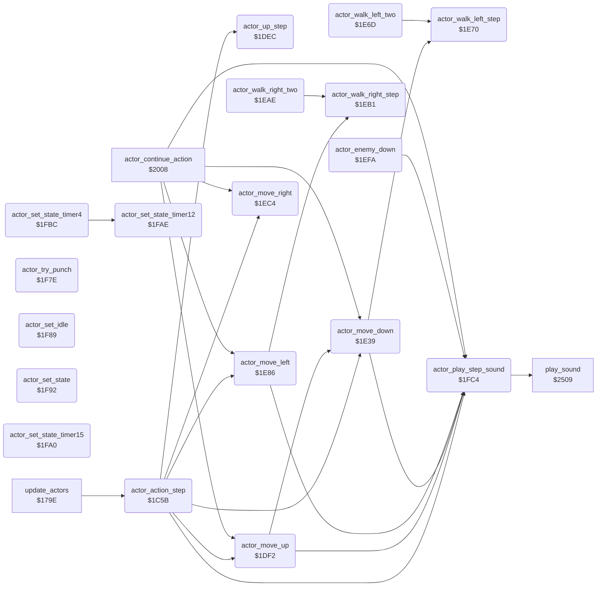

<!-- Generated by c64-docs from knowledge revision 20261029T162352.521-4j8tu8 and .c64-re-tools/local/generated/src/source-map.json. Do not edit: change the knowledge, generate the source again, then run docs.ts generate. -->
# actor/actor_step.asm: Actor action state machine: step delay, move history, wall-bump undo, joystick dispatch, move primitives, state setters, step sound with copy-protection check

Range `$1C5B-$2007`. Source: [actor/actor_step.asm](../../../../src/actor/actor_step.asm). Index: [the reference](../../index.md).

## Routines

| Routine | Address | Reached from | Summary |
|---|---|---|---|
| [`actor_action_step`](actor_step.md#actor_action_step) | `$1C5B` | [`update_actors`](actor_driver_text.md#update_actors) | Action state machine, one step of actor X (0 Bruce, 1 Yamo, 2 Ninja). |
| [`actor_undo_last_moves`](actor_step.md#actor_undo_last_moves) | `$1CD4` | [`$24F1`](../../../../src/actor/actor_hit_states.asm#L140) | undo_only_down stays 1 while only down moves were undone |
| [`actor_start_fall`](actor_step.md#actor_start_fall) | `$1DC4` | [`$2378`](../../../../src/actor/enemy_ai_states.asm#L91) | Start a fall: actor_fall_drift,X = 2 (drift counter), move down once, state $0E (falling). |
| [`actor_up_step`](actor_step.md#actor_up_step) | `$1DEC` | [`actor_action_step`](actor_step.md#actor_action_step) | One unit of the up joystick: climb up when on a ladder or vine (terrain bit 2), else start a jump (state 5, timer 15) unless the actor is inside a wall. |
| [`actor_move_up`](actor_step.md#actor_move_up) | `$1DF2` | [`actor_action_step`](actor_step.md#actor_action_step), [`actor_continue_action`](actor_timed_actions.md#actor_continue_action) | Move primitive: one unit up. |
| [`actor_move_down`](actor_step.md#actor_move_down) | `$1E39` | [`actor_action_step`](actor_step.md#actor_action_step), [`actor_move_up`](actor_step.md#actor_move_up), [`actor_continue_action`](actor_timed_actions.md#actor_continue_action), [`$2455`](../../../../src/actor/actor_hit_states.asm#L54) | Move primitive: one unit down. |
| [`actor_walk_left_two`](actor_step.md#actor_walk_left_two) | `$1E6D` | [`$236C`](../../../../src/actor/enemy_ai_states.asm#L84), [`$23FF`](../../../../src/actor/enemy_ai_states.asm#L175) | Two units of walking left (the call and the fall through into actor_walk_left_step). |
| [`actor_walk_left_step`](actor_step.md#actor_walk_left_step) | `$1E70` | [`actor_move_down`](actor_step.md#actor_move_down), [`actor_walk_left_two`](actor_step.md#actor_walk_left_two) | One unit of the left joystick: after at least 3 steps of walking left (state 3, same-state count below 4), fire starts a flying kick to the left; otherwise move left. |
| [`actor_move_left`](actor_step.md#actor_move_left) | `$1E86` | [`actor_action_step`](actor_step.md#actor_action_step), [`actor_continue_action`](actor_timed_actions.md#actor_continue_action), [`$241F`](../../../../src/actor/actor_hit_states.asm#L22), [`$2422`](../../../../src/actor/actor_hit_states.asm#L23), [`$2466`](../../../../src/actor/actor_hit_states.asm#L64), [`$2469`](../../../../src/actor/actor_hit_states.asm#L65), [`$246C`](../../../../src/actor/actor_hit_states.asm#L66), [`$246F`](../../../../src/actor/actor_hit_states.asm#L67), [`$2472`](../../../../src/actor/actor_hit_states.asm#L68), [`$2475`](../../../../src/actor/actor_hit_states.asm#L69), [`$2478`](../../../../src/actor/actor_hit_states.asm#L70), [`$247B`](../../../../src/actor/actor_hit_states.asm#L71) and 2 more | Move primitive: one unit left. |
| [`actor_walk_right_two`](actor_step.md#actor_walk_right_two) | `$1EAE` | [`$2358`](../../../../src/actor/enemy_ai_states.asm#L73), [`$23F7`](../../../../src/actor/enemy_ai_states.asm#L171) | Two units of walking right (the call and the fall through into actor_walk_right_step). |
| [`actor_walk_right_step`](actor_step.md#actor_walk_right_step) | `$1EB1` | [`actor_move_left`](actor_step.md#actor_move_left), [`actor_walk_right_two`](actor_step.md#actor_walk_right_two) | One unit of the right joystick: after at least 3 steps of walking right (state 4, same-state count below 4), fire starts a flying kick to the right; otherwise move right. |
| [`actor_move_right`](actor_step.md#actor_move_right) | `$1EC4` | [`actor_action_step`](actor_step.md#actor_action_step), [`actor_continue_action`](actor_timed_actions.md#actor_continue_action), [`$242E`](../../../../src/actor/actor_hit_states.asm#L29), [`$2431`](../../../../src/actor/actor_hit_states.asm#L30), [`$2495`](../../../../src/actor/actor_hit_states.asm#L84), [`$2498`](../../../../src/actor/actor_hit_states.asm#L85), [`$249B`](../../../../src/actor/actor_hit_states.asm#L86), [`$249E`](../../../../src/actor/actor_hit_states.asm#L87), [`$24A1`](../../../../src/actor/actor_hit_states.asm#L89), [`$24A4`](../../../../src/actor/actor_hit_states.asm#L90) | Move primitive: one unit right. |
| [`actor_enemy_down`](actor_step.md#actor_enemy_down) | `$1EFA` |  | Down or down-diagonal for an enemy (A = actor number). |
| [`actor_try_punch`](actor_step.md#actor_try_punch) | `$1F7E` | [`$238F`](../../../../src/actor/enemy_ai_states.asm#L109) | Fire without direction: punch (state $11, timer 4) unless the actor is on a ladder or vine. |
| [`actor_set_idle`](actor_step.md#actor_set_idle) | `$1F89` |  | Enter state 0 (idle). |
| [`actor_set_state`](actor_step.md#actor_set_state) | `$1F92` | [`actor_end_action`](actor_hit_states.md#actor_end_action) | State setter: actor_state,X = A, actor_step_delay,X = actor_state_step_delay,A, actor_timer,X = 0. |
| [`actor_set_state_timer15`](actor_step.md#actor_set_state_timer15) | `$1FA0` |  | State setter: actor_state,X = A, step delay from actor_state_step_delay, actor_timer,X = 15 (jumps). |
| [`actor_set_state_timer12`](actor_step.md#actor_set_state_timer12) | `$1FAE` | [`actor_set_state_timer4`](actor_step.md#actor_set_state_timer4) | State setter: actor_state,X = A, step delay from actor_state_step_delay, actor_timer,X = 12 (flying kicks). |
| [`actor_set_state_timer4`](actor_step.md#actor_set_state_timer4) | `$1FBC` |  | State setter: actor_state,X = A, step delay from actor_state_step_delay, actor_timer,X = 4 (punch). |
| [`actor_play_step_sound`](actor_step.md#actor_play_step_sound) | `$1FC4` | [`actor_action_step`](actor_step.md#actor_action_step), [`actor_move_up`](actor_step.md#actor_move_up), [`actor_move_down`](actor_step.md#actor_move_down), [`actor_move_left`](actor_step.md#actor_move_left), [`actor_enemy_down`](actor_step.md#actor_enemy_down), [`actor_continue_action`](actor_timed_actions.md#actor_continue_action) | Plays sound $80 (step) with play_sound at the start of a walk, climb or jump. |

## Data

| Range | Type | Name | Read by | Written by |
|---|---|---|---|---|
| [`$2005`](../../../../src/actor/actor_step.asm#L622)-`$2007` | workspace | [`cia1_ddra_save`](../../../../src/actor/actor_step.asm#L621) | [`frame_update`](../game/frame_update.md#frame_update), [`actor_play_step_sound`](actor_step.md#actor_play_step_sound) | [`frame_update`](../game/frame_update.md#frame_update), [`main_loop`](../game/game_main_loop.md#main_loop) |

## Call graph

A solid arrow is a call, a thick arrow a table entry. Rounded nodes are in this file.

## Details

### [`actor_action_step`](../../../../src/actor/actor_step.asm#L21) `$1C5B`

*routine*

Action state machine, one step of actor X (0 Bruce, 1 Yamo, 2 Ninja). update_actors calls it once per main loop pass for each active actor, after the joystick (or demo/AI) input is in actor_joy_dir,X and actor_fire,X. Variables: actor_state,X action state, actor_timer,X steps left of a timed action, actor_step_delay,X passes to skip before the next step, actor_move_queue the move history. 1. If actor_step_delay,X is nonzero, count it down and return. 2. Push the move record of the last step into the move history (actor_move_queue: 11 records of up/down/left/right counts per actor) and clear the current record 0. 3. Count how long the state has stayed the same (actor_same_state_count,X, 6 down to 0). 4. Wall bump: when actor_contact,X has bit 3 (inside a wall), undo the moves of the last step and retry, push back or enter state $18 (wall bump). 5. A nonzero actor_timer,X continues the current timed action (actor_continue_action, Y = timer). 6. A zero timer starts a new action from the input: direction actor_joy_dir,X, fire actor_fire,X. Each path ends in a state setter (actor_set_state...) that stores the state, its step delay and the timer. States: 0 idle, 1 up, 2 down, 3 left, 4 right, 5 jump up, 6 jump left, 7 jump right, $0C/$0D flying kick left/right, $0E falling, $0F recoil, $10 Yamo appears, $11 punch, $12 Yamo pose, $13 knocked down, $14 AI chase, $15 AI back off, $16 Ninja strike, $17 ride, $18 wall bump, $19 dying, $1A duck, $1B hit by a fall attack.
undo_retry_count: up to 8 undo passes in this step

- **Called from:** [`update_actors`](actor_driver_text.md#update_actors)
- **Calls:** [`actor_move_down`](actor_step.md#actor_move_down), [`actor_move_up`](actor_step.md#actor_move_up), [`actor_move_right`](actor_step.md#actor_move_right), [`actor_move_left`](actor_step.md#actor_move_left), [`actor_play_step_sound`](actor_step.md#actor_play_step_sound), [`actor_up_step`](actor_step.md#actor_up_step)
- **Jumps to:** [`act_wall_bump`](actor_hit_states.md#act_wall_bump), [`actor_continue_action`](actor_timed_actions.md#actor_continue_action), [`actor_move_right`](actor_step.md#actor_move_right), [`actor_move_left`](actor_step.md#actor_move_left), [`actor_move_up_blocked`](actor_step.md#actor_move_up_blocked), [`actor_set_state`](actor_step.md#actor_set_state), [`actor_input_check_down`](actor_step.md#actor_input_check_down), [`actor_up_to_idle`](actor_step.md#actor_up_to_idle)
- **Reads:** [`actor_step_delay`](../../memory-map.md#actor_step_delay), [`actor_move_queue`](../../memory-map.md#actor_move_queue), [`next_room`](../../memory-map.md#next_room), [`actor_state`](../../memory-map.md#actor_state), [`actor_prev_state`](../../memory-map.md#actor_prev_state), [`actor_same_state_count`](../../memory-map.md#actor_same_state_count), [`actor_timer`](../../memory-map.md#actor_timer), [`actor_contact`](../../memory-map.md#actor_contact), [`undo_only_down`](../../memory-map.md#undo_only_down), [`undo_retry_count`](../../memory-map.md#undo_retry_count), [`actor_facing`](../../memory-map.md#actor_facing), [`actor_contact_upper`](../../memory-map.md#actor_contact_upper) and 3 more
- **Writes:** [`undo_retry_count`](../../memory-map.md#undo_retry_count), [`actor_step_delay`](../../memory-map.md#actor_step_delay), [`actor_pose_done`](../../memory-map.md#actor_pose_done), [`next_room`](../../memory-map.md#next_room), [`actor_move_queue`](../../memory-map.md#actor_move_queue), [`actor_same_state_count`](../../memory-map.md#actor_same_state_count), [`actor_prev_state`](../../memory-map.md#actor_prev_state), [`actor_climb_block`](../../memory-map.md#actor_climb_block), [`undo_only_down`](../../memory-map.md#undo_only_down), [`actor_state`](../../memory-map.md#actor_state), [`actor_timer`](../../memory-map.md#actor_timer), [`actor_unused_flag`](../../memory-map.md#actor_unused_flag) and 1 more
- **Refers to:** [`actor_move_queue`](../../memory-map.md#actor_move_queue)

| Label | Address | Comment |
|---|---|---|
| [`actor_action_run`](../../../../src/actor/actor_step.asm#L28) | `$1C68` | A = 0: clear the animation lock of this actor |
| [`actor_push_history_loop`](../../../../src/actor/actor_step.asm#L43) | `$1C82` | Shift the history by one record: slots 0-39 move to slots 4-43 (record 10, the oldest, is lost). |
| [`actor_clear_move_record`](../../../../src/actor/actor_step.asm#L52) | `$1C8F` | Clear record 0, which collects the moves of this step. |
| [`actor_reset_same_state_count`](../../../../src/actor/actor_step.asm#L68) | `$1CAD` |  |
| [`actor_remember_state`](../../../../src/actor/actor_step.asm#L71) | `$1CB1` |  |
| [`actor_check_bump_state`](../../../../src/actor/actor_step.asm#L77) | `$1CBC` | wall bump with time left: let it handle the wall |
| [`actor_check_in_wall`](../../../../src/actor/actor_step.asm#L83) | `$1CC7` |  |
| [`actor_in_wall`](../../../../src/actor/actor_step.asm#L89) | `$1CD0` | The last step moved the actor into a wall. Undo the moves of record 1 (the last step) in reverse. |
| [`actor_undo_up_loop`](../../../../src/actor/actor_step.asm#L95) | `$1CD8` | record 1 up count |
| [`actor_undo_down_loop`](../../../../src/actor/actor_step.asm#L101) | `$1CE5` | record 1 down count |
| [`actor_undo_left_loop`](../../../../src/actor/actor_step.asm#L106) | `$1CF0` | record 1 left count |
| [`actor_undo_right_loop`](../../../../src/actor/actor_step.asm#L112) | `$1CFD` | record 1 right count |
| [`actor_pop_history`](../../../../src/actor/actor_step.asm#L119) | `$1D0A` | Drop records 0 and 1: slots 8-43 move to slots 0-35, then records 9 and 10 are cleared. 36 slots |
| [`actor_pop_history_loop`](../../../../src/actor/actor_step.asm#L124) | `$1D10` |  |
| [`actor_undo_check_retry`](../../../../src/actor/actor_step.asm#L157) | `$1D53` |  |
| [`actor_undo_push_left`](../../../../src/actor/actor_step.asm#L166) | `$1D63` |  |
| [`actor_enter_wall_bump`](../../../../src/actor/actor_step.asm#L168) | `$1D66` | state $18 wall bump |
| [`actor_not_in_wall`](../../../../src/actor/actor_step.asm#L174) | `$1D6F` |  |
| [`actor_check_timer`](../../../../src/actor/actor_step.asm#L179) | `$1D77` | timer nonzero: continue the timed action |
| [`actor_read_input`](../../../../src/actor/actor_step.asm#L184) | `$1D7E` | No timed action: choose the next action. First the falling state $0E (previous state). |
| [`actor_land_step_left`](../../../../src/actor/actor_step.asm#L198) | `$1D96` |  |
| [`actor_bruce_falling`](../../../../src/actor/actor_step.asm#L200) | `$1D99` | terrain flags of the previous pass: was on a floor |
| [`actor_fall_drift_left`](../../../../src/actor/actor_step.asm#L211) | `$1DAD` |  |
| [`actor_bruce_fall_check_floor`](../../../../src/actor/actor_step.asm#L215) | `$1DB3` |  |
| [`actor_fall_two`](../../../../src/actor/actor_step.asm#L220) | `$1DB9` | Fall: move down twice and set state $0E (falling). |
| [`actor_fall_one`](../../../../src/actor/actor_step.asm#L222) | `$1DBC` |  |
| [`actor_read_joystick`](../../../../src/actor/actor_step.asm#L231) | `$1DCA` | no floor and no ladder: fall |
| [`actor_up_three`](../../../../src/actor/actor_step.asm#L247) | `$1DE6` |  |

### [`actor_undo_last_moves`](../../../../src/actor/actor_step.asm#L92) `$1CD4`

*label*

undo_only_down stays 1 while only down moves were undone

- **Jumped to from:** [`$24F1`](../../../../src/actor/actor_hit_states.asm#L140)

### [`actor_start_fall`](../../../../src/actor/actor_step.asm#L227) `$1DC4`

*label*

Start a fall: actor_fall_drift,X = 2 (drift counter), move down once, state $0E (falling).

- **Jumped to from:** [`actor_action_step`](actor_step.md#actor_action_step), [`$2378`](../../../../src/actor/enemy_ai_states.asm#L91)

### [`actor_up_step`](../../../../src/actor/actor_step.asm#L252) `$1DEC`

*routine*

One unit of the up joystick: climb up when on a ladder or vine (terrain bit 2), else start a jump (state 5, timer 15) unless the actor is inside a wall.

- **Called from:** [`actor_action_step`](actor_step.md#actor_action_step)
- **Jumps to:** [`actor_up_not_climbable`](actor_step.md#actor_up_not_climbable)
- **Reads:** [`actor_contact`](../../memory-map.md#actor_contact)

### [`actor_move_up`](../../../../src/actor/actor_step.asm#L258) `$1DF2`

*routine*

Move primitive: one unit up. At the top limit (actor_y < $2E) it sets state 0 (idle) instead. Else actor_y,X - 1, counts the move in the up count of record 0 (actor_move_queue,X), state 1.

- **Called from:** [`actor_action_step`](actor_step.md#actor_action_step), [`actor_continue_action`](actor_timed_actions.md#actor_continue_action)
- **Calls:** [`actor_play_step_sound`](actor_step.md#actor_play_step_sound), [`actor_move_down`](actor_step.md#actor_move_down)
- **Jumps to:** [`actor_set_state`](actor_step.md#actor_set_state), [`actor_go_idle`](actor_step.md#actor_go_idle), [`actor_set_state_timer15`](actor_step.md#actor_set_state_timer15), [`actor_input_check_left`](actor_step.md#actor_input_check_left), [`actor_down_on_floor`](actor_step.md#actor_down_on_floor)
- **Reads:** [`actor_y`](../../memory-map.md#actor_y), [`actor_climb_block`](../../memory-map.md#actor_climb_block), [`actor_move_queue`](../../memory-map.md#actor_move_queue), [`actor_contact`](../../memory-map.md#actor_contact), [`actor_same_state_count`](../../memory-map.md#actor_same_state_count)
- **Writes:** [`actor_y`](../../memory-map.md#actor_y), [`actor_move_queue`](../../memory-map.md#actor_move_queue)

| Label | Address | Comment |
|---|---|---|
| [`actor_move_up_blocked`](../../../../src/actor/actor_step.asm#L264) | `$1DFC` |  |
| [`actor_up_not_climbable`](../../../../src/actor/actor_step.asm#L270) | `$1E08` |  |
| [`actor_up_to_idle`](../../../../src/actor/actor_step.asm#L273) | `$1E0C` |  |
| [`actor_input_check_down`](../../../../src/actor/actor_step.asm#L277) | `$1E13` | $0D = down |
| [`actor_climb_down`](../../../../src/actor/actor_step.asm#L286) | `$1E23` |  |
| [`actor_climb_down_three`](../../../../src/actor/actor_step.asm#L295) | `$1E33` |  |

### [`actor_move_down`](../../../../src/actor/actor_step.asm#L300) `$1E39`

*routine*

Move primitive: one unit down. At the bottom limit (actor_y >= $C7) it sets state 0 (idle) instead. Else actor_y,X + 1, counts the move in the down count of record 0 (actor_move_queue+3,X), state 2.

- **Called from:** [`actor_action_step`](actor_step.md#actor_action_step), [`actor_move_up`](actor_step.md#actor_move_up), [`actor_continue_action`](actor_timed_actions.md#actor_continue_action), [`$2455`](../../../../src/actor/actor_hit_states.asm#L54)
- **Calls:** [`actor_play_step_sound`](actor_step.md#actor_play_step_sound), [`actor_walk_left_step`](actor_step.md#actor_walk_left_step)
- **Jumps to:** [`actor_go_idle`](actor_step.md#actor_go_idle), [`actor_set_state`](actor_step.md#actor_set_state), [`actor_enemy_down`](actor_step.md#actor_enemy_down), [`actor_duck_face_right`](actor_step.md#actor_duck_face_right), [`actor_duck_face_left`](actor_step.md#actor_duck_face_left), [`actor_input_check_right`](actor_step.md#actor_input_check_right), [`actor_walk_left_two`](actor_step.md#actor_walk_left_two)
- **Reads:** [`actor_y`](../../memory-map.md#actor_y), [`actor_move_queue`](../../memory-map.md#actor_move_queue), [`actor_facing`](../../memory-map.md#actor_facing), [`actor_x`](../../memory-map.md#actor_x), [`actor_same_state_count`](../../memory-map.md#actor_same_state_count)
- **Writes:** [`actor_y`](../../memory-map.md#actor_y), [`actor_move_queue`](../../memory-map.md#actor_move_queue)
- **Refers to:** [`actor_move_queue`](../../memory-map.md#actor_move_queue)

| Label | Address | Comment |
|---|---|---|
| [`actor_down_on_floor`](../../../../src/actor/actor_step.asm#L309) | `$1E49` | Down on a floor. Bruce ducks in the direction he faces; Yamo (actor 1) takes his pose. |
| [`actor_bruce_duck`](../../../../src/actor/actor_step.asm#L313) | `$1E4F` | Bruce's facing |
| [`actor_bruce_duck_left`](../../../../src/actor/actor_step.asm#L317) | `$1E56` |  |
| [`actor_input_check_left`](../../../../src/actor/actor_step.asm#L319) | `$1E59` | $0B = left |

### [`actor_walk_left_two`](../../../../src/actor/actor_step.asm#L330) `$1E6D`

*routine*

Two units of walking left (the call and the fall through into actor_walk_left_step).

- **Called from:** [`$236C`](../../../../src/actor/enemy_ai_states.asm#L84), [`$23FF`](../../../../src/actor/enemy_ai_states.asm#L175)
- **Jumped to from:** [`actor_move_down`](actor_step.md#actor_move_down)
- **Calls:** [`actor_walk_left_step`](actor_step.md#actor_walk_left_step)

### [`actor_walk_left_step`](../../../../src/actor/actor_step.asm#L334) `$1E70`

*routine*

One unit of the left joystick: after at least 3 steps of walking left (state 3, same-state count below 4), fire starts a flying kick to the left; otherwise move left.

- **Called from:** [`actor_move_down`](actor_step.md#actor_move_down), [`actor_walk_left_two`](actor_step.md#actor_walk_left_two)
- **Jumps to:** [`actor_move_left`](actor_step.md#actor_move_left), [`actor_start_flying_kick_left`](actor_step.md#actor_start_flying_kick_left), [`actor_set_idle`](actor_step.md#actor_set_idle)
- **Reads:** [`actor_prev_state`](../../memory-map.md#actor_prev_state), [`actor_same_state_count`](../../memory-map.md#actor_same_state_count), [`actor_fire`](../../memory-map.md#actor_fire)

| Label | Address | Comment |
|---|---|---|
| [`actor_go_idle`](../../../../src/actor/actor_step.asm#L344) | `$1E83` |  |

### [`actor_move_left`](../../../../src/actor/actor_step.asm#L349) `$1E86`

*routine*

Move primitive: one unit left. At the left limit (actor_x < $0D) it sets state 0 (idle) instead. Else actor_x,X - 1, counts the move in the left count of record 0 (actor_move_queue+6,X), faces left (actor_facing,X = 0), state 3.

- **Called from:** [`actor_action_step`](actor_step.md#actor_action_step), [`actor_continue_action`](actor_timed_actions.md#actor_continue_action), [`$241F`](../../../../src/actor/actor_hit_states.asm#L22), [`$2422`](../../../../src/actor/actor_hit_states.asm#L23), [`$2466`](../../../../src/actor/actor_hit_states.asm#L64), [`$2469`](../../../../src/actor/actor_hit_states.asm#L65), [`$246C`](../../../../src/actor/actor_hit_states.asm#L66), [`$246F`](../../../../src/actor/actor_hit_states.asm#L67), [`$2472`](../../../../src/actor/actor_hit_states.asm#L68), [`$2475`](../../../../src/actor/actor_hit_states.asm#L69), [`$2478`](../../../../src/actor/actor_hit_states.asm#L70), [`$247B`](../../../../src/actor/actor_hit_states.asm#L71) and 2 more
- **Jumped to from:** [`actor_action_step`](actor_step.md#actor_action_step), [`actor_walk_left_step`](actor_step.md#actor_walk_left_step)
- **Calls:** [`actor_play_step_sound`](actor_step.md#actor_play_step_sound), [`actor_walk_right_step`](actor_step.md#actor_walk_right_step)
- **Jumps to:** [`actor_go_idle`](actor_step.md#actor_go_idle), [`actor_set_state`](actor_step.md#actor_set_state), [`actor_input_check_down_left`](actor_step.md#actor_input_check_down_left), [`actor_walk_right_two`](actor_step.md#actor_walk_right_two)
- **Reads:** [`actor_x`](../../memory-map.md#actor_x), [`actor_move_queue`](../../memory-map.md#actor_move_queue), [`actor_same_state_count`](../../memory-map.md#actor_same_state_count)
- **Writes:** [`actor_x`](../../memory-map.md#actor_x), [`actor_move_queue`](../../memory-map.md#actor_move_queue), [`actor_facing`](../../memory-map.md#actor_facing)
- **Refers to:** [`actor_move_queue`](../../memory-map.md#actor_move_queue)

| Label | Address | Comment |
|---|---|---|
| [`actor_input_check_right`](../../../../src/actor/actor_step.asm#L359) | `$1E9A` | $07 = right |

### [`actor_walk_right_two`](../../../../src/actor/actor_step.asm#L370) `$1EAE`

*routine*

Two units of walking right (the call and the fall through into actor_walk_right_step).

- **Called from:** [`$2358`](../../../../src/actor/enemy_ai_states.asm#L73), [`$23F7`](../../../../src/actor/enemy_ai_states.asm#L171)
- **Jumped to from:** [`actor_move_left`](actor_step.md#actor_move_left)
- **Calls:** [`actor_walk_right_step`](actor_step.md#actor_walk_right_step)

### [`actor_walk_right_step`](../../../../src/actor/actor_step.asm#L374) `$1EB1`

*routine*

One unit of the right joystick: after at least 3 steps of walking right (state 4, same-state count below 4), fire starts a flying kick to the right; otherwise move right.

- **Called from:** [`actor_move_left`](actor_step.md#actor_move_left), [`actor_walk_right_two`](actor_step.md#actor_walk_right_two)
- **Jumps to:** [`actor_move_right`](actor_step.md#actor_move_right), [`actor_start_flying_kick_right`](actor_step.md#actor_start_flying_kick_right)
- **Reads:** [`actor_prev_state`](../../memory-map.md#actor_prev_state), [`actor_same_state_count`](../../memory-map.md#actor_same_state_count), [`actor_fire`](../../memory-map.md#actor_fire)

### [`actor_move_right`](../../../../src/actor/actor_step.asm#L387) `$1EC4`

*routine*

Move primitive: one unit right. At the right limit (actor_x >= $A3) it sets state 0 (idle) instead. Else actor_x,X + 1, counts the move in the right count of record 0 (actor_move_queue+9,X), faces right (actor_facing,X = 1), state 4.

- **Called from:** [`actor_action_step`](actor_step.md#actor_action_step), [`actor_continue_action`](actor_timed_actions.md#actor_continue_action), [`$242E`](../../../../src/actor/actor_hit_states.asm#L29), [`$2431`](../../../../src/actor/actor_hit_states.asm#L30), [`$2495`](../../../../src/actor/actor_hit_states.asm#L84), [`$2498`](../../../../src/actor/actor_hit_states.asm#L85), [`$249B`](../../../../src/actor/actor_hit_states.asm#L86), [`$249E`](../../../../src/actor/actor_hit_states.asm#L87), [`$24A1`](../../../../src/actor/actor_hit_states.asm#L89), [`$24A4`](../../../../src/actor/actor_hit_states.asm#L90)
- **Jumped to from:** [`actor_action_step`](actor_step.md#actor_action_step), [`actor_walk_right_step`](actor_step.md#actor_walk_right_step)
- **Jumps to:** [`actor_go_idle`](actor_step.md#actor_go_idle), [`actor_set_state`](actor_step.md#actor_set_state), [`actor_input_check_down_right`](actor_step.md#actor_input_check_down_right), [`actor_enemy_down`](actor_step.md#actor_enemy_down), [`actor_input_idle`](actor_step.md#actor_input_idle)
- **Reads:** [`actor_x`](../../memory-map.md#actor_x), [`actor_move_queue`](../../memory-map.md#actor_move_queue), [`actor_contact`](../../memory-map.md#actor_contact)
- **Writes:** [`actor_x`](../../memory-map.md#actor_x), [`actor_move_queue`](../../memory-map.md#actor_move_queue), [`actor_facing`](../../memory-map.md#actor_facing)
- **Refers to:** [`actor_move_queue`](../../memory-map.md#actor_move_queue)

| Label | Address | Comment |
|---|---|---|
| [`actor_input_check_down_left`](../../../../src/actor/actor_step.asm#L397) | `$1ED8` | $09 = down-left |
| [`actor_input_no_action`](../../../../src/actor/actor_step.asm#L404) | `$1EE3` |  |
| [`actor_down_left_on_floor`](../../../../src/actor/actor_step.asm#L406) | `$1EE5` |  |
| [`actor_duck_face_left`](../../../../src/actor/actor_step.asm#L410) | `$1EEB` |  |

### [`actor_enemy_down`](../../../../src/actor/actor_step.asm#L420) `$1EFA`

*routine*

Down or down-diagonal for an enemy (A = actor number). Yamo (1) on a floor, not on a ladder, takes his pose (state $12); otherwise nothing happens.
Yamo

- **Jumped to from:** [`actor_move_down`](actor_step.md#actor_move_down), [`actor_move_right`](actor_step.md#actor_move_right)
- **Calls:** [`actor_play_step_sound`](actor_step.md#actor_play_step_sound)
- **Jumps to:** [`yamo_start_pose`](actor_timed_actions.md#yamo_start_pose), [`actor_set_idle`](actor_step.md#actor_set_idle), [`actor_input_no_action`](actor_step.md#actor_input_no_action), [`actor_set_state`](actor_step.md#actor_set_state), [`actor_set_state_timer15`](actor_step.md#actor_set_state_timer15), [`actor_set_state_timer12`](actor_step.md#actor_set_state_timer12)
- **Reads:** [`actor_contact`](../../memory-map.md#actor_contact), [`actor_x`](../../memory-map.md#actor_x), [`actor_fire`](../../memory-map.md#actor_fire)
- **Writes:** [`actor_facing`](../../memory-map.md#actor_facing)

| Label | Address | Comment |
|---|---|---|
| [`actor_input_idle`](../../../../src/actor/actor_step.asm#L427) | `$1F07` |  |
| [`actor_input_check_down_right`](../../../../src/actor/actor_step.asm#L429) | `$1F0A` | $05 = down-right |
| [`actor_duck_face_right`](../../../../src/actor/actor_step.asm#L440) | `$1F1D` |  |
| [`actor_input_check_jumps`](../../../../src/actor/actor_step.asm#L449) | `$1F2C` | Diagonal up: jump left or right (state 6/7, timer 15) unless the actor is inside a wall or on a ladder or vine. |
| [`actor_input_check_up_left`](../../../../src/actor/actor_step.asm#L457) | `$1F37` |  |
| [`actor_input_check_up_right`](../../../../src/actor/actor_step.asm#L469) | `$1F4E` | $06 = up-right |
| [`actor_start_flying_kick_left`](../../../../src/actor/actor_step.asm#L480) | `$1F64` |  |
| [`actor_start_flying_kick_right`](../../../../src/actor/actor_step.asm#L485) | `$1F6D` |  |
| [`actor_input_check_none`](../../../../src/actor/actor_step.asm#L491) | `$1F76` | No direction: fire alone is a punch; nothing pressed is idle. $0F = no direction |

### [`actor_try_punch`](../../../../src/actor/actor_step.asm#L498) `$1F7E`

*routine*

Fire without direction: punch (state $11, timer 4) unless the actor is on a ladder or vine. The AI of Yamo also calls it.

- **Called from:** [`$238F`](../../../../src/actor/enemy_ai_states.asm#L109)
- **Jumps to:** [`actor_set_idle`](actor_step.md#actor_set_idle), [`actor_set_state_timer4`](actor_step.md#actor_set_state_timer4)
- **Reads:** [`actor_contact`](../../memory-map.md#actor_contact)

### [`actor_set_idle`](../../../../src/actor/actor_step.asm#L506) `$1F89`

*routine*

Enter state 0 (idle). When the previous state was already 0, set the animation lock actor_pose_done,X so the standing frame is not advanced.

- **Jumped to from:** [`actor_walk_left_step`](actor_step.md#actor_walk_left_step), [`actor_enemy_down`](actor_step.md#actor_enemy_down), [`actor_try_punch`](actor_step.md#actor_try_punch)
- **Reads:** [`actor_prev_state`](../../memory-map.md#actor_prev_state), [`actor_pose_done`](../../memory-map.md#actor_pose_done)
- **Writes:** [`actor_pose_done`](../../memory-map.md#actor_pose_done)

| Label | Address | Comment |
|---|---|---|
| [`actor_set_idle_state`](../../../../src/actor/actor_step.asm#L510) | `$1F90` |  |

### [`actor_set_state`](../../../../src/actor/actor_step.asm#L514) `$1F92`

*routine*

State setter: actor_state,X = A, actor_step_delay,X = actor_state_step_delay,A, actor_timer,X = 0. Returns to the caller of actor_action_step (or of the move primitive). Changes A, Y.

- **Jumped to from:** [`actor_action_step`](actor_step.md#actor_action_step), [`actor_move_up`](actor_step.md#actor_move_up), [`actor_move_down`](actor_step.md#actor_move_down), [`actor_move_left`](actor_step.md#actor_move_left), [`actor_move_right`](actor_step.md#actor_move_right), [`actor_enemy_down`](actor_step.md#actor_enemy_down), [`actor_end_action`](actor_hit_states.md#actor_end_action)
- **Reads:** [`actor_state_step_delay`](../room/room_tables.md#actor_state_step_delay)
- **Writes:** [`actor_state`](../../memory-map.md#actor_state), [`actor_step_delay`](../../memory-map.md#actor_step_delay), [`actor_timer`](../../memory-map.md#actor_timer)

### [`actor_set_state_timer15`](../../../../src/actor/actor_step.asm#L523) `$1FA0`

*routine*

State setter: actor_state,X = A, step delay from actor_state_step_delay, actor_timer,X = 15 (jumps).

- **Jumped to from:** [`actor_move_up`](actor_step.md#actor_move_up), [`actor_enemy_down`](actor_step.md#actor_enemy_down)
- **Reads:** [`actor_state_step_delay`](../room/room_tables.md#actor_state_step_delay)
- **Writes:** [`actor_state`](../../memory-map.md#actor_state), [`actor_step_delay`](../../memory-map.md#actor_step_delay), [`actor_timer`](../../memory-map.md#actor_timer)

### [`actor_set_state_timer12`](../../../../src/actor/actor_step.asm#L532) `$1FAE`

*routine*

State setter: actor_state,X = A, step delay from actor_state_step_delay, actor_timer,X = 12 (flying kicks).

- **Called from:** [`actor_set_state_timer4`](actor_step.md#actor_set_state_timer4)
- **Jumped to from:** [`actor_enemy_down`](actor_step.md#actor_enemy_down)
- **Reads:** [`actor_state_step_delay`](../room/room_tables.md#actor_state_step_delay)
- **Writes:** [`actor_state`](../../memory-map.md#actor_state), [`actor_step_delay`](../../memory-map.md#actor_step_delay), [`actor_timer`](../../memory-map.md#actor_timer)

### [`actor_set_state_timer4`](../../../../src/actor/actor_step.asm#L541) `$1FBC`

*routine*

State setter: actor_state,X = A, step delay from actor_state_step_delay, actor_timer,X = 4 (punch).

- **Jumped to from:** [`actor_try_punch`](actor_step.md#actor_try_punch)
- **Calls:** [`actor_set_state_timer12`](actor_step.md#actor_set_state_timer12)
- **Writes:** [`actor_timer`](../../memory-map.md#actor_timer)

### [`actor_play_step_sound`](../../../../src/actor/actor_step.asm#L556) `$1FC4`

*routine*

Plays sound $80 (step) with play_sound at the start of a walk, climb or jump. Keeps A, X and Y. It also holds two copy-protection checks on bytes of the protection page $CF00-$CFFF: 1. protection_result (= prot_key_yamo EOR prot_key_yamo_pair, stored by spawn_yamo). When zero, it increments the operands spawn_yamo_prot_key_lo/_pair_lo, so the next Yamo spawn compares the next byte pair; when the key operand reaches $99 it writes $9A (TXS) over the first opcode of random_byte. 2. protection_check_value (= prot_key_tick EOR prot_key_tick_pair, stored by the main loop each pass). When zero, it increments the operands main_loop_prot_key_lo/_pair_lo; when the key operand reaches $9A it writes $9A (TXS) over the CLC at step_sound_crash_point with X = 4, so the stack pointer becomes $04 and the following PLA/RTS crash the game. With the key bytes of the three releases both values are nonzero and nothing happens.

- **Called from:** [`actor_action_step`](actor_step.md#actor_action_step), [`actor_move_up`](actor_step.md#actor_move_up), [`actor_move_down`](actor_step.md#actor_move_down), [`actor_move_left`](actor_step.md#actor_move_left), [`actor_enemy_down`](actor_step.md#actor_enemy_down), [`actor_continue_action`](actor_timed_actions.md#actor_continue_action)
- **Calls:** [`play_sound`](../sfx/sound_request.md#play_sound)
- **Reads:** [`protection_result`](../room/room_enemy_tables.md#protection_result), [`spawn_yamo_prot_key_lo`](actor_spawn.md#spawn_yamo_prot_key_lo), [`spawn_yamo_prot_pair_lo`](actor_spawn.md#spawn_yamo_prot_pair_lo), [`main_loop_prot_key_lo`](../game/game_main_loop.md#main_loop_prot_key_lo), [`main_loop_prot_pair_lo`](../game/game_main_loop.md#main_loop_prot_pair_lo)
- **Writes:** [`spawn_yamo_prot_key_lo`](actor_spawn.md#spawn_yamo_prot_key_lo), [`spawn_yamo_prot_pair_lo`](actor_spawn.md#spawn_yamo_prot_pair_lo), [`random_byte`](../irq/interrupt_entry_1131.md#random_byte), [`main_loop_prot_key_lo`](../game/game_main_loop.md#main_loop_prot_key_lo), [`main_loop_prot_pair_lo`](../game/game_main_loop.md#main_loop_prot_pair_lo)

| Label | Address | Comment |
|---|---|---|
| [`step_sound_check_protection2`](../../../../src/actor/actor_step.asm#L586) | `$1FE5` | second protection value (main_loop) |
| [`step_sound_crash_point`](../../../../src/actor/actor_step.asm#L610) | `$1FFE` | CLC, replaced by TXS when the protection check fails |
| [`step_sound_restore_regs`](../../../../src/actor/actor_step.asm#L612) | `$1FFF` |  |

### [`cia1_ddra_save`](../../../../src/actor/actor_step.asm#L621) `$2005`

*variable*

Copies of the CIA 1 data direction registers CIADDRA/CIADDRB: frame_update_read_input saves them before it reads the joysticks, frame_update_restore_ddr writes them back.

- **Read by:** [`frame_update`](../game/frame_update.md#frame_update)
- **Written by:** [`frame_update`](../game/frame_update.md#frame_update)

### [`cia1_ddrb_save`](../../../../src/actor/actor_step.asm#L623) `$2006`

*variable*

- **Read by:** [`frame_update`](../game/frame_update.md#frame_update)
- **Written by:** [`frame_update`](../game/frame_update.md#frame_update)

### [`protection_check_value`](../../../../src/actor/actor_step.asm#L627) `$2007`

*variable*

prot_key_tick EOR prot_key_tick_pair, stored by main_loop_protection_check each pass; zero means the protection bytes were changed. Read by step_sound_check_protection2. Start value $FF.

- **Read by:** [`actor_play_step_sound`](actor_step.md#actor_play_step_sound)
- **Written by:** [`main_loop`](../game/game_main_loop.md#main_loop)
