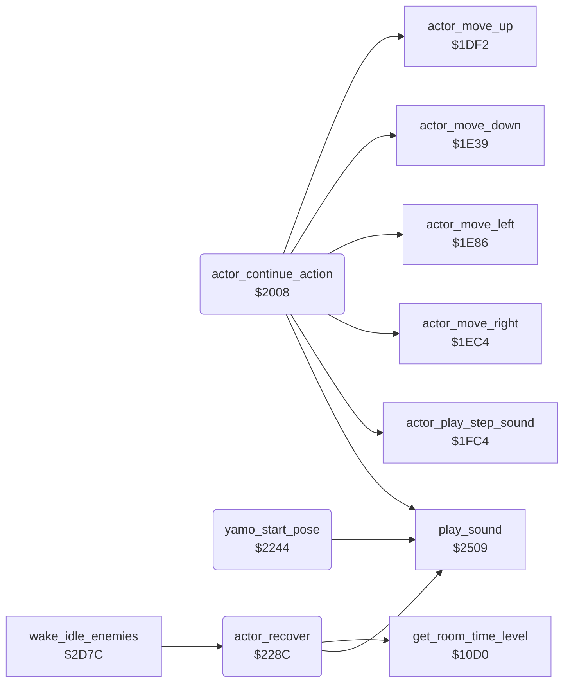

<!-- Generated by c64-docs from knowledge revision 20261025T141148.619-ij2l1b and .c64-re-tools/local/generated/src/source-map.json. Do not edit: change the knowledge, generate the source again, then run docs.ts generate. -->
# actor/actor_timed_actions.asm: Actor action state machine: continuation handlers of timed actions (jumps, flying kicks, ride, Yamo appear, punch, Ninja strike)

Range `$2008-$22F9`. Source: [actor/actor_timed_actions.asm](../../../../src/actor/actor_timed_actions.asm). Index: [the reference](../../index.md).

## Routines

| Routine | Address | Reached from | Summary |
|---|---|---|---|
| [`actor_continue_action`](actor_timed_actions.md#actor_continue_action) | `$2008` | [`actor_action_step`](actor_step.md#actor_action_step) | Continues the timed action of actor X (from actor_action_step when actor_timer,X is nonzero). |
| [`yamo_start_pose`](actor_timed_actions.md#yamo_start_pose) | `$2244` | [`actor_enemy_down`](actor_step.md#actor_enemy_down) | Yamo's pose (state $12, timer 16): he turns toward Bruce and sound $81 plays. |
| [`actor_recover`](actor_timed_actions.md#actor_recover) | `$228C` | [`wake_idle_enemies`](actor_helpers.md#wake_idle_enemies), [`$2369`](../../../../src/actor/enemy_ai_states.asm#L82), [`$2399`](../../../../src/actor/enemy_ai_states.asm#L116), [`$243D`](../../../../src/actor/actor_hit_states.asm#L36), [`$24B0`](../../../../src/actor/actor_hit_states.asm#L96) | Ends an attack: state 0 with a recovery timer during which the actor stands still. |

## Call graph

A solid arrow is a call, a thick arrow a table entry. Rounded nodes are in this file.

## Details

### [`actor_continue_action`](../../../../src/actor/actor_timed_actions.asm#L14) `$2008`

*routine*

Continues the timed action of actor X (from actor_action_step when actor_timer,X is nonzero). In: Y = actor_timer,X, kept in temp_y. Each handler ends in actor_continue_state (state = A, timer = temp_y - 1) or in a setter that ends the action (actor_end_action, actor_recover, lose_fall ...). Dispatch on actor_state,X (a compare chain): $05 jump up        $0C flying kick left   $0D flying kick right  $06 jump left $07 jump right     $19 dying              $17 ride               $10 Yamo appears $11 punch          $16 Ninja strike       $14 AI chase           $15 AI back off $12 Yamo pose      $0F recoil             $13 knocked down       $18 wall bump Any other state (0 recovering after an attack, $1B hit by a fall attack) only counts its timer down.

- **Jumped to from:** [`actor_action_step`](actor_step.md#actor_action_step)
- **Calls:** [`actor_move_down`](actor_step.md#actor_move_down), [`actor_move_up`](actor_step.md#actor_move_up), [`play_sound`](../sfx/sound_request.md#play_sound), [`actor_move_left`](actor_step.md#actor_move_left), [`actor_move_right`](actor_step.md#actor_move_right), [`actor_play_step_sound`](actor_step.md#actor_play_step_sound)
- **Jumps to:** [`actor_continue_state`](actor_hit_states.md#actor_continue_state), [`actor_end_action`](actor_hit_states.md#actor_end_action), [`lose_fall`](../game/lose_fall_game_over.md#lose_fall), [`act_check_punch`](actor_timed_actions.md#act_check_punch), [`yamo_start_pose`](actor_timed_actions.md#yamo_start_pose)
- **Reads:** [`actor_state`](../../memory-map.md#actor_state), [`actor_contact`](../../memory-map.md#actor_contact), [`current_actor`](../../memory-map.md#current_actor), [`temp_y`](../../memory-map.md#temp_y), [`option_yamo_player2`](../game/options_and_patterns.md#option_yamo_player2), [`actor_facing`](../../memory-map.md#actor_facing), [`actor_ride_delay`](../../memory-map.md#actor_ride_delay), [`actor_joy_dir`](../../memory-map.md#actor_joy_dir), [`actor_ride_hold`](../../memory-map.md#actor_ride_hold), [`anim_chars_delay`](../../memory-map.md#anim_chars_delay), [`anim_chars_direction`](../../memory-map.md#anim_chars_direction), [`actor_move_queue`](../../memory-map.md#actor_move_queue) and 1 more
- **Writes:** [`temp_y`](../../memory-map.md#temp_y), [`current_actor`](../../memory-map.md#current_actor), [`actor_ride_hold`](../../memory-map.md#actor_ride_hold), [`actor_joy_dir`](../../memory-map.md#actor_joy_dir), [`actor_ride_delay`](../../memory-map.md#actor_ride_delay), [`actor_fire`](../../memory-map.md#actor_fire), [`actor_move_queue`](../../memory-map.md#actor_move_queue)
- **Refers to:** [`actor_move_queue`](../../memory-map.md#actor_move_queue)

| Label | Address | Comment |
|---|---|---|
| [`act_jump_up_continue`](../../../../src/actor/actor_timed_actions.asm#L35) | `$202E` |  |
| [`act_jump_up_rise`](../../../../src/actor/actor_timed_actions.asm#L38) | `$2033` | first rising step: 4 units |
| [`act_jump_up_rise_two`](../../../../src/actor/actor_timed_actions.asm#L43) | `$203D` |  |
| [`act_check_kick_left`](../../../../src/actor/actor_timed_actions.asm#L48) | `$2048` | state $0C flying kick left |
| [`act_kick_left_phase`](../../../../src/actor/actor_timed_actions.asm#L63) | `$2061` |  |
| [`act_kick_left_fly`](../../../../src/actor/actor_timed_actions.asm#L70) | `$2070` |  |
| [`act_kick_left_descend`](../../../../src/actor/actor_timed_actions.asm#L76) | `$207C` | on a floor: end the kick |
| [`act_end_if_nonzero`](../../../../src/actor/actor_timed_actions.asm#L79) | `$2080` | Z flag from the AND before the branch here |
| [`act_check_kick_right`](../../../../src/actor/actor_timed_actions.asm#L85) | `$208D` | state $0D flying kick right |
| [`act_kick_right_phase`](../../../../src/actor/actor_timed_actions.asm#L99) | `$20A6` |  |
| [`act_kick_right_fly`](../../../../src/actor/actor_timed_actions.asm#L106) | `$20B5` |  |
| [`act_kick_right_descend`](../../../../src/actor/actor_timed_actions.asm#L112) | `$20C1` | on a floor: end the kick |
| [`act_kick_right_down`](../../../../src/actor/actor_timed_actions.asm#L116) | `$20C7` |  |
| [`act_check_jump_left`](../../../../src/actor/actor_timed_actions.asm#L121) | `$20D2` | state 6 jump left |
| [`act_jump_left_rise_one`](../../../../src/actor/actor_timed_actions.asm#L133) | `$20E5` |  |
| [`act_end_action_near`](../../../../src/actor/actor_timed_actions.asm#L139) | `$20F3` |  |
| [`act_jump_left_glide`](../../../../src/actor/actor_timed_actions.asm#L141) | `$20F6` |  |
| [`act_jump_left_descend`](../../../../src/actor/actor_timed_actions.asm#L148) | `$2105` | on a floor: end the jump |
| [`act_jump_left_fall_one`](../../../../src/actor/actor_timed_actions.asm#L157) | `$2118` |  |
| [`act_check_jump_right`](../../../../src/actor/actor_timed_actions.asm#L161) | `$2120` | state 7 jump right |
| [`act_jump_right_rise_one`](../../../../src/actor/actor_timed_actions.asm#L172) | `$2133` |  |
| [`act_jump_right_glide`](../../../../src/actor/actor_timed_actions.asm#L178) | `$2141` |  |
| [`act_jump_right_descend`](../../../../src/actor/actor_timed_actions.asm#L185) | `$2150` | on a floor: end the jump |
| [`act_jump_right_fall_one`](../../../../src/actor/actor_timed_actions.asm#L194) | `$2163` |  |
| [`act_check_dying`](../../../../src/actor/actor_timed_actions.asm#L198) | `$216B` | state $19 dying |
| [`act_continue_far`](../../../../src/actor/actor_timed_actions.asm#L207) | `$2177` |  |
| [`act_dying_lose_fall`](../../../../src/actor/actor_timed_actions.asm#L209) | `$217A` | lose a fall, restart the room or end the game |
| [`act_end_action_far`](../../../../src/actor/actor_timed_actions.asm#L211) | `$217D` |  |
| [`act_check_ride`](../../../../src/actor/actor_timed_actions.asm#L214) | `$2180` | state $17 ride |
| [`act_ride`](../../../../src/actor/actor_timed_actions.asm#L224) | `$2187` | Ride (state $17, set by touch_climb_tile with timer 16 when an actor on a ladder or vine touches the moving character $62). Every 5th step (actor_ride_delay,X counts 4 down to 0) the actor moves 2 units in its joystick direction; a computer enemy gets a horizontal direction from its facing. When the moving scenery of animate_scrolling_chars steps (anim_chars_delay = 1) the actor is carried 2 units down (anim_chars_direction nonzero) or up. Then the joystick is cleared and the up and down counts of record 0 are reduced to their difference. Leaving the ladder or vine ends the ride. |
| [`act_ride_enemy_left`](../../../../src/actor/actor_timed_actions.asm#L240) | `$21A5` | left |
| [`act_ride_check_delay`](../../../../src/actor/actor_timed_actions.asm#L244) | `$21A9` | Every 5th step: move 2 units in the joystick direction (actor_ride_delay counts the steps between). |
| [`act_ride_move`](../../../../src/actor/actor_timed_actions.asm#L249) | `$21B2` | up |
| [`act_ride_check_down`](../../../../src/actor/actor_timed_actions.asm#L256) | `$21C1` | down |
| [`act_ride_check_left`](../../../../src/actor/actor_timed_actions.asm#L262) | `$21CE` | left |
| [`act_ride_check_right`](../../../../src/actor/actor_timed_actions.asm#L268) | `$21DB` | right |
| [`act_ride_moved`](../../../../src/actor/actor_timed_actions.asm#L273) | `$21E5` |  |
| [`act_ride_carry`](../../../../src/actor/actor_timed_actions.asm#L279) | `$21EE` | Carry the actor with the moving scenery when it steps this pass. the moving scenery steps now |
| [`act_ride_carry_up`](../../../../src/actor/actor_timed_actions.asm#L288) | `$2201` |  |
| [`act_ride_finish`](../../../../src/actor/actor_timed_actions.asm#L291) | `$2207` | joystick: no direction |
| [`act_ride_net_up`](../../../../src/actor/actor_timed_actions.asm#L308) | `$2228` |  |
| [`act_ride_continue`](../../../../src/actor/actor_timed_actions.asm#L312) | `$2230` |  |
| [`act_check_yamo_appear`](../../../../src/actor/actor_timed_actions.asm#L315) | `$2235` | state $10 Yamo appears |

### [`yamo_start_pose`](../../../../src/actor/actor_timed_actions.asm#L326) `$2244`

*routine*

Yamo's pose (state $12, timer 16): he turns toward Bruce and sound $81 plays. Used when Yamo appears and when player 2 pushes down.

- **Jumped to from:** [`actor_enemy_down`](actor_step.md#actor_enemy_down), [`actor_continue_action`](actor_timed_actions.md#actor_continue_action)
- **Calls:** [`play_sound`](../sfx/sound_request.md#play_sound)
- **Jumps to:** [`act_check_ninja_strike`](actor_timed_actions.md#act_check_ninja_strike), [`act_strike_in_wall`](actor_timed_actions.md#act_strike_in_wall), [`actor_recover`](actor_timed_actions.md#actor_recover), [`actor_continue_state`](actor_hit_states.md#actor_continue_state)
- **Reads:** [`actor_x`](../../memory-map.md#actor_x), [`actor_contact`](../../memory-map.md#actor_contact), [`current_actor`](../../memory-map.md#current_actor), [`temp_y`](../../memory-map.md#temp_y)
- **Writes:** [`actor_facing`](../../memory-map.md#actor_facing), [`actor_state`](../../memory-map.md#actor_state), [`actor_timer`](../../memory-map.md#actor_timer), [`actor_step_delay`](../../memory-map.md#actor_step_delay), [`current_actor`](../../memory-map.md#current_actor)

| Label | Address | Comment |
|---|---|---|
| [`yamo_pose_set_facing`](../../../../src/actor/actor_timed_actions.asm#L331) | `$224C` |  |
| [`yamo_pose_face_right`](../../../../src/actor/actor_timed_actions.asm#L346) | `$2265` |  |
| [`act_check_punch`](../../../../src/actor/actor_timed_actions.asm#L349) | `$226A` | state $11 punch |
| [`act_punch_check_end`](../../../../src/actor/actor_timed_actions.asm#L366) | `$2283` |  |

### [`actor_recover`](../../../../src/actor/actor_timed_actions.asm#L376) `$228C`

*routine*

Ends an attack: state 0 with a recovery timer during which the actor stands still. The length depends on the time spent in the room (get_room_time_level: C = 1 from $19 units of 256 frames, V = 1 from $20 units): Bruce: 3 steps, 12 steps when C or V is set. Enemies: 6 steps (1 when game_loop_count is nonzero), 3 steps when C is set, 1 step when V is set.

- **Called from:** [`wake_idle_enemies`](actor_helpers.md#wake_idle_enemies)
- **Jumped to from:** [`yamo_start_pose`](actor_timed_actions.md#yamo_start_pose), [`$2369`](../../../../src/actor/enemy_ai_states.asm#L82), [`$2399`](../../../../src/actor/enemy_ai_states.asm#L116), [`$243D`](../../../../src/actor/actor_hit_states.asm#L36), [`$24B0`](../../../../src/actor/actor_hit_states.asm#L96)
- **Calls:** [`get_room_time_level`](../game/game_setup.md#get_room_time_level), [`play_sound`](../sfx/sound_request.md#play_sound)
- **Jumps to:** [`actor_end_action`](actor_hit_states.md#actor_end_action), [`actor_continue_state`](actor_hit_states.md#actor_continue_state), [`ai_chase`](enemy_ai_states.md#ai_chase), [`act_check_ai_back_off`](enemy_ai_states.md#act_check_ai_back_off)
- **Reads:** [`actor_timer`](../../memory-map.md#actor_timer), [`game_loop_count`](../../memory-map.md#game_loop_count), [`actor_contact`](../../memory-map.md#actor_contact), [`current_actor`](../../memory-map.md#current_actor), [`temp_y`](../../memory-map.md#temp_y), [`actor_facing`](../../memory-map.md#actor_facing), [`actor_move_queue`](../../memory-map.md#actor_move_queue)
- **Writes:** [`actor_state`](../../memory-map.md#actor_state), [`actor_timer`](../../memory-map.md#actor_timer), [`actor_step_delay`](../../memory-map.md#actor_step_delay), [`current_actor`](../../memory-map.md#current_actor), [`actor_move_queue`](../../memory-map.md#actor_move_queue)
- **Refers to:** [`actor_move_queue`](../../memory-map.md#actor_move_queue)

| Label | Address | Comment |
|---|---|---|
| [`actor_recover_enemy`](../../../../src/actor/actor_timed_actions.asm#L390) | `$22A6` |  |
| [`actor_recover_halve`](../../../../src/actor/actor_timed_actions.asm#L397) | `$22B2` |  |
| [`actor_recover_double`](../../../../src/actor/actor_timed_actions.asm#L400) | `$22B5` |  |
| [`actor_recover_short`](../../../../src/actor/actor_timed_actions.asm#L403) | `$22B8` |  |
| [`act_check_ninja_strike`](../../../../src/actor/actor_timed_actions.asm#L407) | `$22BD` | state $16 Ninja strike |
| [`act_strike_in_wall`](../../../../src/actor/actor_timed_actions.asm#L415) | `$22C5` |  |
| [`act_strike_phase`](../../../../src/actor/actor_timed_actions.asm#L419) | `$22CA` |  |
| [`act_strike_check_end`](../../../../src/actor/actor_timed_actions.asm#L427) | `$22D9` |  |
| [`act_strike_count_left`](../../../../src/actor/actor_timed_actions.asm#L435) | `$22E8` |  |
| [`act_strike_continue`](../../../../src/actor/actor_timed_actions.asm#L437) | `$22EB` |  |
| [`act_strike_end`](../../../../src/actor/actor_timed_actions.asm#L440) | `$22F0` |  |
| [`act_check_ai_chase`](../../../../src/actor/actor_timed_actions.asm#L442) | `$22F3` | state $14 AI chase |
