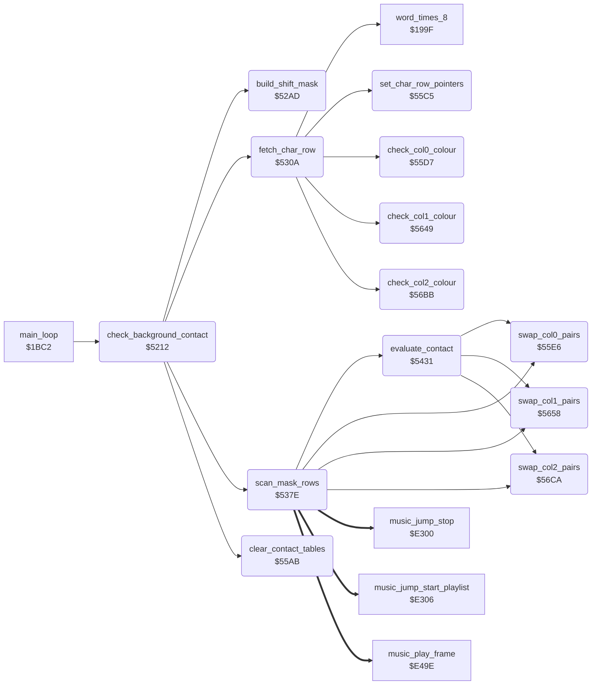

<!-- Generated by c64-docs from knowledge revision 20261025T141148.619-ij2l1b and .c64-re-tools/local/generated/src/source-map.json. Do not edit: change the knowledge, generate the source again, then run docs.ts generate. -->
# actor/background_contact.asm: Pixel contact test of the three characters against the background characters

Range `$5212-$572C`. Source: [actor/background_contact.asm](../../../../src/actor/background_contact.asm). Index: [the reference](../../index.md).

## Routines

| Routine | Address | Reached from | Summary |
|---|---|---|---|
| [`check_background_contact`](background_contact.md#check_background_contact) | `$5212` | [`main_loop`](../game/game_main_loop.md#main_loop) | Pixel contact test of the actors against the background chars, called on each main loop pass (main_loop_room_logic). |
| [`build_shift_mask`](background_contact.md#build_shift_mask) | `$52AD` | [`check_background_contact`](background_contact.md#check_background_contact) | Builds the shifted mask in shift_mask_col0: contact_pixel_y zero bytes (row shift), 32 more zero bytes when contact_pixel_x = 3 (one column right), then the 96 mask bytes (address patched into shift_mask_copy). |
| [`shift_mask_copy_src`](background_contact.md#shift_mask_copy_src) | `$52CC` |  |  |
| [`shift_mask_copy_src_hi`](background_contact.md#shift_mask_copy_src_hi) | `$52CD` |  |  |
| [`fetch_char_row`](background_contact.md#fetch_char_row) | `$530A` | [`check_background_contact`](background_contact.md#check_background_contact) | For char row actor_cell_row,x and columns actor_cell_col,x .. |
| [`scan_mask_rows`](background_contact.md#scan_mask_rows) | `$537E` | [`check_background_contact`](background_contact.md#check_background_contact) | Scans mask rows Y = temp_y .. |
| [`scan_col0_src`](background_contact.md#scan_col0_src) | `$5381` |  |  |
| [`scan_col0_src_hi`](background_contact.md#scan_col0_src_hi) | `$5382` |  |  |
| [`scan_col1_src`](background_contact.md#scan_col1_src) | `$539B` |  |  |
| [`scan_col1_src_hi`](background_contact.md#scan_col1_src_hi) | `$539C` |  |  |
| [`scan_col2_src`](background_contact.md#scan_col2_src) | `$53B5` |  |  |
| [`scan_col2_src_hi`](background_contact.md#scan_col2_src_hi) | `$53B6` |  |  |
| [`evaluate_contact`](background_contact.md#evaluate_contact) | `$5431` | [`scan_mask_rows`](background_contact.md#scan_mask_rows) | Turns the contact tables into the flags actor_contact,x (X = contact_actor). |
| [`clear_contact_tables`](background_contact.md#clear_contact_tables) | `$55AB` | [`check_background_contact`](background_contact.md#check_background_contact) | Clears contact_col0..2 (23 bytes each) and the colour states contact_col0_lit..contact_col2_lit. |
| [`set_char_row_pointers`](background_contact.md#set_char_row_pointers) | `$55C5` | [`fetch_char_row`](background_contact.md#fetch_char_row) | X = char row: row_ptr_top = screen address and colour_ptr_bottom = colour RAM address of screen row X+1. |
| [`check_col0_colour`](background_contact.md#check_col0_colour) | `$55D7` | [`fetch_char_row`](background_contact.md#fetch_char_row) | Y = column: reads colour RAM (colour_ptr_bottom),Y. |
| [`swap_col0_pairs`](background_contact.md#swap_col0_pairs) | `$55E6` | [`scan_mask_rows`](background_contact.md#scan_mask_rows), [`evaluate_contact`](background_contact.md#evaluate_contact) | Swaps contact_col0 entries 3/16, 7/17, 11/18, 12/19, 13/20, 14/21, 15/22. |
| [`check_col1_colour`](background_contact.md#check_col1_colour) | `$5649` | [`fetch_char_row`](background_contact.md#fetch_char_row) | As check_col0_colour for column 1 (contact_col1_lit, swap_col1_pairs). |
| [`swap_col1_pairs`](background_contact.md#swap_col1_pairs) | `$5658` | [`scan_mask_rows`](background_contact.md#scan_mask_rows), [`evaluate_contact`](background_contact.md#evaluate_contact) | Swaps contact_col1 entries 3/16, 7/17, 11/18, 12/19, 13/20, 14/21, 15/22. |
| [`check_col2_colour`](background_contact.md#check_col2_colour) | `$56BB` | [`fetch_char_row`](background_contact.md#fetch_char_row) | As check_col0_colour for column 2 (contact_col2_lit, swap_col2_pairs). |
| [`swap_col2_pairs`](background_contact.md#swap_col2_pairs) | `$56CA` | [`scan_mask_rows`](background_contact.md#scan_mask_rows), [`evaluate_contact`](background_contact.md#evaluate_contact) | Swaps contact_col2 entries 3/16, 7/17, 11/18, 12/19, 13/20, 14/21, 15/22. |

## Call graph

A solid arrow is a call, a thick arrow a table entry. Rounded nodes are in this file.

## Details

### [`check_background_contact`](../../../../src/actor/background_contact.asm#L17) `$5212`

*routine*

Pixel contact test of the actors against the background chars, called on each main loop pass (main_loop_room_logic). For each actor X = 2..0 that is active (bit 0 of actor_flags,x): - the contact mask of frame actor_frame_a,x is copied into the mask buffer shift_mask_col0..col3 (4 columns of 32 rows), shifted down by (Y - 29) AND 7 rows and right by (X - 12) AND 3 multicolour pixels (build_shift_mask); actor_cell_col,x / actor_cell_row,x = char column and row of its top left corner; - for 4 char rows, the 3 chars under the mask columns are ANDed with the mask row by row (fetch_char_row, scan_mask_rows) and the pixel code pairs are recorded in contact_col0..2; - actor_contact_upper,x gets the result for the rows down to contact_upper_end_row and actor_contact,x for all rows: bit 0 = %01 pixels touched, bit 1 = %10, bit 2 = %11 in a char with colour RAM colour not 0, bit 3 = %11 in a char with colour 0. Uses contact_actor (actor), temp_y (first mask row of the char row), contact_pixel_x / contact_pixel_y (pixel offsets in the char), and zero page next_room as a scratch byte.

- **Called from:** [`main_loop`](../game/game_main_loop.md#main_loop)
- **Calls:** [`build_shift_mask`](background_contact.md#build_shift_mask), [`clear_contact_tables`](background_contact.md#clear_contact_tables), [`fetch_char_row`](background_contact.md#fetch_char_row), [`scan_mask_rows`](background_contact.md#scan_mask_rows)
- **Reads:** [`actor_flags`](../../memory-map.md#actor_flags), [`actor_x`](../../memory-map.md#actor_x), [`actor_y`](../../memory-map.md#actor_y), [`actor_frame_a`](../../memory-map.md#actor_frame_a), [`contact_mask_addr_lo`](../room/room_enemy_tables.md#contact_mask_addr_lo), [`contact_mask_addr_hi`](../room/room_enemy_tables.md#contact_mask_addr_hi), [`contact_pixel_y`](../../memory-map.md#contact_pixel_y), [`contact_actor`](../../memory-map.md#contact_actor), [`actor_cell_col`](../../memory-map.md#actor_cell_col), [`actor_cell_row`](../../memory-map.md#actor_cell_row)
- **Writes:** [`contact_actor`](../../memory-map.md#contact_actor), [`actor_cell_col`](../../memory-map.md#actor_cell_col), [`contact_pixel_x`](../../memory-map.md#contact_pixel_x), [`actor_cell_row`](../../memory-map.md#actor_cell_row), [`contact_pixel_y`](../../memory-map.md#contact_pixel_y), [`shift_mask_copy_src`](background_contact.md#shift_mask_copy_src), [`shift_mask_copy_src_hi`](background_contact.md#shift_mask_copy_src_hi), [`contact_last_row`](../../memory-map.md#contact_last_row), [`contact_upper_end_row`](../../memory-map.md#contact_upper_end_row), [`temp_y`](../../memory-map.md#temp_y), [`contact_char_row_end`](../../memory-map.md#contact_char_row_end)

| Label | Address | Comment |
|---|---|---|
| [`contact_next_char`](../../../../src/actor/background_contact.asm#L19) | `$5214` |  |
| [`contact_char_active`](../../../../src/actor/background_contact.asm#L25) | `$521F` |  |
| [`contact_char_done`](../../../../src/actor/background_contact.asm#L87) | `$52A4` |  |
| [`contact_return`](../../../../src/actor/background_contact.asm#L92) | `$52AC` |  |

### [`build_shift_mask`](../../../../src/actor/background_contact.asm#L98) `$52AD`

*routine*

Builds the shifted mask in shift_mask_col0: contact_pixel_y zero bytes (row shift), 32 more zero bytes when contact_pixel_x = 3 (one column right), then the 96 mask bytes (address patched into shift_mask_copy). Then shifts columns 0-2 right by contact_pixel_x multicolour pixels (bits leaving column 2 are lost), or for contact_pixel_x = 3 shifts columns 3-0 left by one pixel (net 3 pixels right; column 3 keeps the rest).

- **Called from:** [`check_background_contact`](background_contact.md#check_background_contact)
- **Reads:** [`contact_pixel_y`](../../memory-map.md#contact_pixel_y), [`contact_pixel_x`](../../memory-map.md#contact_pixel_x), [`shift_mask_col0`](../../memory-map.md#shift_mask_col0), [`shift_mask_col1`](../../memory-map.md#shift_mask_col1), [`shift_mask_col2`](../../memory-map.md#shift_mask_col2), [`shift_mask_col3`](../../memory-map.md#shift_mask_col3)
- **Writes:** [`shift_mask_col0`](../../memory-map.md#shift_mask_col0), [`shift_mask_col1`](../../memory-map.md#shift_mask_col1), [`shift_mask_col2`](../../memory-map.md#shift_mask_col2), [`shift_mask_col3`](../../memory-map.md#shift_mask_col3)

| Label | Address | Comment |
|---|---|---|
| [`shift_mask_pad_rows`](../../../../src/actor/background_contact.asm#L101) | `$52B0` |  |
| [`shift_mask_pad_check`](../../../../src/actor/background_contact.asm#L107) | `$52BA` |  |
| [`shift_mask_pad_column`](../../../../src/actor/background_contact.asm#L112) | `$52C2` |  |
| [`shift_mask_copy_start`](../../../../src/actor/background_contact.asm#L117) | `$52C9` |  |
| [`shift_mask_copy`](../../../../src/actor/background_contact.asm#L119) | `$52CB` | contact mask; check_background_contact patches the operand (shift_mask_copy_src); $E000 is a placeholder |
| [`shift_mask_shift`](../../../../src/actor/background_contact.asm#L128) | `$52D7` |  |
| [`shift_mask_right_bit`](../../../../src/actor/background_contact.asm#L135) | `$52E1` |  |
| [`shift_mask_right_row`](../../../../src/actor/background_contact.asm#L137) | `$52E3` |  |
| [`shift_mask_done`](../../../../src/actor/background_contact.asm#L145) | `$52F2` |  |
| [`shift_mask_left_pixel`](../../../../src/actor/background_contact.asm#L147) | `$52F3` |  |
| [`shift_mask_left_bit`](../../../../src/actor/background_contact.asm#L149) | `$52F5` |  |
| [`shift_mask_left_row`](../../../../src/actor/background_contact.asm#L151) | `$52F7` |  |

### [`shift_mask_copy_src`](../../../../src/actor/background_contact.asm#L120) `$52CC`

*label*

- **Written by:** [`check_background_contact`](background_contact.md#check_background_contact)

### [`shift_mask_copy_src_hi`](../../../../src/actor/background_contact.asm#L121) `$52CD`

*label*

- **Written by:** [`check_background_contact`](background_contact.md#check_background_contact)

### [`fetch_char_row`](../../../../src/actor/background_contact.asm#L165) `$530A`

*routine*

For char row actor_cell_row,x and columns actor_cell_col,x .. +2: sets the colour state of each column (check_col0..2_colour) and patches the operands of scan_col0..2 with room_charset_hi*256 + code*8 - temp_y, so that (operand),Y with the mask row Y reads the right charset byte. A third column beyond column 39 uses char 0.

- **Called from:** [`check_background_contact`](background_contact.md#check_background_contact)
- **Calls:** [`set_char_row_pointers`](background_contact.md#set_char_row_pointers), [`check_col0_colour`](background_contact.md#check_col0_colour), [`word_times_8`](../game/lose_fall_game_over.md#word_times_8), [`check_col1_colour`](background_contact.md#check_col1_colour), [`check_col2_colour`](background_contact.md#check_col2_colour)
- **Reads:** [`contact_actor`](../../memory-map.md#contact_actor), [`actor_cell_row`](../../memory-map.md#actor_cell_row), [`actor_cell_col`](../../memory-map.md#actor_cell_col), [`row_ptr_top`](../../memory-map.md#row_ptr_top), [`mul8_value`](../game/fireball_text_score_vars_4392.md#mul8_value), [`temp_y`](../../memory-map.md#temp_y), [`mul8_result_hi`](../game/fireball_text_score_vars_4392.md#mul8_result_hi), [`room_charset_hi`](../../memory-map.md#room_charset_hi)
- **Writes:** [`mul8_value`](../game/fireball_text_score_vars_4392.md#mul8_value), [`scan_col0_src`](background_contact.md#scan_col0_src), [`scan_col0_src_hi`](background_contact.md#scan_col0_src_hi), [`scan_col1_src`](background_contact.md#scan_col1_src), [`scan_col1_src_hi`](background_contact.md#scan_col1_src_hi), [`scan_col2_src`](background_contact.md#scan_col2_src), [`scan_col2_src_hi`](background_contact.md#scan_col2_src_hi)

| Label | Address | Comment |
|---|---|---|
| [`fetch_third_col`](../../../../src/actor/background_contact.asm#L205) | `$535E` |  |
| [`fetch_set_third`](../../../../src/actor/background_contact.asm#L208) | `$5363` |  |

### [`scan_mask_rows`](../../../../src/actor/background_contact.asm#L225) `$537E`

*routine*

Scans mask rows Y = temp_y .. : for each column, charset byte AND mask byte; a nonzero result is stored at contact_colN + its high nibble and contact_colN + its low nibble. Stops at contact_char_row_end (saves Y in temp_y), takes the upper-body result at contact_upper_end_row, and at contact_last_row takes the full result and returns straight to contact_char_done (drops its own return address).

- **Called from:** [`check_background_contact`](background_contact.md#check_background_contact)
- **Calls:** [`evaluate_contact`](background_contact.md#evaluate_contact), [`swap_col0_pairs`](background_contact.md#swap_col0_pairs), [`swap_col1_pairs`](background_contact.md#swap_col1_pairs), [`swap_col2_pairs`](background_contact.md#swap_col2_pairs)
- **Jumps to:** [`contact_char_done`](background_contact.md#contact_char_done)
- **Reads:** [`temp_y`](../../memory-map.md#temp_y), [`music_api_stop`](../music/music_player_state.md#music_api_stop), [`shift_mask_col0`](../../memory-map.md#shift_mask_col0), [`next_room`](../../memory-map.md#next_room), [`shift_mask_col1`](../../memory-map.md#shift_mask_col1), [`shift_mask_col2`](../../memory-map.md#shift_mask_col2), [`contact_upper_end_row`](../../memory-map.md#contact_upper_end_row), [`contact_last_row`](../../memory-map.md#contact_last_row), [`contact_char_row_end`](../../memory-map.md#contact_char_row_end), [`contact_col0_lit`](../../memory-map.md#contact_col0_lit), [`actor_contact`](../../memory-map.md#actor_contact), [`contact_lit_saved`](../../memory-map.md#contact_lit_saved) and 2 more
- **Writes:** [`next_room`](../../memory-map.md#next_room), [`contact_col0`](../../memory-map.md#contact_col0), [`contact_col1`](../../memory-map.md#contact_col1), [`contact_col2`](../../memory-map.md#contact_col2), [`temp_y`](../../memory-map.md#temp_y), [`contact_lit_saved`](../../memory-map.md#contact_lit_saved), [`actor_contact_upper`](../../memory-map.md#actor_contact_upper), [`contact_col0_lit`](../../memory-map.md#contact_col0_lit), [`contact_col1_lit`](../../memory-map.md#contact_col1_lit), [`contact_col2_lit`](../../memory-map.md#contact_col2_lit)
- **Refers to:** [`contact_lit_saved`](../../memory-map.md#contact_lit_saved)

| Label | Address | Comment |
|---|---|---|
| [`scan_col0`](../../../../src/actor/background_contact.asm#L227) | `$5380` | charset byte of char 0 of the row; fetch_char_row patches the operand (scan_col0_src); $E000 is a placeholder |
| [`scan_col0_hit`](../../../../src/actor/background_contact.asm#L233) | `$5388` | scratch: zero page next_room |
| [`scan_col1`](../../../../src/actor/background_contact.asm#L245) | `$539A` | charset byte of char 1 of the row; fetch_char_row patches the operand (scan_col1_src); $E000 is a placeholder |
| [`scan_col1_hit`](../../../../src/actor/background_contact.asm#L251) | `$53A2` | scratch: zero page next_room |
| [`scan_col2`](../../../../src/actor/background_contact.asm#L263) | `$53B4` | charset byte of char 2 of the row; fetch_char_row patches the operand (scan_col2_src); $E000 is a placeholder |
| [`scan_col2_hit`](../../../../src/actor/background_contact.asm#L269) | `$53BC` | scratch: zero page next_room |
| [`scan_next_row`](../../../../src/actor/background_contact.asm#L281) | `$53CE` |  |
| [`scan_check_last`](../../../../src/actor/background_contact.asm#L285) | `$53D4` |  |
| [`scan_char_row_done`](../../../../src/actor/background_contact.asm#L291) | `$53E1` |  |
| [`scan_upper_body`](../../../../src/actor/background_contact.asm#L296) | `$53E4` | Upper body: save the colour states, evaluate (states reset), copy actor_contact,x to actor_contact_upper,x, then restore the colour states (swapping the tables back where needed). |
| [`scan_save_states`](../../../../src/actor/background_contact.asm#L298) | `$53E6` |  |
| [`scan_restore_col1`](../../../../src/actor/background_contact.asm#L312) | `$5406` |  |
| [`scan_restore_col2`](../../../../src/actor/background_contact.asm#L319) | `$5416` |  |
| [`scan_full_body`](../../../../src/actor/background_contact.asm#L327) | `$5429` |  |

### [`scan_col0_src`](../../../../src/actor/background_contact.asm#L228) `$5381`

*label*

- **Written by:** [`fetch_char_row`](background_contact.md#fetch_char_row)

### [`scan_col0_src_hi`](../../../../src/actor/background_contact.asm#L229) `$5382`

*label*

- **Written by:** [`fetch_char_row`](background_contact.md#fetch_char_row)

### [`scan_col1_src`](../../../../src/actor/background_contact.asm#L246) `$539B`

*label*

- **Written by:** [`fetch_char_row`](background_contact.md#fetch_char_row)

### [`scan_col1_src_hi`](../../../../src/actor/background_contact.asm#L247) `$539C`

*label*

- **Written by:** [`fetch_char_row`](background_contact.md#fetch_char_row)

### [`scan_col2_src`](../../../../src/actor/background_contact.asm#L264) `$53B5`

*label*

- **Written by:** [`fetch_char_row`](background_contact.md#fetch_char_row)

### [`scan_col2_src_hi`](../../../../src/actor/background_contact.asm#L265) `$53B6`

*label*

- **Written by:** [`fetch_char_row`](background_contact.md#fetch_char_row)

### [`evaluate_contact`](../../../../src/actor/background_contact.asm#L336) `$5431`

*routine*

Turns the contact tables into the flags actor_contact,x (X = contact_actor). Puts every column back in the canonical state (the %11 pairs of coloured chars in entries 16-22), then ORs the entries of each pixel code into the four counters and packs them: actor_contact = c11_dark<<3 | c11_lit<<2 | c10<<1 | c01. The colour states are left at 0.

- **Called from:** [`scan_mask_rows`](background_contact.md#scan_mask_rows)
- **Calls:** [`swap_col0_pairs`](background_contact.md#swap_col0_pairs), [`swap_col1_pairs`](background_contact.md#swap_col1_pairs), [`swap_col2_pairs`](background_contact.md#swap_col2_pairs)
- **Reads:** [`contact_col0_lit`](../../memory-map.md#contact_col0_lit), [`contact_col1_lit`](../../memory-map.md#contact_col1_lit), [`contact_col2_lit`](../../memory-map.md#contact_col2_lit), [`contact_col0`](../../memory-map.md#contact_col0), [`contact_col1`](../../memory-map.md#contact_col1), [`contact_col2`](../../memory-map.md#contact_col2), [`contact_count_c01`](../../memory-map.md#contact_count_c01), [`contact_count_c10`](../../memory-map.md#contact_count_c10), [`contact_count_c11_lit`](../../memory-map.md#contact_count_c11_lit), [`contact_count_c11_dark`](../../memory-map.md#contact_count_c11_dark), [`contact_actor`](../../memory-map.md#contact_actor), [`actor_contact`](../../memory-map.md#actor_contact)
- **Writes:** [`contact_char_row_end`](../../memory-map.md#contact_char_row_end), [`contact_col0_lit`](../../memory-map.md#contact_col0_lit), [`contact_col1_lit`](../../memory-map.md#contact_col1_lit), [`contact_col2_lit`](../../memory-map.md#contact_col2_lit), [`contact_count_c01`](../../memory-map.md#contact_count_c01), [`contact_count_c10`](../../memory-map.md#contact_count_c10), [`contact_count_c11_lit`](../../memory-map.md#contact_count_c11_lit), [`contact_count_c11_dark`](../../memory-map.md#contact_count_c11_dark), [`actor_contact`](../../memory-map.md#actor_contact)
- **Refers to:** [`contact_count_c01`](../../memory-map.md#contact_count_c01), [`contact_col0`](../../memory-map.md#contact_col0), [`contact_col1`](../../memory-map.md#contact_col1), [`contact_col2`](../../memory-map.md#contact_col2)

| Label | Address | Comment |
|---|---|---|
| [`evaluate_clear`](../../../../src/actor/background_contact.asm#L339) | `$5435` | X = 4..0: clears $4F3B (unused) and the four contact counters |
| [`evaluate_reset_col1`](../../../../src/actor/background_contact.asm#L347) | `$5446` |  |
| [`evaluate_reset_col2`](../../../../src/actor/background_contact.asm#L352) | `$5451` |  |
| [`evaluate_test_c01`](../../../../src/actor/background_contact.asm#L358) | `$545C` | Pairs with a %01 pixel: 1, 4, 5, 6, 7, 9, 13 and 17, 20 (swapped 7, 13). |
| [`evaluate_test_c10`](../../../../src/actor/background_contact.asm#L389) | `$54B2` | Pairs with a %10 pixel: 2, 6, 8, 9, 10, 11, 14 and 18, 21 (swapped 11, 14). |
| [`evaluate_test_c11_lit`](../../../../src/actor/background_contact.asm#L420) | `$5508` | %11 pairs of coloured chars: entries 16-22. |
| [`evaluate_test_c11_dark`](../../../../src/actor/background_contact.asm#L445) | `$554C` | %11 pairs of chars with colour 0: 3, 7, 11, 12, 13, 14, 15. |
| [`evaluate_pack`](../../../../src/actor/background_contact.asm#L469) | `$5590` |  |

### [`clear_contact_tables`](../../../../src/actor/background_contact.asm#L483) `$55AB`

*routine*

Clears contact_col0..2 (23 bytes each) and the colour states contact_col0_lit..contact_col2_lit.

- **Called from:** [`check_background_contact`](background_contact.md#check_background_contact)
- **Writes:** [`contact_col0`](../../memory-map.md#contact_col0), [`contact_col1`](../../memory-map.md#contact_col1), [`contact_col2`](../../memory-map.md#contact_col2), [`contact_col0_lit`](../../memory-map.md#contact_col0_lit), [`contact_col1_lit`](../../memory-map.md#contact_col1_lit), [`contact_col2_lit`](../../memory-map.md#contact_col2_lit)

| Label | Address | Comment |
|---|---|---|
| [`clear_contact_loop`](../../../../src/actor/background_contact.asm#L486) | `$55AF` |  |

### [`set_char_row_pointers`](../../../../src/actor/background_contact.asm#L497) `$55C5`

*routine*

X = char row: row_ptr_top = screen address and colour_ptr_bottom = colour RAM address of screen row X+1.

- **Called from:** [`fetch_char_row`](background_contact.md#fetch_char_row)
- **Reads:** [`char_row_screen_lo`](../text/char_row_tables.md#char_row_screen_lo), [`char_row_screen_hi`](../text/char_row_tables.md#char_row_screen_hi), [`char_row_colour_hi`](../text/char_row_tables.md#char_row_colour_hi)
- **Writes:** [`row_ptr_top`](../../memory-map.md#row_ptr_top), [`colour_ptr_bottom`](../../memory-map.md#colour_ptr_bottom)
- **Refers to:** [`row_ptr_top`](../../memory-map.md#row_ptr_top), [`colour_ptr_bottom`](../../memory-map.md#colour_ptr_bottom)

### [`check_col0_colour`](../../../../src/actor/background_contact.asm#L508) `$55D7`

*routine*

Y = column: reads colour RAM (colour_ptr_bottom),Y. Colour (bits 0-2) not 0 -> contact_col0_lit = 1, colour 0 -> 0; a change swaps the %11 entries of contact_col0 (swap_col0_pairs). X = contact_actor on return.

- **Called from:** [`fetch_char_row`](background_contact.md#fetch_char_row)
- **Jumps to:** [`check_col0_dark`](background_contact.md#check_col0_dark)
- **Reads:** [`colour_ptr_bottom`](../../memory-map.md#colour_ptr_bottom), [`contact_col0_lit`](../../memory-map.md#contact_col0_lit)
- **Writes:** [`contact_col0_lit`](../../memory-map.md#contact_col0_lit)

| Label | Address | Comment |
|---|---|---|
| [`check_col0_set`](../../../../src/actor/background_contact.asm#L515) | `$55E3` |  |

### [`swap_col0_pairs`](../../../../src/actor/background_contact.asm#L518) `$55E6`

*routine*

Swaps contact_col0 entries 3/16, 7/17, 11/18, 12/19, 13/20, 14/21, 15/22.

- **Called from:** [`scan_mask_rows`](background_contact.md#scan_mask_rows), [`evaluate_contact`](background_contact.md#evaluate_contact)
- **Reads:** [`contact_col0`](../../memory-map.md#contact_col0), [`contact_actor`](../../memory-map.md#contact_actor), [`contact_col0_lit`](../../memory-map.md#contact_col0_lit)
- **Writes:** [`contact_col0`](../../memory-map.md#contact_col0), [`contact_col0_lit`](../../memory-map.md#contact_col0_lit)
- **Refers to:** [`contact_col0`](../../memory-map.md#contact_col0)

| Label | Address | Comment |
|---|---|---|
| [`check_col0_dark`](../../../../src/actor/background_contact.asm#L549) | `$563D` |  |
| [`check_col0_clear`](../../../../src/actor/background_contact.asm#L553) | `$5643` |  |

### [`check_col1_colour`](../../../../src/actor/background_contact.asm#L557) `$5649`

*routine*

As check_col0_colour for column 1 (contact_col1_lit, swap_col1_pairs).

- **Called from:** [`fetch_char_row`](background_contact.md#fetch_char_row)
- **Jumps to:** [`check_col1_dark`](background_contact.md#check_col1_dark)
- **Reads:** [`colour_ptr_bottom`](../../memory-map.md#colour_ptr_bottom), [`contact_col1_lit`](../../memory-map.md#contact_col1_lit)
- **Writes:** [`contact_col1_lit`](../../memory-map.md#contact_col1_lit)

| Label | Address | Comment |
|---|---|---|
| [`check_col1_set`](../../../../src/actor/background_contact.asm#L564) | `$5655` |  |

### [`swap_col1_pairs`](../../../../src/actor/background_contact.asm#L567) `$5658`

*routine*

Swaps contact_col1 entries 3/16, 7/17, 11/18, 12/19, 13/20, 14/21, 15/22.

- **Called from:** [`scan_mask_rows`](background_contact.md#scan_mask_rows), [`evaluate_contact`](background_contact.md#evaluate_contact)
- **Reads:** [`contact_col1`](../../memory-map.md#contact_col1), [`contact_actor`](../../memory-map.md#contact_actor), [`contact_col1_lit`](../../memory-map.md#contact_col1_lit)
- **Writes:** [`contact_col1`](../../memory-map.md#contact_col1), [`contact_col1_lit`](../../memory-map.md#contact_col1_lit)
- **Refers to:** [`contact_col1`](../../memory-map.md#contact_col1)

| Label | Address | Comment |
|---|---|---|
| [`check_col1_dark`](../../../../src/actor/background_contact.asm#L598) | `$56AF` |  |
| [`check_col1_clear`](../../../../src/actor/background_contact.asm#L602) | `$56B5` |  |

### [`check_col2_colour`](../../../../src/actor/background_contact.asm#L606) `$56BB`

*routine*

As check_col0_colour for column 2 (contact_col2_lit, swap_col2_pairs).

- **Called from:** [`fetch_char_row`](background_contact.md#fetch_char_row)
- **Jumps to:** [`check_col2_dark`](background_contact.md#check_col2_dark)
- **Reads:** [`colour_ptr_bottom`](../../memory-map.md#colour_ptr_bottom), [`contact_col2_lit`](../../memory-map.md#contact_col2_lit)
- **Writes:** [`contact_col2_lit`](../../memory-map.md#contact_col2_lit)

| Label | Address | Comment |
|---|---|---|
| [`check_col2_set`](../../../../src/actor/background_contact.asm#L613) | `$56C7` |  |

### [`swap_col2_pairs`](../../../../src/actor/background_contact.asm#L616) `$56CA`

*routine*

Swaps contact_col2 entries 3/16, 7/17, 11/18, 12/19, 13/20, 14/21, 15/22.

- **Called from:** [`scan_mask_rows`](background_contact.md#scan_mask_rows), [`evaluate_contact`](background_contact.md#evaluate_contact)
- **Reads:** [`contact_col2`](../../memory-map.md#contact_col2), [`contact_actor`](../../memory-map.md#contact_actor), [`contact_col2_lit`](../../memory-map.md#contact_col2_lit)
- **Writes:** [`contact_col2`](../../memory-map.md#contact_col2), [`contact_col2_lit`](../../memory-map.md#contact_col2_lit)
- **Refers to:** [`contact_col2`](../../memory-map.md#contact_col2)

| Label | Address | Comment |
|---|---|---|
| [`check_col2_dark`](../../../../src/actor/background_contact.asm#L647) | `$5721` |  |
| [`check_col2_clear`](../../../../src/actor/background_contact.asm#L651) | `$5727` |  |
