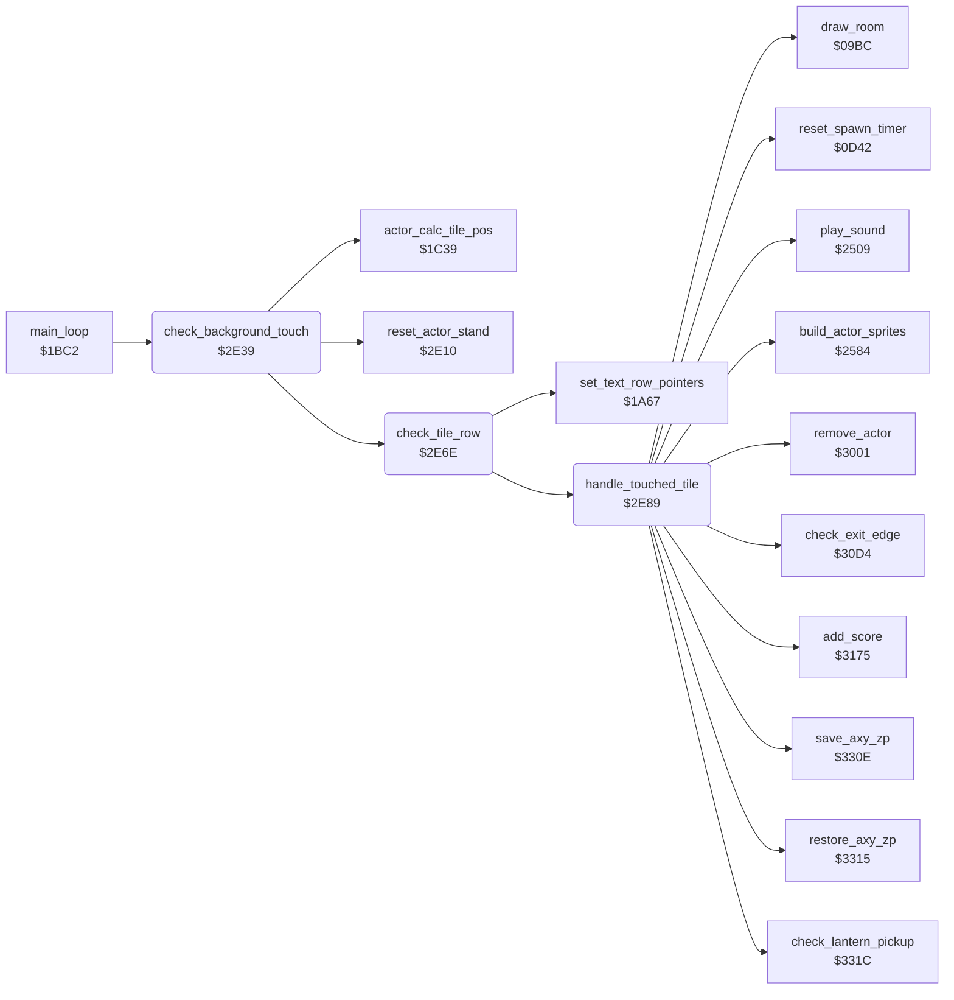

<!-- Generated by c64-docs from knowledge revision 20261025T214801.837-ucnw24 and .c64-re-tools/local/generated/src/source-map.json. Do not edit: change the knowledge, generate the source again, then run docs.ts generate. -->
# actor/background_touch.asm: Background touch: tile checks under the actors, lanterns and room exits

Range `$2E39-$2FD5`. Source: [actor/background_touch.asm](../../../../src/actor/background_touch.asm). Index: [the reference](../../index.md).

## Routines

| Routine | Address | Reached from | Summary |
|---|---|---|---|
| [`check_background_touch`](background_touch.md#check_background_touch) | `$2E39` | [`main_loop`](../game/game_main_loop.md#main_loop) | Main loop: background touch of each active actor that is not dying (state $19). |
| [`check_tile_row`](background_touch.md#check_tile_row) | `$2E6E` | [`check_background_touch`](background_touch.md#check_background_touch) | Checks the 3 characters from column actor_cell_col,X of text line actor_cell_row,X for actor current_actor (handle_touched_tile for each). |
| [`handle_touched_tile`](background_touch.md#handle_touched_tile) | `$2E89` | [`check_tile_row`](background_touch.md#check_tile_row) | Action of character A touched by actor current_actor at (row_ptr_top),Y: 2-5 exit markers (take_exit2..5), $62 moving character (touch_climb_tile), $2D/$2E room 16 bonus. |
| [`handle_tile_try_bonus`](background_touch.md#handle_tile_try_bonus) | `$2EA9` | [`touch_climb_tile`](touch_effects.md#touch_climb_tile) |  |
| [`enter_room`](background_touch.md#enter_room) | `$2F8E` | [`$24EA`](../../../../src/actor/actor_hit_states.asm#L136), [`place_bruce_at_room_start`](../room/room_misc_support.md#place_bruce_at_room_start) | Moves actor current_actor to room next_room at X = A, Y = Y. |

## Call graph

A solid arrow is a call, a thick arrow a table entry. Rounded nodes are in this file.

## Details

### [`check_background_touch`](../../../../src/actor/background_touch.asm#L10) `$2E39`

*routine*

Main loop: background touch of each active actor that is not dying (state $19). An actor in state $17 (ride) first goes back to stand; touching the moving character $62 again restores it. touch_tile_gate = actor_contact,X bit 1: the lanterns and the deadly tiles count only when it is set. The actor position becomes a column actor_cell_col,X and a tile row actor_cell_row,X (actor_calc_tile_pos); then 3 characters of that text line and 3 of the line below are checked (check_tile_row).

- **Called from:** [`main_loop`](../game/game_main_loop.md#main_loop)
- **Calls:** [`reset_actor_stand`](actor_helpers.md#reset_actor_stand), [`actor_calc_tile_pos`](../game/game_main_loop.md#actor_calc_tile_pos), [`check_tile_row`](background_touch.md#check_tile_row)
- **Reads:** [`actor_flags`](../../memory-map.md#actor_flags), [`actor_state`](../../memory-map.md#actor_state), [`actor_contact`](../../memory-map.md#actor_contact), [`current_actor`](../../memory-map.md#current_actor), [`actor_cell_row`](../../memory-map.md#actor_cell_row)
- **Writes:** [`text_single_height`](../../memory-map.md#text_single_height), [`current_actor`](../../memory-map.md#current_actor), [`touch_tile_gate`](../../memory-map.md#touch_tile_gate), [`actor_cell_row`](../../memory-map.md#actor_cell_row)

| Label | Address | Comment |
|---|---|---|
| [`check_background_touch_loop`](../../../../src/actor/background_touch.asm#L14) | `$2E40` |  |
| [`check_background_touch_rows`](../../../../src/actor/background_touch.asm#L25) | `$2E55` |  |
| [`check_background_touch_next`](../../../../src/actor/background_touch.asm#L34) | `$2E68` |  |

### [`check_tile_row`](../../../../src/actor/background_touch.asm#L41) `$2E6E`

*routine*

Checks the 3 characters from column actor_cell_col,X of text line actor_cell_row,X for actor current_actor (handle_touched_tile for each). Uses temp_counter as the loop counter.

- **Called from:** [`check_background_touch`](background_touch.md#check_background_touch)
- **Calls:** [`set_text_row_pointers`](../game/pause_status_line.md#set_text_row_pointers), [`handle_touched_tile`](background_touch.md#handle_touched_tile)
- **Reads:** [`actor_cell_row`](../../memory-map.md#actor_cell_row), [`current_actor`](../../memory-map.md#current_actor), [`actor_cell_col`](../../memory-map.md#actor_cell_col), [`row_ptr_top`](../../memory-map.md#row_ptr_top), [`temp_counter`](../../memory-map.md#temp_counter)
- **Writes:** [`temp_counter`](../../memory-map.md#temp_counter)

| Label | Address | Comment |
|---|---|---|
| [`check_tile_row_loop`](../../../../src/actor/background_touch.asm#L49) | `$2E7C` |  |

### [`handle_touched_tile`](../../../../src/actor/background_touch.asm#L61) `$2E89`

*routine*

Action of character A touched by actor current_actor at (row_ptr_top),Y: 2-5 exit markers (take_exit2..5), $62 moving character (touch_climb_tile), $2D/$2E room 16 bonus. When touch_tile_gate is nonzero also: $13, $14, $31 lantern (Bruce only); $0F, $40, $64, $54-$5A except $57, $71-$7C deadly; $66 deadly in rooms 10-19; $60 trap tile.

- **Called from:** [`check_tile_row`](background_touch.md#check_tile_row)
- **Calls:** [`save_axy_zp`](../room/room_misc_support.md#save_axy_zp), [`check_lantern_pickup`](../room/lantern_pickup.md#check_lantern_pickup), [`restore_axy_zp`](../room/room_misc_support.md#restore_axy_zp), [`add_score`](../game/score.md#add_score), [`play_sound`](../sfx/sound_request.md#play_sound), [`check_exit_edge`](touch_effects.md#check_exit_edge), [`remove_actor`](touch_effects.md#remove_actor), [`reset_spawn_timer`](actor_spawn.md#reset_spawn_timer), [`draw_room`](../room/draw_room.md#draw_room), [`build_actor_sprites`](actor_sprites.md#build_actor_sprites)
- **Jumps to:** [`collect_room16_bonus`](touch_effects.md#collect_room16_bonus), [`touch_climb_tile`](touch_effects.md#touch_climb_tile), [`touch_trap_tile`](touch_effects.md#touch_trap_tile), [`touch_deadly_tile`](touch_effects.md#touch_deadly_tile), [`restore_axy_zp`](../room/room_misc_support.md#restore_axy_zp), [`check_background_touch_next`](background_touch.md#check_background_touch_next), [`main_loop`](../game/game_main_loop.md#main_loop)
- **Reads:** [`touch_tile_gate`](../../memory-map.md#touch_tile_gate), [`room`](../../memory-map.md#room), [`row_ptr_top`](../../memory-map.md#row_ptr_top), [`exit2_dest_room`](../room/room_tables.md#exit2_dest_room), [`exit2_entry_y`](../room/room_tables.md#exit2_entry_y), [`exit2_entry_x`](../room/room_tables.md#exit2_entry_x), [`exit3_dest_room`](../room/room_tables.md#exit3_dest_room), [`exit3_entry_y`](../room/room_tables.md#exit3_entry_y), [`exit3_entry_x`](../room/room_tables.md#exit3_entry_x), [`exit4_dest_room`](../room/room_tables.md#exit4_dest_room), [`exit4_entry_y`](../room/room_tables.md#exit4_entry_y), [`exit4_entry_x`](../room/room_tables.md#exit4_entry_x) and 9 more
- **Writes:** [`touch_tile_gate`](../../memory-map.md#touch_tile_gate), [`next_room`](../../memory-map.md#next_room), [`actor_x`](../../memory-map.md#actor_x), [`actor_y`](../../memory-map.md#actor_y), [`room`](../../memory-map.md#room), [`enemy_follow_y`](../../memory-map.md#enemy_follow_y), [`yamo_idle_time`](../../memory-map.md#yamo_idle_time), [`enemy_follow_x`](../../memory-map.md#enemy_follow_x)
- **Refers to:** [`enemy_follow_energy`](../../memory-map.md#enemy_follow_energy), [`enemy_follow_x`](../../memory-map.md#enemy_follow_x), [`enemy_follow_y`](../../memory-map.md#enemy_follow_y)

| Label | Address | Comment |
|---|---|---|
| [`handle_tile_try_exit2`](../../../../src/actor/background_touch.asm#L65) | `$2E90` |  |
| [`handle_tile_try_exit3`](../../../../src/actor/background_touch.asm#L69) | `$2E97` |  |
| [`handle_tile_try_exit4`](../../../../src/actor/background_touch.asm#L73) | `$2E9E` |  |
| [`handle_tile_try_climb`](../../../../src/actor/background_touch.asm#L77) | `$2EA5` |  |
| [`handle_tile_try_high_deadly`](../../../../src/actor/background_touch.asm#L108) | `$2EDD` |  |
| [`handle_tile_try_trap`](../../../../src/actor/background_touch.asm#L113) | `$2EE5` |  |
| [`handle_tile_done`](../../../../src/actor/background_touch.asm#L116) | `$2EE9` |  |
| [`handle_tile_bonus`](../../../../src/actor/background_touch.asm#L118) | `$2EEA` |  |
| [`handle_tile_goto_bonus`](../../../../src/actor/background_touch.asm#L123) | `$2EF1` |  |
| [`handle_tile_goto_climb`](../../../../src/actor/background_touch.asm#L126) | `$2EF4` |  |
| [`handle_tile_goto_trap`](../../../../src/actor/background_touch.asm#L128) | `$2EF7` |  |
| [`handle_tile_late_rooms_deadly`](../../../../src/actor/background_touch.asm#L130) | `$2EFA` |  |
| [`handle_tile_goto_deadly`](../../../../src/actor/background_touch.asm#L136) | `$2F01` |  |
| [`collect_lantern`](../../../../src/actor/background_touch.asm#L142) | `$2F04` | Lantern touched (Bruce only): find it in the lantern list of the room (check_lantern_pickup; carry set = not there or already taken; it decrements the lantern count of the room). Draw the background character it returns over the tile (top character, and character + $80 on the next line), add 125 points and start sound effect $8E. |
| [`collect_lantern_done`](../../../../src/actor/background_touch.asm#L173) | `$2F39` |  |
| [`take_exit2`](../../../../src/actor/background_touch.asm#L178) | `$2F3C` | Exit marker characters 2-5: when the actor stands at the matching screen edge (check_exit_edge), it leaves to room exitN_dest_room,room with entry X exitN_entry_x,room and entry Y exitN_entry_y,room (N = 2..5). An entry X of 0 falls through to the next exit table. |
| [`take_exit_blocked`](../../../../src/actor/background_touch.asm#L180) | `$2F3F` |  |
| [`take_exit3`](../../../../src/actor/background_touch.asm#L189) | `$2F51` |  |
| [`take_exit4`](../../../../src/actor/background_touch.asm#L199) | `$2F66` |  |
| [`take_exit_blocked_b`](../../../../src/actor/background_touch.asm#L201) | `$2F69` |  |
| [`take_exit5`](../../../../src/actor/background_touch.asm#L210) | `$2F7B` |  |
| [`change_room`](../../../../src/actor/background_touch.asm#L234) | `$2F9A` | Bruce changes the room: store his entry position, set room = next_room. Each active enemy keeps its energy in enemy_follow_energy and Bruce's entry position in enemy_follow_x/enemy_follow_y (index actor - 1; it follows him); an absent enemy gets enemy_follow_x/_y = 0. The enemies are removed, the spawn timers restart (reset_spawn_timer), the stack is reset and the new room is drawn (draw_room); then the sprites are built and the main loop restarts. |
| [`change_room_enemy_loop`](../../../../src/actor/background_touch.asm#L241) | `$2FA5` |  |
| [`change_room_enemy_absent`](../../../../src/actor/background_touch.asm#L252) | `$2FB9` |  |
| [`change_room_remove_enemy`](../../../../src/actor/background_touch.asm#L256) | `$2FBF` |  |

### [`handle_tile_try_bonus`](../../../../src/actor/background_touch.asm#L80) `$2EA9`

*label*

- **Jumped to from:** [`touch_climb_tile`](touch_effects.md#touch_climb_tile)

### [`enter_room`](../../../../src/actor/background_touch.asm#L222) `$2F8E`

*label*

Moves actor current_actor to room next_room at X = A, Y = Y. An enemy is only removed (remove_actor) and the check of the other actors goes on. Also jumped to by act_wall_bump (room restart) and place_bruce_at_room_start.

- **Jumped to from:** [`$24EA`](../../../../src/actor/actor_hit_states.asm#L136), [`handle_touched_tile`](background_touch.md#handle_touched_tile), [`place_bruce_at_room_start`](../room/room_misc_support.md#place_bruce_at_room_start)
