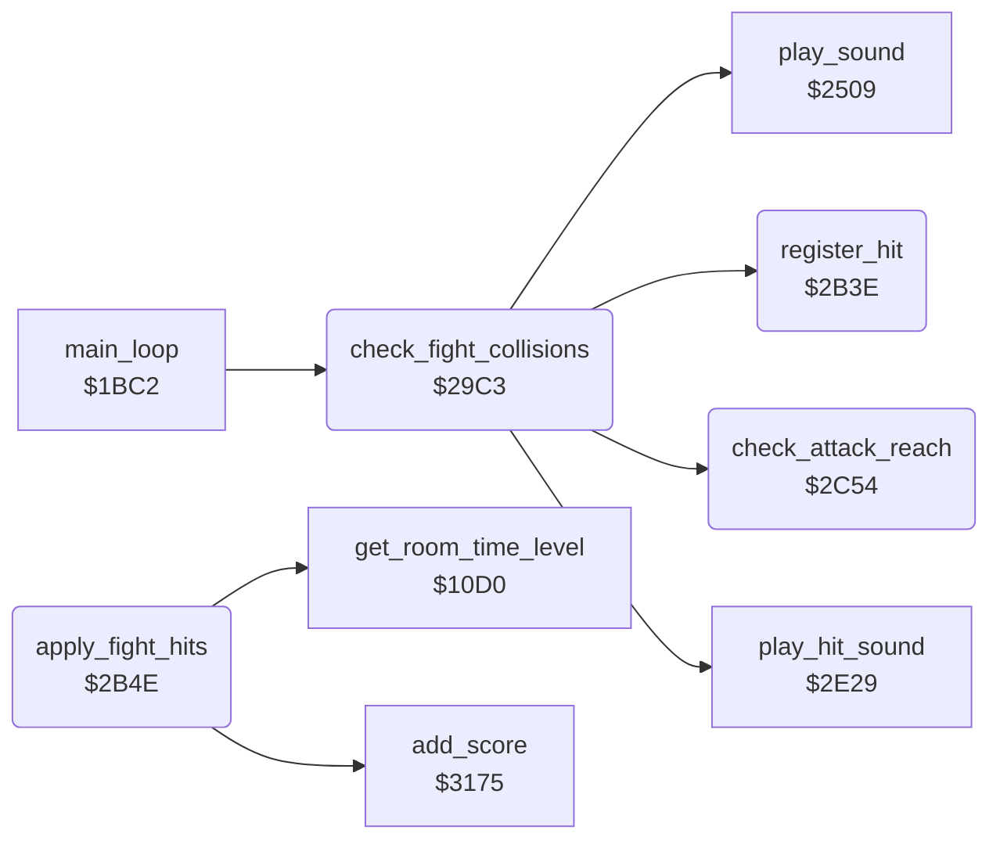

<!-- Generated by c64-docs from knowledge revision 20261029T162352.521-4j8tu8 and .c64-re-tools/local/generated/src/source-map.json. Do not edit: change the knowledge, generate the source again, then run docs.ts generate. -->
# actor/fight_hits.asm: Fights: sprite-sprite collisions, hits, damage, knock-outs and hit points

Range `$29C3-$2C6F`. Source: [actor/fight_hits.asm](../../../../src/actor/fight_hits.asm). Index: [the reference](../../index.md).

## Routines

| Routine | Address | Reached from | Summary |
|---|---|---|---|
| [`check_fight_collisions`](fight_hits.md#check_fight_collisions) | `$29C3` | [`main_loop`](../game/game_main_loop.md#main_loop) | Fight collision check, once per main loop pass (the main loop skips it in rooms whose room_no_enemies entry is nonzero). |
| [`register_hit`](fight_hits.md#register_hit) | `$2B3E` | [`check_fight_collisions`](fight_hits.md#check_fight_collisions) | Marks a hit of attacker Y on victim X: actor_hit_flags,Y bit 0 = landed a hit, and the victim turns to face the attacker (actor_facing,X = actor_facing,Y XOR 1). |
| [`apply_fight_hits`](fight_hits.md#apply_fight_hits) | `$2B4E` |  | Applies the hits that check_fight_collisions found, for each actor X = 2..0 (current_actor = actor). |
| [`check_attack_reach`](fight_hits.md#check_attack_reach) | `$2C54` | [`check_fight_collisions`](fight_hits.md#check_fight_collisions) | Distance check of attacker Y against victim X: A = victim X - attacker X when the attacker faces right (actor_facing,Y = 1), else attacker X - victim X. |

## Call graph

A solid arrow is a call, a thick arrow a table entry. Rounded nodes are in this file.

## Details

### [`check_fight_collisions`](../../../../src/actor/fight_hits.asm#L14) `$29C3`

*routine*

Fight collision check, once per main loop pass (the main loop skips it in rooms whose room_no_enemies entry is nonzero). Reads SPSPCL (sprite-sprite collisions; the read clears it) into sprite_collisions. Bits $03 count as Bruce, $0C as Yamo, $30 as the Ninja. For each pair of actors that touch, actor_touch_mask,X of each gets the bit of the other actor's sprite: bit 1 = Bruce (sprite 1), bit 3 = Yamo (sprite 3), bit 4 = Ninja (sprite 4). Then each actor X is tested as the victim of each actor Y it touches (check_fight_pair): a hit needs the attacker in an attack state and the victim in front of it (check_attack_reach). A hit sets actor_hit_flags,Y bit 0 (attacker landed a hit) and on the victim actor_hit_flags,X bit 1 (Ninja strike), bit 2 (punch), bit 3 (flying kick) or bit 4 (fall attack), plus bit 7 when the attacker is Bruce. Then it continues in apply_fight_hits. actor_touch_mask and actor_hit_flags are cleared first.

- **Called from:** [`main_loop`](../game/game_main_loop.md#main_loop)
- **Calls:** [`check_attack_reach`](fight_hits.md#check_attack_reach), [`play_sound`](../sfx/sound_request.md#play_sound), [`register_hit`](fight_hits.md#register_hit), [`play_hit_sound`](actor_helpers.md#play_hit_sound)
- **Jumps to:** [`apply_fight_hits`](fight_hits.md#apply_fight_hits)
- **Reads:** [`SPSPCL`](../../memory-map.md#SPSPCL), [`sprite_collisions`](../../memory-map.md#sprite_collisions), [`actor_touch_mask`](../../memory-map.md#actor_touch_mask), [`temp_counter`](../../memory-map.md#temp_counter), [`actor_state`](../../memory-map.md#actor_state), [`sprite_owner`](../../memory-map.md#sprite_owner), [`temp_y`](../../memory-map.md#temp_y), [`actor_timer`](../../memory-map.md#actor_timer), [`actor_hit_flags`](../../memory-map.md#actor_hit_flags), [`actor_y`](../../memory-map.md#actor_y), [`fall_attack_budget`](../../memory-map.md#fall_attack_budget)
- **Writes:** [`actor_touch_mask`](../../memory-map.md#actor_touch_mask), [`actor_hit_flags`](../../memory-map.md#actor_hit_flags), [`sprite_collisions`](../../memory-map.md#sprite_collisions), [`temp_counter`](../../memory-map.md#temp_counter), [`temp_y`](../../memory-map.md#temp_y), [`attack_reach`](../../memory-map.md#attack_reach), [`fall_attack_budget`](../../memory-map.md#fall_attack_budget)
- **Refers to:** [`actor_touch_mask`](../../memory-map.md#actor_touch_mask)

| Label | Address | Comment |
|---|---|---|
| [`check_fight_collisions_clear`](../../../../src/actor/fight_hits.asm#L17) | `$29C7` |  |
| [`check_fight_collisions_found`](../../../../src/actor/fight_hits.asm#L26) | `$29D4` | Observed (room 0 run): values $12, $1C, $1D, $1E, $1F; never $03 or $0C alone, so the main and overlay sprite of one actor do not collide. |
| [`check_fight_bruce_yamo`](../../../../src/actor/fight_hits.asm#L31) | `$29DD` |  |
| [`check_fight_bruce_yamo_touch`](../../../../src/actor/fight_hits.asm#L36) | `$29E6` |  |
| [`check_fight_bruce_ninja`](../../../../src/actor/fight_hits.asm#L43) | `$29F2` |  |
| [`check_fight_bruce_ninja_touch`](../../../../src/actor/fight_hits.asm#L48) | `$29FB` |  |
| [`check_fight_yamo_ninja`](../../../../src/actor/fight_hits.asm#L56) | `$2A07` | When both Yamo's and the Ninja's bits are set, they count as touching each other. |
| [`check_fight_scan`](../../../../src/actor/fight_hits.asm#L70) | `$2A1F` | For each victim X = 2..0, test each sprite bit 0-4 of actor_touch_mask,X (shifted out of temp_counter). |
| [`check_fight_scan_actor`](../../../../src/actor/fight_hits.asm#L72) | `$2A21` |  |
| [`check_fight_scan_bit`](../../../../src/actor/fight_hits.asm#L76) | `$2A27` |  |
| [`check_fight_scan_next_bit`](../../../../src/actor/fight_hits.asm#L79) | `$2A2B` |  |
| [`check_fight_pair`](../../../../src/actor/fight_hits.asm#L89) | `$2A36` | Victim X touches sprite Y (kept in temp_y). A victim in state $18 wall bump, $1A duck, $0F recoil, $13 knocked down, $19 dying or $1B hit by a fall attack is not hit. The attacker is the owner of the sprite (sprite_owner,Y); its state selects the attack test. |
| [`check_fight_pair_done`](../../../../src/actor/fight_hits.asm#L121) | `$2A76` |  |
| [`check_fight_strike`](../../../../src/actor/fight_hits.asm#L126) | `$2A7B` | Ninja strike (state $16): hits while the attacker's timer is below 8 at reach 4 or more. Sound $87, hit bit 1, no points. |
| [`check_fight_punch`](../../../../src/actor/fight_hits.asm#L151) | `$2AA5` | Punch (state $11): reach 6 or more and a height difference below $16. Hit sound, hit bit 2. |
| [`check_fight_punch_height`](../../../../src/actor/fight_hits.asm#L163) | `$2ABC` |  |
| [`check_fight_punch_store`](../../../../src/actor/fight_hits.asm#L173) | `$2AD0` |  |
| [`check_fight_kick`](../../../../src/actor/fight_hits.asm#L177) | `$2AD4` | Flying kick (state $0C/$0D): hits while the timer is below $0A at reach 6 or more. Hit sound, hit bit 3. |
| [`check_fight_kick_store`](../../../../src/actor/fight_hits.asm#L193) | `$2AF6` |  |
| [`check_fight_fall`](../../../../src/actor/fight_hits.asm#L200) | `$2AFA` | Fall attack (state $0E, falling): the attacker is $0A or more above the victim and its fall attack counter fall_attack_budget,Y is not 0 (decremented for each test that gets this far; frame_update refills it to 2). No hit when either actor already has hit bit 4 or the victim is kicking or punching. Hit bit 4. The attacker does not get bit 0 and the victim does not turn. |
| [`check_fight_fall_store`](../../../../src/actor/fight_hits.asm#L231) | `$2B39` |  |
| [`check_fight_pair_next`](../../../../src/actor/fight_hits.asm#L233) | `$2B3B` |  |

### [`register_hit`](../../../../src/actor/fight_hits.asm#L237) `$2B3E`

*routine*

Marks a hit of attacker Y on victim X: actor_hit_flags,Y bit 0 = landed a hit, and the victim turns to face the attacker (actor_facing,X = actor_facing,Y XOR 1).

- **Called from:** [`check_fight_collisions`](fight_hits.md#check_fight_collisions)
- **Reads:** [`actor_hit_flags`](../../memory-map.md#actor_hit_flags), [`actor_facing`](../../memory-map.md#actor_facing)
- **Writes:** [`actor_hit_flags`](../../memory-map.md#actor_hit_flags), [`actor_facing`](../../memory-map.md#actor_facing)

### [`apply_fight_hits`](../../../../src/actor/fight_hits.asm#L252) `$2B4E`

*routine*

Applies the hits that check_fight_collisions found, for each actor X = 2..0 (current_actor = actor). Bit 0 (landed a hit): the attacker goes to state 0 with actor_step_delay = 4 and a pause in actor_timer by the time in the room (get_room_time_level: V = room_time+1 >= $20, C = room_time+1 >= $19): Bruce 3, 8 (C) or 10 (V); an enemy 10 (C or V), else 3 when game_loop_count is nonzero, else $18. Damage on actor_energy,X: bit 1 Ninja strike 2 (state $0F recoil, timer 3), bit 2 punch 3 (state $0F, timer 4), bit 3 flying kick 7 (state $13 knocked down, timer 12), bit 4 fall attack 5 (state $1B, timer 8). Points for Bruce's hits (bit 7): punch 100, kick 75, fall attack 50. Energy below 0: knock-out (apply_fight_ko).

- **Jumped to from:** [`check_fight_collisions`](fight_hits.md#check_fight_collisions)
- **Calls:** [`get_room_time_level`](../game/game_setup.md#get_room_time_level), [`add_score`](../game/score.md#add_score)
- **Reads:** [`actor_hit_flags`](../../memory-map.md#actor_hit_flags), [`actor_pose_done`](../../memory-map.md#actor_pose_done), [`game_loop_count`](../../memory-map.md#game_loop_count), [`actor_energy`](../../memory-map.md#actor_energy), [`current_actor`](../../memory-map.md#current_actor)
- **Writes:** [`current_actor`](../../memory-map.md#current_actor), [`actor_state`](../../memory-map.md#actor_state), [`actor_step_delay`](../../memory-map.md#actor_step_delay), [`actor_timer`](../../memory-map.md#actor_timer), [`actor_pose_done`](../../memory-map.md#actor_pose_done), [`actor_energy`](../../memory-map.md#actor_energy)

| Label | Address | Comment |
|---|---|---|
| [`apply_fight_hits_loop`](../../../../src/actor/fight_hits.asm#L254) | `$2B50` |  |
| [`apply_fight_hits_pause_long`](../../../../src/actor/fight_hits.asm#L275) | `$2B79` |  |
| [`apply_fight_hits_pause_short`](../../../../src/actor/fight_hits.asm#L279) | `$2B7F` | 2 is replaced at once by apply_fight_hits_pause_by_time |
| [`apply_fight_hits_pause_by_time`](../../../../src/actor/fight_hits.asm#L282) | `$2B83` |  |
| [`apply_fight_hits_pause_8`](../../../../src/actor/fight_hits.asm#L289) | `$2B90` |  |
| [`apply_fight_hits_pause_10`](../../../../src/actor/fight_hits.asm#L293) | `$2B96` |  |
| [`apply_fight_hits_strike`](../../../../src/actor/fight_hits.asm#L297) | `$2B9A` | Bit 1: Ninja strike, 2 energy, recoil (state $0F, timer 3). |
| [`apply_fight_hits_punch`](../../../../src/actor/fight_hits.asm#L311) | `$2BB1` | Bit 2: punch, 100 points when Bruce hit, 3 energy, recoil (state $0F, timer 4). |
| [`apply_fight_hits_punch_damage`](../../../../src/actor/fight_hits.asm#L321) | `$2BC4` |  |
| [`apply_fight_hits_kick`](../../../../src/actor/fight_hits.asm#L332) | `$2BD5` | Bit 3: flying kick, 75 points when Bruce hit, 7 energy, knocked down (state $13, timer 12). |
| [`apply_fight_hits_kick_damage`](../../../../src/actor/fight_hits.asm#L342) | `$2BE8` |  |
| [`apply_fight_hits_check_ko`](../../../../src/actor/fight_hits.asm#L347) | `$2BEF` |  |
| [`apply_fight_hits_fall`](../../../../src/actor/fight_hits.asm#L354) | `$2BF9` | Bit 4: fall attack, 50 points when Bruce hit, 5 energy, state $1B with timer 8. |
| [`apply_fight_hits_fall_damage`](../../../../src/actor/fight_hits.asm#L364) | `$2C0C` |  |
| [`apply_fight_hits_next`](../../../../src/actor/fight_hits.asm#L374) | `$2C1D` |  |
| [`apply_fight_hits_done`](../../../../src/actor/fight_hits.asm#L378) | `$2C23` |  |
| [`apply_fight_ko`](../../../../src/actor/fight_hits.asm#L384) | `$2C24` | Knock-out (energy below 0). Bruce's knock-out of Yamo scores 256+194 = 450 points, of the Ninja 200. The victim goes to state $13 (knocked down) with timer $0c; check_actor_knockouts removes it later. It continues at apply_fight_hits_fall, which still sees hit bit 4: a knock-out by a fall attack repeats the damage, the 50 points and the knock-out points until the energy wraps to a positive value. |
| [`apply_fight_ko_ninja`](../../../../src/actor/fight_hits.asm#L398) | `$2C40` | Ninja: 200 points |
| [`apply_fight_ko_knockdown`](../../../../src/actor/fight_hits.asm#L402) | `$2C47` |  |

### [`check_attack_reach`](../../../../src/actor/fight_hits.asm#L412) `$2C54`

*routine*

Distance check of attacker Y against victim X: A = victim X - attacker X when the attacker faces right (actor_facing,Y = 1), else attacker X - victim X. Compares A with attack_reach. Returns carry set and N clear when the victim is in front of the attacker at a distance of attack_reach or more.

- **Called from:** [`check_fight_collisions`](fight_hits.md#check_fight_collisions)
- **Reads:** [`actor_x`](../../memory-map.md#actor_x), [`actor_facing`](../../memory-map.md#actor_facing), [`attack_reach`](../../memory-map.md#attack_reach)

| Label | Address | Comment |
|---|---|---|
| [`check_attack_reach_compare`](../../../../src/actor/fight_hits.asm#L427) | `$2C6B` |  |
