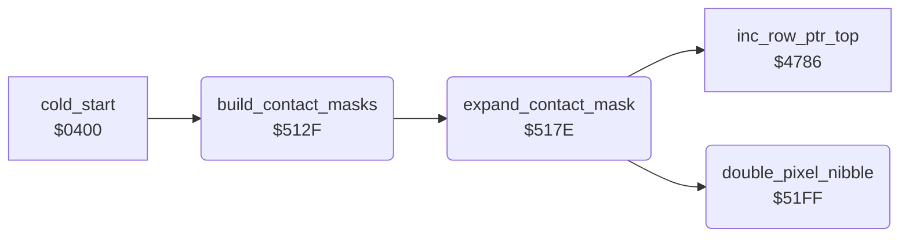

<!-- Generated by c64-docs from knowledge revision 20261025T141148.619-ij2l1b and .c64-re-tools/local/generated/src/source-map.json. Do not edit: change the knowledge, generate the source again, then run docs.ts generate. -->
# actor/frame_builder.asm: Start-up builder of the 96-byte background contact masks of the animation frames

Range `$512F-$5211`. Source: [actor/frame_builder.asm](../../../../src/actor/frame_builder.asm). Index: [the reference](../../index.md).

## Routines

| Routine | Address | Reached from | Summary |
|---|---|---|---|
| [`build_contact_masks`](frame_builder.md#build_contact_masks) | `$512F` | [`cold_start`](../game/cold_start.md#cold_start) | Start-up builder of the background contact masks, called once by cold_start after the room charsets are expanded. |
| [`expand_contact_mask`](frame_builder.md#expand_contact_mask) | `$517E` | [`build_contact_masks`](frame_builder.md#build_contact_masks) | Expands the 1-bit shape of frame X into its 96-byte contact mask at contact_mask_addr_lo/hi,X. |
| [`double_pixel_nibble`](frame_builder.md#double_pixel_nibble) | `$51FF` | [`expand_contact_mask`](frame_builder.md#expand_contact_mask) | Doubles 4 pixels: returns in A one byte where bit n of double_pixel_bits (n = 0-3) became the bit pair 2n+1..2n (%11 for a set bit). |

## Call graph

A solid arrow is a call, a thick arrow a table entry. Rounded nodes are in this file.

## Details

### [`build_contact_masks`](../../../../src/actor/frame_builder.asm#L16) `$512F`

*routine*

Start-up builder of the background contact masks, called once by cold_start after the room charsets are expanded. First it loops for ever unless prot_signature_a = $B9 and prot_signature_b = prot_signature_a (protection key page). Then for each pair of frame numbers X = $D1, $CF, ... 1 (odd) and X-1 (even): frame X is expanded into the 96-byte buffer shift_mask_col0 ($CAE0; the odd entries of contact_mask_addr_lo/hi point there), or the buffer is cleared when contact_mask_addr_hi,X is 0 (the Ninja has no second sprite); frame X-1 is expanded to its own address contact_mask_addr_lo/hi and the buffer is ORed into it. So the mask of an even frame covers both sprites of the pose. check_background_contact uses these masks. Mask format: 96 bytes = 3 columns of 32 rows, column after column; each source pixel becomes a %11 multicolour pixel. The masks fill $9000-$9FBF (over the room charset sources, already expanded) and contact_masks_high ($C000-$CADF). current_actor ($51) holds the frame number. Ends with JMP $0080 (an RTS).

- **Called from:** [`cold_start`](../game/cold_start.md#cold_start)
- **Calls:** [`expand_contact_mask`](frame_builder.md#expand_contact_mask)
- **Jumps to:** [`frame_count_256`](../../memory-map.md#frame_count_256)
- **Reads:** [`prot_signature_a`](../protection/protection_key_page.md#prot_signature_a), [`prot_signature_b`](../protection/protection_key_page.md#prot_signature_b), [`contact_mask_addr_hi`](../room/room_enemy_tables.md#contact_mask_addr_hi), [`current_actor`](../../memory-map.md#current_actor), [`contact_mask_addr_lo`](../room/room_enemy_tables.md#contact_mask_addr_lo), [`data_ptr`](../../memory-map.md#data_ptr), [`shift_mask_col0`](../../memory-map.md#shift_mask_col0)
- **Writes:** [`current_actor`](../../memory-map.md#current_actor), [`shift_mask_col0`](../../memory-map.md#shift_mask_col0), [`data_ptr`](../../memory-map.md#data_ptr)
- **Refers to:** [`data_ptr`](../../memory-map.md#data_ptr)

| Label | Address | Comment |
|---|---|---|
| [`build_masks_pair`](../../../../src/actor/frame_builder.asm#L41) | `$513D` | frame number (zero page current_actor reused) |
| [`build_masks_clear_buffer`](../../../../src/actor/frame_builder.asm#L48) | `$514A` | No second sprite: clear the 96-byte buffer. |
| [`build_masks_clear_loop`](../../../../src/actor/frame_builder.asm#L51) | `$514E` |  |
| [`build_masks_even`](../../../../src/actor/frame_builder.asm#L55) | `$5154` |  |
| [`build_masks_overlay`](../../../../src/actor/frame_builder.asm#L66) | `$5169` | OR the odd frame in the buffer into the even frame (96 bytes). |
| [`build_masks_done`](../../../../src/actor/frame_builder.asm#L76) | `$517B` | $0080 holds an RTS |

### [`expand_contact_mask`](../../../../src/actor/frame_builder.asm#L93) `$517E`

*routine*

Expands the 1-bit shape of frame X into its 96-byte contact mask at contact_mask_addr_lo/hi,X. Source = frame_gfx_lo/hi,X, height = frame_last_row,X + 1 rows (kept in zero page $1D, demo_input_ptr, which is free at start-up), width flag frame_is_wide,X: 0 = 1 source byte per row (8 pixels -> columns 0 and 1, column 2 empty), else 2 source bytes per row (the high nibble of the second byte -> column 2). Rows from the height to 31 are cleared. Pointers: row_ptr_top = source, data_ptr / row_ptr_bottom / aux_ptr = mask columns 0 / 1 / 2.

- **Called from:** [`build_contact_masks`](frame_builder.md#build_contact_masks)
- **Calls:** [`double_pixel_nibble`](frame_builder.md#double_pixel_nibble), [`inc_row_ptr_top`](../text/pointer_helpers.md#inc_row_ptr_top)
- **Reads:** [`frame_gfx_lo`](actor_frame_gfx_tables.md#frame_gfx_lo), [`frame_gfx_hi`](actor_frame_gfx_tables.md#frame_gfx_hi), [`frame_last_row`](actor_frame_gfx_tables.md#frame_last_row), [`contact_mask_addr_hi`](../room/room_enemy_tables.md#contact_mask_addr_hi), [`contact_mask_addr_lo`](../room/room_enemy_tables.md#contact_mask_addr_lo), [`data_ptr`](../../memory-map.md#data_ptr), [`frame_is_wide`](actor_frame_gfx_tables.md#frame_is_wide), [`row_ptr_top`](../../memory-map.md#row_ptr_top), [`row_ptr_bottom`](../../memory-map.md#row_ptr_bottom), [`aux_ptr`](../../memory-map.md#aux_ptr), [`demo_input_ptr`](../../memory-map.md#demo_input_ptr)
- **Writes:** [`row_ptr_top`](../../memory-map.md#row_ptr_top), [`demo_input_ptr`](../../memory-map.md#demo_input_ptr), [`data_ptr`](../../memory-map.md#data_ptr), [`row_ptr_bottom`](../../memory-map.md#row_ptr_bottom), [`aux_ptr`](../../memory-map.md#aux_ptr), [`double_pixel_bits`](../../memory-map.md#double_pixel_bits)
- **Refers to:** [`row_ptr_top`](../../memory-map.md#row_ptr_top), [`data_ptr`](../../memory-map.md#data_ptr), [`row_ptr_bottom`](../../memory-map.md#row_ptr_bottom), [`aux_ptr`](../../memory-map.md#aux_ptr)

| Label | Address | Comment |
|---|---|---|
| [`expand_narrow_row`](../../../../src/actor/frame_builder.asm#L122) | `$51B7` | Narrow frame: one source byte per row. |
| [`expand_clear_rows`](../../../../src/actor/frame_builder.asm#L135) | `$51CE` | Clear the rest of the 32 rows (A = 0). |
| [`expand_wide_row`](../../../../src/actor/frame_builder.asm#L144) | `$51DA` | Wide frame: two source bytes per row (row_ptr_top steps one extra byte per row). |
| [`expand_wide_done`](../../../../src/actor/frame_builder.asm#L162) | `$51FB` |  |

### [`double_pixel_nibble`](../../../../src/actor/frame_builder.asm#L168) `$51FF`

*routine*

Doubles 4 pixels: returns in A one byte where bit n of double_pixel_bits (n = 0-3) became the bit pair 2n+1..2n (%11 for a set bit). double_pixel_bits is shifted right by 4, so a second call does the high nibble. X = $FF on return.

- **Called from:** [`expand_contact_mask`](frame_builder.md#expand_contact_mask)
- **Reads:** [`double_pixel_bits`](../../memory-map.md#double_pixel_bits)
- **Writes:** [`double_pixel_bits`](../../memory-map.md#double_pixel_bits)

| Label | Address | Comment |
|---|---|---|
| [`double_pixel_loop`](../../../../src/actor/frame_builder.asm#L171) | `$5203` |  |
| [`double_pixel_next`](../../../../src/actor/frame_builder.asm#L175) | `$5209` |  |
| [`double_pixel_done`](../../../../src/actor/frame_builder.asm#L181) | `$5211` |  |
