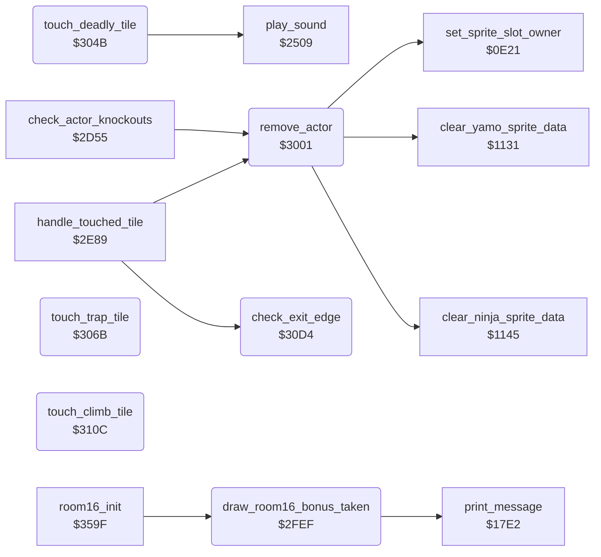

<!-- Generated by c64-docs from knowledge revision 20261025T214801.837-ucnw24 and .c64-re-tools/local/generated/src/source-map.json. Do not edit: change the knowledge, generate the source again, then run docs.ts generate. -->
# actor/touch_effects.asm: Touch effects: room 16 bonus, actor removal, deadly and trap tiles, exit edges

Range `$2FD6-$312B`. Source: [actor/touch_effects.asm](../../../../src/actor/touch_effects.asm). Index: [the reference](../../index.md).

## Routines

| Routine | Address | Reached from | Summary |
|---|---|---|---|
| [`collect_room16_bonus`](touch_effects.md#collect_room16_bonus) | `$2FD6` | [`handle_touched_tile`](background_touch.md#handle_touched_tile) | Room 16 bonus tile ($2D/$2E), Bruce only and at actor_y $A0 or more: one extra fall. |
| [`draw_room16_bonus_taken`](touch_effects.md#draw_room16_bonus_taken) | `$2FEF` | [`room16_init`](../room/room_specific_init.md#room16_init) | Draws tile $56 at column $24 of the text lines $0A and $0B over the room 16 bonus. |
| [`remove_actor`](touch_effects.md#remove_actor) | `$3001` | [`check_actor_knockouts`](actor_helpers.md#check_actor_knockouts), [`handle_touched_tile`](background_touch.md#handle_touched_tile) | Removes actor X from the room: clears its active bit, switches off its sprites, frees the extra sprites of actor_collision_code_a,X/_b,X (sprite_owner = $FF), clears its sprite images in both buffers (clear_yamo_sprite_data, clear_ninja_sprite_data) and restarts its spawn timer (reset_spawn_timer). |
| [`touch_deadly_tile`](touch_effects.md#touch_deadly_tile) | `$304B` | [`handle_touched_tile`](background_touch.md#handle_touched_tile) | Deadly tile touched (not in room 18): sound effect $8C; an enemy is removed, Bruce dies (set_actor_hazard_death sets state $19). |
| [`touch_trap_tile`](touch_effects.md#touch_trap_tile) | `$306B` | [`handle_touched_tile`](background_touch.md#handle_touched_tile) | Trap tile $60 touched: when its colour RAM is not yet 5, take a free one of the 3 burst trap slots (burst_trap_timer+n = 1), store the tile row - 1 (burst_trap_row+n) and column - 1 (burst_trap_col+n) and set the colour to $FD (5, marked). |
| [`check_exit_edge`](touch_effects.md#check_exit_edge) | `$30D4` | [`handle_touched_tile`](background_touch.md#handle_touched_tile) | Exit permission of actor X. |
| [`touch_climb_tile`](touch_effects.md#touch_climb_tile) | `$310C` | [`handle_touched_tile`](background_touch.md#handle_touched_tile) | Moving character $62 touched on a ladder or vine (actor_contact,X bit 2): state $17 (ride) with timer $10, actor_step_delay,X = 0 and actor_ride_hold,X = 0 (not for a dying actor). |

## Call graph

A solid arrow is a call, a thick arrow a table entry. Rounded nodes are in this file.

## Details

### [`collect_room16_bonus`](../../../../src/actor/touch_effects.asm#L8) `$2FD6`

*label*

Room 16 bonus tile ($2D/$2E), Bruce only and at actor_y $A0 or more: one extra fall. It decrements the bonus count extra_fall_pickups_left of current_player (5 at the game start), adds 1 to falls_left, shows it, starts sound $8E and removes the bonus from the screen (draw_room16_bonus_taken).

- **Jumped to from:** [`handle_touched_tile`](background_touch.md#handle_touched_tile)

### [`draw_room16_bonus_taken`](../../../../src/actor/touch_effects.asm#L26) `$2FEF`

*routine*

Draws tile $56 at column $24 of the text lines $0A and $0B over the room 16 bonus. Also called by room16_init when the bonus count of the player is 0.

- **Called from:** [`room16_init`](../room/room_specific_init.md#room16_init)
- **Calls:** [`print_message`](actor_driver_text.md#print_message)
- **Jumps to:** [`print_message`](actor_driver_text.md#print_message)

### [`remove_actor`](../../../../src/actor/touch_effects.asm#L38) `$3001`

*routine*

Removes actor X from the room: clears its active bit, switches off its sprites, frees the extra sprites of actor_collision_code_a,X/_b,X (sprite_owner = $FF), clears its sprite images in both buffers (clear_yamo_sprite_data, clear_ninja_sprite_data) and restarts its spawn timer (reset_spawn_timer).

- **Called from:** [`check_actor_knockouts`](actor_helpers.md#check_actor_knockouts), [`handle_touched_tile`](background_touch.md#handle_touched_tile)
- **Jumped to from:** [`touch_deadly_tile`](touch_effects.md#touch_deadly_tile)
- **Calls:** [`set_sprite_slot_owner`](actor_spawn.md#set_sprite_slot_owner), [`clear_yamo_sprite_data`](../irq/interrupt_entry_1131.md#clear_yamo_sprite_data), [`clear_ninja_sprite_data`](../irq/interrupt_entry_1131.md#clear_ninja_sprite_data)
- **Jumps to:** [`reset_spawn_timer`](actor_spawn.md#reset_spawn_timer)
- **Reads:** [`actor_flags`](../../memory-map.md#actor_flags), [`actor_main_sprite`](actor_sprites.md#actor_main_sprite), [`SPENA`](../../memory-map.md#SPENA), [`sprite_clear_bit`](actor_sprites.md#sprite_clear_bit), [`actor_overlay_sprite`](actor_sprites.md#actor_overlay_sprite), [`actor_collision_code_a`](../../memory-map.md#actor_collision_code_a), [`actor_collision_code_b`](../../memory-map.md#actor_collision_code_b)
- **Writes:** [`actor_flags`](../../memory-map.md#actor_flags), [`SPENA`](../../memory-map.md#SPENA), [`sprite_owner`](../../memory-map.md#sprite_owner)

| Label | Address | Comment |
|---|---|---|
| [`remove_actor_free_extra_a`](../../../../src/actor/touch_effects.asm#L52) | `$3023` |  |
| [`remove_actor_free_extra_b`](../../../../src/actor/touch_effects.asm#L58) | `$302F` |  |
| [`remove_actor_clear_images`](../../../../src/actor/touch_effects.asm#L64) | `$303B` |  |
| [`remove_actor_clear_ninja`](../../../../src/actor/touch_effects.asm#L69) | `$3045` |  |
| [`remove_actor_restart_timer`](../../../../src/actor/touch_effects.asm#L71) | `$3048` |  |

### [`touch_deadly_tile`](../../../../src/actor/touch_effects.asm#L75) `$304B`

*routine*

Deadly tile touched (not in room 18): sound effect $8C; an enemy is removed, Bruce dies (set_actor_hazard_death sets state $19).

- **Jumped to from:** [`handle_touched_tile`](background_touch.md#handle_touched_tile)
- **Calls:** [`play_sound`](../sfx/sound_request.md#play_sound)
- **Jumps to:** [`remove_actor`](touch_effects.md#remove_actor), [`set_actor_hazard_death`](../room/room_hazard_draw.md#set_actor_hazard_death)
- **Reads:** [`room`](../../memory-map.md#room), [`current_actor`](../../memory-map.md#current_actor)

| Label | Address | Comment |
|---|---|---|
| [`touch_deadly_tile_kill`](../../../../src/actor/touch_effects.asm#L80) | `$3052` |  |
| [`touch_deadly_tile_bruce`](../../../../src/actor/touch_effects.asm#L96) | `$3068` |  |

### [`touch_trap_tile`](../../../../src/actor/touch_effects.asm#L101) `$306B`

*routine*

Trap tile $60 touched: when its colour RAM is not yet 5, take a free one of the 3 burst trap slots (burst_trap_timer+n = 1), store the tile row - 1 (burst_trap_row+n) and column - 1 (burst_trap_col+n) and set the colour to $FD (5, marked). update_burst_traps animates the slots. When all slots are busy nothing happens.

- **Jumped to from:** [`handle_touched_tile`](background_touch.md#handle_touched_tile)
- **Reads:** [`row_ptr_top`](../../memory-map.md#row_ptr_top), [`burst_trap_timer`](../../memory-map.md#burst_trap_timer), [`actor_cell_row`](../../memory-map.md#actor_cell_row), [`burst_trap_col`](../../memory-map.md#burst_trap_col), [`burst_trap_row`](../../memory-map.md#burst_trap_row)
- **Writes:** [`row_ptr_top`](../../memory-map.md#row_ptr_top), [`burst_trap_timer`](../../memory-map.md#burst_trap_timer), [`burst_trap_row`](../../memory-map.md#burst_trap_row), [`burst_trap_col`](../../memory-map.md#burst_trap_col)
- **Refers to:** [`row_ptr_top`](../../memory-map.md#row_ptr_top), [`game_screen`](../../memory-map.md#game_screen), [`burst_trap_timer`](../../memory-map.md#burst_trap_timer), [`burst_trap_row`](../../memory-map.md#burst_trap_row), [`burst_trap_col`](../../memory-map.md#burst_trap_col)

| Label | Address | Comment |
|---|---|---|
| [`touch_trap_tile_slot1`](../../../../src/actor/touch_effects.asm#L120) | `$3095` |  |
| [`touch_trap_tile_slot2`](../../../../src/actor/touch_effects.asm#L131) | `$30B0` |  |
| [`touch_trap_tile_mark`](../../../../src/actor/touch_effects.asm#L141) | `$30C8` |  |
| [`touch_trap_tile_done`](../../../../src/actor/touch_effects.asm#L144) | `$30CC` |  |

### [`check_exit_edge`](../../../../src/actor/touch_effects.asm#L154) `$30D4`

*routine*

Exit permission of actor X. Returns carry clear when the actor may leave: always in room 11; at the left edge (actor_x < $10) after moving left (actor_move_queue+6,X); at the right edge (actor_x > $A1) after moving right (actor_move_queue+9,X); below actor_y $C5 while falling (state $0E); at the top (actor_y < $31) after moving up (actor_move_queue,X). Else carry set.

- **Called from:** [`handle_touched_tile`](background_touch.md#handle_touched_tile)
- **Reads:** [`room`](../../memory-map.md#room), [`actor_x`](../../memory-map.md#actor_x), [`actor_move_queue`](../../memory-map.md#actor_move_queue), [`actor_y`](../../memory-map.md#actor_y), [`actor_state`](../../memory-map.md#actor_state)
- **Refers to:** [`actor_move_queue`](../../memory-map.md#actor_move_queue)

| Label | Address | Comment |
|---|---|---|
| [`check_exit_right_edge`](../../../../src/actor/touch_effects.asm#L164) | `$30E6` |  |
| [`check_exit_bottom_edge`](../../../../src/actor/touch_effects.asm#L170) | `$30F1` |  |
| [`check_exit_top_edge`](../../../../src/actor/touch_effects.asm#L178) | `$30FD` |  |
| [`check_exit_blocked`](../../../../src/actor/touch_effects.asm#L185) | `$3108` |  |
| [`check_exit_allowed`](../../../../src/actor/touch_effects.asm#L188) | `$310A` |  |

### [`touch_climb_tile`](../../../../src/actor/touch_effects.asm#L194) `$310C`

*routine*

Moving character $62 touched on a ladder or vine (actor_contact,X bit 2): state $17 (ride) with timer $10, actor_step_delay,X = 0 and actor_ride_hold,X = 0 (not for a dying actor). Then the character is checked again from handle_tile_try_bonus.

- **Jumped to from:** [`handle_touched_tile`](background_touch.md#handle_touched_tile)
- **Jumps to:** [`handle_tile_try_bonus`](background_touch.md#handle_tile_try_bonus)
- **Reads:** [`actor_state`](../../memory-map.md#actor_state), [`actor_contact`](../../memory-map.md#actor_contact), [`row_ptr_top`](../../memory-map.md#row_ptr_top)
- **Writes:** [`actor_state`](../../memory-map.md#actor_state), [`actor_timer`](../../memory-map.md#actor_timer), [`actor_step_delay`](../../memory-map.md#actor_step_delay), [`actor_ride_hold`](../../memory-map.md#actor_ride_hold)

| Label | Address | Comment |
|---|---|---|
| [`touch_climb_tile_continue`](../../../../src/actor/touch_effects.asm#L208) | `$3127` |  |

## Labels

| Label | Address | Comment |
|---|---|---|
| [`collect_room16_bonus_exit`](../../../../src/actor/touch_effects.asm#L12) | `$2FD9` |  |
| [`collect_room16_bonus_check_y`](../../../../src/actor/touch_effects.asm#L14) | `$2FDA` |  |
