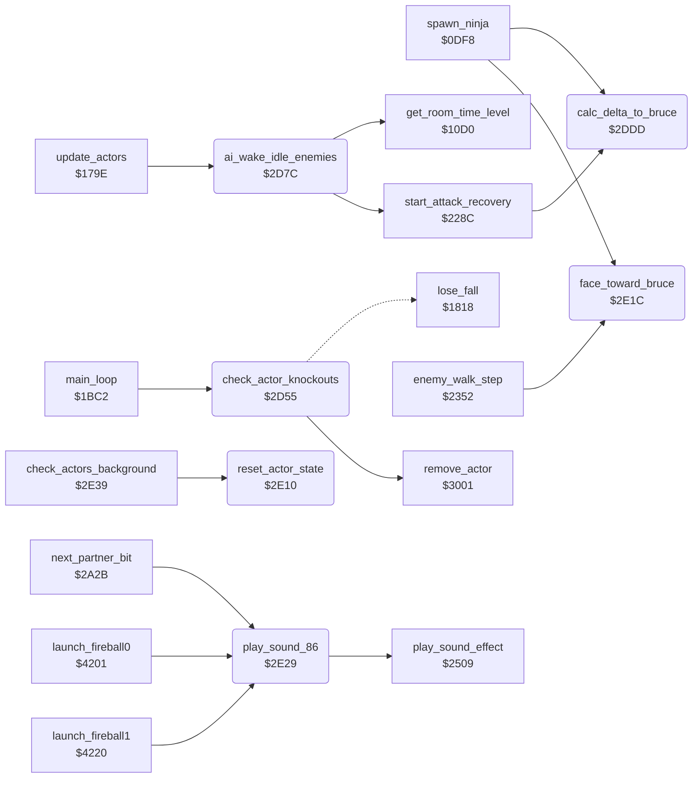

<!-- Generated by c64-docs from knowledge revision 20261016T170255.379-vv114c and src/source-map.json. Do not edit: change the knowledge, generate the source again, then run generate.ts. -->
# actor_checks.asm: Actor knockout check, enemy AI wake-up, distance and facing helpers

Range `$2D55-$2E38`. Source: [actor_checks.asm](../../../src/actor_checks.asm). Index: [the reference](../index.md).

## Call graph

A solid arrow is a call, a thick arrow a table entry, a dotted arrow a jump. Rounded nodes are in this file.

## Names

### [`check_actor_knockouts`](../../../src/actor_checks.asm#L6) `$2D55`

*routine*

Each frame: for every active actor whose energy (actor_energy) went negative, except while state $13/$19 still has a running timer: Bruce -> JMP $1818 (lose a fall), enemy -> remove_actor.

- **Called from:** [`main_loop`](main_loop.md#main_loop) [`$1C2F`](../../../src/main_loop.asm#L58)
- **Calls:** [`remove_actor`](background_touch.md#remove_actor)
- **Jumps to:** [`lose_fall`](game_over.md#lose_fall)
- **Reads:** [`actor_flags+2`](../variables.md#actor_flags), [`actor_state+2`](../variables.md#actor_state), [`actor_state_timer+2`](../variables.md#actor_state_timer), [`actor_energy+2`](../variables.md#actor_energy)

### [`bruce_knocked_out`](../../../src/actor_checks.asm#L30) `$2D79`

*label*

Bruce out of energy: lose a fall

- **Jumped to from:** [`check_actor_knockouts`](actor_checks.md#check_actor_knockouts) [`$2D70`](../../../src/actor_checks.asm#L24)

### [`ai_wake_idle_enemies`](../../../src/actor_checks.asm#L33) `$2D7C`

*routine*

For each live computer-controlled enemy (type bit 7 only when $42CA=0, type bit 6 always) that is idle (state 0, timer 0) with background-contact bit 0 or 2 set: starts state $14 with timer $14; if its previous state was $0C/$0D it instead resets it to idle with a recovery timer ($18, or 1/3 by random and game cycle).

- **Called from:** [`update_actors`](actor_input.md#update_actors) [`$179E`](../../../src/actor_input.asm#L7)
- **Calls:** [`start_attack_recovery`](object_actions.md#start_attack_recovery), [`get_room_time_level`](room_state.md#get_room_time_level)
- **Reads:** [`actor_energy+1`](../variables.md#actor_energy), [`actor_energy+2`](../variables.md#actor_energy), [`human_opponent_mode`](variables.md#human_opponent_mode), [`actor_flags+1`](../variables.md#actor_flags), [`actor_flags+2`](../variables.md#actor_flags), [`actor_state+1`](../variables.md#actor_state), [`actor_state+2`](../variables.md#actor_state), [`actor_state_timer+1`](../variables.md#actor_state_timer), [`actor_state_timer+2`](../variables.md#actor_state_timer), [`actor_contact+1`](../variables.md#actor_contact), [`actor_contact+2`](../variables.md#actor_contact), [`actor_prev_state+1`](../variables.md#actor_prev_state), [`actor_prev_state+2`](../variables.md#actor_prev_state), [`game_cycle`](../variables.md#game_cycle)
- **Writes:** [`actor_state+2`](../variables.md#actor_state), [`actor_state_timer+2`](../variables.md#actor_state_timer), [`actor_step_delay+2`](../variables.md#actor_step_delay)

### [`calc_delta_to_bruce`](../../../src/actor_checks.asm#L92) `$2DDD`

*routine*

For actor X: delta_y_to_bruce/delta_x_to_bruce = |actor - Bruce| on Y/X, clamped to $30, bit 7 set when Bruce is below/right of the actor.

- **Called from:** [`spawn_ninja`](actors.md#spawn_ninja) [`$0E1B`](../../../src/actors.asm#L372), [`start_attack_recovery`](object_actions.md#start_attack_recovery) [`$2300`](../../../src/object_actions.asm#L433)
- **Reads:** [`actor_y`](../variables.md#actor_y), [`actor_x`](../variables.md#actor_x)
- **Writes:** [`delta_y_to_bruce`](../variables.md#delta_y_to_bruce), [`delta_x_to_bruce`](../variables.md#delta_x_to_bruce)

### [`reset_actor_state`](../../../src/actor_checks.asm#L129) `$2E10`

*routine*

Sets actor X to state 0 with timer 0 and action delay 0.

- **Called from:** [`check_actors_background`](background_touch.md#check_actors_background) [`$2E52`](../../../src/background_touch.asm#L20)

### [`face_toward_bruce`](../../../src/actor_checks.asm#L137) `$2E1C`

*routine*

Sets actor_facing,X to 1 (right) when Bruce is to the right of the actor (delta_x_to_bruce bit 7), else 0.

- **Called from:** [`spawn_ninja`](actors.md#spawn_ninja) [`$0E1E`](../../../src/actors.asm#L373), [`enemy_walk_step`](object_actions.md#enemy_walk_step) [`$2366`](../../../src/object_actions.asm#L497)
- **Reads:** [`delta_x_to_bruce`](../variables.md#delta_x_to_bruce)

### [`play_sound_86`](../../../src/actor_checks.asm#L148) `$2E29`

*routine*

Plays sound effect $86 through $2509; keeps A, X and Y.

- **Called from:** [`next_partner_bit`](combat_hits.md#next_partner_bit) [`$2AC0`](../../../src/combat_hits.asm#L150), [`next_partner_bit`](combat_hits.md#next_partner_bit) [`$2AE6`](../../../src/combat_hits.asm#L170), [`next_partner_bit`](combat_hits.md#next_partner_bit) [`$2B2C`](../../../src/combat_hits.asm#L206), [`launch_fireball0`](fireballs.md#launch_fireball0) [`$421D`](../../../src/fireballs.asm#L136), [`launch_fireball1`](fireballs.md#launch_fireball1) [`$423C`](../../../src/fireballs.asm#L150)
- **Calls:** [`play_sound_effect`](sound_effects.md#play_sound_effect)
