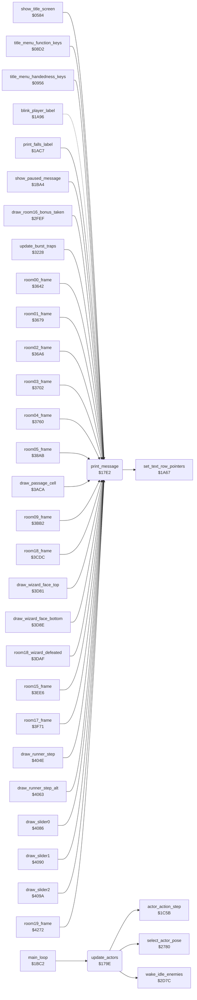

<!-- Generated by c64-docs from knowledge revision 20261018T152957.577-ll4gr6 and src/source-map.json. Do not edit: change the knowledge, generate the source again, then run docs.ts generate. -->
# actor_driver_text.asm: Actor update driver and message printing

Range `$179E-$1817`. Source: [actor_driver_text.asm](../../../src/actor_driver_text.asm). Index: [the reference](../index.md).

## Call graph

A solid arrow is a call, a thick arrow a table entry, a dotted arrow a jump. Rounded nodes are in this file.

## Names

### [`update_actors`](../../../src/actor_driver_text.asm#L10) `$179E`

*routine*

Actor step of the main loop. Calls wake_idle_enemies, then in the demo reads one byte of the demo stream (demo_input_ptr, from demo_input_stream): low nybble = joystick bits of Bruce (actor_joy_dir), high nybble = fire (actor_fire). Then for each active actor (X = 2 Ninja, 1 Yamo, 0 Bruce; bit 0 of actor_flags) it calls actor_action_step and select_actor_pose. In room 19 the joystick of Bruce is forced: up while the room_time high byte is below 2 (512 frames), then no input.

- **Called from:** [`main_loop`](game_main_loop.md#main_loop) [`$1C29`](../../../src/game_main_loop.asm#L79)
- **Calls:** [`wake_idle_enemies`](actor_helpers.md#wake_idle_enemies), [`actor_action_step`](actor_step.md#actor_action_step), [`select_actor_pose`](actor_poses.md#select_actor_pose)
- **Reads:** [`game_mode`](../memory-map.md#game_mode), [`demo_input_ptr`](../memory-map.md#demo_input_ptr), [`demo_input_ptr+1`](../memory-map.md#demo_input_ptr), [`actor_flags+1`](../memory-map.md#actor_flags), [`actor_flags+2`](../memory-map.md#actor_flags), [`room`](../memory-map.md#room), [`room_time+1`](../memory-map.md#room_time)
- **Writes:** [`actor_joy_dir`](../memory-map.md#actor_joy_dir), [`actor_fire`](../memory-map.md#actor_fire), [`demo_input_ptr`](../memory-map.md#demo_input_ptr), [`demo_input_ptr+1`](../memory-map.md#demo_input_ptr)
- **Refers to:** [`demo_input_ptr`](../memory-map.md#demo_input_ptr), [`room_time`](../memory-map.md#room_time)

### [`update_actors_start`](../../../src/actor_driver_text.asm#L27) `$17BC`

*label*

- **Jumped to from:** [`update_actors`](actor_driver_text.md#update_actors) [`$17A4`](../../../src/actor_driver_text.asm#L13), [`update_actors`](actor_driver_text.md#update_actors) [`$17B8`](../../../src/actor_driver_text.asm#L25)

### [`update_actors_loop`](../../../src/actor_driver_text.asm#L29) `$17BE`

*label*

- **Jumped to from:** [`update_actors`](actor_driver_text.md#update_actors) [`$17DF`](../../../src/actor_driver_text.asm#L50)

### [`update_actors_no_input`](../../../src/actor_driver_text.asm#L41) `$17D4`

*label*

no direction

- **Jumped to from:** [`update_actors`](actor_driver_text.md#update_actors) [`$17CE`](../../../src/actor_driver_text.asm#L38)

### [`update_actors_store_input`](../../../src/actor_driver_text.asm#L43) `$17D6`

*label*

- **Jumped to from:** [`update_actors`](actor_driver_text.md#update_actors) [`$17D2`](../../../src/actor_driver_text.asm#L40)

### [`update_actors_step`](../../../src/actor_driver_text.asm#L45) `$17D8`

*label*

- **Jumped to from:** [`update_actors`](actor_driver_text.md#update_actors) [`$17C8`](../../../src/actor_driver_text.asm#L35)

### [`update_actors_next`](../../../src/actor_driver_text.asm#L48) `$17DE`

*label*

- **Jumped to from:** [`update_actors`](actor_driver_text.md#update_actors) [`$17C2`](../../../src/actor_driver_text.asm#L32)

### [`print_message`](../../../src/actor_driver_text.asm#L59) `$17E2`

*routine*

Print message A (pointer table message_ptrs) on text row X at offset Y from the row start. Text row 0 = screen row 0, row 1 = screen row 1, row n >= 2 = screen rows 2n-1 and 2n (text_line_top_lo/hi and text_line_bottom_lo/hi, built by build_screen_row_tables). Each message byte b gives character c = b - $20: c AND $7F goes to the upper screen row and c OR $80 to the lower row, so text is two rows high. Byte $A0 ends the message. When text_single_height is nonzero the lower row goes to io1_dummy (lost), so the text is one row high. Rows 0 and 1 are always one row high. Uses row_ptr_top, data_ptr and row_ptr_bottom. Changes A, X, Y.

- **Called from:** [`show_title_screen`](title_demo_start.md#show_title_screen) [`$0656`](../../../src/title_demo_start.asm#L176), [`show_title_screen`](title_demo_start.md#show_title_screen) [`$065F`](../../../src/title_demo_start.asm#L180), [`show_title_screen`](title_demo_start.md#show_title_screen) [`$0668`](../../../src/title_demo_start.asm#L184), [`title_menu_function_keys`](title_menu.md#title_menu_function_keys) [`$08F2`](../../../src/title_menu.asm#L47), [`title_menu_handedness_keys`](title_menu.md#title_menu_handedness_keys) [`$096F`](../../../src/title_menu.asm#L121), [`title_menu_handedness_keys`](title_menu.md#title_menu_handedness_keys) [`$097E`](../../../src/title_menu.asm#L129), [`title_menu_handedness_keys`](title_menu.md#title_menu_handedness_keys) [`$098E`](../../../src/title_menu.asm#L137), [`title_menu_handedness_keys`](title_menu.md#title_menu_handedness_keys) [`$099E`](../../../src/title_menu.asm#L145), [`print_falls_label`](pause_status_line.md#print_falls_label) [`$1ACD`](../../../src/pause_status_line.asm#L181), [`show_paused_message`](status_and_keys.md#show_paused_message) [`$1BAD`](../../../src/status_and_keys.asm#L149), [`draw_room16_bonus_taken`](touch_effects.md#draw_room16_bonus_taken) [`$2FF5`](../../../src/touch_effects.asm#L30), [`draw_room16_bonus_taken`](touch_effects.md#draw_room16_bonus_taken) [`$2FFE`](../../../src/touch_effects.asm#L34), [`update_burst_traps`](room_misc_support.md#update_burst_traps) [`$324B`](../../../src/room_misc_support.asm#L54), [`update_burst_traps`](room_misc_support.md#update_burst_traps) [`$325A`](../../../src/room_misc_support.asm#L61), [`update_burst_traps`](room_misc_support.md#update_burst_traps) [`$326D`](../../../src/room_misc_support.asm#L70), [`update_burst_traps`](room_misc_support.md#update_burst_traps) [`$327C`](../../../src/room_misc_support.asm#L77), [`update_burst_traps`](room_misc_support.md#update_burst_traps) [`$3293`](../../../src/room_misc_support.asm#L89), [`update_burst_traps`](room_misc_support.md#update_burst_traps) [`$32B5`](../../../src/room_misc_support.asm#L108), [`room00_frame`](room_frames_0_7.md#room00_frame) [`$365F`](../../../src/room_frames_0_7.asm#L25), [`room00_frame`](room_frames_0_7.md#room00_frame) [`$366D`](../../../src/room_frames_0_7.asm#L32), [`room01_frame`](room_frames_0_7.md#room01_frame) [`$36A2`](../../../src/room_frames_0_7.asm#L64), [`room02_frame`](room_frames_0_7.md#room02_frame) [`$36C3`](../../../src/room_frames_0_7.asm#L101), [`room02_frame`](room_frames_0_7.md#room02_frame) [`$36CC`](../../../src/room_frames_0_7.asm#L105), [`room02_frame`](room_frames_0_7.md#room02_frame) [`$36E8`](../../../src/room_frames_0_7.asm#L118), [`room02_frame`](room_frames_0_7.md#room02_frame) [`$36F6`](../../../src/room_frames_0_7.asm#L125), [`room03_frame`](room_frames_0_7.md#room03_frame) [`$3723`](../../../src/room_frames_0_7.asm#L154), [`room03_frame`](room_frames_0_7.md#room03_frame) [`$373F`](../../../src/room_frames_0_7.asm#L169), [`room03_frame`](room_frames_0_7.md#room03_frame) [`$3748`](../../../src/room_frames_0_7.asm#L173), [`room03_frame`](room_frames_0_7.md#room03_frame) [`$3754`](../../../src/room_frames_0_7.asm#L179), [`room03_frame`](room_frames_0_7.md#room03_frame) [`$375D`](../../../src/room_frames_0_7.asm#L183), [`room04_frame`](room_frames_0_7.md#room04_frame) [`$3775`](../../../src/room_frames_0_7.asm#L205), [`room04_frame`](room_frames_0_7.md#room04_frame) [`$378A`](../../../src/room_frames_0_7.asm#L215), [`room04_frame`](room_frames_0_7.md#room04_frame) [`$37A3`](../../../src/room_frames_0_7.asm#L227), [`room04_frame`](room_frames_0_7.md#room04_frame) [`$37AC`](../../../src/room_frames_0_7.asm#L231), [`room04_frame`](room_frames_0_7.md#room04_frame) [`$37C9`](../../../src/room_frames_0_7.asm#L245), [`room04_frame`](room_frames_0_7.md#room04_frame) [`$37DE`](../../../src/room_frames_0_7.asm#L255), [`room04_frame`](room_frames_0_7.md#room04_frame) [`$3800`](../../../src/room_frames_0_7.asm#L271), [`room04_frame`](room_frames_0_7.md#room04_frame) [`$3809`](../../../src/room_frames_0_7.asm#L275), [`room05_frame`](room_frames_0_7.md#room05_frame) [`$38E5`](../../../src/room_frames_0_7.asm#L406), [`room05_frame`](room_frames_0_7.md#room05_frame) [`$3904`](../../../src/room_frames_0_7.asm#L424) and 29 more
- **Jumped to from:** [`blink_player_label`](pause_status_line.md#blink_player_label) [`$1AA5`](../../../src/pause_status_line.asm#L155), [`blink_player_label`](pause_status_line.md#blink_player_label) [`$1AB7`](../../../src/pause_status_line.asm#L165)
- **Calls:** [`set_text_row_pointers`](pause_status_line.md#set_text_row_pointers)
- **Reads:** [`data_ptr`](../memory-map.md#data_ptr), [`row_ptr_top`](../memory-map.md#row_ptr_top), [`row_ptr_bottom`](../memory-map.md#row_ptr_bottom), [`row_ptr_top+1`](../memory-map.md#row_ptr_top), [`data_ptr+1`](../memory-map.md#data_ptr), [`row_ptr_bottom+1`](../memory-map.md#row_ptr_bottom)
- **Writes:** [`data_ptr`](../memory-map.md#data_ptr), [`data_ptr+1`](../memory-map.md#data_ptr), [`row_ptr_top+1`](../memory-map.md#row_ptr_top), [`row_ptr_bottom+1`](../memory-map.md#row_ptr_bottom)
- **Refers to:** [`message_ptrs`](messages.md#message_ptrs), [`message_ptrs+1`](messages.md#message_ptrs), [`data_ptr`](../memory-map.md#data_ptr), [`row_ptr_top`](../memory-map.md#row_ptr_top), [`row_ptr_bottom`](../memory-map.md#row_ptr_bottom)

### [`print_message_loop`](../../../src/actor_driver_text.asm#L73) `$17FA`

*label*

- **Jumped to from:** [`print_message`](actor_driver_text.md#print_message) [`$180C`](../../../src/actor_driver_text.asm#L84), [`print_message`](actor_driver_text.md#print_message) [`$1814`](../../../src/actor_driver_text.asm#L89)

### [`print_message_done`](../../../src/actor_driver_text.asm#L90) `$1817`

*label*

- **Jumped to from:** [`print_message`](actor_driver_text.md#print_message) [`$1801`](../../../src/actor_driver_text.asm#L78)
