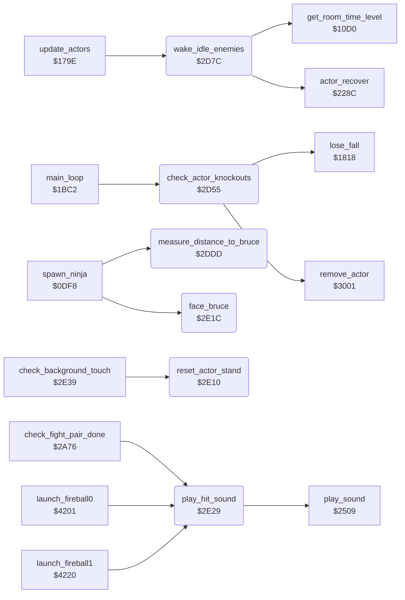

<!-- Generated by c64-docs from knowledge revision 20261017T121733.607-wszjh3 and src/source-map.json. Do not edit: change the knowledge, generate the source again, then run generate.ts. -->
# actor_helpers.asm: Actor helpers: knock-out removal, waking enemies, distance and facing to Bruce

Range `$2D55-$2E38`. Source: [actor_helpers.asm](../../../src/actor_helpers.asm). Index: [the reference](../index.md).

## Call graph

A solid arrow is a call, a thick arrow a table entry, a dotted arrow a jump. Rounded nodes are in this file.

## Names

### [`check_actor_knockouts`](../../../src/actor_helpers.asm#L8) `$2D55`

*routine*

Main loop: for each active actor whose actor_energy,X is below 0 (knocked out), except while the timer of state $13 (knocked down) or $19 (dying) still runs: an enemy is removed (remove_actor), Bruce loses a fall (lose_fall, does not return).

- **Called from:** [`main_loop`](game_main_loop.md#main_loop) [`$1C2F`](../../../src/game_main_loop.asm#L81)
- **Calls:** [`remove_actor`](touch_effects.md#remove_actor), [`lose_fall`](lose_fall_game_over.md#lose_fall)
- **Reads:** [`actor_flags+1`](../variables.md#actor_flags), [`actor_flags+2`](../variables.md#actor_flags), [`actor_state+1`](../variables.md#actor_state), [`actor_state+2`](../variables.md#actor_state), [`actor_timer+1`](../variables.md#actor_timer), [`actor_timer+2`](../variables.md#actor_timer), [`actor_energy+1`](../variables.md#actor_energy), [`actor_energy+2`](../variables.md#actor_energy)

### [`check_actor_knockouts_loop`](../../../src/actor_helpers.asm#L10) `$2D57`

*label*

- **Jumped to from:** [`check_actor_knockouts`](actor_helpers.md#check_actor_knockouts) [`$2D76`](../../../src/actor_helpers.asm#L30)

### [`check_actor_knockouts_timer`](../../../src/actor_helpers.asm#L19) `$2D67`

*label*

- **Jumped to from:** [`check_actor_knockouts`](actor_helpers.md#check_actor_knockouts) [`$2D61`](../../../src/actor_helpers.asm#L16)

### [`check_actor_knockouts_energy`](../../../src/actor_helpers.asm#L22) `$2D6B`

*label*

- **Jumped to from:** [`check_actor_knockouts`](actor_helpers.md#check_actor_knockouts) [`$2D65`](../../../src/actor_helpers.asm#L18)

### [`check_actor_knockouts_next`](../../../src/actor_helpers.asm#L28) `$2D75`

*label*

- **Jumped to from:** [`check_actor_knockouts`](actor_helpers.md#check_actor_knockouts) [`$2D5B`](../../../src/actor_helpers.asm#L13), [`check_actor_knockouts`](actor_helpers.md#check_actor_knockouts) [`$2D69`](../../../src/actor_helpers.asm#L21), [`check_actor_knockouts`](actor_helpers.md#check_actor_knockouts) [`$2D6D`](../../../src/actor_helpers.asm#L24)

### [`check_actor_knockouts_bruce`](../../../src/actor_helpers.asm#L33) `$2D79`

*label*

Observed: the attract demo ends here, about 1714 frames after start_attract_demo, when Bruce is knocked out (lose_fall with game_mode = 0 goes to show_title_screen); demo_input_ptr was $F539 (569 bytes read).
Bruce: lose a fall

- **Jumped to from:** [`check_actor_knockouts`](actor_helpers.md#check_actor_knockouts) [`$2D70`](../../../src/actor_helpers.asm#L26)

### [`wake_idle_enemies`](../../../src/actor_helpers.asm#L40) `$2D7C`

*routine*

update_actors calls it. For Yamo (only when option_yamo_player2 = 0) and the Ninja: when the enemy has energy left, stands (state 0, timer 0) and has terrain flag bit 0 or 2 (floor, ladder or vine), it starts state $14 (AI chase) with timer $14, unless its previous state actor_prev_state,X is a flying kick ($0C/$0D): then it recovers (actor_recover) and pauses: actor_timer = $18, or 3 (C) / 1 (V or game_loop_count nonzero) by get_room_time_level.

- **Called from:** [`update_actors`](actor_driver_text.md#update_actors) [`$179E`](../../../src/actor_driver_text.asm#L11)
- **Calls:** [`actor_recover`](actor_timed_actions.md#actor_recover), [`get_room_time_level`](game_setup.md#get_room_time_level)
- **Reads:** [`actor_energy+1`](../variables.md#actor_energy), [`actor_energy+2`](../variables.md#actor_energy), [`option_yamo_player2`](options_and_patterns.md#option_yamo_player2), [`actor_flags+1`](../variables.md#actor_flags), [`actor_flags+2`](../variables.md#actor_flags), [`actor_state+1`](../variables.md#actor_state), [`actor_state+2`](../variables.md#actor_state), [`actor_timer+1`](../variables.md#actor_timer), [`actor_timer+2`](../variables.md#actor_timer), [`actor_contact+1`](../variables.md#actor_contact), [`actor_contact+2`](../variables.md#actor_contact), [`actor_prev_state+1`](../variables.md#actor_prev_state), [`actor_prev_state+2`](../variables.md#actor_prev_state), [`game_loop_count`](../variables.md#game_loop_count)
- **Writes:** [`actor_state+2`](../variables.md#actor_state), [`actor_timer+2`](../variables.md#actor_timer), [`actor_step_delay+2`](../variables.md#actor_step_delay), [`actor_timer+1`](../variables.md#actor_timer)

### [`wake_idle_enemies_loop`](../../../src/actor_helpers.asm#L42) `$2D7E`

*label*

- **Jumped to from:** [`wake_idle_enemies`](actor_helpers.md#wake_idle_enemies) [`$2DBD`](../../../src/actor_helpers.asm#L77)

### [`wake_idle_enemies_try_ninja`](../../../src/actor_helpers.asm#L51) `$2D8F`

*label*

- **Jumped to from:** [`wake_idle_enemies`](actor_helpers.md#wake_idle_enemies) [`$2D85`](../../../src/actor_helpers.asm#L46)

### [`wake_idle_enemies_check`](../../../src/actor_helpers.asm#L56) `$2D97`

*label*

- **Jumped to from:** [`wake_idle_enemies`](actor_helpers.md#wake_idle_enemies) [`$2D8D`](../../../src/actor_helpers.asm#L50)

### [`wake_idle_enemies_next`](../../../src/actor_helpers.asm#L75) `$2DBC`

*label*

- **Jumped to from:** [`wake_idle_enemies`](actor_helpers.md#wake_idle_enemies) [`$2D80`](../../../src/actor_helpers.asm#L44), [`wake_idle_enemies`](actor_helpers.md#wake_idle_enemies) [`$2D95`](../../../src/actor_helpers.asm#L55), [`wake_idle_enemies`](actor_helpers.md#wake_idle_enemies) [`$2D9B`](../../../src/actor_helpers.asm#L59), [`wake_idle_enemies`](actor_helpers.md#wake_idle_enemies) [`$2D9F`](../../../src/actor_helpers.asm#L61), [`wake_idle_enemies`](actor_helpers.md#wake_idle_enemies) [`$2DA5`](../../../src/actor_helpers.asm#L64)

### [`wake_idle_enemies_kick`](../../../src/actor_helpers.asm#L80) `$2DC0`

*label*

After a flying kick: recover and pause before the next chase.

- **Jumped to from:** [`wake_idle_enemies`](actor_helpers.md#wake_idle_enemies) [`$2DAB`](../../../src/actor_helpers.asm#L67), [`wake_idle_enemies`](actor_helpers.md#wake_idle_enemies) [`$2DAF`](../../../src/actor_helpers.asm#L69)

### [`wake_idle_enemies_pause_3`](../../../src/actor_helpers.asm#L90) `$2DD3`

*label*

- **Jumped to from:** [`wake_idle_enemies`](actor_helpers.md#wake_idle_enemies) [`$2DCC`](../../../src/actor_helpers.asm#L86)

### [`wake_idle_enemies_pause_1`](../../../src/actor_helpers.asm#L95) `$2DD8`

*label*

- **Jumped to from:** [`wake_idle_enemies`](actor_helpers.md#wake_idle_enemies) [`$2DCA`](../../../src/actor_helpers.asm#L85), [`wake_idle_enemies`](actor_helpers.md#wake_idle_enemies) [`$2DD0`](../../../src/actor_helpers.asm#L88)

### [`measure_distance_to_bruce`](../../../src/actor_helpers.asm#L102) `$2DDD`

*routine*

For actor X: bruce_dist_y = |Y - Bruce Y| and bruce_dist_x = |X - Bruce X|, each at most $30. Bit 7 of bruce_dist_y is set when the actor is above Bruce, bit 7 of bruce_dist_x when it is left of Bruce. Used by the enemy AI. Changes A.

- **Called from:** [`spawn_ninja`](actor_spawn.md#spawn_ninja) [`$0E1B`](../../../src/actor_spawn.asm#L415), [`$2300`](../../../src/enemy_ai_states.asm#L17)
- **Reads:** [`actor_y`](../variables.md#actor_y), [`actor_x`](../variables.md#actor_x)
- **Writes:** [`bruce_dist_y`](../variables.md#bruce_dist_y), [`bruce_dist_x`](../variables.md#bruce_dist_x)

### [`measure_distance_cap_y`](../../../src/actor_helpers.asm#L110) `$2DE9`

*label*

- **Jumped to from:** [`measure_distance_to_bruce`](actor_helpers.md#measure_distance_to_bruce) [`$2DE3`](../../../src/actor_helpers.asm#L107)

### [`measure_distance_sign_y`](../../../src/actor_helpers.asm#L114) `$2DEF`

*label*

- **Jumped to from:** [`measure_distance_to_bruce`](actor_helpers.md#measure_distance_to_bruce) [`$2DEB`](../../../src/actor_helpers.asm#L112)

### [`measure_distance_store_y`](../../../src/actor_helpers.asm#L118) `$2DF4`

*label*

- **Jumped to from:** [`measure_distance_to_bruce`](actor_helpers.md#measure_distance_to_bruce) [`$2DF0`](../../../src/actor_helpers.asm#L116)

### [`measure_distance_cap_x`](../../../src/actor_helpers.asm#L127) `$2E02`

*label*

- **Jumped to from:** [`measure_distance_to_bruce`](actor_helpers.md#measure_distance_to_bruce) [`$2DFC`](../../../src/actor_helpers.asm#L124)

### [`measure_distance_sign_x`](../../../src/actor_helpers.asm#L131) `$2E08`

*label*

- **Jumped to from:** [`measure_distance_to_bruce`](actor_helpers.md#measure_distance_to_bruce) [`$2E04`](../../../src/actor_helpers.asm#L129)

### [`measure_distance_store_x`](../../../src/actor_helpers.asm#L135) `$2E0D`

*label*

- **Jumped to from:** [`measure_distance_to_bruce`](actor_helpers.md#measure_distance_to_bruce) [`$2E09`](../../../src/actor_helpers.asm#L133)

### [`reset_actor_stand`](../../../src/actor_helpers.asm#L139) `$2E10`

*routine*

Sets actor X to state 0 (stand) with actor_timer,X = 0 and actor_step_delay,X = 0.

- **Called from:** [`check_background_touch`](background_touch.md#check_background_touch) [`$2E52`](../../../src/background_touch.asm#L24)
- **Refers to:** [`actor_step_delay`](../variables.md#actor_step_delay)

### [`face_bruce`](../../../src/actor_helpers.asm#L148) `$2E1C`

*routine*

Turns actor X toward Bruce from the sign bit of bruce_dist_x (measure_distance_to_bruce): actor_facing,X = 1 (right) when the actor is left of Bruce, else 0.

- **Called from:** [`spawn_ninja`](actor_spawn.md#spawn_ninja) [`$0E1E`](../../../src/actor_spawn.asm#L416), [`$2366`](../../../src/enemy_ai_states.asm#L81)
- **Reads:** [`bruce_dist_x`](../variables.md#bruce_dist_x)

### [`face_bruce_left`](../../../src/actor_helpers.asm#L153) `$2E24`

*label*

- **Jumped to from:** [`face_bruce`](actor_helpers.md#face_bruce) [`$2E1E`](../../../src/actor_helpers.asm#L150)

### [`face_bruce_store`](../../../src/actor_helpers.asm#L155) `$2E26`

*label*

- **Jumped to from:** [`face_bruce`](actor_helpers.md#face_bruce) [`$2E22`](../../../src/actor_helpers.asm#L152)

### [`play_hit_sound`](../../../src/actor_helpers.asm#L159) `$2E29`

*routine*

Starts sound effect $86 (hit). Keeps A, X and Y.

- **Called from:** [`check_fight_pair_done`](fight_hits.md#check_fight_pair_done) [`$2AC0`](../../../src/fight_hits.asm#L166), [`check_fight_pair_done`](fight_hits.md#check_fight_pair_done) [`$2AE6`](../../../src/fight_hits.asm#L186), [`check_fight_pair_done`](fight_hits.md#check_fight_pair_done) [`$2B2C`](../../../src/fight_hits.asm#L225), [`launch_fireball0`](wizard_fireballs.md#launch_fireball0) [`$421D`](../../../src/wizard_fireballs.asm#L153), [`launch_fireball1`](wizard_fireballs.md#launch_fireball1) [`$423C`](../../../src/wizard_fireballs.asm#L168)
- **Calls:** [`play_sound`](sound_request.md#play_sound)
