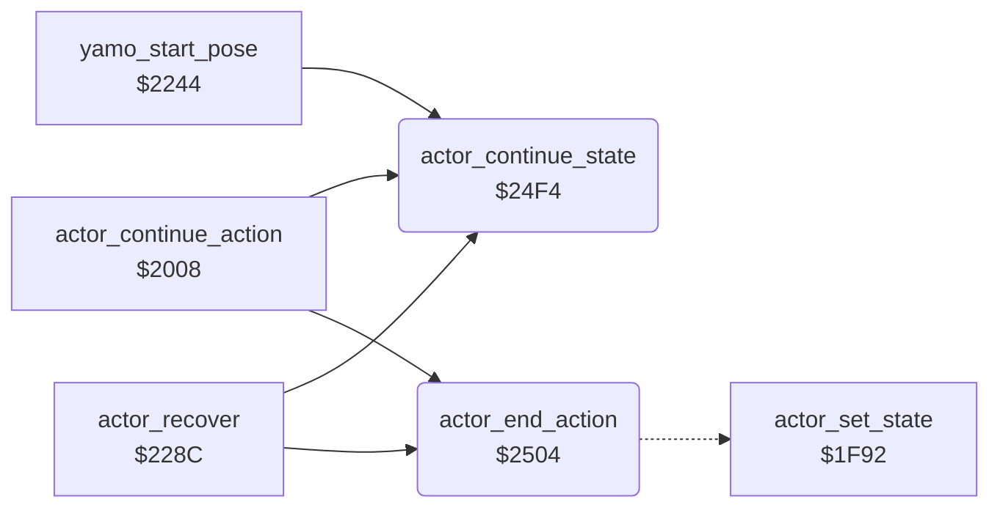

<!-- Generated by c64-docs from knowledge revision 20261017T124710.947-seivas and src/source-map.json. Do not edit: change the knowledge, generate the source again, then run generate.ts. -->
# actor_hit_states.asm: Actor states after a hit (Yamo pose, recoil, knocked down), wall bump and the state continuation setters

Range `$2407-$2508`. Source: [actor_hit_states.asm](../../../src/actor_hit_states.asm). Index: [the reference](../index.md).

## Call graph

A solid arrow is a call, a thick arrow a table entry, a dotted arrow a jump. Rounded nodes are in this file.

## Names

### [`act_check_yamo_pose`](../../../src/actor_hit_states.asm#L5) `$2407`

*label*

state $12 Yamo pose: only the timer runs

- **Jumped to from:** [`$23CF`](../../../src/enemy_ai_states.asm#L148)

### [`act_check_recoil`](../../../src/actor_hit_states.asm#L9) `$240E`

*label*

state $0F recoil

- **Jumped to from:** [`$2409`](../../../src/actor_hit_states.asm#L7)

### [`act_recoil_push`](../../../src/actor_hit_states.asm#L18) `$2419`

*label*

- **Jumped to from:** [`$2413`](../../../src/actor_hit_states.asm#L15)

### [`act_recoil_push_right`](../../../src/actor_hit_states.asm#L28) `$242E`

*label*

- **Jumped to from:** [`$241D`](../../../src/actor_hit_states.asm#L21)

### [`act_recoil_end`](../../../src/actor_hit_states.asm#L35) `$243D`

*label*

- **Jumped to from:** [`$2417`](../../../src/actor_hit_states.asm#L17)

### [`act_check_knocked_down`](../../../src/actor_hit_states.asm#L37) `$2440`

*label*

state $13 knocked down

- **Jumped to from:** [`$2410`](../../../src/actor_hit_states.asm#L11)

### [`act_knocked_down_fall`](../../../src/actor_hit_states.asm#L50) `$244F`

*label*

- **Jumped to from:** [`$2445`](../../../src/actor_hit_states.asm#L45), [`$2449`](../../../src/actor_hit_states.asm#L47)

### [`act_knocked_down_slide`](../../../src/actor_hit_states.asm#L56) `$2458`

*label*

Slide away from the facing direction: 2 units per step, the Ninja 8 (left) or 4 (right) more at timer 10.

- **Jumped to from:** [`$2453`](../../../src/actor_hit_states.asm#L53)

### [`act_knocked_down_left_two`](../../../src/actor_hit_states.asm#L72) `$247E`

*label*

- **Jumped to from:** [`$2460`](../../../src/actor_hit_states.asm#L61), [`$2464`](../../../src/actor_hit_states.asm#L63)

### [`act_knocked_down_right`](../../../src/actor_hit_states.asm#L79) `$248D`

*label*

- **Jumped to from:** [`$245C`](../../../src/actor_hit_states.asm#L59)

### [`act_knocked_down_right_two`](../../../src/actor_hit_states.asm#L88) `$24A1`

*label*

- **Jumped to from:** [`$248F`](../../../src/actor_hit_states.asm#L81), [`$2493`](../../../src/actor_hit_states.asm#L83)

### [`act_knocked_down_end`](../../../src/actor_hit_states.asm#L95) `$24B0`

*label*

- **Jumped to from:** [`$244D`](../../../src/actor_hit_states.asm#L49)

### [`act_check_wall_bump`](../../../src/actor_hit_states.asm#L97) `$24B3`

*label*

state $18 wall bump

- **Jumped to from:** [`$2442`](../../../src/actor_hit_states.asm#L39)

### [`act_wall_bump`](../../../src/actor_hit_states.asm#L104) `$24B7`

*label*

Wall bump (state $18, timer 64). When the actor is out of the wall the state ends at the next step. While it is still in the wall the older moves are undone record by record (actor_undo_last_moves). When the move history is empty, the room restarts through enter_room with Bruce at the room's start point A (spawn_a_x/spawn_a_y), also when the stuck actor is an enemy.

- **Jumped to from:** [`actor_action_step`](actor_step.md#actor_action_step) [`$1CC4`](../../../src/actor_step.asm#L82)

### [`act_wall_bump_still_in`](../../../src/actor_hit_states.asm#L112) `$24C6`

*label*

- **Jumped to from:** [`$24BB`](../../../src/actor_hit_states.asm#L107)

### [`act_wall_bump_scan_history`](../../../src/actor_hit_states.asm#L117) `$24CC`

*label*

- **Jumped to from:** [`$24D3`](../../../src/actor_hit_states.asm#L123)

### [`act_wall_bump_undo_again`](../../../src/actor_hit_states.asm#L137) `$24ED`

*label*

- **Jumped to from:** [`$24D9`](../../../src/actor_hit_states.asm#L128)

### [`actor_continue_state`](../../../src/actor_hit_states.asm#L143) `$24F4`

*routine*

State setter for a running timed action: actor_state,X = A, step delay from actor_state_step_delay, actor_timer,X = temp_y - 1.

- **Called from:** [`actor_continue_action`](actor_timed_actions.md#actor_continue_action) [`$2030`](../../../src/actor_timed_actions.asm#L37), [`actor_continue_action`](actor_timed_actions.md#actor_continue_action) [`$2045`](../../../src/actor_timed_actions.asm#L47), [`actor_continue_action`](actor_timed_actions.md#actor_continue_action) [`$206D`](../../../src/actor_timed_actions.asm#L69), [`actor_continue_action`](actor_timed_actions.md#actor_continue_action) [`$2079`](../../../src/actor_timed_actions.asm#L75), [`actor_continue_action`](actor_timed_actions.md#actor_continue_action) [`$208A`](../../../src/actor_timed_actions.asm#L84), [`actor_continue_action`](actor_timed_actions.md#actor_continue_action) [`$20B2`](../../../src/actor_timed_actions.asm#L105), [`actor_continue_action`](actor_timed_actions.md#actor_continue_action) [`$20BE`](../../../src/actor_timed_actions.asm#L111), [`actor_continue_action`](actor_timed_actions.md#actor_continue_action) [`$20CF`](../../../src/actor_timed_actions.asm#L120), [`actor_continue_action`](actor_timed_actions.md#actor_continue_action) [`$20F0`](../../../src/actor_timed_actions.asm#L138), [`actor_continue_action`](actor_timed_actions.md#actor_continue_action) [`$2102`](../../../src/actor_timed_actions.asm#L147), [`actor_continue_action`](actor_timed_actions.md#actor_continue_action) [`$211D`](../../../src/actor_timed_actions.asm#L160), [`actor_continue_action`](actor_timed_actions.md#actor_continue_action) [`$213E`](../../../src/actor_timed_actions.asm#L177), [`actor_continue_action`](actor_timed_actions.md#actor_continue_action) [`$214D`](../../../src/actor_timed_actions.asm#L184), [`actor_continue_action`](actor_timed_actions.md#actor_continue_action) [`$2168`](../../../src/actor_timed_actions.asm#L197), [`actor_continue_action`](actor_timed_actions.md#actor_continue_action) [`$2232`](../../../src/actor_timed_actions.asm#L314), [`actor_continue_action`](actor_timed_actions.md#actor_continue_action) [`$2241`](../../../src/actor_timed_actions.asm#L323), [`yamo_start_pose`](actor_timed_actions.md#yamo_start_pose) [`$2289`](../../../src/actor_timed_actions.asm#L370), [`actor_recover`](actor_timed_actions.md#actor_recover) [`$22ED`](../../../src/actor_timed_actions.asm#L439), [`$235F`](../../../src/enemy_ai_states.asm#L77), [`$23FC`](../../../src/enemy_ai_states.asm#L173), [`$2404`](../../../src/enemy_ai_states.asm#L177), [`$240B`](../../../src/actor_hit_states.asm#L8), [`$242B`](../../../src/actor_hit_states.asm#L27), [`$243A`](../../../src/actor_hit_states.asm#L34), [`$248A`](../../../src/actor_hit_states.asm#L78), [`$24AD`](../../../src/actor_hit_states.asm#L94), [`$24C3`](../../../src/actor_hit_states.asm#L111)
- **Jumped to from:** [`actor_continue_action`](actor_timed_actions.md#actor_continue_action) [`$2177`](../../../src/actor_timed_actions.asm#L208), [`$24B5`](../../../src/actor_hit_states.asm#L99)
- **Reads:** [`temp_y`](../variables.md#temp_y)
- **Writes:** [`temp_y`](../variables.md#temp_y)
- **Refers to:** [`actor_state_step_delay`](room_tables.md#actor_state_step_delay), [`actor_step_delay`](../variables.md#actor_step_delay)

### [`actor_end_action`](../../../src/actor_hit_states.asm#L153) `$2504`

*routine*

Ends the current action: state 0, timer 0 (through actor_set_state).

- **Called from:** [`actor_continue_action`](actor_timed_actions.md#actor_continue_action) [`$20F3`](../../../src/actor_timed_actions.asm#L140), [`actor_recover`](actor_timed_actions.md#actor_recover) [`$22C7`](../../../src/actor_timed_actions.asm#L418)
- **Jumped to from:** [`actor_continue_action`](actor_timed_actions.md#actor_continue_action) [`$217D`](../../../src/actor_timed_actions.asm#L213)
- **Jumps to:** [`actor_set_state`](actor_step.md#actor_set_state)
