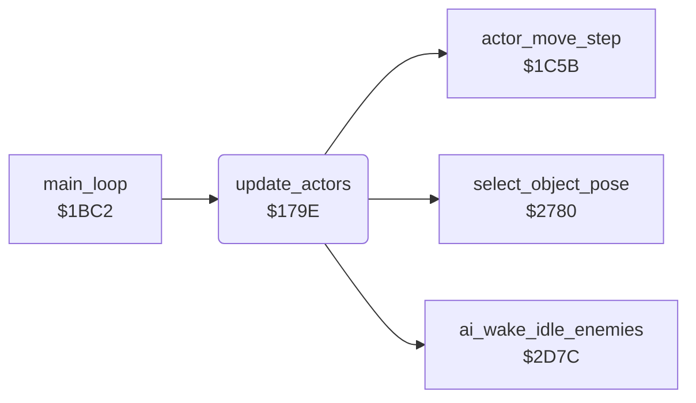

<!-- Generated by c64-docs from knowledge revision 20261016T170255.379-vv114c and src/source-map.json. Do not edit: change the knowledge, generate the source again, then run generate.ts. -->
# actor_input.asm: Actor input (demo stream or joystick) and per-actor update dispatch

Range `$179E-$17E1`. Source: [actor_input.asm](../../../src/actor_input.asm). Index: [the reference](../index.md).

## Call graph

A solid arrow is a call, a thick arrow a table entry, a dotted arrow a jump. Rounded nodes are in this file.

## Names

### [`update_actors`](../../../src/actor_input.asm#L6) `$179E`

*routine*

Per main-loop pass: calls $2D7C, in demo mode takes Bruce's direction (low nibble) and fire (high nibble) from the demo stream at (demo_input_ptr), then for each active actor (2..0) runs actor_move_step and $2780. In room 19 Bruce's direction is overridden: up while room_timer < 2, else none.

- **Called from:** [`main_loop`](main_loop.md#main_loop) [`$1C29`](../../../src/main_loop.asm#L56)
- **Calls:** [`ai_wake_idle_enemies`](actor_checks.md#ai_wake_idle_enemies), [`actor_move_step`](actor_movement.md#actor_move_step), [`select_object_pose`](object_pose.md#select_object_pose)
- **Reads:** [`game_playing`](../variables.md#game_playing), [`demo_input_ptr`](../variables.md#demo_input_ptr), [`demo_input_ptr+1`](../variables.md#demo_input_ptr), [`actor_flags+2`](../variables.md#actor_flags), [`current_room`](../variables.md#current_room), [`room_timer`](../variables.md#room_timer)
- **Writes:** [`actor_joy_dir`](../variables.md#actor_joy_dir), [`actor_joy_fire`](../variables.md#actor_joy_fire), [`demo_input_ptr`](../variables.md#demo_input_ptr), [`demo_input_ptr+1`](../variables.md#demo_input_ptr)
- **Refers to:** [`demo_input_ptr`](../variables.md#demo_input_ptr)
