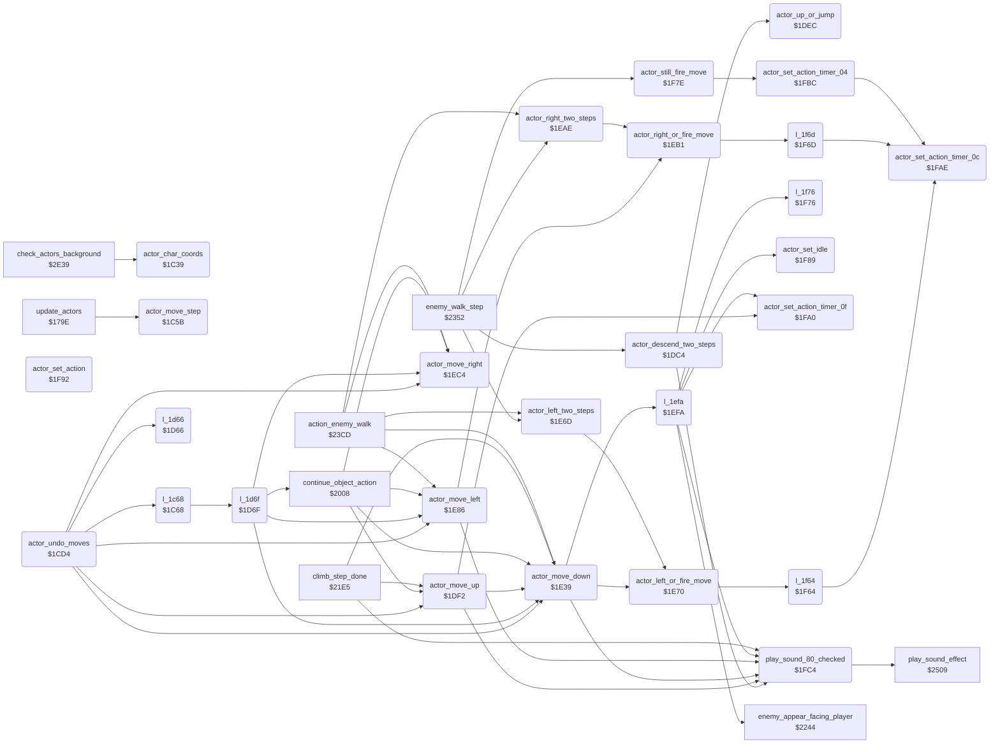

<!-- Generated by c64-docs from knowledge revision 20261016T170255.379-vv114c and src/source-map.json. Do not edit: change the knowledge, generate the source again, then run generate.ts. -->
# actor_movement.asm: Actor movement and action selection from joystick input

Range `$1C39-$2007`. Source: [actor_movement.asm](../../../src/actor_movement.asm). Index: [the reference](../index.md).

## Call graph

A solid arrow is a call, a thick arrow a table entry, a dotted arrow a jump. Rounded nodes are in this file.

The graph shows 53 of the 83 edges: the calls only.

## Data

| Range | Type | Name | Read by | Written by |
|---|---|---|---|---|
| [`$2005`](../../../src/actor_movement.asm#L572)-`$2006` | workspace | [`saved_cia1_ddra`](../../../src/actor_movement.asm#L571) | [`game_frame_update`](frame_update.md#game_frame_update) | [`game_frame_update`](frame_update.md#game_frame_update) |
| [`$2007`](../../../src/actor_movement.asm#L577) | bytes | [`protection_key2`](../../../src/actor_movement.asm#L576) | [`play_sound_80_checked`](actor_movement.md#play_sound_80_checked) | [`main_loop`](main_loop.md#main_loop) |

## Names

### [`actor_char_coords`](../../../src/actor_movement.asm#L6) `$1C39`

*routine*

Converts actor X's position to character cell coordinates: actor_char_x = (actor_x-12)/4, actor_char_y = (actor_y-12)/16 (actor_y+4 in room 13).

- **Called from:** [`check_actors_background`](background_touch.md#check_actors_background) [`$2E5B`](../../../src/background_touch.asm#L25)
- **Reads:** [`current_room`](../variables.md#current_room)

### [`actor_move_step`](../../../src/actor_movement.asm#L32) `$1C5B`

*routine*

One movement step of actor X: waits for actor_anim_delay, records the moves of the last step, then chooses the next action from actor_joy_dir/actor_joy_fire, the terrain flags actor_flags_b6 and the current action, and moves the actor (up to 8 sub-steps).

- **Called from:** [`update_actors`](actor_input.md#update_actors) [`$17D8`](../../../src/actor_input.asm#L42)
- **Jumps to:** [`l_1c68`](../../../src/actor_movement.asm#L39)
- **Writes:** [`undo_rounds_left`](../variables.md#undo_rounds_left)

### [`actor_undo_moves`](../../../src/actor_movement.asm#L98) `$1CD4`

*routine*

Takes back the moves recorded for actor X (up, down, left and right counters at $4F63-$4F6E) and restores the previous move history; then sets action $18 with actor_action_timer $40.

- **Jumped to from:** [`action_enemy_walk`](object_actions.md#action_enemy_walk) [`$24F1`](../../../src/object_actions.asm#L717)
- **Calls:** [`actor_move_down`](actor_movement.md#actor_move_down), [`actor_move_up`](actor_movement.md#actor_move_up), [`actor_move_right`](actor_movement.md#actor_move_right), [`actor_move_left`](actor_movement.md#actor_move_left), [`l_1c68`](../../../src/actor_movement.asm#L39), [`l_1d66`](../../../src/actor_movement.asm#L170)
- **Jumps to:** [`l_1d66`](../../../src/actor_movement.asm#L170)
- **Reads:** [`undo_down_only`](../variables.md#undo_down_only), [`last_key+3`](../variables.md#last_key), [`undo_rounds_left`](../variables.md#undo_rounds_left)
- **Writes:** [`undo_down_only`](../variables.md#undo_down_only), [`last_key+3`](../variables.md#last_key), [`undo_rounds_left`](../variables.md#undo_rounds_left)
- **Refers to:** [`actor_move_history`](actor_vars.md#actor_move_history), [`actor_move_history+3`](actor_vars.md#actor_move_history), [`actor_move_history+6`](actor_vars.md#actor_move_history), [`actor_move_history+9`](actor_vars.md#actor_move_history), [`actor_move_history+12`](actor_vars.md#actor_move_history), [`actor_move_counters`](actor_vars.md#actor_move_counters), [`actor_move_history+96`](actor_vars.md#actor_move_history), [`actor_move_history+99`](actor_vars.md#actor_move_history), [`actor_move_history+102`](actor_vars.md#actor_move_history), [`actor_move_history+105`](actor_vars.md#actor_move_history), [`actor_move_history+108`](actor_vars.md#actor_move_history), [`actor_move_history+111`](actor_vars.md#actor_move_history), [`actor_move_history+114`](actor_vars.md#actor_move_history), [`actor_move_history+117`](actor_vars.md#actor_move_history)

### [`actor_descend_two_steps`](../../../src/actor_movement.asm#L225) `$1DC4`

*routine*

Sets $B0,X to 2, enters at the second jsr actor_move_down ($1DBC), so it moves actor X down one step, and sets action $0E.

- **Called from:** [`enemy_walk_step`](object_actions.md#enemy_walk_step) [`$2378`](../../../src/object_actions.asm#L507)
- **Calls:** [`play_sound_80_checked`](actor_movement.md#play_sound_80_checked), [`actor_up_or_jump`](actor_movement.md#actor_up_or_jump)
- **Jumps to:** [`l_1dbc`](../../../src/actor_movement.asm#L220), [`l_1e13`](../../../src/actor_movement.asm#L272), [`l_1e0c`](../../../src/actor_movement.asm#L268)

### [`actor_up_or_jump`](../../../src/actor_movement.asm#L248) `$1DEC`

*routine*

With terrain bit 2 set moves actor X up; with bit 3 set makes it idle; otherwise starts action 5 with actor_action_timer $0F.

- **Called from:** [`actor_descend_two_steps`](actor_movement.md#actor_descend_two_steps) [`$1DE3`](../../../src/actor_movement.asm#L243), [`actor_descend_two_steps`](actor_movement.md#actor_descend_two_steps) [`$1DE6`](../../../src/actor_movement.asm#L245), [`actor_descend_two_steps`](actor_movement.md#actor_descend_two_steps) [`$1DE9`](../../../src/actor_movement.asm#L246)
- **Jumps to:** [`l_1e08`](../../../src/actor_movement.asm#L265)

### [`actor_move_up`](../../../src/actor_movement.asm#L253) `$1DF2`

*routine*

Moves actor X up one pixel (actor_y-1, top limit $2E) and sets action 1; blocked -> idle.

- **Called from:** [`actor_undo_moves`](actor_movement.md#actor_undo_moves) [`$1CEA`](../../../src/actor_movement.asm#L110), [`continue_object_action`](object_actions.md#continue_object_action) [`$2037`](../../../src/object_actions.asm#L32), [`continue_object_action`](object_actions.md#continue_object_action) [`$203A`](../../../src/object_actions.asm#L33), [`continue_object_action`](object_actions.md#continue_object_action) [`$203D`](../../../src/object_actions.asm#L35), [`continue_object_action`](object_actions.md#continue_object_action) [`$2040`](../../../src/object_actions.asm#L36), [`continue_object_action`](object_actions.md#continue_object_action) [`$2065`](../../../src/object_actions.asm#L56), [`continue_object_action`](object_actions.md#continue_object_action) [`$20AA`](../../../src/object_actions.asm#L95), [`continue_object_action`](object_actions.md#continue_object_action) [`$20E2`](../../../src/object_actions.asm#L123), [`continue_object_action`](object_actions.md#continue_object_action) [`$20E5`](../../../src/object_actions.asm#L125), [`continue_object_action`](object_actions.md#continue_object_action) [`$2130`](../../../src/object_actions.asm#L162), [`continue_object_action`](object_actions.md#continue_object_action) [`$2133`](../../../src/object_actions.asm#L164), [`continue_object_action`](object_actions.md#continue_object_action) [`$21B8`](../../../src/object_actions.asm#L238), [`continue_object_action`](object_actions.md#continue_object_action) [`$21BB`](../../../src/object_actions.asm#L239), [`climb_step_done`](object_actions.md#climb_step_done) [`$2201`](../../../src/object_actions.asm#L276), [`climb_step_done`](object_actions.md#climb_step_done) [`$2204`](../../../src/object_actions.asm#L277)
- **Calls:** [`actor_set_action_timer_0f`](actor_movement.md#actor_set_action_timer_0f), [`play_sound_80_checked`](actor_movement.md#play_sound_80_checked), [`actor_move_down`](actor_movement.md#actor_move_down)
- **Jumps to:** [`actor_set_action`](actor_movement.md#actor_set_action), [`actor_move_blocked`](actor_movement.md#actor_move_blocked), [`l_1e59`](../../../src/actor_movement.asm#L313), [`l_1e49`](../../../src/actor_movement.asm#L302)
- **Refers to:** [`actor_move_counters`](actor_vars.md#actor_move_counters)

### [`actor_move_down`](../../../src/actor_movement.asm#L294) `$1E39`

*routine*

Moves actor X down one pixel (actor_y+1, limit $C7) and sets action 2; blocked -> idle.

- **Called from:** [`actor_undo_moves`](actor_movement.md#actor_undo_moves) [`$1CDF`](../../../src/actor_movement.asm#L105), [`l_1d6f`](../../../src/actor_movement.asm#L176) [`$1DB9`](../../../src/actor_movement.asm#L219), [`l_1d6f`](../../../src/actor_movement.asm#L176) [`$1DBC`](../../../src/actor_movement.asm#L221), [`actor_move_up`](actor_movement.md#actor_move_up) [`$1E30`](../../../src/actor_movement.asm#L289), [`actor_move_up`](actor_movement.md#actor_move_up) [`$1E33`](../../../src/actor_movement.asm#L291), [`actor_move_up`](actor_movement.md#actor_move_up) [`$1E36`](../../../src/actor_movement.asm#L292), [`continue_object_action`](object_actions.md#continue_object_action) [`$2028`](../../../src/object_actions.asm#L24), [`continue_object_action`](object_actions.md#continue_object_action) [`$202B`](../../../src/object_actions.asm#L25), [`continue_object_action`](object_actions.md#continue_object_action) [`$2082`](../../../src/object_actions.asm#L73), [`continue_object_action`](object_actions.md#continue_object_action) [`$20C7`](../../../src/object_actions.asm#L109), [`continue_object_action`](object_actions.md#continue_object_action) [`$2115`](../../../src/object_actions.asm#L147), [`continue_object_action`](object_actions.md#continue_object_action) [`$2118`](../../../src/object_actions.asm#L149), [`continue_object_action`](object_actions.md#continue_object_action) [`$2160`](../../../src/object_actions.asm#L184), [`continue_object_action`](object_actions.md#continue_object_action) [`$2163`](../../../src/object_actions.asm#L186), [`continue_object_action`](object_actions.md#continue_object_action) [`$21C5`](../../../src/object_actions.asm#L245), [`continue_object_action`](object_actions.md#continue_object_action) [`$21C8`](../../../src/object_actions.asm#L246), [`climb_step_done`](object_actions.md#climb_step_done) [`$21F8`](../../../src/object_actions.asm#L272), [`climb_step_done`](object_actions.md#climb_step_done) [`$21FB`](../../../src/object_actions.asm#L273), [`action_enemy_walk`](object_actions.md#action_enemy_walk) [`$2455`](../../../src/object_actions.asm#L634)
- **Calls:** [`l_1efa`](../../../src/actor_movement.asm#L407), [`play_sound_80_checked`](actor_movement.md#play_sound_80_checked), [`actor_left_or_fire_move`](actor_movement.md#actor_left_or_fire_move)
- **Jumps to:** [`actor_move_blocked`](actor_movement.md#actor_move_blocked), [`actor_set_action`](actor_movement.md#actor_set_action), [`l_1f1d`](../../../src/actor_movement.asm#L428), [`l_1eeb`](../../../src/actor_movement.asm#L399), [`l_1e9a`](../../../src/actor_movement.asm#L351), [`actor_left_two_steps`](actor_movement.md#actor_left_two_steps)
- **Reads:** [`actor_facing`](../variables.md#actor_facing)
- **Refers to:** [`actor_moved_down`](actor_vars.md#actor_moved_down)

### [`actor_left_two_steps`](../../../src/actor_movement.asm#L324) `$1E6D`

*routine*

Runs actor_left_or_fire_move twice.

- **Called from:** [`enemy_walk_step`](object_actions.md#enemy_walk_step) [`$236C`](../../../src/object_actions.asm#L500), [`action_enemy_walk`](object_actions.md#action_enemy_walk) [`$23FF`](../../../src/object_actions.asm#L585)
- **Jumped to from:** [`actor_move_down`](actor_movement.md#actor_move_down) [`$1E68`](../../../src/actor_movement.asm#L321)
- **Calls:** [`actor_left_or_fire_move`](actor_movement.md#actor_left_or_fire_move)

### [`actor_left_or_fire_move`](../../../src/actor_movement.asm#L327) `$1E70`

*routine*

When actor X is walking left (action 3, actor_anim_step < 4) and fire is pressed, starts action $0C with actor_action_timer $0C; otherwise moves left.

- **Called from:** [`actor_move_down`](actor_movement.md#actor_move_down) [`$1E6A`](../../../src/actor_movement.asm#L322), [`actor_left_two_steps`](actor_movement.md#actor_left_two_steps) [`$1E6D`](../../../src/actor_movement.asm#L325)
- **Calls:** [`l_1f64`](../../../src/actor_movement.asm#L467)
- **Jumps to:** [`actor_move_left`](actor_movement.md#actor_move_left), [`actor_set_idle`](actor_movement.md#actor_set_idle)

### [`actor_move_blocked`](../../../src/actor_movement.asm#L338) `$1E83`

*label*

- **Jumped to from:** [`actor_move_up`](actor_movement.md#actor_move_up) [`$1E0C`](../../../src/actor_movement.asm#L269), [`actor_move_up`](actor_movement.md#actor_move_up) [`$1E27`](../../../src/actor_movement.asm#L285), [`actor_move_down`](actor_movement.md#actor_move_down) [`$1E3D`](../../../src/actor_movement.asm#L297), [`actor_move_down`](actor_movement.md#actor_move_down) [`$1E61`](../../../src/actor_movement.asm#L318), [`actor_move_left`](actor_movement.md#actor_move_left) [`$1E8A`](../../../src/actor_movement.asm#L344), [`actor_move_left`](actor_movement.md#actor_move_left) [`$1EA2`](../../../src/actor_movement.asm#L356), [`actor_move_right`](actor_movement.md#actor_move_right) [`$1EC8`](../../../src/actor_movement.asm#L380), [`actor_move_right`](actor_movement.md#actor_move_right) [`$1EE3`](../../../src/actor_movement.asm#L395)

### [`actor_move_left`](../../../src/actor_movement.asm#L341) `$1E86`

*routine*

Moves actor X left one pixel (actor_x-1, limit $0D), faces left and sets action 3; blocked -> idle.

- **Called from:** [`actor_undo_moves`](actor_movement.md#actor_undo_moves) [`$1D04`](../../../src/actor_movement.asm#L122), [`actor_undo_moves`](actor_movement.md#actor_undo_moves) [`$1D63`](../../../src/actor_movement.asm#L169), [`l_1d6f`](../../../src/actor_movement.asm#L176) [`$1DAD`](../../../src/actor_movement.asm#L212), [`continue_object_action`](object_actions.md#continue_object_action) [`$2068`](../../../src/object_actions.asm#L57), [`continue_object_action`](object_actions.md#continue_object_action) [`$2074`](../../../src/object_actions.asm#L63), [`continue_object_action`](object_actions.md#continue_object_action) [`$2085`](../../../src/object_actions.asm#L74), [`continue_object_action`](object_actions.md#continue_object_action) [`$20E8`](../../../src/object_actions.asm#L126), [`continue_object_action`](object_actions.md#continue_object_action) [`$20EB`](../../../src/object_actions.asm#L127), [`continue_object_action`](object_actions.md#continue_object_action) [`$20FA`](../../../src/object_actions.asm#L135), [`continue_object_action`](object_actions.md#continue_object_action) [`$20FD`](../../../src/object_actions.asm#L136), [`continue_object_action`](object_actions.md#continue_object_action) [`$210B`](../../../src/object_actions.asm#L143), [`continue_object_action`](object_actions.md#continue_object_action) [`$210E`](../../../src/object_actions.asm#L144), [`continue_object_action`](object_actions.md#continue_object_action) [`$21D2`](../../../src/object_actions.asm#L251), [`continue_object_action`](object_actions.md#continue_object_action) [`$21D5`](../../../src/object_actions.asm#L252), [`action_enemy_walk`](object_actions.md#action_enemy_walk) [`$241F`](../../../src/object_actions.asm#L605), [`action_enemy_walk`](object_actions.md#action_enemy_walk) [`$2422`](../../../src/object_actions.asm#L606), [`action_enemy_walk`](object_actions.md#action_enemy_walk) [`$2466`](../../../src/object_actions.asm#L643), [`action_enemy_walk`](object_actions.md#action_enemy_walk) [`$2469`](../../../src/object_actions.asm#L644), [`action_enemy_walk`](object_actions.md#action_enemy_walk) [`$246C`](../../../src/object_actions.asm#L645), [`action_enemy_walk`](object_actions.md#action_enemy_walk) [`$246F`](../../../src/object_actions.asm#L646), [`action_enemy_walk`](object_actions.md#action_enemy_walk) [`$2472`](../../../src/object_actions.asm#L647), [`action_enemy_walk`](object_actions.md#action_enemy_walk) [`$2475`](../../../src/object_actions.asm#L648), [`action_enemy_walk`](object_actions.md#action_enemy_walk) [`$2478`](../../../src/object_actions.asm#L649), [`action_enemy_walk`](object_actions.md#action_enemy_walk) [`$247B`](../../../src/object_actions.asm#L650), [`action_enemy_walk`](object_actions.md#action_enemy_walk) [`$247E`](../../../src/object_actions.asm#L652), [`action_enemy_walk`](object_actions.md#action_enemy_walk) [`$2481`](../../../src/object_actions.asm#L653)
- **Jumped to from:** [`l_1d6f`](../../../src/actor_movement.asm#L176) [`$1D96`](../../../src/actor_movement.asm#L199), [`actor_left_or_fire_move`](actor_movement.md#actor_left_or_fire_move) [`$1E74`](../../../src/actor_movement.asm#L330), [`actor_left_or_fire_move`](actor_movement.md#actor_left_or_fire_move) [`$1E7A`](../../../src/actor_movement.asm#L333), [`actor_left_or_fire_move`](actor_movement.md#actor_left_or_fire_move) [`$1E7E`](../../../src/actor_movement.asm#L335)
- **Calls:** [`play_sound_80_checked`](actor_movement.md#play_sound_80_checked), [`actor_right_or_fire_move`](actor_movement.md#actor_right_or_fire_move)
- **Jumps to:** [`actor_move_blocked`](actor_movement.md#actor_move_blocked), [`actor_set_action`](actor_movement.md#actor_set_action), [`l_1ed8`](../../../src/actor_movement.asm#L387), [`actor_right_two_steps`](actor_movement.md#actor_right_two_steps)
- **Refers to:** [`actor_moved_left`](actor_vars.md#actor_moved_left)

### [`actor_right_two_steps`](../../../src/actor_movement.asm#L362) `$1EAE`

*routine*

Runs actor_right_or_fire_move twice.

- **Called from:** [`enemy_walk_step`](object_actions.md#enemy_walk_step) [`$2358`](../../../src/object_actions.asm#L489), [`action_enemy_walk`](object_actions.md#action_enemy_walk) [`$23F7`](../../../src/object_actions.asm#L581)
- **Jumped to from:** [`actor_move_left`](actor_movement.md#actor_move_left) [`$1EA9`](../../../src/actor_movement.asm#L359)
- **Calls:** [`actor_right_or_fire_move`](actor_movement.md#actor_right_or_fire_move)

### [`actor_right_or_fire_move`](../../../src/actor_movement.asm#L365) `$1EB1`

*routine*

When actor X is walking right (action 4, actor_anim_step < 4) and fire is pressed, starts action $0D with actor_action_timer $0C; otherwise moves right.

- **Called from:** [`actor_move_left`](actor_movement.md#actor_move_left) [`$1EAB`](../../../src/actor_movement.asm#L360), [`actor_right_two_steps`](actor_movement.md#actor_right_two_steps) [`$1EAE`](../../../src/actor_movement.asm#L363)
- **Calls:** [`l_1f6d`](../../../src/actor_movement.asm#L473)
- **Jumps to:** [`actor_move_right`](actor_movement.md#actor_move_right)

### [`actor_move_right`](../../../src/actor_movement.asm#L377) `$1EC4`

*routine*

Moves actor X right one pixel (actor_x+1, limit $A3), faces right and sets action 4; blocked -> idle.

- **Called from:** [`actor_undo_moves`](actor_movement.md#actor_undo_moves) [`$1CF7`](../../../src/actor_movement.asm#L116), [`actor_undo_moves`](actor_movement.md#actor_undo_moves) [`$1D5D`](../../../src/actor_movement.asm#L165), [`l_1d6f`](../../../src/actor_movement.asm#L176) [`$1D93`](../../../src/actor_movement.asm#L197), [`l_1d6f`](../../../src/actor_movement.asm#L176) [`$1DA7`](../../../src/actor_movement.asm#L208), [`continue_object_action`](object_actions.md#continue_object_action) [`$20AD`](../../../src/object_actions.asm#L96), [`continue_object_action`](object_actions.md#continue_object_action) [`$20B9`](../../../src/object_actions.asm#L102), [`continue_object_action`](object_actions.md#continue_object_action) [`$20CA`](../../../src/object_actions.asm#L110), [`continue_object_action`](object_actions.md#continue_object_action) [`$2136`](../../../src/object_actions.asm#L165), [`continue_object_action`](object_actions.md#continue_object_action) [`$2139`](../../../src/object_actions.asm#L166), [`continue_object_action`](object_actions.md#continue_object_action) [`$2145`](../../../src/object_actions.asm#L172), [`continue_object_action`](object_actions.md#continue_object_action) [`$2148`](../../../src/object_actions.asm#L173), [`continue_object_action`](object_actions.md#continue_object_action) [`$2156`](../../../src/object_actions.asm#L180), [`continue_object_action`](object_actions.md#continue_object_action) [`$2159`](../../../src/object_actions.asm#L181), [`continue_object_action`](object_actions.md#continue_object_action) [`$21DF`](../../../src/object_actions.asm#L258), [`continue_object_action`](object_actions.md#continue_object_action) [`$21E2`](../../../src/object_actions.asm#L259), [`action_enemy_walk`](object_actions.md#action_enemy_walk) [`$242E`](../../../src/object_actions.asm#L612), [`action_enemy_walk`](object_actions.md#action_enemy_walk) [`$2431`](../../../src/object_actions.asm#L613), [`action_enemy_walk`](object_actions.md#action_enemy_walk) [`$2495`](../../../src/object_actions.asm#L663), [`action_enemy_walk`](object_actions.md#action_enemy_walk) [`$2498`](../../../src/object_actions.asm#L664), [`action_enemy_walk`](object_actions.md#action_enemy_walk) [`$249B`](../../../src/object_actions.asm#L665), [`action_enemy_walk`](object_actions.md#action_enemy_walk) [`$249E`](../../../src/object_actions.asm#L666), [`action_enemy_walk`](object_actions.md#action_enemy_walk) [`$24A1`](../../../src/object_actions.asm#L668), [`action_enemy_walk`](object_actions.md#action_enemy_walk) [`$24A4`](../../../src/object_actions.asm#L669)
- **Jumped to from:** [`actor_right_or_fire_move`](actor_movement.md#actor_right_or_fire_move) [`$1EB5`](../../../src/actor_movement.asm#L368), [`actor_right_or_fire_move`](actor_movement.md#actor_right_or_fire_move) [`$1EBB`](../../../src/actor_movement.asm#L371), [`actor_right_or_fire_move`](actor_movement.md#actor_right_or_fire_move) [`$1EBF`](../../../src/actor_movement.asm#L373)
- **Jumps to:** [`actor_move_blocked`](actor_movement.md#actor_move_blocked), [`actor_set_action`](actor_movement.md#actor_set_action), [`l_1f0a`](../../../src/actor_movement.asm#L417), [`l_1efa`](../../../src/actor_movement.asm#L407), [`l_1f07`](../../../src/actor_movement.asm#L415)
- **Refers to:** [`actor_moved_right`](actor_vars.md#actor_moved_right)

### [`actor_still_fire_move`](../../../src/actor_movement.asm#L484) `$1F7E`

*routine*

Unless terrain bit 2 is set, starts action $11 for actor X with actor_action_timer 4.

- **Called from:** [`enemy_walk_step`](object_actions.md#enemy_walk_step) [`$238F`](../../../src/object_actions.asm#L520)
- **Calls:** [`actor_set_action_timer_04`](actor_movement.md#actor_set_action_timer_04)
- **Jumps to:** [`actor_set_idle`](actor_movement.md#actor_set_idle)

### [`actor_set_idle`](../../../src/actor_movement.asm#L491) `$1F89`

*routine*

Sets action 0 for actor X; counts $4FDB,X up when it was already idle.

- **Called from:** [`l_1efa`](../../../src/actor_movement.asm#L407) [`$1F07`](../../../src/actor_movement.asm#L416)
- **Jumped to from:** [`actor_left_or_fire_move`](actor_movement.md#actor_left_or_fire_move) [`$1E83`](../../../src/actor_movement.asm#L339), [`l_1f76`](../../../src/actor_movement.asm#L478) [`$1F78`](../../../src/actor_movement.asm#L480), [`l_1f76`](../../../src/actor_movement.asm#L478) [`$1F7C`](../../../src/actor_movement.asm#L482), [`actor_still_fire_move`](actor_movement.md#actor_still_fire_move) [`$1F82`](../../../src/actor_movement.asm#L487)
- **Refers to:** [`actor_frame_updated`](actor_vars.md#actor_frame_updated)

### [`actor_set_action`](../../../src/actor_movement.asm#L498) `$1F92`

*routine*

Sets action A for actor X, loads actor_anim_delay from action_delay_table and clears actor_action_timer.

- **Jumped to from:** [`l_1d6f`](../../../src/actor_movement.asm#L176) [`$1DC1`](../../../src/actor_movement.asm#L223), [`actor_move_up`](actor_movement.md#actor_move_up) [`$1E05`](../../../src/actor_movement.asm#L264), [`actor_move_down`](actor_movement.md#actor_move_down) [`$1E46`](../../../src/actor_movement.asm#L301), [`actor_move_left`](actor_movement.md#actor_move_left) [`$1E97`](../../../src/actor_movement.asm#L350), [`actor_move_right`](actor_movement.md#actor_move_right) [`$1ED5`](../../../src/actor_movement.asm#L386), [`actor_move_right`](actor_movement.md#actor_move_right) [`$1EF7`](../../../src/actor_movement.asm#L406), [`l_1efa`](../../../src/actor_movement.asm#L407) [`$1F29`](../../../src/actor_movement.asm#L435), [`end_action_stand`](object_actions.md#end_action_stand) [`$2506`](../../../src/object_actions.asm#L731)
- **Reads:** [`action_delay_table`](room_tables.md#action_delay_table), [`action_delay_table+26`](room_tables.md#action_delay_table)

### [`actor_set_action_timer_0f`](../../../src/actor_movement.asm#L507) `$1FA0`

*routine*

Sets action A for actor X with actor_action_timer $0F.

- **Called from:** [`actor_move_up`](actor_movement.md#actor_move_up) [`$1E10`](../../../src/actor_movement.asm#L271), [`l_1efa`](../../../src/actor_movement.asm#L407) [`$1F4B`](../../../src/actor_movement.asm#L455), [`l_1efa`](../../../src/actor_movement.asm#L407) [`$1F61`](../../../src/actor_movement.asm#L466)
- **Refers to:** [`action_delay_table`](room_tables.md#action_delay_table)

### [`actor_set_action_timer_0c`](../../../src/actor_movement.asm#L516) `$1FAE`

*routine*

Sets action A for actor X with actor_action_timer $0C.

- **Called from:** [`l_1f64`](../../../src/actor_movement.asm#L467) [`$1F6A`](../../../src/actor_movement.asm#L472), [`l_1f6d`](../../../src/actor_movement.asm#L473) [`$1F73`](../../../src/actor_movement.asm#L477), [`actor_set_action_timer_04`](actor_movement.md#actor_set_action_timer_04) [`$1FBC`](../../../src/actor_movement.asm#L526)
- **Refers to:** [`action_delay_table`](room_tables.md#action_delay_table)

### [`actor_set_action_timer_04`](../../../src/actor_movement.asm#L525) `$1FBC`

*routine*

Sets action A for actor X with actor_action_timer 4.

- **Called from:** [`actor_still_fire_move`](actor_movement.md#actor_still_fire_move) [`$1F86`](../../../src/actor_movement.asm#L489)
- **Calls:** [`actor_set_action_timer_0c`](actor_movement.md#actor_set_action_timer_0c)

### [`play_sound_80_checked`](../../../src/actor_movement.asm#L531) `$1FC4`

*routine*

Starts sound effect $80 (keeps A, X, Y) and runs two tamper checks: protection_key = 0 or protection_key2 = 0 slowly patch the key-reading code and finally write $9A (TXS) into random_byte or over tamper_trap, which crashes the game.

- **Called from:** [`actor_descend_two_steps`](actor_movement.md#actor_descend_two_steps) [`$1DDC`](../../../src/actor_movement.asm#L240), [`actor_move_up`](actor_movement.md#actor_move_up) [`$1E29`](../../../src/actor_movement.asm#L286), [`actor_move_down`](actor_movement.md#actor_move_down) [`$1E63`](../../../src/actor_movement.asm#L319), [`actor_move_left`](actor_movement.md#actor_move_left) [`$1EA4`](../../../src/actor_movement.asm#L357), [`l_1efa`](../../../src/actor_movement.asm#L407) [`$1F46`](../../../src/actor_movement.asm#L453), [`l_1efa`](../../../src/actor_movement.asm#L407) [`$1F5C`](../../../src/actor_movement.asm#L464), [`climb_step_done`](object_actions.md#climb_step_done) [`$21EB`](../../../src/object_actions.asm#L264)
- **Calls:** [`play_sound_effect`](sound_effects.md#play_sound_effect)
- **Reads:** [`protection_key`](actor_room_tables.md#protection_key), [`sig_a_operand`](actors.md#sig_a_operand), [`sig_b_operand`](actors.md#sig_b_operand), [`l_1c14`](../../../src/main_loop.asm#L45), [`l_1c17`](../../../src/main_loop.asm#L47)
- **Writes:** [`sig_a_operand`](actors.md#sig_a_operand), [`sig_b_operand`](actors.md#sig_b_operand), [`random_byte`](interrupts.md#random_byte), [`l_1c14`](../../../src/main_loop.asm#L45), [`l_1c17`](../../../src/main_loop.asm#L47)
- **Refers to:** [`compute_protection_key2`](main_loop.md#compute_protection_key2)

### [`tamper_trap`](../../../src/actor_movement.asm#L561) `$1FFE`

*label*

CLC; overwritten with $9A (TXS, X=4) by the tamper check

- **Written by:** [`play_sound_80_checked`](actor_movement.md#play_sound_80_checked) [`$1FFB`](../../../src/actor_movement.asm#L560)

### [`saved_cia1_ddra`](../../../src/actor_movement.asm#L571) `$2005`

*variable*

Copies of the CIA 1 data direction registers ($DC02/$DC03), saved at $1689 and restored at $1717 around the keyboard scan.
CIA1 DDR A saved during the IRQ joystick read.

- **Read by:** [`game_frame_update`](frame_update.md#game_frame_update) [`$1717`](../../../src/frame_update.asm#L223)
- **Written by:** [`game_frame_update`](frame_update.md#game_frame_update) [`$168C`](../../../src/frame_update.asm#L141)

### [`saved_cia1_ddrb`](../../../src/actor_movement.asm#L573) `$2006`

*variable*

CIA1 DDR B saved during the IRQ joystick read.

- **Read by:** [`game_frame_update`](frame_update.md#game_frame_update) [`$171D`](../../../src/frame_update.asm#L225)
- **Written by:** [`game_frame_update`](frame_update.md#game_frame_update) [`$1692`](../../../src/frame_update.asm#L143)

### [`protection_key2`](../../../src/actor_movement.asm#L576) `$2007`

*variable*

Anti-tamper value: $CF7A XOR $CF9A, written each main-loop pass at $1C13. When it is 0, $1FE5 changes code operands ($1C14/$1C17) and finally writes TXS ($9A) to $1FFE so that the game crashes.
$CF7A XOR $CF9A, computed each main-loop pass; checked by play_sound_80_checked.

- **Read by:** [`play_sound_80_checked`](actor_movement.md#play_sound_80_checked) [`$1FE5`](../../../src/actor_movement.asm#L550)
- **Written by:** [`main_loop`](main_loop.md#main_loop) [`$1C19`](../../../src/main_loop.asm#L49)
