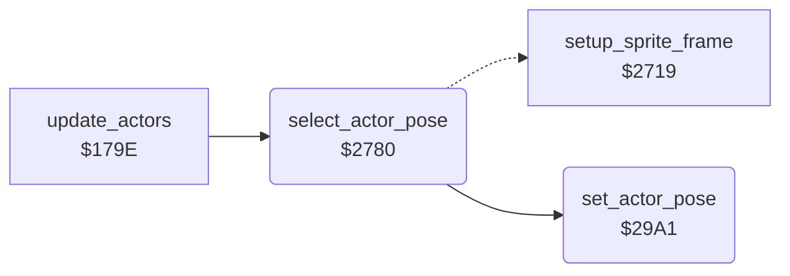

<!-- Generated by c64-docs from knowledge revision 20261017T124710.947-seivas and src/source-map.json. Do not edit: change the knowledge, generate the source again, then run generate.ts. -->
# actor_poses.asm: Actor poses: choose the animation frames from state, timer and facing

Range `$2780-$29C2`. Source: [actor_poses.asm](../../../src/actor_poses.asm). Index: [the reference](../index.md).

## Call graph

A solid arrow is a call, a thick arrow a table entry, a dotted arrow a jump. Rounded nodes are in this file.

## Names

### [`select_actor_pose`](../../../src/actor_poses.asm#L18) `$2780`

*routine*

Chooses the pose (pair of animation frames) of actor X from actor_state,X, actor_timer,X and actor_facing,X (1 = right), then sets it with set_actor_pose (Y = pose). update_actors_step calls it. It runs once for each tick of the actor animation: actor_pose_done,X <> 0 means the pose is already chosen. The previous pose is kept in actor_prev_pose,X so walking and climbing alternate between two poses. State: pose (left facing / right facing): $00 stand $00/$02          $03/$04 walk $0E<->$10 / $12<->$14     $05 jump up $08,$1E,$20 by timer $06/$07 jump $22,$24 / $26,$28                                   $0C/$0D flying kick $16,$18 / $1A,$1C $0E fall $44 ($08 inside a wall)    $0F recoil $00/$02         $10 Yamo appears $2A $11 punch $04/$06          $12 Yamo pose $2C/$2E              $13 knocked down $3C,$3E / $38,$3A $14/$15 AI walk (as $03/$04 by facing)                        $16 Ninja strike $30,$32 / $34,$36 $17 ride (climbing poses)  $18 wall bump (previous pose, else $08)    $19 dying $08 $1A duck $40/$42           $1B hit by a fall attack $3C,$3E / $38,$3A On a ladder or vine (actor_contact,X bit 2) the walk and stand states use the climbing poses $0A<->$0C.

- **Called from:** [`update_actors`](actor_driver_text.md#update_actors) [`$17DB`](../../../src/actor_driver_text.asm#L47)
- **Calls:** [`set_actor_pose`](actor_poses.md#set_actor_pose)
- **Jumps to:** [`setup_sprite_frame_done`](actor_sprites.md#setup_sprite_frame_done), [`set_actor_pose`](actor_poses.md#set_actor_pose)
- **Refers to:** [`actor_pose_done`](../variables.md#actor_pose_done), [`actor_pose`](../variables.md#actor_pose), [`actor_prev_pose`](../variables.md#actor_prev_pose)

### [`select_pose_fall`](../../../src/actor_poses.asm#L34) `$27A1`

*label*

- **Jumped to from:** [`select_actor_pose`](actor_poses.md#select_actor_pose) [`$279A`](../../../src/actor_poses.asm#L30)

### [`select_pose_try_crouch`](../../../src/actor_poses.asm#L37) `$27A6`

*label*

state $1a: crouch

- **Jumped to from:** [`select_actor_pose`](actor_poses.md#select_actor_pose) [`$2794`](../../../src/actor_poses.asm#L27)

### [`select_pose_crouch_left`](../../../src/actor_poses.asm#L44) `$27B3`

*label*

- **Jumped to from:** [`select_actor_pose`](actor_poses.md#select_actor_pose) [`$27AC`](../../../src/actor_poses.asm#L41)

### [`select_pose_try_dying`](../../../src/actor_poses.asm#L47) `$27B8`

*label*

state $19: dying

- **Jumped to from:** [`select_actor_pose`](actor_poses.md#select_actor_pose) [`$27A8`](../../../src/actor_poses.asm#L39)

### [`select_pose_try_wall_bump`](../../../src/actor_poses.asm#L52) `$27C1`

*label*

state $18 wall bump: keep the previous pose; pose $08 after $44 or for wide frames

- **Jumped to from:** [`select_actor_pose`](actor_poses.md#select_actor_pose) [`$27BA`](../../../src/actor_poses.asm#L49)

### [`select_pose_wall_bump_default`](../../../src/actor_poses.asm#L62) `$27D5`

*label*

- **Jumped to from:** [`select_actor_pose`](actor_poses.md#select_actor_pose) [`$27CA`](../../../src/actor_poses.asm#L57), [`select_actor_pose`](actor_poses.md#select_actor_pose) [`$27D0`](../../../src/actor_poses.asm#L60)

### [`select_pose_try_fall_knockdown`](../../../src/actor_poses.asm#L65) `$27DA`

*label*

state $1B: hit by a fall attack

- **Jumped to from:** [`select_actor_pose`](actor_poses.md#select_actor_pose) [`$27C3`](../../../src/actor_poses.asm#L54)

### [`select_pose_fall_knockdown_right_late`](../../../src/actor_poses.asm#L75) `$27ED`

*label*

- **Jumped to from:** [`select_actor_pose`](actor_poses.md#select_actor_pose) [`$27E6`](../../../src/actor_poses.asm#L72)

### [`select_pose_fall_knockdown_left`](../../../src/actor_poses.asm#L78) `$27F2`

*label*

- **Jumped to from:** [`select_actor_pose`](actor_poses.md#select_actor_pose) [`$27E2`](../../../src/actor_poses.asm#L70)

### [`select_pose_fall_knockdown_left_late`](../../../src/actor_poses.asm#L83) `$27FB`

*label*

- **Jumped to from:** [`select_actor_pose`](actor_poses.md#select_actor_pose) [`$27F4`](../../../src/actor_poses.asm#L80)

### [`select_pose_try_knockdown`](../../../src/actor_poses.asm#L86) `$2800`

*label*

state $13: knocked down

- **Jumped to from:** [`select_actor_pose`](actor_poses.md#select_actor_pose) [`$27DC`](../../../src/actor_poses.asm#L67)

### [`select_pose_knockdown_right`](../../../src/actor_poses.asm#L96) `$2813`

*label*

- **Jumped to from:** [`select_actor_pose`](actor_poses.md#select_actor_pose) [`$280C`](../../../src/actor_poses.asm#L93)

### [`select_pose_knockdown_late`](../../../src/actor_poses.asm#L99) `$2818`

*label*

- **Jumped to from:** [`select_actor_pose`](actor_poses.md#select_actor_pose) [`$2808`](../../../src/actor_poses.asm#L91)

### [`select_pose_knockdown_right_late`](../../../src/actor_poses.asm#L104) `$2821`

*label*

- **Jumped to from:** [`select_actor_pose`](actor_poses.md#select_actor_pose) [`$281A`](../../../src/actor_poses.asm#L101)

### [`select_pose_try_yamo_appear`](../../../src/actor_poses.asm#L107) `$2826`

*label*

state $10 Yamo appears: pose $2A

- **Jumped to from:** [`select_actor_pose`](actor_poses.md#select_actor_pose) [`$2802`](../../../src/actor_poses.asm#L88)

### [`select_pose_try_punch`](../../../src/actor_poses.asm#L112) `$282F`

*label*

state $11: punch

- **Jumped to from:** [`select_actor_pose`](actor_poses.md#select_actor_pose) [`$2828`](../../../src/actor_poses.asm#L109)

### [`select_pose_punch_left`](../../../src/actor_poses.asm#L119) `$283C`

*label*

- **Jumped to from:** [`select_actor_pose`](actor_poses.md#select_actor_pose) [`$2835`](../../../src/actor_poses.asm#L116)

### [`select_pose_try_yamo_pose`](../../../src/actor_poses.asm#L122) `$2841`

*label*

state $12 Yamo pose: pose $2C (left) / $2E (right)

- **Jumped to from:** [`select_actor_pose`](actor_poses.md#select_actor_pose) [`$2831`](../../../src/actor_poses.asm#L114)

### [`select_pose_yamo_pose_left`](../../../src/actor_poses.asm#L129) `$284E`

*label*

- **Jumped to from:** [`select_actor_pose`](actor_poses.md#select_actor_pose) [`$2847`](../../../src/actor_poses.asm#L126)

### [`select_pose_try_enemy_strike`](../../../src/actor_poses.asm#L132) `$2853`

*label*

state $16: Ninja strike

- **Jumped to from:** [`select_actor_pose`](actor_poses.md#select_actor_pose) [`$2843`](../../../src/actor_poses.asm#L124)

### [`select_pose_strike_left`](../../../src/actor_poses.asm#L142) `$2866`

*label*

- **Jumped to from:** [`select_actor_pose`](actor_poses.md#select_actor_pose) [`$285F`](../../../src/actor_poses.asm#L139)

### [`select_pose_strike_late`](../../../src/actor_poses.asm#L145) `$286B`

*label*

- **Jumped to from:** [`select_actor_pose`](actor_poses.md#select_actor_pose) [`$285B`](../../../src/actor_poses.asm#L137)

### [`select_pose_strike_left_late`](../../../src/actor_poses.asm#L150) `$2874`

*label*

- **Jumped to from:** [`select_actor_pose`](actor_poses.md#select_actor_pose) [`$286D`](../../../src/actor_poses.asm#L147)

### [`select_pose_try_recoil`](../../../src/actor_poses.asm#L153) `$2879`

*label*

state $0f: hit recoil

- **Jumped to from:** [`select_actor_pose`](actor_poses.md#select_actor_pose) [`$2855`](../../../src/actor_poses.asm#L134)

### [`select_pose_recoil_left`](../../../src/actor_poses.asm#L160) `$2886`

*label*

- **Jumped to from:** [`select_actor_pose`](actor_poses.md#select_actor_pose) [`$287F`](../../../src/actor_poses.asm#L157)

### [`select_pose_try_kick_left`](../../../src/actor_poses.asm#L163) `$288B`

*label*

state $0c: flying kick left

- **Jumped to from:** [`select_actor_pose`](actor_poses.md#select_actor_pose) [`$287B`](../../../src/actor_poses.asm#L155)

### [`select_pose_kick_left_late`](../../../src/actor_poses.asm#L171) `$289A`

*label*

- **Jumped to from:** [`select_actor_pose`](actor_poses.md#select_actor_pose) [`$2893`](../../../src/actor_poses.asm#L168)

### [`select_pose_try_kick_right`](../../../src/actor_poses.asm#L174) `$289F`

*label*

state $0d: flying kick right

- **Jumped to from:** [`select_actor_pose`](actor_poses.md#select_actor_pose) [`$288D`](../../../src/actor_poses.asm#L165)

### [`select_pose_kick_right_late`](../../../src/actor_poses.asm#L182) `$28AE`

*label*

- **Jumped to from:** [`select_actor_pose`](actor_poses.md#select_actor_pose) [`$28A7`](../../../src/actor_poses.asm#L179)

### [`select_pose_try_enemy_walk_a`](../../../src/actor_poses.asm#L185) `$28B3`

*label*

state $14 AI chase: walk poses by facing

- **Jumped to from:** [`select_actor_pose`](actor_poses.md#select_actor_pose) [`$28A1`](../../../src/actor_poses.asm#L176)

### [`select_pose_try_enemy_walk_b`](../../../src/actor_poses.asm#L191) `$28BD`

*label*

state $15 AI back off: walk poses by facing

- **Jumped to from:** [`select_actor_pose`](actor_poses.md#select_actor_pose) [`$28B5`](../../../src/actor_poses.asm#L187)

### [`select_pose_try_walk_left`](../../../src/actor_poses.asm#L197) `$28C7`

*label*

state $03: walk left

- **Jumped to from:** [`select_actor_pose`](actor_poses.md#select_actor_pose) [`$28BF`](../../../src/actor_poses.asm#L193)

### [`select_pose_walk_left`](../../../src/actor_poses.asm#L200) `$28CB`

*label*

terrain flag bit 2: climbing poses

- **Jumped to from:** [`select_actor_pose`](actor_poses.md#select_actor_pose) [`$28BB`](../../../src/actor_poses.asm#L190), [`select_actor_pose`](actor_poses.md#select_actor_pose) [`$28C5`](../../../src/actor_poses.asm#L196)

### [`select_pose_walk_left_step`](../../../src/actor_poses.asm#L205) `$28D4`

*label*

- **Jumped to from:** [`select_actor_pose`](actor_poses.md#select_actor_pose) [`$28CF`](../../../src/actor_poses.asm#L203)

### [`select_pose_walk_left_other`](../../../src/actor_poses.asm#L211) `$28E0`

*label*

- **Jumped to from:** [`select_actor_pose`](actor_poses.md#select_actor_pose) [`$28D9`](../../../src/actor_poses.asm#L208)

### [`select_pose_try_walk_right`](../../../src/actor_poses.asm#L214) `$28E5`

*label*

state $04: walk right

- **Jumped to from:** [`select_actor_pose`](actor_poses.md#select_actor_pose) [`$28C9`](../../../src/actor_poses.asm#L199)

### [`select_pose_walk_right`](../../../src/actor_poses.asm#L217) `$28E9`

*label*

- **Jumped to from:** [`select_actor_pose`](actor_poses.md#select_actor_pose) [`$28B9`](../../../src/actor_poses.asm#L189), [`select_actor_pose`](actor_poses.md#select_actor_pose) [`$28C3`](../../../src/actor_poses.asm#L195)

### [`select_pose_walk_right_step`](../../../src/actor_poses.asm#L222) `$28F2`

*label*

- **Jumped to from:** [`select_actor_pose`](actor_poses.md#select_actor_pose) [`$28ED`](../../../src/actor_poses.asm#L220)

### [`select_pose_walk_right_other`](../../../src/actor_poses.asm#L228) `$28FE`

*label*

- **Jumped to from:** [`select_actor_pose`](actor_poses.md#select_actor_pose) [`$28F7`](../../../src/actor_poses.asm#L225)

### [`select_pose_try_jump_up`](../../../src/actor_poses.asm#L231) `$2903`

*label*

state $05: jump up, timer counts down from $0f

- **Jumped to from:** [`select_actor_pose`](actor_poses.md#select_actor_pose) [`$28E7`](../../../src/actor_poses.asm#L216)

### [`select_pose_jump_up_rising`](../../../src/actor_poses.asm#L239) `$2912`

*label*

- **Jumped to from:** [`select_actor_pose`](actor_poses.md#select_actor_pose) [`$290B`](../../../src/actor_poses.asm#L236)

### [`select_pose_jump_up_air`](../../../src/actor_poses.asm#L244) `$291B`

*label*

- **Jumped to from:** [`select_actor_pose`](actor_poses.md#select_actor_pose) [`$2914`](../../../src/actor_poses.asm#L241)

### [`select_pose_jump_up_landing`](../../../src/actor_poses.asm#L249) `$2924`

*label*

- **Jumped to from:** [`select_actor_pose`](actor_poses.md#select_actor_pose) [`$291D`](../../../src/actor_poses.asm#L246)

### [`select_pose_jump_up_end`](../../../src/actor_poses.asm#L254) `$292D`

*label*

- **Jumped to from:** [`select_actor_pose`](actor_poses.md#select_actor_pose) [`$2926`](../../../src/actor_poses.asm#L251)

### [`select_pose_try_jump_left`](../../../src/actor_poses.asm#L257) `$2932`

*label*

state $06: jump left

- **Jumped to from:** [`select_actor_pose`](actor_poses.md#select_actor_pose) [`$2905`](../../../src/actor_poses.asm#L233)

### [`select_pose_jump_left_ground`](../../../src/actor_poses.asm#L263) `$293C`

*label*

- **Jumped to from:** [`select_actor_pose`](actor_poses.md#select_actor_pose) [`$2943`](../../../src/actor_poses.asm#L268)

### [`select_pose_jump_left_air`](../../../src/actor_poses.asm#L266) `$2941`

*label*

- **Jumped to from:** [`select_actor_pose`](actor_poses.md#select_actor_pose) [`$293A`](../../../src/actor_poses.asm#L262)

### [`select_pose_try_jump_right`](../../../src/actor_poses.asm#L271) `$294A`

*label*

state $07: jump right

- **Jumped to from:** [`select_actor_pose`](actor_poses.md#select_actor_pose) [`$2934`](../../../src/actor_poses.asm#L259)

### [`select_pose_jump_right_ground`](../../../src/actor_poses.asm#L277) `$2954`

*label*

- **Jumped to from:** [`select_actor_pose`](actor_poses.md#select_actor_pose) [`$295B`](../../../src/actor_poses.asm#L282)

### [`select_pose_jump_right_air`](../../../src/actor_poses.asm#L280) `$2959`

*label*

- **Jumped to from:** [`select_actor_pose`](actor_poses.md#select_actor_pose) [`$2952`](../../../src/actor_poses.asm#L276)

### [`select_pose_try_ride`](../../../src/actor_poses.asm#L285) `$2962`

*label*

state $17 ride (moving character $62)

- **Jumped to from:** [`select_actor_pose`](actor_poses.md#select_actor_pose) [`$294C`](../../../src/actor_poses.asm#L273)

### [`select_pose_try_stand`](../../../src/actor_poses.asm#L292) `$2970`

*label*

state $00: stand; other states use the climbing poses

- **Jumped to from:** [`select_actor_pose`](actor_poses.md#select_actor_pose) [`$2964`](../../../src/actor_poses.asm#L287)

### [`select_pose_climb_step`](../../../src/actor_poses.asm#L304) `$2985`

*label*

Climbing: alternate between poses $0a and $0c.

- **Jumped to from:** [`select_actor_pose`](actor_poses.md#select_actor_pose) [`$28D1`](../../../src/actor_poses.asm#L204), [`select_actor_pose`](actor_poses.md#select_actor_pose) [`$28EF`](../../../src/actor_poses.asm#L221), [`select_actor_pose`](actor_poses.md#select_actor_pose) [`$296B`](../../../src/actor_poses.asm#L290), [`select_actor_pose`](actor_poses.md#select_actor_pose) [`$2972`](../../../src/actor_poses.asm#L294)

### [`select_pose_store`](../../../src/actor_poses.asm#L309) `$298E`

*label*

- **Jumped to from:** [`select_actor_pose`](actor_poses.md#select_actor_pose) [`$297F`](../../../src/actor_poses.asm#L300), [`select_actor_pose`](actor_poses.md#select_actor_pose) [`$2983`](../../../src/actor_poses.asm#L302)

### [`select_pose_climb_other`](../../../src/actor_poses.asm#L311) `$2991`

*label*

- **Jumped to from:** [`select_actor_pose`](actor_poses.md#select_actor_pose) [`$298A`](../../../src/actor_poses.asm#L307)

### [`select_pose_stand`](../../../src/actor_poses.asm#L314) `$2996`

*label*

- **Jumped to from:** [`select_actor_pose`](actor_poses.md#select_actor_pose) [`$2978`](../../../src/actor_poses.asm#L297)

### [`select_pose_stand_right`](../../../src/actor_poses.asm#L319) `$299F`

*label*

- **Jumped to from:** [`select_actor_pose`](actor_poses.md#select_actor_pose) [`$2998`](../../../src/actor_poses.asm#L316)

### [`set_actor_pose`](../../../src/actor_poses.asm#L324) `$29A1`

*routine*

Sets the pose Y of actor X: actor_pose,X = pose, actor_pose_b,X = pose + 1, actor_frame_a,X = first frame = frame base of the actor type + pose, actor_frame_b,X = first frame + 1. The actor type is bits 7-6 of actor_flags,X (0 Bruce, 1 Ninja, 2 Yamo) and indexes the frame base table actor_frame_base. Changes A, Y.

- **Called from:** [`select_actor_pose`](actor_poses.md#select_actor_pose) [`$279E`](../../../src/actor_poses.asm#L33), [`select_actor_pose`](actor_poses.md#select_actor_pose) [`$27A3`](../../../src/actor_poses.asm#L36), [`select_actor_pose`](actor_poses.md#select_actor_pose) [`$27B0`](../../../src/actor_poses.asm#L43), [`select_actor_pose`](actor_poses.md#select_actor_pose) [`$27B5`](../../../src/actor_poses.asm#L46), [`select_actor_pose`](actor_poses.md#select_actor_pose) [`$27BE`](../../../src/actor_poses.asm#L51), [`select_actor_pose`](actor_poses.md#select_actor_pose) [`$27D2`](../../../src/actor_poses.asm#L61), [`select_actor_pose`](actor_poses.md#select_actor_pose) [`$27D7`](../../../src/actor_poses.asm#L64), [`select_actor_pose`](actor_poses.md#select_actor_pose) [`$27EA`](../../../src/actor_poses.asm#L74), [`select_actor_pose`](actor_poses.md#select_actor_pose) [`$27EF`](../../../src/actor_poses.asm#L77), [`select_actor_pose`](actor_poses.md#select_actor_pose) [`$27F8`](../../../src/actor_poses.asm#L82), [`select_actor_pose`](actor_poses.md#select_actor_pose) [`$27FD`](../../../src/actor_poses.asm#L85), [`select_actor_pose`](actor_poses.md#select_actor_pose) [`$2810`](../../../src/actor_poses.asm#L95), [`select_actor_pose`](actor_poses.md#select_actor_pose) [`$2815`](../../../src/actor_poses.asm#L98), [`select_actor_pose`](actor_poses.md#select_actor_pose) [`$281E`](../../../src/actor_poses.asm#L103), [`select_actor_pose`](actor_poses.md#select_actor_pose) [`$2823`](../../../src/actor_poses.asm#L106), [`select_actor_pose`](actor_poses.md#select_actor_pose) [`$282C`](../../../src/actor_poses.asm#L111), [`select_actor_pose`](actor_poses.md#select_actor_pose) [`$2839`](../../../src/actor_poses.asm#L118), [`select_actor_pose`](actor_poses.md#select_actor_pose) [`$283E`](../../../src/actor_poses.asm#L121), [`select_actor_pose`](actor_poses.md#select_actor_pose) [`$284B`](../../../src/actor_poses.asm#L128), [`select_actor_pose`](actor_poses.md#select_actor_pose) [`$2863`](../../../src/actor_poses.asm#L141), [`select_actor_pose`](actor_poses.md#select_actor_pose) [`$2868`](../../../src/actor_poses.asm#L144), [`select_actor_pose`](actor_poses.md#select_actor_pose) [`$2871`](../../../src/actor_poses.asm#L149), [`select_actor_pose`](actor_poses.md#select_actor_pose) [`$2876`](../../../src/actor_poses.asm#L152), [`select_actor_pose`](actor_poses.md#select_actor_pose) [`$2883`](../../../src/actor_poses.asm#L159), [`select_actor_pose`](actor_poses.md#select_actor_pose) [`$2888`](../../../src/actor_poses.asm#L162), [`select_actor_pose`](actor_poses.md#select_actor_pose) [`$2897`](../../../src/actor_poses.asm#L170), [`select_actor_pose`](actor_poses.md#select_actor_pose) [`$289C`](../../../src/actor_poses.asm#L173), [`select_actor_pose`](actor_poses.md#select_actor_pose) [`$28AB`](../../../src/actor_poses.asm#L181), [`select_actor_pose`](actor_poses.md#select_actor_pose) [`$28B0`](../../../src/actor_poses.asm#L184), [`select_actor_pose`](actor_poses.md#select_actor_pose) [`$28DD`](../../../src/actor_poses.asm#L210), [`select_actor_pose`](actor_poses.md#select_actor_pose) [`$28E2`](../../../src/actor_poses.asm#L213), [`select_actor_pose`](actor_poses.md#select_actor_pose) [`$28FB`](../../../src/actor_poses.asm#L227), [`select_actor_pose`](actor_poses.md#select_actor_pose) [`$2900`](../../../src/actor_poses.asm#L230), [`select_actor_pose`](actor_poses.md#select_actor_pose) [`$290F`](../../../src/actor_poses.asm#L238), [`select_actor_pose`](actor_poses.md#select_actor_pose) [`$2918`](../../../src/actor_poses.asm#L243), [`select_actor_pose`](actor_poses.md#select_actor_pose) [`$2921`](../../../src/actor_poses.asm#L248), [`select_actor_pose`](actor_poses.md#select_actor_pose) [`$292A`](../../../src/actor_poses.asm#L253), [`select_actor_pose`](actor_poses.md#select_actor_pose) [`$292F`](../../../src/actor_poses.asm#L256), [`select_actor_pose`](actor_poses.md#select_actor_pose) [`$293E`](../../../src/actor_poses.asm#L265), [`select_actor_pose`](actor_poses.md#select_actor_pose) [`$2947`](../../../src/actor_poses.asm#L270) and 6 more
- **Jumped to from:** [`select_actor_pose`](actor_poses.md#select_actor_pose) [`$2850`](../../../src/actor_poses.asm#L131)
- **Refers to:** [`actor_pose`](../variables.md#actor_pose), [`actor_frame_base`](actor_frame_tables.md#actor_frame_base), [`actor_frame_a`](../variables.md#actor_frame_a), [`actor_frame_b`](../variables.md#actor_frame_b)
