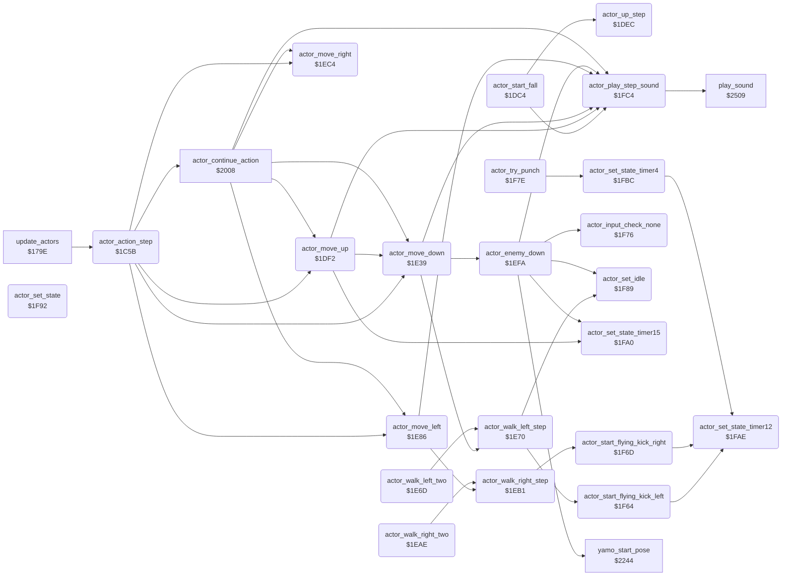

<!-- Generated by c64-docs from knowledge revision 20261017T123532.893-hcxwuv and src/source-map.json. Do not edit: change the knowledge, generate the source again, then run generate.ts. -->
# actor_step.asm: Actor action state machine: step delay, move history, wall-bump undo, joystick dispatch, move primitives, state setters, step sound with copy-protection check

Range `$1C5B-$2007`. Source: [actor_step.asm](../../../src/actor_step.asm). Index: [the reference](../index.md).

## Call graph

A solid arrow is a call, a thick arrow a table entry, a dotted arrow a jump. Rounded nodes are in this file.

The graph shows 36 of the 61 edges: the calls only.

## Data

| Range | Type | Name | Read by | Written by |
|---|---|---|---|---|
| [`$2005`](../../../src/actor_step.asm#L618)-`$2007` | workspace | [`cia1_ddra_save`](../../../src/actor_step.asm#L617) | [`frame_update`](frame_update.md#frame_update), [`actor_play_step_sound`](actor_step.md#actor_play_step_sound) | [`frame_update`](frame_update.md#frame_update), [`main_loop`](game_main_loop.md#main_loop) |

## Names

### [`actor_action_step`](../../../src/actor_step.asm#L21) `$1C5B`

*routine*

Action state machine, one step of actor X (0 Bruce, 1 Yamo, 2 Ninja). update_actors calls it once per main loop pass for each active actor, after the joystick (or demo/AI) input is in actor_joy_dir,X and actor_fire,X. Variables: actor_state,X action state, actor_timer,X steps left of a timed action, actor_step_delay,X passes to skip before the next step, actor_move_queue the move history. 1. If actor_step_delay,X is nonzero, count it down and return. 2. Push the move record of the last step into the move history (actor_move_queue: 11 records of up/down/left/right counts per actor) and clear the current record 0. 3. Count how long the state has stayed the same (actor_same_state_count,X, 6 down to 0). 4. Wall bump: when actor_contact,X has bit 3 (inside a wall), undo the moves of the last step and retry, push back or enter state $18 (wall bump). 5. A nonzero actor_timer,X continues the current timed action (actor_continue_action, Y = timer). 6. A zero timer starts a new action from the input: direction actor_joy_dir,X, fire actor_fire,X. Each path ends in a state setter (actor_set_state...) that stores the state, its step delay and the timer. States: 0 idle, 1 up, 2 down, 3 left, 4 right, 5 jump up, 6 jump left, 7 jump right, $0C/$0D flying kick left/right, $0E falling, $0F recoil, $10 Yamo appears, $11 punch, $12 Yamo pose, $13 knocked down, $14 AI chase, $15 AI back off, $16 Ninja strike, $17 ride, $18 wall bump, $19 dying, $1A duck, $1B hit by a fall attack.
undo_retry_count: up to 8 undo passes in this step

- **Called from:** [`update_actors`](actor_driver_text.md#update_actors) [`$17D8`](../../../src/actor_driver_text.asm#L46)
- **Calls:** [`actor_move_down`](actor_step.md#actor_move_down), [`actor_move_up`](actor_step.md#actor_move_up), [`actor_move_right`](actor_step.md#actor_move_right), [`actor_move_left`](actor_step.md#actor_move_left), [`actor_continue_action`](actor_timed_actions.md#actor_continue_action)
- **Jumps to:** [`act_wall_bump`](actor_hit_states.md#act_wall_bump), [`actor_read_joystick`](actor_step.md#actor_read_joystick), [`actor_move_up_blocked`](actor_step.md#actor_move_up_blocked), [`actor_set_state`](actor_step.md#actor_set_state)
- **Reads:** [`next_room`](../variables.md#next_room), [`undo_only_down`](../variables.md#undo_only_down), [`undo_retry_count`](../variables.md#undo_retry_count)
- **Writes:** [`undo_retry_count`](../variables.md#undo_retry_count), [`next_room`](../variables.md#next_room), [`undo_only_down`](../variables.md#undo_only_down)
- **Refers to:** [`actor_step_delay`](../variables.md#actor_step_delay), [`actor_pose_done`](../variables.md#actor_pose_done), [`actor_move_queue`](../variables.md#actor_move_queue), [`actor_move_queue+3`](../variables.md#actor_move_queue), [`actor_move_queue+6`](../variables.md#actor_move_queue), [`actor_move_queue+9`](../variables.md#actor_move_queue), [`actor_move_queue+12`](../variables.md#actor_move_queue), [`actor_move_queue+15`](../variables.md#actor_move_queue), [`actor_move_queue+18`](../variables.md#actor_move_queue), [`actor_move_queue+21`](../variables.md#actor_move_queue), [`actor_move_queue+24`](../variables.md#actor_move_queue), [`actor_move_queue+108`](../variables.md#actor_move_queue), [`actor_move_queue+111`](../variables.md#actor_move_queue), [`actor_move_queue+114`](../variables.md#actor_move_queue), [`actor_move_queue+117`](../variables.md#actor_move_queue), [`actor_move_queue+120`](../variables.md#actor_move_queue), [`actor_move_queue+123`](../variables.md#actor_move_queue), [`actor_move_queue+126`](../variables.md#actor_move_queue), [`actor_move_queue+129`](../variables.md#actor_move_queue)

### [`actor_action_run`](../../../src/actor_step.asm#L28) `$1C68`

*label*

A = 0: clear the animation lock of this actor

- **Jumped to from:** [`actor_action_step`](actor_step.md#actor_action_step) [`$1C62`](../../../src/actor_step.asm#L25), [`actor_action_step`](actor_step.md#actor_action_step) [`$1D50`](../../../src/actor_step.asm#L156)

### [`actor_push_history_loop`](../../../src/actor_step.asm#L43) `$1C82`

*label*

Shift the history by one record: slots 0-39 move to slots 4-43 (record 10, the oldest, is lost).

- **Jumped to from:** [`actor_action_step`](actor_step.md#actor_action_step) [`$1C8D`](../../../src/actor_step.asm#L50)

### [`actor_clear_move_record`](../../../src/actor_step.asm#L52) `$1C8F`

*label*

Clear record 0, which collects the moves of this step.

- **Jumped to from:** [`actor_action_step`](actor_step.md#actor_action_step) [`$1C77`](../../../src/actor_step.asm#L35)

### [`actor_reset_same_state_count`](../../../src/actor_step.asm#L68) `$1CAD`

*label*

- **Jumped to from:** [`actor_action_step`](actor_step.md#actor_action_step) [`$1C9F`](../../../src/actor_step.asm#L61), [`actor_action_step`](actor_step.md#actor_action_step) [`$1CA3`](../../../src/actor_step.asm#L63)

### [`actor_remember_state`](../../../src/actor_step.asm#L71) `$1CB1`

*label*

- **Jumped to from:** [`actor_action_step`](actor_step.md#actor_action_step) [`$1CA7`](../../../src/actor_step.asm#L65), [`actor_action_step`](actor_step.md#actor_action_step) [`$1CAB`](../../../src/actor_step.asm#L67)

### [`actor_check_bump_state`](../../../src/actor_step.asm#L77) `$1CBC`

*label*

wall bump with time left: let it handle the wall

- **Jumped to from:** [`actor_action_step`](actor_step.md#actor_action_step) [`$1CB7`](../../../src/actor_step.asm#L75)

### [`actor_check_in_wall`](../../../src/actor_step.asm#L83) `$1CC7`

*label*

- **Jumped to from:** [`actor_action_step`](actor_step.md#actor_action_step) [`$1CBE`](../../../src/actor_step.asm#L79), [`actor_action_step`](actor_step.md#actor_action_step) [`$1CC2`](../../../src/actor_step.asm#L81)

### [`actor_in_wall`](../../../src/actor_step.asm#L89) `$1CD0`

*label*

The last step moved the actor into a wall. Undo the moves of record 1 (the last step) in reverse.

- **Jumped to from:** [`actor_action_step`](actor_step.md#actor_action_step) [`$1CCB`](../../../src/actor_step.asm#L86)

### [`actor_undo_last_moves`](../../../src/actor_step.asm#L92) `$1CD4`

*label*

undo_only_down stays 1 while only down moves were undone

- **Jumped to from:** [`$24F1`](../../../src/actor_hit_states.asm#L140)

### [`actor_undo_up_loop`](../../../src/actor_step.asm#L95) `$1CD8`

*label*

record 1 up count

- **Jumped to from:** [`actor_action_step`](actor_step.md#actor_action_step) [`$1CE2`](../../../src/actor_step.asm#L100)

### [`actor_undo_down_loop`](../../../src/actor_step.asm#L101) `$1CE5`

*label*

record 1 down count

- **Jumped to from:** [`actor_action_step`](actor_step.md#actor_action_step) [`$1CDB`](../../../src/actor_step.asm#L97), [`actor_action_step`](actor_step.md#actor_action_step) [`$1CED`](../../../src/actor_step.asm#L105)

### [`actor_undo_left_loop`](../../../src/actor_step.asm#L106) `$1CF0`

*label*

record 1 left count

- **Jumped to from:** [`actor_action_step`](actor_step.md#actor_action_step) [`$1CE8`](../../../src/actor_step.asm#L103), [`actor_action_step`](actor_step.md#actor_action_step) [`$1CFA`](../../../src/actor_step.asm#L111)

### [`actor_undo_right_loop`](../../../src/actor_step.asm#L112) `$1CFD`

*label*

record 1 right count

- **Jumped to from:** [`actor_action_step`](actor_step.md#actor_action_step) [`$1CF3`](../../../src/actor_step.asm#L108), [`actor_action_step`](actor_step.md#actor_action_step) [`$1D07`](../../../src/actor_step.asm#L117)

### [`actor_pop_history`](../../../src/actor_step.asm#L119) `$1D0A`

*label*

Drop records 0 and 1: slots 8-43 move to slots 0-35, then records 9 and 10 are cleared.
36 slots

- **Jumped to from:** [`actor_action_step`](actor_step.md#actor_action_step) [`$1D00`](../../../src/actor_step.asm#L114)

### [`actor_pop_history_loop`](../../../src/actor_step.asm#L124) `$1D10`

*label*

- **Jumped to from:** [`actor_action_step`](actor_step.md#actor_action_step) [`$1D1B`](../../../src/actor_step.asm#L131)

### [`actor_undo_check_retry`](../../../src/actor_step.asm#L157) `$1D53`

*label*

- **Jumped to from:** [`actor_action_step`](actor_step.md#actor_action_step) [`$1D46`](../../../src/actor_step.asm#L150)

### [`actor_undo_push_left`](../../../src/actor_step.asm#L166) `$1D63`

*label*

- **Jumped to from:** [`actor_action_step`](actor_step.md#actor_action_step) [`$1D5B`](../../../src/actor_step.asm#L162)

### [`actor_enter_wall_bump`](../../../src/actor_step.asm#L168) `$1D66`

*label*

state $18 wall bump

- **Jumped to from:** [`actor_action_step`](actor_step.md#actor_action_step) [`$1D3C`](../../../src/actor_step.asm#L145), [`actor_action_step`](actor_step.md#actor_action_step) [`$1D42`](../../../src/actor_step.asm#L148), [`actor_action_step`](actor_step.md#actor_action_step) [`$1D4C`](../../../src/actor_step.asm#L154), [`actor_action_step`](actor_step.md#actor_action_step) [`$1D57`](../../../src/actor_step.asm#L160), [`actor_action_step`](actor_step.md#actor_action_step) [`$1D60`](../../../src/actor_step.asm#L165)

### [`actor_not_in_wall`](../../../src/actor_step.asm#L174) `$1D6F`

*label*

- **Jumped to from:** [`actor_action_step`](actor_step.md#actor_action_step) [`$1CCD`](../../../src/actor_step.asm#L87)

### [`actor_check_timer`](../../../src/actor_step.asm#L179) `$1D77`

*label*

timer nonzero: continue the timed action

- **Jumped to from:** [`actor_action_step`](actor_step.md#actor_action_step) [`$1CB9`](../../../src/actor_step.asm#L76)

### [`actor_read_input`](../../../src/actor_step.asm#L184) `$1D7E`

*label*

No timed action: choose the next action. First the falling state $0E (previous state).

- **Jumped to from:** [`actor_action_step`](actor_step.md#actor_action_step) [`$1D79`](../../../src/actor_step.asm#L181)

### [`actor_land_step_left`](../../../src/actor_step.asm#L198) `$1D96`

*label*

- **Jumped to from:** [`actor_action_step`](actor_step.md#actor_action_step) [`$1D91`](../../../src/actor_step.asm#L196)

### [`actor_bruce_falling`](../../../src/actor_step.asm#L200) `$1D99`

*label*

terrain flags of the previous pass: was on a floor

- **Jumped to from:** [`actor_action_step`](actor_step.md#actor_action_step) [`$1D85`](../../../src/actor_step.asm#L189)

### [`actor_fall_drift_left`](../../../src/actor_step.asm#L211) `$1DAD`

*label*

- **Jumped to from:** [`actor_action_step`](actor_step.md#actor_action_step) [`$1DA5`](../../../src/actor_step.asm#L208)

### [`actor_bruce_fall_check_floor`](../../../src/actor_step.asm#L215) `$1DB3`

*label*

- **Jumped to from:** [`actor_action_step`](actor_step.md#actor_action_step) [`$1D9D`](../../../src/actor_step.asm#L203)

### [`actor_fall_two`](../../../src/actor_step.asm#L220) `$1DB9`

*label*

Fall: move down twice and set state $0E (falling).

- **Jumped to from:** [`actor_action_step`](actor_step.md#actor_action_step) [`$1D8B`](../../../src/actor_step.asm#L192), [`actor_action_step`](actor_step.md#actor_action_step) [`$1DA1`](../../../src/actor_step.asm#L205), [`actor_action_step`](actor_step.md#actor_action_step) [`$1DAA`](../../../src/actor_step.asm#L210), [`actor_action_step`](actor_step.md#actor_action_step) [`$1DB0`](../../../src/actor_step.asm#L214)

### [`actor_fall_one`](../../../src/actor_step.asm#L222) `$1DBC`

*label*

- **Jumped to from:** [`actor_start_fall`](actor_step.md#actor_start_fall) [`$1DC8`](../../../src/actor_step.asm#L230)

### [`actor_start_fall`](../../../src/actor_step.asm#L227) `$1DC4`

*label*

Start a fall: actor_fall_drift,X = 2 (drift counter), move down once, state $0E (falling).

- **Called from:** [`$2378`](../../../src/enemy_ai_states.asm#L91)
- **Calls:** [`actor_play_step_sound`](actor_step.md#actor_play_step_sound), [`actor_up_step`](actor_step.md#actor_up_step)
- **Jumps to:** [`actor_fall_one`](actor_step.md#actor_fall_one), [`actor_input_check_down`](actor_step.md#actor_input_check_down), [`actor_up_to_idle`](actor_step.md#actor_up_to_idle)

### [`actor_read_joystick`](../../../src/actor_step.asm#L231) `$1DCA`

*label*

no floor and no ladder: fall

- **Jumped to from:** [`actor_action_step`](actor_step.md#actor_action_step) [`$1D82`](../../../src/actor_step.asm#L187)

### [`actor_up_three`](../../../src/actor_step.asm#L247) `$1DE6`

*label*

- **Jumped to from:** [`actor_start_fall`](actor_step.md#actor_start_fall) [`$1DE1`](../../../src/actor_step.asm#L245)

### [`actor_up_step`](../../../src/actor_step.asm#L252) `$1DEC`

*routine*

One unit of the up joystick: climb up when on a ladder or vine (terrain bit 2), else start a jump (state 5, timer 15) unless the actor is inside a wall.

- **Called from:** [`actor_start_fall`](actor_step.md#actor_start_fall) [`$1DE3`](../../../src/actor_step.asm#L246), [`actor_start_fall`](actor_step.md#actor_start_fall) [`$1DE6`](../../../src/actor_step.asm#L248), [`actor_start_fall`](actor_step.md#actor_start_fall) [`$1DE9`](../../../src/actor_step.asm#L249)
- **Jumps to:** [`actor_up_not_climbable`](actor_step.md#actor_up_not_climbable)

### [`actor_move_up`](../../../src/actor_step.asm#L258) `$1DF2`

*routine*

Move primitive: one unit up. At the top limit (actor_y < $2E) it sets state 0 (idle) instead. Else actor_y,X - 1, counts the move in the up count of record 0 (actor_move_queue,X), state 1.

- **Called from:** [`actor_action_step`](actor_step.md#actor_action_step) [`$1CEA`](../../../src/actor_step.asm#L104), [`actor_continue_action`](actor_timed_actions.md#actor_continue_action) [`$2037`](../../../src/actor_timed_actions.asm#L41), [`actor_continue_action`](actor_timed_actions.md#actor_continue_action) [`$203A`](../../../src/actor_timed_actions.asm#L42), [`actor_continue_action`](actor_timed_actions.md#actor_continue_action) [`$203D`](../../../src/actor_timed_actions.asm#L44), [`actor_continue_action`](actor_timed_actions.md#actor_continue_action) [`$2040`](../../../src/actor_timed_actions.asm#L45), [`actor_continue_action`](actor_timed_actions.md#actor_continue_action) [`$2065`](../../../src/actor_timed_actions.asm#L66), [`actor_continue_action`](actor_timed_actions.md#actor_continue_action) [`$20AA`](../../../src/actor_timed_actions.asm#L102), [`actor_continue_action`](actor_timed_actions.md#actor_continue_action) [`$20E2`](../../../src/actor_timed_actions.asm#L132), [`actor_continue_action`](actor_timed_actions.md#actor_continue_action) [`$20E5`](../../../src/actor_timed_actions.asm#L134), [`actor_continue_action`](actor_timed_actions.md#actor_continue_action) [`$2130`](../../../src/actor_timed_actions.asm#L171), [`actor_continue_action`](actor_timed_actions.md#actor_continue_action) [`$2133`](../../../src/actor_timed_actions.asm#L173), [`actor_continue_action`](actor_timed_actions.md#actor_continue_action) [`$21B8`](../../../src/actor_timed_actions.asm#L253), [`actor_continue_action`](actor_timed_actions.md#actor_continue_action) [`$21BB`](../../../src/actor_timed_actions.asm#L254), [`actor_continue_action`](actor_timed_actions.md#actor_continue_action) [`$2201`](../../../src/actor_timed_actions.asm#L289), [`actor_continue_action`](actor_timed_actions.md#actor_continue_action) [`$2204`](../../../src/actor_timed_actions.asm#L290)
- **Calls:** [`actor_set_state_timer15`](actor_step.md#actor_set_state_timer15), [`actor_play_step_sound`](actor_step.md#actor_play_step_sound), [`actor_move_down`](actor_step.md#actor_move_down)
- **Jumps to:** [`actor_set_state`](actor_step.md#actor_set_state), [`actor_go_idle`](actor_step.md#actor_go_idle), [`actor_input_check_left`](actor_step.md#actor_input_check_left), [`actor_down_on_floor`](actor_step.md#actor_down_on_floor)
- **Refers to:** [`actor_move_queue`](../variables.md#actor_move_queue)

### [`actor_move_up_blocked`](../../../src/actor_step.asm#L264) `$1DFC`

*label*

- **Jumped to from:** [`actor_action_step`](actor_step.md#actor_action_step) [`$1DB7`](../../../src/actor_step.asm#L218), [`actor_move_up`](actor_step.md#actor_move_up) [`$1DF6`](../../../src/actor_step.asm#L261)

### [`actor_up_not_climbable`](../../../src/actor_step.asm#L270) `$1E08`

*label*

- **Jumped to from:** [`actor_up_step`](actor_step.md#actor_up_step) [`$1DF0`](../../../src/actor_step.asm#L255)

### [`actor_up_to_idle`](../../../src/actor_step.asm#L273) `$1E0C`

*label*

- **Jumped to from:** [`actor_start_fall`](actor_step.md#actor_start_fall) [`$1DDA`](../../../src/actor_step.asm#L242), [`actor_move_up`](actor_step.md#actor_move_up) [`$1DFC`](../../../src/actor_step.asm#L265)

### [`actor_input_check_down`](../../../src/actor_step.asm#L277) `$1E13`

*label*

$0D = down

- **Jumped to from:** [`actor_start_fall`](actor_step.md#actor_start_fall) [`$1DD4`](../../../src/actor_step.asm#L239)

### [`actor_climb_down`](../../../src/actor_step.asm#L286) `$1E23`

*label*

- **Jumped to from:** [`actor_move_up`](actor_step.md#actor_move_up) [`$1E1B`](../../../src/actor_step.asm#L282)

### [`actor_climb_down_three`](../../../src/actor_step.asm#L295) `$1E33`

*label*

- **Jumped to from:** [`actor_move_up`](actor_step.md#actor_move_up) [`$1E2E`](../../../src/actor_step.asm#L292)

### [`actor_move_down`](../../../src/actor_step.asm#L300) `$1E39`

*routine*

Move primitive: one unit down. At the bottom limit (actor_y >= $C7) it sets state 0 (idle) instead. Else actor_y,X + 1, counts the move in the down count of record 0 (actor_move_queue+3,X), state 2.

- **Called from:** [`actor_action_step`](actor_step.md#actor_action_step) [`$1CDF`](../../../src/actor_step.asm#L99), [`actor_action_step`](actor_step.md#actor_action_step) [`$1DB9`](../../../src/actor_step.asm#L221), [`actor_action_step`](actor_step.md#actor_action_step) [`$1DBC`](../../../src/actor_step.asm#L223), [`actor_move_up`](actor_step.md#actor_move_up) [`$1E30`](../../../src/actor_step.asm#L294), [`actor_move_up`](actor_step.md#actor_move_up) [`$1E33`](../../../src/actor_step.asm#L296), [`actor_move_up`](actor_step.md#actor_move_up) [`$1E36`](../../../src/actor_step.asm#L297), [`actor_continue_action`](actor_timed_actions.md#actor_continue_action) [`$2028`](../../../src/actor_timed_actions.asm#L33), [`actor_continue_action`](actor_timed_actions.md#actor_continue_action) [`$202B`](../../../src/actor_timed_actions.asm#L34), [`actor_continue_action`](actor_timed_actions.md#actor_continue_action) [`$2082`](../../../src/actor_timed_actions.asm#L81), [`actor_continue_action`](actor_timed_actions.md#actor_continue_action) [`$20C7`](../../../src/actor_timed_actions.asm#L117), [`actor_continue_action`](actor_timed_actions.md#actor_continue_action) [`$2115`](../../../src/actor_timed_actions.asm#L156), [`actor_continue_action`](actor_timed_actions.md#actor_continue_action) [`$2118`](../../../src/actor_timed_actions.asm#L158), [`actor_continue_action`](actor_timed_actions.md#actor_continue_action) [`$2160`](../../../src/actor_timed_actions.asm#L193), [`actor_continue_action`](actor_timed_actions.md#actor_continue_action) [`$2163`](../../../src/actor_timed_actions.asm#L195), [`actor_continue_action`](actor_timed_actions.md#actor_continue_action) [`$21C5`](../../../src/actor_timed_actions.asm#L259), [`actor_continue_action`](actor_timed_actions.md#actor_continue_action) [`$21C8`](../../../src/actor_timed_actions.asm#L260), [`actor_continue_action`](actor_timed_actions.md#actor_continue_action) [`$21F8`](../../../src/actor_timed_actions.asm#L285), [`actor_continue_action`](actor_timed_actions.md#actor_continue_action) [`$21FB`](../../../src/actor_timed_actions.asm#L286), [`$2455`](../../../src/actor_hit_states.asm#L54)
- **Calls:** [`actor_enemy_down`](actor_step.md#actor_enemy_down), [`actor_play_step_sound`](actor_step.md#actor_play_step_sound), [`actor_walk_left_step`](actor_step.md#actor_walk_left_step)
- **Jumps to:** [`actor_go_idle`](actor_step.md#actor_go_idle), [`actor_set_state`](actor_step.md#actor_set_state), [`actor_duck_face_right`](actor_step.md#actor_duck_face_right), [`actor_duck_face_left`](actor_step.md#actor_duck_face_left), [`actor_input_check_right`](actor_step.md#actor_input_check_right), [`actor_walk_left_two`](actor_step.md#actor_walk_left_two)
- **Reads:** [`actor_facing`](../variables.md#actor_facing)
- **Refers to:** [`actor_move_queue`](../variables.md#actor_move_queue), [`actor_move_queue+3`](../variables.md#actor_move_queue)

### [`actor_down_on_floor`](../../../src/actor_step.asm#L309) `$1E49`

*label*

Down on a floor. Bruce ducks in the direction he faces; Yamo (actor 1) takes his pose.

- **Jumped to from:** [`actor_move_up`](actor_step.md#actor_move_up) [`$1E21`](../../../src/actor_step.asm#L285)

### [`actor_bruce_duck`](../../../src/actor_step.asm#L313) `$1E4F`

*label*

Bruce's facing

- **Jumped to from:** [`actor_move_down`](actor_step.md#actor_move_down) [`$1E4A`](../../../src/actor_step.asm#L311)

### [`actor_bruce_duck_left`](../../../src/actor_step.asm#L317) `$1E56`

*label*

- **Jumped to from:** [`actor_move_down`](actor_step.md#actor_move_down) [`$1E51`](../../../src/actor_step.asm#L315)

### [`actor_input_check_left`](../../../src/actor_step.asm#L319) `$1E59`

*label*

$0B = left

- **Jumped to from:** [`actor_move_up`](actor_step.md#actor_move_up) [`$1E15`](../../../src/actor_step.asm#L279)

### [`actor_walk_left_two`](../../../src/actor_step.asm#L330) `$1E6D`

*routine*

Two units of walking left (the call and the fall through into actor_walk_left_step).

- **Called from:** [`$236C`](../../../src/enemy_ai_states.asm#L84), [`$23FF`](../../../src/enemy_ai_states.asm#L175)
- **Jumped to from:** [`actor_move_down`](actor_step.md#actor_move_down) [`$1E68`](../../../src/actor_step.asm#L327)
- **Calls:** [`actor_walk_left_step`](actor_step.md#actor_walk_left_step)

### [`actor_walk_left_step`](../../../src/actor_step.asm#L334) `$1E70`

*routine*

One unit of the left joystick: after at least 3 steps of walking left (state 3, same-state count below 4), fire starts a flying kick to the left; otherwise move left.

- **Called from:** [`actor_move_down`](actor_step.md#actor_move_down) [`$1E6A`](../../../src/actor_step.asm#L328), [`actor_walk_left_two`](actor_step.md#actor_walk_left_two) [`$1E6D`](../../../src/actor_step.asm#L331)
- **Calls:** [`actor_start_flying_kick_left`](actor_step.md#actor_start_flying_kick_left), [`actor_set_idle`](actor_step.md#actor_set_idle)
- **Jumps to:** [`actor_move_left`](actor_step.md#actor_move_left)

### [`actor_go_idle`](../../../src/actor_step.asm#L344) `$1E83`

*label*

- **Jumped to from:** [`actor_move_up`](actor_step.md#actor_move_up) [`$1E0C`](../../../src/actor_step.asm#L274), [`actor_move_up`](actor_step.md#actor_move_up) [`$1E27`](../../../src/actor_step.asm#L289), [`actor_move_down`](actor_step.md#actor_move_down) [`$1E3D`](../../../src/actor_step.asm#L303), [`actor_move_down`](actor_step.md#actor_move_down) [`$1E61`](../../../src/actor_step.asm#L324), [`actor_move_left`](actor_step.md#actor_move_left) [`$1E8A`](../../../src/actor_step.asm#L352), [`actor_move_left`](actor_step.md#actor_move_left) [`$1EA2`](../../../src/actor_step.asm#L364), [`actor_move_right`](actor_step.md#actor_move_right) [`$1EC8`](../../../src/actor_step.asm#L390), [`actor_move_right`](actor_step.md#actor_move_right) [`$1EE3`](../../../src/actor_step.asm#L405)

### [`actor_move_left`](../../../src/actor_step.asm#L349) `$1E86`

*routine*

Move primitive: one unit left. At the left limit (actor_x < $0D) it sets state 0 (idle) instead. Else actor_x,X - 1, counts the move in the left count of record 0 (actor_move_queue+6,X), faces left (actor_facing,X = 0), state 3.

- **Called from:** [`actor_action_step`](actor_step.md#actor_action_step) [`$1D04`](../../../src/actor_step.asm#L116), [`actor_action_step`](actor_step.md#actor_action_step) [`$1D63`](../../../src/actor_step.asm#L167), [`actor_action_step`](actor_step.md#actor_action_step) [`$1D96`](../../../src/actor_step.asm#L199), [`actor_action_step`](actor_step.md#actor_action_step) [`$1DAD`](../../../src/actor_step.asm#L213), [`actor_continue_action`](actor_timed_actions.md#actor_continue_action) [`$2068`](../../../src/actor_timed_actions.asm#L67), [`actor_continue_action`](actor_timed_actions.md#actor_continue_action) [`$2074`](../../../src/actor_timed_actions.asm#L73), [`actor_continue_action`](actor_timed_actions.md#actor_continue_action) [`$2085`](../../../src/actor_timed_actions.asm#L82), [`actor_continue_action`](actor_timed_actions.md#actor_continue_action) [`$20E8`](../../../src/actor_timed_actions.asm#L135), [`actor_continue_action`](actor_timed_actions.md#actor_continue_action) [`$20EB`](../../../src/actor_timed_actions.asm#L136), [`actor_continue_action`](actor_timed_actions.md#actor_continue_action) [`$20FA`](../../../src/actor_timed_actions.asm#L144), [`actor_continue_action`](actor_timed_actions.md#actor_continue_action) [`$20FD`](../../../src/actor_timed_actions.asm#L145), [`actor_continue_action`](actor_timed_actions.md#actor_continue_action) [`$210B`](../../../src/actor_timed_actions.asm#L152), [`actor_continue_action`](actor_timed_actions.md#actor_continue_action) [`$210E`](../../../src/actor_timed_actions.asm#L153), [`actor_continue_action`](actor_timed_actions.md#actor_continue_action) [`$21D2`](../../../src/actor_timed_actions.asm#L265), [`actor_continue_action`](actor_timed_actions.md#actor_continue_action) [`$21D5`](../../../src/actor_timed_actions.asm#L266), [`$241F`](../../../src/actor_hit_states.asm#L22), [`$2422`](../../../src/actor_hit_states.asm#L23), [`$2466`](../../../src/actor_hit_states.asm#L64), [`$2469`](../../../src/actor_hit_states.asm#L65), [`$246C`](../../../src/actor_hit_states.asm#L66), [`$246F`](../../../src/actor_hit_states.asm#L67), [`$2472`](../../../src/actor_hit_states.asm#L68), [`$2475`](../../../src/actor_hit_states.asm#L69), [`$2478`](../../../src/actor_hit_states.asm#L70), [`$247B`](../../../src/actor_hit_states.asm#L71), [`$247E`](../../../src/actor_hit_states.asm#L73), [`$2481`](../../../src/actor_hit_states.asm#L74)
- **Jumped to from:** [`actor_walk_left_step`](actor_step.md#actor_walk_left_step) [`$1E74`](../../../src/actor_step.asm#L337), [`actor_walk_left_step`](actor_step.md#actor_walk_left_step) [`$1E7A`](../../../src/actor_step.asm#L340), [`actor_walk_left_step`](actor_step.md#actor_walk_left_step) [`$1E7E`](../../../src/actor_step.asm#L342)
- **Calls:** [`actor_play_step_sound`](actor_step.md#actor_play_step_sound), [`actor_walk_right_step`](actor_step.md#actor_walk_right_step)
- **Jumps to:** [`actor_go_idle`](actor_step.md#actor_go_idle), [`actor_set_state`](actor_step.md#actor_set_state), [`actor_input_check_down_left`](actor_step.md#actor_input_check_down_left), [`actor_walk_right_two`](actor_step.md#actor_walk_right_two)
- **Refers to:** [`actor_move_queue`](../variables.md#actor_move_queue), [`actor_move_queue+6`](../variables.md#actor_move_queue)

### [`actor_input_check_right`](../../../src/actor_step.asm#L359) `$1E9A`

*label*

$07 = right

- **Jumped to from:** [`actor_move_down`](actor_step.md#actor_move_down) [`$1E5B`](../../../src/actor_step.asm#L321)

### [`actor_walk_right_two`](../../../src/actor_step.asm#L370) `$1EAE`

*routine*

Two units of walking right (the call and the fall through into actor_walk_right_step).

- **Called from:** [`$2358`](../../../src/enemy_ai_states.asm#L73), [`$23F7`](../../../src/enemy_ai_states.asm#L171)
- **Jumped to from:** [`actor_move_left`](actor_step.md#actor_move_left) [`$1EA9`](../../../src/actor_step.asm#L367)
- **Calls:** [`actor_walk_right_step`](actor_step.md#actor_walk_right_step)

### [`actor_walk_right_step`](../../../src/actor_step.asm#L374) `$1EB1`

*routine*

One unit of the right joystick: after at least 3 steps of walking right (state 4, same-state count below 4), fire starts a flying kick to the right; otherwise move right.

- **Called from:** [`actor_move_left`](actor_step.md#actor_move_left) [`$1EAB`](../../../src/actor_step.asm#L368), [`actor_walk_right_two`](actor_step.md#actor_walk_right_two) [`$1EAE`](../../../src/actor_step.asm#L371)
- **Calls:** [`actor_start_flying_kick_right`](actor_step.md#actor_start_flying_kick_right)
- **Jumps to:** [`actor_move_right`](actor_step.md#actor_move_right)

### [`actor_move_right`](../../../src/actor_step.asm#L387) `$1EC4`

*routine*

Move primitive: one unit right. At the right limit (actor_x >= $A3) it sets state 0 (idle) instead. Else actor_x,X + 1, counts the move in the right count of record 0 (actor_move_queue+9,X), faces right (actor_facing,X = 1), state 4.

- **Called from:** [`actor_action_step`](actor_step.md#actor_action_step) [`$1CF7`](../../../src/actor_step.asm#L110), [`actor_action_step`](actor_step.md#actor_action_step) [`$1D5D`](../../../src/actor_step.asm#L164), [`actor_action_step`](actor_step.md#actor_action_step) [`$1D93`](../../../src/actor_step.asm#L197), [`actor_action_step`](actor_step.md#actor_action_step) [`$1DA7`](../../../src/actor_step.asm#L209), [`actor_continue_action`](actor_timed_actions.md#actor_continue_action) [`$20AD`](../../../src/actor_timed_actions.asm#L103), [`actor_continue_action`](actor_timed_actions.md#actor_continue_action) [`$20B9`](../../../src/actor_timed_actions.asm#L109), [`actor_continue_action`](actor_timed_actions.md#actor_continue_action) [`$20CA`](../../../src/actor_timed_actions.asm#L118), [`actor_continue_action`](actor_timed_actions.md#actor_continue_action) [`$2136`](../../../src/actor_timed_actions.asm#L174), [`actor_continue_action`](actor_timed_actions.md#actor_continue_action) [`$2139`](../../../src/actor_timed_actions.asm#L175), [`actor_continue_action`](actor_timed_actions.md#actor_continue_action) [`$2145`](../../../src/actor_timed_actions.asm#L181), [`actor_continue_action`](actor_timed_actions.md#actor_continue_action) [`$2148`](../../../src/actor_timed_actions.asm#L182), [`actor_continue_action`](actor_timed_actions.md#actor_continue_action) [`$2156`](../../../src/actor_timed_actions.asm#L189), [`actor_continue_action`](actor_timed_actions.md#actor_continue_action) [`$2159`](../../../src/actor_timed_actions.asm#L190), [`actor_continue_action`](actor_timed_actions.md#actor_continue_action) [`$21DF`](../../../src/actor_timed_actions.asm#L271), [`actor_continue_action`](actor_timed_actions.md#actor_continue_action) [`$21E2`](../../../src/actor_timed_actions.asm#L272), [`$242E`](../../../src/actor_hit_states.asm#L29), [`$2431`](../../../src/actor_hit_states.asm#L30), [`$2495`](../../../src/actor_hit_states.asm#L84), [`$2498`](../../../src/actor_hit_states.asm#L85), [`$249B`](../../../src/actor_hit_states.asm#L86), [`$249E`](../../../src/actor_hit_states.asm#L87), [`$24A1`](../../../src/actor_hit_states.asm#L89), [`$24A4`](../../../src/actor_hit_states.asm#L90)
- **Jumped to from:** [`actor_walk_right_step`](actor_step.md#actor_walk_right_step) [`$1EB5`](../../../src/actor_step.asm#L377), [`actor_walk_right_step`](actor_step.md#actor_walk_right_step) [`$1EBB`](../../../src/actor_step.asm#L380), [`actor_walk_right_step`](actor_step.md#actor_walk_right_step) [`$1EBF`](../../../src/actor_step.asm#L382)
- **Jumps to:** [`actor_go_idle`](actor_step.md#actor_go_idle), [`actor_set_state`](actor_step.md#actor_set_state), [`actor_input_check_down_right`](actor_step.md#actor_input_check_down_right), [`actor_enemy_down`](actor_step.md#actor_enemy_down), [`actor_input_idle`](actor_step.md#actor_input_idle)
- **Refers to:** [`actor_move_queue`](../variables.md#actor_move_queue), [`actor_move_queue+9`](../variables.md#actor_move_queue)

### [`actor_input_check_down_left`](../../../src/actor_step.asm#L397) `$1ED8`

*label*

$09 = down-left

- **Jumped to from:** [`actor_move_left`](actor_step.md#actor_move_left) [`$1E9C`](../../../src/actor_step.asm#L361)

### [`actor_input_no_action`](../../../src/actor_step.asm#L404) `$1EE3`

*label*

- **Jumped to from:** [`actor_enemy_down`](actor_step.md#actor_enemy_down) [`$1F15`](../../../src/actor_step.asm#L436), [`actor_enemy_down`](actor_step.md#actor_enemy_down) [`$1F40`](../../../src/actor_step.asm#L463), [`actor_enemy_down`](actor_step.md#actor_enemy_down) [`$1F56`](../../../src/actor_step.asm#L474)

### [`actor_down_left_on_floor`](../../../src/actor_step.asm#L406) `$1EE5`

*label*

### [`actor_duck_face_left`](../../../src/actor_step.asm#L410) `$1EEB`

*label*

- **Jumped to from:** [`actor_move_down`](actor_step.md#actor_move_down) [`$1E56`](../../../src/actor_step.asm#L318)

### [`actor_enemy_down`](../../../src/actor_step.asm#L420) `$1EFA`

*routine*

Down or down-diagonal for an enemy (A = actor number). Yamo (1) on a floor, not on a ladder, takes his pose (state $12); otherwise nothing happens.
Yamo

- **Called from:** [`actor_move_down`](actor_step.md#actor_move_down) [`$1E4C`](../../../src/actor_step.asm#L312)
- **Jumped to from:** [`actor_move_right`](actor_step.md#actor_move_right) [`$1EDD`](../../../src/actor_step.asm#L401)
- **Calls:** [`yamo_start_pose`](actor_timed_actions.md#yamo_start_pose), [`actor_set_idle`](actor_step.md#actor_set_idle), [`actor_input_check_none`](actor_step.md#actor_input_check_none), [`actor_play_step_sound`](actor_step.md#actor_play_step_sound), [`actor_set_state_timer15`](actor_step.md#actor_set_state_timer15)
- **Jumps to:** [`actor_input_no_action`](actor_step.md#actor_input_no_action), [`actor_set_state`](actor_step.md#actor_set_state), [`actor_input_check_none`](actor_step.md#actor_input_check_none)

### [`actor_input_idle`](../../../src/actor_step.asm#L427) `$1F07`

*label*

- **Jumped to from:** [`actor_move_right`](actor_step.md#actor_move_right) [`$1EE9`](../../../src/actor_step.asm#L409), [`actor_move_right`](actor_step.md#actor_move_right) [`$1EEF`](../../../src/actor_step.asm#L413), [`actor_enemy_down`](actor_step.md#actor_enemy_down) [`$1EFC`](../../../src/actor_step.asm#L422), [`actor_enemy_down`](actor_step.md#actor_enemy_down) [`$1F02`](../../../src/actor_step.asm#L425), [`actor_enemy_down`](actor_step.md#actor_enemy_down) [`$1F1B`](../../../src/actor_step.asm#L439), [`actor_enemy_down`](actor_step.md#actor_enemy_down) [`$1F21`](../../../src/actor_step.asm#L443)

### [`actor_input_check_down_right`](../../../src/actor_step.asm#L429) `$1F0A`

*label*

$05 = down-right

- **Jumped to from:** [`actor_move_right`](actor_step.md#actor_move_right) [`$1EDA`](../../../src/actor_step.asm#L399)

### [`actor_duck_face_right`](../../../src/actor_step.asm#L440) `$1F1D`

*label*

- **Jumped to from:** [`actor_move_down`](actor_step.md#actor_move_down) [`$1E53`](../../../src/actor_step.asm#L316)

### [`actor_input_check_jumps`](../../../src/actor_step.asm#L449) `$1F2C`

*label*

Diagonal up: jump left or right (state 6/7, timer 15) unless the actor is inside a wall or on a ladder or vine.

- **Jumped to from:** [`actor_enemy_down`](actor_step.md#actor_enemy_down) [`$1F0C`](../../../src/actor_step.asm#L431)

### [`actor_input_check_up_left`](../../../src/actor_step.asm#L457) `$1F37`

*label*

- **Jumped to from:** [`actor_enemy_down`](actor_step.md#actor_enemy_down) [`$1F31`](../../../src/actor_step.asm#L453)

### [`actor_input_check_up_right`](../../../src/actor_step.asm#L469) `$1F4E`

*label*

$06 = up-right

- **Jumped to from:** [`actor_enemy_down`](actor_step.md#actor_enemy_down) [`$1F3A`](../../../src/actor_step.asm#L460)

### [`actor_start_flying_kick_left`](../../../src/actor_step.asm#L480) `$1F64`

*label*

- **Called from:** [`actor_walk_left_step`](actor_step.md#actor_walk_left_step) [`$1E80`](../../../src/actor_step.asm#L343)
- **Calls:** [`actor_set_state_timer12`](actor_step.md#actor_set_state_timer12)

### [`actor_start_flying_kick_right`](../../../src/actor_step.asm#L485) `$1F6D`

*label*

- **Called from:** [`actor_walk_right_step`](actor_step.md#actor_walk_right_step) [`$1EC1`](../../../src/actor_step.asm#L383)
- **Calls:** [`actor_set_state_timer12`](actor_step.md#actor_set_state_timer12)

### [`actor_input_check_none`](../../../src/actor_step.asm#L491) `$1F76`

*label*

No direction: fire alone is a punch; nothing pressed is idle.
$0F = no direction

- **Called from:** [`actor_enemy_down`](actor_step.md#actor_enemy_down) [`$1F34`](../../../src/actor_step.asm#L456)
- **Jumped to from:** [`actor_enemy_down`](actor_step.md#actor_enemy_down) [`$1F50`](../../../src/actor_step.asm#L471)
- **Jumps to:** [`actor_set_idle`](actor_step.md#actor_set_idle)

### [`actor_try_punch`](../../../src/actor_step.asm#L498) `$1F7E`

*routine*

Fire without direction: punch (state $11, timer 4) unless the actor is on a ladder or vine. The AI of Yamo also calls it.

- **Called from:** [`$238F`](../../../src/enemy_ai_states.asm#L109)
- **Calls:** [`actor_set_state_timer4`](actor_step.md#actor_set_state_timer4)
- **Jumps to:** [`actor_set_idle`](actor_step.md#actor_set_idle)

### [`actor_set_idle`](../../../src/actor_step.asm#L506) `$1F89`

*routine*

Enter state 0 (idle). When the previous state was already 0, set the animation lock actor_pose_done,X so the standing frame is not advanced.

- **Called from:** [`actor_walk_left_step`](actor_step.md#actor_walk_left_step) [`$1E83`](../../../src/actor_step.asm#L345), [`actor_enemy_down`](actor_step.md#actor_enemy_down) [`$1F07`](../../../src/actor_step.asm#L428)
- **Jumped to from:** [`actor_input_check_none`](actor_step.md#actor_input_check_none) [`$1F78`](../../../src/actor_step.asm#L493), [`actor_input_check_none`](actor_step.md#actor_input_check_none) [`$1F7C`](../../../src/actor_step.asm#L495), [`actor_try_punch`](actor_step.md#actor_try_punch) [`$1F82`](../../../src/actor_step.asm#L501)
- **Refers to:** [`actor_pose_done`](../variables.md#actor_pose_done)

### [`actor_set_idle_state`](../../../src/actor_step.asm#L510) `$1F90`

*label*

- **Jumped to from:** [`actor_set_idle`](actor_step.md#actor_set_idle) [`$1F8B`](../../../src/actor_step.asm#L508)

### [`actor_set_state`](../../../src/actor_step.asm#L514) `$1F92`

*routine*

State setter: actor_state,X = A, actor_step_delay,X = actor_state_step_delay,A, actor_timer,X = 0. Returns to the caller of actor_action_step (or of the move primitive). Changes A, Y.

- **Jumped to from:** [`actor_action_step`](actor_step.md#actor_action_step) [`$1DC1`](../../../src/actor_step.asm#L225), [`actor_move_up`](actor_step.md#actor_move_up) [`$1E05`](../../../src/actor_step.asm#L269), [`actor_move_down`](actor_step.md#actor_move_down) [`$1E46`](../../../src/actor_step.asm#L307), [`actor_move_left`](actor_step.md#actor_move_left) [`$1E97`](../../../src/actor_step.asm#L358), [`actor_move_right`](actor_step.md#actor_move_right) [`$1ED5`](../../../src/actor_step.asm#L396), [`actor_move_right`](actor_step.md#actor_move_right) [`$1EF7`](../../../src/actor_step.asm#L417), [`actor_enemy_down`](actor_step.md#actor_enemy_down) [`$1F29`](../../../src/actor_step.asm#L447), [`actor_end_action`](actor_hit_states.md#actor_end_action) [`$2506`](../../../src/actor_hit_states.asm#L155)
- **Reads:** [`actor_state_step_delay`](room_tables.md#actor_state_step_delay), [`actor_state_step_delay+2`](room_tables.md#actor_state_step_delay), [`actor_state_step_delay+3`](room_tables.md#actor_state_step_delay), [`actor_state_step_delay+4`](room_tables.md#actor_state_step_delay), [`actor_state_step_delay+26`](room_tables.md#actor_state_step_delay)
- **Refers to:** [`actor_step_delay`](../variables.md#actor_step_delay)

### [`actor_set_state_timer15`](../../../src/actor_step.asm#L523) `$1FA0`

*routine*

State setter: actor_state,X = A, step delay from actor_state_step_delay, actor_timer,X = 15 (jumps).

- **Called from:** [`actor_move_up`](actor_step.md#actor_move_up) [`$1E10`](../../../src/actor_step.asm#L276), [`actor_enemy_down`](actor_step.md#actor_enemy_down) [`$1F4B`](../../../src/actor_step.asm#L468), [`actor_enemy_down`](actor_step.md#actor_enemy_down) [`$1F61`](../../../src/actor_step.asm#L479)
- **Refers to:** [`actor_state_step_delay`](room_tables.md#actor_state_step_delay), [`actor_step_delay`](../variables.md#actor_step_delay)

### [`actor_set_state_timer12`](../../../src/actor_step.asm#L532) `$1FAE`

*routine*

State setter: actor_state,X = A, step delay from actor_state_step_delay, actor_timer,X = 12 (flying kicks).

- **Called from:** [`actor_start_flying_kick_left`](actor_step.md#actor_start_flying_kick_left) [`$1F6A`](../../../src/actor_step.asm#L484), [`actor_start_flying_kick_right`](actor_step.md#actor_start_flying_kick_right) [`$1F73`](../../../src/actor_step.asm#L489), [`actor_set_state_timer4`](actor_step.md#actor_set_state_timer4) [`$1FBC`](../../../src/actor_step.asm#L542)
- **Refers to:** [`actor_state_step_delay`](room_tables.md#actor_state_step_delay), [`actor_step_delay`](../variables.md#actor_step_delay)

### [`actor_set_state_timer4`](../../../src/actor_step.asm#L541) `$1FBC`

*routine*

State setter: actor_state,X = A, step delay from actor_state_step_delay, actor_timer,X = 4 (punch).

- **Called from:** [`actor_try_punch`](actor_step.md#actor_try_punch) [`$1F86`](../../../src/actor_step.asm#L503)
- **Calls:** [`actor_set_state_timer12`](actor_step.md#actor_set_state_timer12)

### [`actor_play_step_sound`](../../../src/actor_step.asm#L556) `$1FC4`

*routine*

Plays sound $80 (step) with play_sound at the start of a walk, climb or jump. Keeps A, X and Y. It also holds two copy-protection checks on bytes of the protection page $CF00-$CFFF: 1. protection_result (= prot_key_yamo EOR prot_key_yamo_pair, stored by spawn_yamo). When zero, it increments the operands spawn_yamo_prot_key_lo/_pair_lo, so the next Yamo spawn compares the next byte pair; when the key operand reaches $99 it writes $9A (TXS) over the first opcode of random_byte. 2. protection_check_value (= prot_key_tick EOR prot_key_tick_pair, stored by the main loop each pass). When zero, it increments the operands main_loop_prot_key_lo/_pair_lo; when the key operand reaches $9A it writes $9A (TXS) over the CLC at step_sound_crash_point with X = 4, so the stack pointer becomes $04 and the following PLA/RTS crash the game. With the original protection bytes both values are nonzero and nothing happens.

- **Called from:** [`actor_start_fall`](actor_step.md#actor_start_fall) [`$1DDC`](../../../src/actor_step.asm#L243), [`actor_move_up`](actor_step.md#actor_move_up) [`$1E29`](../../../src/actor_step.asm#L290), [`actor_move_down`](actor_step.md#actor_move_down) [`$1E63`](../../../src/actor_step.asm#L325), [`actor_move_left`](actor_step.md#actor_move_left) [`$1EA4`](../../../src/actor_step.asm#L365), [`actor_enemy_down`](actor_step.md#actor_enemy_down) [`$1F46`](../../../src/actor_step.asm#L466), [`actor_enemy_down`](actor_step.md#actor_enemy_down) [`$1F5C`](../../../src/actor_step.asm#L477), [`actor_continue_action`](actor_timed_actions.md#actor_continue_action) [`$21EB`](../../../src/actor_timed_actions.asm#L277)
- **Calls:** [`play_sound`](sound_request.md#play_sound)
- **Reads:** [`protection_result`](room_enemy_tables.md#protection_result), [`spawn_yamo_prot_key_lo`](actor_spawn.md#spawn_yamo_prot_key_lo), [`spawn_yamo_prot_pair_lo`](actor_spawn.md#spawn_yamo_prot_pair_lo), [`main_loop_prot_key_lo`](game_main_loop.md#main_loop_prot_key_lo), [`main_loop_prot_pair_lo`](game_main_loop.md#main_loop_prot_pair_lo)
- **Writes:** [`spawn_yamo_prot_key_lo`](actor_spawn.md#spawn_yamo_prot_key_lo), [`spawn_yamo_prot_pair_lo`](actor_spawn.md#spawn_yamo_prot_pair_lo), [`random_byte`](interrupt_entry.md#random_byte), [`main_loop_prot_key_lo`](game_main_loop.md#main_loop_prot_key_lo), [`main_loop_prot_pair_lo`](game_main_loop.md#main_loop_prot_pair_lo)

### [`step_sound_check_protection2`](../../../src/actor_step.asm#L584) `$1FE5`

*label*

second protection value (main_loop)

- **Jumped to from:** [`actor_play_step_sound`](actor_step.md#actor_play_step_sound) [`$1FD1`](../../../src/actor_step.asm#L573), [`actor_play_step_sound`](actor_step.md#actor_play_step_sound) [`$1FDE`](../../../src/actor_step.asm#L581)

### [`step_sound_crash_point`](../../../src/actor_step.asm#L606) `$1FFE`

*label*

CLC, replaced by TXS when the protection check fails

- **Written by:** [`actor_play_step_sound`](actor_step.md#actor_play_step_sound) [`$1FFB`](../../../src/actor_step.asm#L605)

### [`step_sound_restore_regs`](../../../src/actor_step.asm#L608) `$1FFF`

*label*

- **Jumped to from:** [`actor_play_step_sound`](actor_step.md#actor_play_step_sound) [`$1FE8`](../../../src/actor_step.asm#L594), [`actor_play_step_sound`](actor_step.md#actor_play_step_sound) [`$1FF5`](../../../src/actor_step.asm#L602)

### [`cia1_ddra_save`](../../../src/actor_step.asm#L617) `$2005`

*variable*

Copies of the CIA 1 data direction registers CIADDRA/CIADDRB: frame_update_read_input saves them before it reads the joysticks, frame_update_restore_ddr writes them back.

- **Read by:** [`frame_update`](frame_update.md#frame_update) [`$1717`](../../../src/frame_update.asm#L273)
- **Written by:** [`frame_update`](frame_update.md#frame_update) [`$168C`](../../../src/frame_update.asm#L173)

### [`cia1_ddrb_save`](../../../src/actor_step.asm#L619) `$2006`

*variable*

- **Read by:** [`frame_update`](frame_update.md#frame_update) [`$171D`](../../../src/frame_update.asm#L275)
- **Written by:** [`frame_update`](frame_update.md#frame_update) [`$1692`](../../../src/frame_update.asm#L175)

### [`protection_check_value`](../../../src/actor_step.asm#L623) `$2007`

*variable*

prot_key_tick EOR prot_key_tick_pair, stored by main_loop_protection_check each pass; zero means the protection bytes were changed. Read by step_sound_check_protection2. Start value $FF.

- **Read by:** [`actor_play_step_sound`](actor_step.md#actor_play_step_sound) [`$1FE5`](../../../src/actor_step.asm#L593)
- **Written by:** [`main_loop`](game_main_loop.md#main_loop) [`$1C19`](../../../src/game_main_loop.asm#L72)
