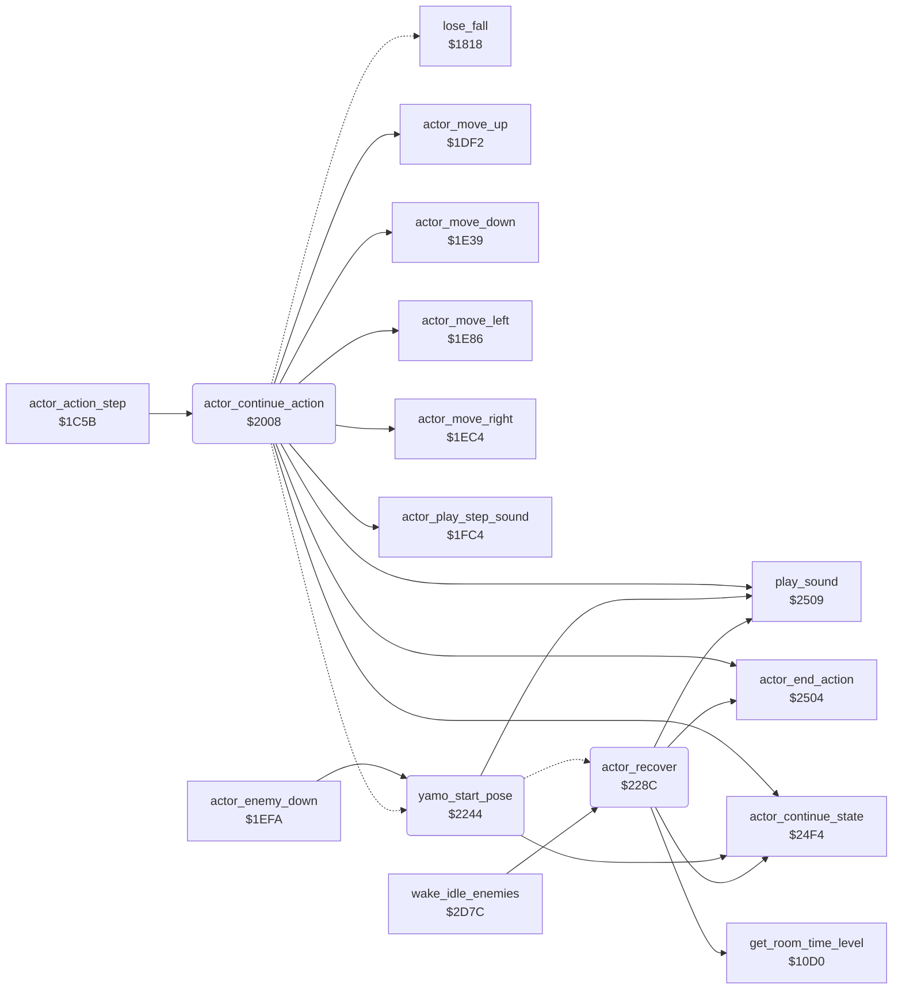

<!-- Generated by c64-docs from knowledge revision 20261018T222907.626-4u1tp6 and src/source-map.json. Do not edit: change the knowledge, generate the source again, then run docs.ts generate. -->
# actor_timed_actions.asm: Actor action state machine: continuation handlers of timed actions (jumps, flying kicks, ride, Yamo appear, punch, Ninja strike)

Range `$2008-$22F9`. Source: [actor_timed_actions.asm](../../../src/actor_timed_actions.asm). Index: [the reference](../index.md).

## Call graph

A solid arrow is a call, a thick arrow a table entry, a dotted arrow a jump. Rounded nodes are in this file.

## Names

### [`actor_continue_action`](../../../src/actor_timed_actions.asm#L14) `$2008`

*routine*

Continues the timed action of actor X (from actor_action_step when actor_timer,X is nonzero). In: Y = actor_timer,X, kept in temp_y. Each handler ends in actor_continue_state (state = A, timer = temp_y - 1) or in a setter that ends the action (actor_end_action, actor_recover, lose_fall ...). Dispatch on actor_state,X (a compare chain): $05 jump up        $0C flying kick left   $0D flying kick right  $06 jump left $07 jump right     $19 dying              $17 ride               $10 Yamo appears $11 punch          $16 Ninja strike       $14 AI chase           $15 AI back off $12 Yamo pose      $0F recoil             $13 knocked down       $18 wall bump Any other state (0 recovering after an attack, $1B hit by a fall attack) only counts its timer down.

- **Called from:** [`actor_action_step`](actor_step.md#actor_action_step) [`$1D7B`](../../../src/actor_step.asm#L182)
- **Calls:** [`actor_move_down`](actor_step.md#actor_move_down), [`actor_continue_state`](actor_hit_states.md#actor_continue_state), [`actor_move_up`](actor_step.md#actor_move_up), [`play_sound`](sound_request.md#play_sound), [`actor_move_left`](actor_step.md#actor_move_left), [`actor_move_right`](actor_step.md#actor_move_right), [`actor_end_action`](actor_hit_states.md#actor_end_action), [`actor_play_step_sound`](actor_step.md#actor_play_step_sound)
- **Jumps to:** [`actor_continue_state`](actor_hit_states.md#actor_continue_state), [`lose_fall`](lose_fall_game_over.md#lose_fall), [`actor_end_action`](actor_hit_states.md#actor_end_action), [`act_check_punch`](actor_timed_actions.md#act_check_punch), [`yamo_start_pose`](actor_timed_actions.md#yamo_start_pose)
- **Reads:** [`current_actor`](../memory-map.md#current_actor), [`temp_y`](../memory-map.md#temp_y), [`option_yamo_player2`](options_and_patterns.md#option_yamo_player2), [`anim_chars_delay`](../memory-map.md#anim_chars_delay), [`anim_chars_direction`](../memory-map.md#anim_chars_direction)
- **Writes:** [`temp_y`](../memory-map.md#temp_y), [`current_actor`](../memory-map.md#current_actor)
- **Refers to:** [`actor_move_queue`](../memory-map.md#actor_move_queue), [`actor_move_queue+3`](../memory-map.md#actor_move_queue)

### [`act_jump_up_continue`](../../../src/actor_timed_actions.asm#L35) `$202E`

*label*

- **Jumped to from:** [`actor_continue_action`](actor_timed_actions.md#actor_continue_action) [`$2018`](../../../src/actor_timed_actions.asm#L25), [`actor_continue_action`](actor_timed_actions.md#actor_continue_action) [`$201C`](../../../src/actor_timed_actions.asm#L27)

### [`act_jump_up_rise`](../../../src/actor_timed_actions.asm#L38) `$2033`

*label*

first rising step: 4 units

- **Jumped to from:** [`actor_continue_action`](actor_timed_actions.md#actor_continue_action) [`$2020`](../../../src/actor_timed_actions.asm#L29)

### [`act_jump_up_rise_two`](../../../src/actor_timed_actions.asm#L43) `$203D`

*label*

- **Jumped to from:** [`actor_continue_action`](actor_timed_actions.md#actor_continue_action) [`$2035`](../../../src/actor_timed_actions.asm#L40)

### [`act_check_kick_left`](../../../src/actor_timed_actions.asm#L48) `$2048`

*label*

state $0C flying kick left

- **Jumped to from:** [`actor_continue_action`](actor_timed_actions.md#actor_continue_action) [`$200E`](../../../src/actor_timed_actions.asm#L18)

### [`act_kick_left_phase`](../../../src/actor_timed_actions.asm#L63) `$2061`

*label*

- **Jumped to from:** [`actor_continue_action`](actor_timed_actions.md#actor_continue_action) [`$2054`](../../../src/actor_timed_actions.asm#L57)

### [`act_kick_left_fly`](../../../src/actor_timed_actions.asm#L70) `$2070`

*label*

- **Jumped to from:** [`actor_continue_action`](actor_timed_actions.md#actor_continue_action) [`$2063`](../../../src/actor_timed_actions.asm#L65)

### [`act_kick_left_descend`](../../../src/actor_timed_actions.asm#L76) `$207C`

*label*

on a floor: end the kick

- **Jumped to from:** [`actor_continue_action`](actor_timed_actions.md#actor_continue_action) [`$2072`](../../../src/actor_timed_actions.asm#L72)

### [`act_end_if_nonzero`](../../../src/actor_timed_actions.asm#L79) `$2080`

*label*

Z flag from the AND before the branch here

- **Jumped to from:** [`actor_continue_action`](actor_timed_actions.md#actor_continue_action) [`$2014`](../../../src/actor_timed_actions.asm#L23), [`actor_continue_action`](actor_timed_actions.md#actor_continue_action) [`$2026`](../../../src/actor_timed_actions.asm#L32), [`actor_continue_action`](actor_timed_actions.md#actor_continue_action) [`$2050`](../../../src/actor_timed_actions.asm#L55)

### [`act_check_kick_right`](../../../src/actor_timed_actions.asm#L85) `$208D`

*label*

state $0D flying kick right

- **Jumped to from:** [`actor_continue_action`](actor_timed_actions.md#actor_continue_action) [`$204A`](../../../src/actor_timed_actions.asm#L50)

### [`act_kick_right_phase`](../../../src/actor_timed_actions.asm#L99) `$20A6`

*label*

- **Jumped to from:** [`actor_continue_action`](actor_timed_actions.md#actor_continue_action) [`$2099`](../../../src/actor_timed_actions.asm#L93)

### [`act_kick_right_fly`](../../../src/actor_timed_actions.asm#L106) `$20B5`

*label*

- **Jumped to from:** [`actor_continue_action`](actor_timed_actions.md#actor_continue_action) [`$20A8`](../../../src/actor_timed_actions.asm#L101)

### [`act_kick_right_descend`](../../../src/actor_timed_actions.asm#L112) `$20C1`

*label*

on a floor: end the kick

- **Jumped to from:** [`actor_continue_action`](actor_timed_actions.md#actor_continue_action) [`$20B7`](../../../src/actor_timed_actions.asm#L108)

### [`act_kick_right_down`](../../../src/actor_timed_actions.asm#L116) `$20C7`

*label*

### [`act_check_jump_left`](../../../src/actor_timed_actions.asm#L121) `$20D2`

*label*

state 6 jump left

- **Jumped to from:** [`actor_continue_action`](actor_timed_actions.md#actor_continue_action) [`$208F`](../../../src/actor_timed_actions.asm#L87)

### [`act_jump_left_rise_one`](../../../src/actor_timed_actions.asm#L133) `$20E5`

*label*

- **Jumped to from:** [`actor_continue_action`](actor_timed_actions.md#actor_continue_action) [`$20E0`](../../../src/actor_timed_actions.asm#L131)

### [`act_end_action_near`](../../../src/actor_timed_actions.asm#L139) `$20F3`

*label*

- **Jumped to from:** [`actor_continue_action`](actor_timed_actions.md#actor_continue_action) [`$2080`](../../../src/actor_timed_actions.asm#L80), [`actor_continue_action`](actor_timed_actions.md#actor_continue_action) [`$2095`](../../../src/actor_timed_actions.asm#L91), [`actor_continue_action`](actor_timed_actions.md#actor_continue_action) [`$20C5`](../../../src/actor_timed_actions.asm#L115), [`actor_continue_action`](actor_timed_actions.md#actor_continue_action) [`$20DA`](../../../src/actor_timed_actions.asm#L128), [`actor_continue_action`](actor_timed_actions.md#actor_continue_action) [`$2109`](../../../src/actor_timed_actions.asm#L151), [`actor_continue_action`](actor_timed_actions.md#actor_continue_action) [`$2128`](../../../src/actor_timed_actions.asm#L167), [`actor_continue_action`](actor_timed_actions.md#actor_continue_action) [`$2154`](../../../src/actor_timed_actions.asm#L188)

### [`act_jump_left_glide`](../../../src/actor_timed_actions.asm#L141) `$20F6`

*label*

- **Jumped to from:** [`actor_continue_action`](actor_timed_actions.md#actor_continue_action) [`$20DE`](../../../src/actor_timed_actions.asm#L130)

### [`act_jump_left_descend`](../../../src/actor_timed_actions.asm#L148) `$2105`

*label*

on a floor: end the jump

- **Jumped to from:** [`actor_continue_action`](actor_timed_actions.md#actor_continue_action) [`$20F8`](../../../src/actor_timed_actions.asm#L143)

### [`act_jump_left_fall_one`](../../../src/actor_timed_actions.asm#L157) `$2118`

*label*

- **Jumped to from:** [`actor_continue_action`](actor_timed_actions.md#actor_continue_action) [`$2113`](../../../src/actor_timed_actions.asm#L155)

### [`act_check_jump_right`](../../../src/actor_timed_actions.asm#L161) `$2120`

*label*

state 7 jump right

- **Jumped to from:** [`actor_continue_action`](actor_timed_actions.md#actor_continue_action) [`$20D4`](../../../src/actor_timed_actions.asm#L123)

### [`act_jump_right_rise_one`](../../../src/actor_timed_actions.asm#L172) `$2133`

*label*

- **Jumped to from:** [`actor_continue_action`](actor_timed_actions.md#actor_continue_action) [`$212E`](../../../src/actor_timed_actions.asm#L170)

### [`act_jump_right_glide`](../../../src/actor_timed_actions.asm#L178) `$2141`

*label*

- **Jumped to from:** [`actor_continue_action`](actor_timed_actions.md#actor_continue_action) [`$212C`](../../../src/actor_timed_actions.asm#L169)

### [`act_jump_right_descend`](../../../src/actor_timed_actions.asm#L185) `$2150`

*label*

on a floor: end the jump

- **Jumped to from:** [`actor_continue_action`](actor_timed_actions.md#actor_continue_action) [`$2143`](../../../src/actor_timed_actions.asm#L180)

### [`act_jump_right_fall_one`](../../../src/actor_timed_actions.asm#L194) `$2163`

*label*

- **Jumped to from:** [`actor_continue_action`](actor_timed_actions.md#actor_continue_action) [`$215E`](../../../src/actor_timed_actions.asm#L192)

### [`act_check_dying`](../../../src/actor_timed_actions.asm#L198) `$216B`

*label*

state $19 dying

- **Jumped to from:** [`actor_continue_action`](actor_timed_actions.md#actor_continue_action) [`$2122`](../../../src/actor_timed_actions.asm#L163)

### [`act_continue_far`](../../../src/actor_timed_actions.asm#L207) `$2177`

*label*

- **Jumped to from:** [`actor_continue_action`](actor_timed_actions.md#actor_continue_action) [`$2171`](../../../src/actor_timed_actions.asm#L204)

### [`act_dying_lose_fall`](../../../src/actor_timed_actions.asm#L209) `$217A`

*label*

lose a fall, restart the room or end the game

- **Jumped to from:** [`actor_continue_action`](actor_timed_actions.md#actor_continue_action) [`$2175`](../../../src/actor_timed_actions.asm#L206)

### [`act_end_action_far`](../../../src/actor_timed_actions.asm#L211) `$217D`

*label*

- **Jumped to from:** [`actor_continue_action`](actor_timed_actions.md#actor_continue_action) [`$218B`](../../../src/actor_timed_actions.asm#L227)

### [`act_check_ride`](../../../src/actor_timed_actions.asm#L214) `$2180`

*label*

state $17 ride

- **Jumped to from:** [`actor_continue_action`](actor_timed_actions.md#actor_continue_action) [`$216D`](../../../src/actor_timed_actions.asm#L200)

### [`act_ride`](../../../src/actor_timed_actions.asm#L224) `$2187`

*label*

Ride (state $17, set by touch_climb_tile with timer 16 when an actor on a ladder or vine touches the moving character $62). Every 5th step (actor_ride_delay,X counts 4 down to 0) the actor moves 2 units in its joystick direction; a computer enemy gets a horizontal direction from its facing. When the moving scenery of animate_scrolling_chars steps (anim_chars_delay = 1) the actor is carried 2 units down (anim_chars_direction nonzero) or up. Then the joystick is cleared and the up and down counts of record 0 are reduced to their difference. Leaving the ladder or vine ends the ride.

- **Jumped to from:** [`actor_continue_action`](actor_timed_actions.md#actor_continue_action) [`$2182`](../../../src/actor_timed_actions.asm#L216)

### [`act_ride_enemy_left`](../../../src/actor_timed_actions.asm#L240) `$21A5`

*label*

left

- **Jumped to from:** [`actor_continue_action`](actor_timed_actions.md#actor_continue_action) [`$219D`](../../../src/actor_timed_actions.asm#L236)

### [`act_ride_check_delay`](../../../src/actor_timed_actions.asm#L244) `$21A9`

*label*

Every 5th step: move 2 units in the joystick direction (actor_ride_delay counts the steps between).

- **Jumped to from:** [`actor_continue_action`](actor_timed_actions.md#actor_continue_action) [`$2192`](../../../src/actor_timed_actions.asm#L231), [`actor_continue_action`](actor_timed_actions.md#actor_continue_action) [`$2197`](../../../src/actor_timed_actions.asm#L233), [`actor_continue_action`](actor_timed_actions.md#actor_continue_action) [`$21A3`](../../../src/actor_timed_actions.asm#L239)

### [`act_ride_move`](../../../src/actor_timed_actions.asm#L249) `$21B2`

*label*

up

- **Jumped to from:** [`actor_continue_action`](actor_timed_actions.md#actor_continue_action) [`$21AB`](../../../src/actor_timed_actions.asm#L246)

### [`act_ride_check_down`](../../../src/actor_timed_actions.asm#L256) `$21C1`

*label*

down

- **Jumped to from:** [`actor_continue_action`](actor_timed_actions.md#actor_continue_action) [`$21B6`](../../../src/actor_timed_actions.asm#L252)

### [`act_ride_check_left`](../../../src/actor_timed_actions.asm#L262) `$21CE`

*label*

left

- **Jumped to from:** [`actor_continue_action`](actor_timed_actions.md#actor_continue_action) [`$21C3`](../../../src/actor_timed_actions.asm#L258)

### [`act_ride_check_right`](../../../src/actor_timed_actions.asm#L268) `$21DB`

*label*

right

- **Jumped to from:** [`actor_continue_action`](actor_timed_actions.md#actor_continue_action) [`$21D0`](../../../src/actor_timed_actions.asm#L264)

### [`act_ride_moved`](../../../src/actor_timed_actions.asm#L273) `$21E5`

*label*

- **Jumped to from:** [`actor_continue_action`](actor_timed_actions.md#actor_continue_action) [`$21BE`](../../../src/actor_timed_actions.asm#L255), [`actor_continue_action`](actor_timed_actions.md#actor_continue_action) [`$21CB`](../../../src/actor_timed_actions.asm#L261), [`actor_continue_action`](actor_timed_actions.md#actor_continue_action) [`$21D8`](../../../src/actor_timed_actions.asm#L267)

### [`act_ride_carry`](../../../src/actor_timed_actions.asm#L279) `$21EE`

*label*

Carry the actor with the moving scenery when it steps this pass.
the moving scenery steps now

- **Jumped to from:** [`actor_continue_action`](actor_timed_actions.md#actor_continue_action) [`$21AF`](../../../src/actor_timed_actions.asm#L248), [`actor_continue_action`](actor_timed_actions.md#actor_continue_action) [`$21DD`](../../../src/actor_timed_actions.asm#L270)

### [`act_ride_carry_up`](../../../src/actor_timed_actions.asm#L288) `$2201`

*label*

- **Jumped to from:** [`actor_continue_action`](actor_timed_actions.md#actor_continue_action) [`$21F6`](../../../src/actor_timed_actions.asm#L284)

### [`act_ride_finish`](../../../src/actor_timed_actions.asm#L291) `$2207`

*label*

joystick: no direction

- **Jumped to from:** [`actor_continue_action`](actor_timed_actions.md#actor_continue_action) [`$21F2`](../../../src/actor_timed_actions.asm#L282), [`actor_continue_action`](actor_timed_actions.md#actor_continue_action) [`$21FE`](../../../src/actor_timed_actions.asm#L287)

### [`act_ride_net_up`](../../../src/actor_timed_actions.asm#L308) `$2228`

*label*

- **Jumped to from:** [`actor_continue_action`](actor_timed_actions.md#actor_continue_action) [`$2218`](../../../src/actor_timed_actions.asm#L301)

### [`act_ride_continue`](../../../src/actor_timed_actions.asm#L312) `$2230`

*label*

- **Jumped to from:** [`actor_continue_action`](actor_timed_actions.md#actor_continue_action) [`$2226`](../../../src/actor_timed_actions.asm#L307)

### [`act_check_yamo_appear`](../../../src/actor_timed_actions.asm#L315) `$2235`

*label*

state $10 Yamo appears

- **Jumped to from:** [`actor_continue_action`](actor_timed_actions.md#actor_continue_action) [`$2184`](../../../src/actor_timed_actions.asm#L217)

### [`yamo_start_pose`](../../../src/actor_timed_actions.asm#L326) `$2244`

*routine*

Yamo's pose (state $12, timer 16): he turns toward Bruce and sound $81 plays. Used when Yamo appears and when player 2 pushes down.

- **Called from:** [`actor_enemy_down`](actor_step.md#actor_enemy_down) [`$1F04`](../../../src/actor_step.asm#L426)
- **Jumped to from:** [`actor_continue_action`](actor_timed_actions.md#actor_continue_action) [`$223D`](../../../src/actor_timed_actions.asm#L321)
- **Calls:** [`play_sound`](sound_request.md#play_sound), [`actor_continue_state`](actor_hit_states.md#actor_continue_state)
- **Jumps to:** [`act_check_ninja_strike`](actor_timed_actions.md#act_check_ninja_strike), [`act_strike_in_wall`](actor_timed_actions.md#act_strike_in_wall), [`actor_recover`](actor_timed_actions.md#actor_recover)
- **Reads:** [`actor_x`](../memory-map.md#actor_x), [`current_actor`](../memory-map.md#current_actor), [`temp_y`](../memory-map.md#temp_y)
- **Writes:** [`current_actor`](../memory-map.md#current_actor)
- **Refers to:** [`actor_step_delay`](../memory-map.md#actor_step_delay)

### [`yamo_pose_set_facing`](../../../src/actor_timed_actions.asm#L331) `$224C`

*label*

- **Jumped to from:** [`yamo_start_pose`](actor_timed_actions.md#yamo_start_pose) [`$2267`](../../../src/actor_timed_actions.asm#L348)

### [`yamo_pose_face_right`](../../../src/actor_timed_actions.asm#L346) `$2265`

*label*

- **Jumped to from:** [`yamo_start_pose`](actor_timed_actions.md#yamo_start_pose) [`$2248`](../../../src/actor_timed_actions.asm#L329)

### [`act_check_punch`](../../../src/actor_timed_actions.asm#L349) `$226A`

*label*

state $11 punch

- **Jumped to from:** [`actor_continue_action`](actor_timed_actions.md#actor_continue_action) [`$2237`](../../../src/actor_timed_actions.asm#L317)

### [`act_punch_check_end`](../../../src/actor_timed_actions.asm#L366) `$2283`

*label*

- **Jumped to from:** [`yamo_start_pose`](actor_timed_actions.md#yamo_start_pose) [`$2276`](../../../src/actor_timed_actions.asm#L359)

### [`actor_recover`](../../../src/actor_timed_actions.asm#L376) `$228C`

*routine*

Ends an attack: state 0 with a recovery timer during which the actor stands still. The length depends on the time spent in the room (get_room_time_level: C = 1 from $19 units of 256 frames, V = 1 from $20 units): Bruce: 3 steps, 12 steps when C or V is set. Enemies: 6 steps (1 when game_loop_count is nonzero), 3 steps when C is set, 1 step when V is set.

- **Called from:** [`$2369`](../../../src/enemy_ai_states.asm#L82), [`$2399`](../../../src/enemy_ai_states.asm#L116), [`$243D`](../../../src/actor_hit_states.asm#L36), [`$24B0`](../../../src/actor_hit_states.asm#L96), [`wake_idle_enemies`](actor_helpers.md#wake_idle_enemies) [`$2DC0`](../../../src/actor_helpers.asm#L81)
- **Jumped to from:** [`yamo_start_pose`](actor_timed_actions.md#yamo_start_pose) [`$2285`](../../../src/actor_timed_actions.asm#L368)
- **Calls:** [`get_room_time_level`](game_setup.md#get_room_time_level), [`actor_end_action`](actor_hit_states.md#actor_end_action), [`play_sound`](sound_request.md#play_sound), [`actor_continue_state`](actor_hit_states.md#actor_continue_state)
- **Jumps to:** [`ai_chase`](enemy_ai_states.md#ai_chase), [`act_check_ai_back_off`](enemy_ai_states.md#act_check_ai_back_off)
- **Reads:** [`game_loop_count`](../memory-map.md#game_loop_count), [`current_actor`](../memory-map.md#current_actor), [`temp_y`](../memory-map.md#temp_y)
- **Writes:** [`current_actor`](../memory-map.md#current_actor)
- **Refers to:** [`actor_step_delay`](../memory-map.md#actor_step_delay), [`actor_move_queue`](../memory-map.md#actor_move_queue), [`actor_move_queue+9`](../memory-map.md#actor_move_queue), [`actor_move_queue+6`](../memory-map.md#actor_move_queue)

### [`actor_recover_enemy`](../../../src/actor_timed_actions.asm#L390) `$22A6`

*label*

- **Jumped to from:** [`actor_recover`](actor_timed_actions.md#actor_recover) [`$229A`](../../../src/actor_timed_actions.asm#L384)

### [`actor_recover_halve`](../../../src/actor_timed_actions.asm#L397) `$22B2`

*label*

- **Jumped to from:** [`actor_recover`](actor_timed_actions.md#actor_recover) [`$22AB`](../../../src/actor_timed_actions.asm#L393)

### [`actor_recover_double`](../../../src/actor_timed_actions.asm#L400) `$22B5`

*label*

- **Jumped to from:** [`actor_recover`](actor_timed_actions.md#actor_recover) [`$229F`](../../../src/actor_timed_actions.asm#L386), [`actor_recover`](actor_timed_actions.md#actor_recover) [`$22A1`](../../../src/actor_timed_actions.asm#L387)

### [`actor_recover_short`](../../../src/actor_timed_actions.asm#L403) `$22B8`

*label*

- **Jumped to from:** [`actor_recover`](actor_timed_actions.md#actor_recover) [`$22A9`](../../../src/actor_timed_actions.asm#L392), [`actor_recover`](actor_timed_actions.md#actor_recover) [`$22AF`](../../../src/actor_timed_actions.asm#L395)

### [`act_check_ninja_strike`](../../../src/actor_timed_actions.asm#L407) `$22BD`

*label*

state $16 Ninja strike

- **Jumped to from:** [`yamo_start_pose`](actor_timed_actions.md#yamo_start_pose) [`$226C`](../../../src/actor_timed_actions.asm#L351)

### [`act_strike_in_wall`](../../../src/actor_timed_actions.asm#L415) `$22C5`

*label*

- **Jumped to from:** [`yamo_start_pose`](actor_timed_actions.md#yamo_start_pose) [`$2272`](../../../src/actor_timed_actions.asm#L357)

### [`act_strike_phase`](../../../src/actor_timed_actions.asm#L419) `$22CA`

*label*

- **Jumped to from:** [`actor_recover`](actor_timed_actions.md#actor_recover) [`$22C5`](../../../src/actor_timed_actions.asm#L416)

### [`act_strike_check_end`](../../../src/actor_timed_actions.asm#L427) `$22D9`

*label*

- **Jumped to from:** [`actor_recover`](actor_timed_actions.md#actor_recover) [`$22CC`](../../../src/actor_timed_actions.asm#L421)

### [`act_strike_count_left`](../../../src/actor_timed_actions.asm#L435) `$22E8`

*label*

- **Jumped to from:** [`actor_recover`](actor_timed_actions.md#actor_recover) [`$22E1`](../../../src/actor_timed_actions.asm#L432)

### [`act_strike_continue`](../../../src/actor_timed_actions.asm#L437) `$22EB`

*label*

- **Jumped to from:** [`actor_recover`](actor_timed_actions.md#actor_recover) [`$22E6`](../../../src/actor_timed_actions.asm#L434)

### [`act_strike_end`](../../../src/actor_timed_actions.asm#L440) `$22F0`

*label*

- **Jumped to from:** [`actor_recover`](actor_timed_actions.md#actor_recover) [`$22DB`](../../../src/actor_timed_actions.asm#L429)

### [`act_check_ai_chase`](../../../src/actor_timed_actions.asm#L442) `$22F3`

*label*

state $14 AI chase

- **Jumped to from:** [`actor_recover`](actor_timed_actions.md#actor_recover) [`$22BF`](../../../src/actor_timed_actions.asm#L409)
