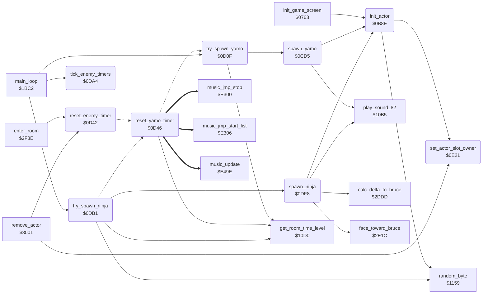

<!-- Generated by c64-docs from knowledge revision 20261016T170255.379-vv114c and src/source-map.json. Do not edit: change the knowledge, generate the source again, then run generate.ts. -->
# actors.asm: Actor set-up and enemy spawning

Range `$0B8E-$0E2D`. Source: [actors.asm](../../../src/actors.asm). Index: [the reference](../index.md).

## Call graph

A solid arrow is a call, a thick arrow a table entry, a dotted arrow a jump. Rounded nodes are in this file.

## Names

### [`init_actor`](../../../src/actors.asm#L6) `$0B8E`

*routine*

Initialises actor X (0 Bruce Lee, 1 Yamo, 2 Ninja) with type bits A ($00 Bruce, $80 Yamo, $40 Ninja): state, animation, start position (room spawn point, or the pending room entry position), sprite pointers, positions and enable bits.

- **Called from:** [`init_game_screen`](game_setup.md#init_game_screen) [`$082A`](../../../src/game_setup.asm#L95), [`spawn_yamo`](actors.md#spawn_yamo) [`$0CE5`](../../../src/actors.asm#L186), [`spawn_ninja`](actors.md#spawn_ninja) [`$0DFD`](../../../src/actors.asm#L358)
- **Calls:** [`set_actor_slot_owner`](actors.md#set_actor_slot_owner), [`random_byte`](interrupts.md#random_byte)
- **Reads:** [`temp_y`](../variables.md#temp_y), [`game_playing`](../variables.md#game_playing), [`current_room`](../variables.md#current_room), [`current_actor`](../variables.md#current_actor), [`sprite_buffer_select`](sprite_render.md#sprite_buffer_select), [`MSIGX`](../variables.md#MSIGX), [`SPENA`](../variables.md#SPENA)
- **Writes:** [`temp_y`](../variables.md#temp_y), [`current_actor`](../variables.md#current_actor), [`MSIGX`](../variables.md#MSIGX), [`SPENA`](../variables.md#SPENA)
- **Refers to:** [`actor_type_sprite_a`](sprite_data.md#actor_type_sprite_a), [`actor_type_sprite_b`](sprite_data.md#actor_type_sprite_b), [`actor_frame_rel_a`](actor_vars.md#actor_frame_rel_a), [`actor_frame_a`](actor_vars.md#actor_frame_a), [`actor_frame_b`](actor_vars.md#actor_frame_b), [`room_spawn_y`](room_tables.md#room_spawn_y), [`room_spawn_x`](room_tables.md#room_spawn_x), [`yamo_idle_timer`](../variables.md#yamo_idle_timer), [`yamo_entry_preference`](actor_room_tables.md#yamo_entry_preference), [`room_alt_spawn_y`](room_tables.md#room_alt_spawn_y), [`room_alt_spawn_x`](room_tables.md#room_alt_spawn_x), [`ninja_entry_preference`](actor_room_tables.md#ninja_entry_preference), [`enemy_entry_y`](../variables.md#enemy_entry_y), [`enemy_saved_energy`](../variables.md#enemy_saved_energy), [`actor_body_sprite`](sprite_render.md#actor_body_sprite), [`sprite_pointer_table`](sprite_render.md#sprite_pointer_table), [`sprite_pointers`](vic_bank2.md#sprite_pointers), [`sprite_bit_mask`](sprite_render.md#sprite_bit_mask), [`sprite_clear_mask`](sprite_render.md#sprite_clear_mask), [`SP0X`](../variables.md#SP0X), [`SP0Y`](../variables.md#SP0Y), [`actor_overlay_sprite`](sprite_render.md#actor_overlay_sprite)

### [`actor_use_spawn_a`](../../../src/actors.asm#L50) `$0BE7`

*label*

- **Jumped to from:** [`init_actor`](actors.md#init_actor) [`$0BE2`](../../../src/actors.asm#L47), [`init_actor`](actors.md#init_actor) [`$0C13`](../../../src/actors.asm#L73), [`init_actor`](actors.md#init_actor) [`$0C1C`](../../../src/actors.asm#L79), [`init_actor`](actors.md#init_actor) [`$0C3B`](../../../src/actors.asm#L94)

### [`actor_set_position`](../../../src/actors.asm#L55) `$0BF0`

*label*

- **Jumped to from:** [`init_actor`](actors.md#init_actor) [`$0C27`](../../../src/actors.asm#L85)

### [`actor_pick_spawn`](../../../src/actors.asm#L61) `$0BFA`

*label*

enemy: follow entry point (enemy_entry_x non-zero), else spawn point A or B from the room tables

- **Jumped to from:** [`init_actor`](actors.md#init_actor) [`$0BE5`](../../../src/actors.asm#L49)

### [`actor_random_spawn`](../../../src/actors.asm#L76) `$0C17`

*label*

Random spawn: spawn point A (room_spawn_x/y) or B (room_alt_spawn_x/y) with equal chance.

- **Jumped to from:** [`init_actor`](actors.md#init_actor) [`$0C07`](../../../src/actors.asm#L68), [`init_actor`](actors.md#init_actor) [`$0C0E`](../../../src/actors.asm#L71), [`init_actor`](actors.md#init_actor) [`$0C2F`](../../../src/actors.asm#L89), [`init_actor`](actors.md#init_actor) [`$0C36`](../../../src/actors.asm#L92)

### [`actor_use_spawn_b`](../../../src/actors.asm#L80) `$0C1E`

*label*

- **Jumped to from:** [`init_actor`](actors.md#init_actor) [`$0C15`](../../../src/actors.asm#L74), [`init_actor`](actors.md#init_actor) [`$0C3D`](../../../src/actors.asm#L95)

### [`actor_pick_spawn_ninja`](../../../src/actors.asm#L86) `$0C2A`

*label*

- **Jumped to from:** [`init_actor`](actors.md#init_actor) [`$0C00`](../../../src/actors.asm#L65)

### [`actor_use_entry_pos`](../../../src/actors.asm#L97) `$0C3F`

*label*

Follow entry (X = 1 Yamo, 2 Ninja): A = enemy_entry_x ($8A+X), actor_y = enemy_entry_y ($8C+X), actor_energy = enemy_saved_energy ($8E+X), then enemy_entry_x is cleared. The source shows these operands as yamo_idle_timer+1, enemy_entry_x+1 and enemy_entry_y+1 because X starts at 1.

- **Jumped to from:** [`init_actor`](actors.md#init_actor) [`$0BFC`](../../../src/actors.asm#L63)

### [`actor_place_sprites`](../../../src/actors.asm#L105) `$0C4D`

*label*

- **Jumped to from:** [`init_actor`](actors.md#init_actor) [`$0BF7`](../../../src/actors.asm#L60)

### [`spawn_yamo`](../../../src/actors.asm#L177) `$0CD5`

*routine*

Plays sound $82, stores the protection signature XOR in protection_key, and initialises actor 1 as Yamo with his animation frames.

- **Called from:** [`try_spawn_yamo`](actors.md#try_spawn_yamo) [`$0D1B`](../../../src/actors.asm#L214)
- **Calls:** [`play_sound_82`](room_state.md#play_sound_82), [`init_actor`](actors.md#init_actor)
- **Reads:** [`protection_sig_a`](protection_signature.md#protection_sig_a), [`protection_sig_b`](protection_signature.md#protection_sig_b), [`actor_energy+1`](../variables.md#actor_energy)
- **Writes:** [`protection_key`](actor_room_tables.md#protection_key), [`actor_state+1`](../variables.md#actor_state), [`actor_frame_rel_a+1`](actor_vars.md#actor_frame_rel_a), [`actor_frame_rel_b+1`](actor_vars.md#actor_frame_rel_b), [`actor_frame_a+1`](actor_vars.md#actor_frame_a), [`actor_frame_b+1`](actor_vars.md#actor_frame_b), [`actor_state_timer+1`](../variables.md#actor_state_timer), [`actor_energy+1`](../variables.md#actor_energy)

### [`sig_a_operand`](../../../src/actors.asm#L179) `$0CD9-$0CDB`

*variable*

- **Read by:** [`play_sound_80_checked`](actor_movement.md#play_sound_80_checked) [`$1FD3`](../../../src/actor_movement.asm#L542), [`play_sound_80_checked`](actor_movement.md#play_sound_80_checked) [`$1FD9`](../../../src/actor_movement.asm#L544)
- **Written by:** [`play_sound_80_checked`](actor_movement.md#play_sound_80_checked) [`$1FD3`](../../../src/actor_movement.asm#L542)

### [`sig_b_operand`](../../../src/actors.asm#L181) `$0CDC-$0D0E`

*variable*

- **Jumped to from:** [`spawn_yamo`](actors.md#spawn_yamo) [`$0D08`](../../../src/actors.asm#L201) (+50)
- **Read by:** [`play_sound_80_checked`](actor_movement.md#play_sound_80_checked) [`$1FD6`](../../../src/actor_movement.asm#L543)
- **Written by:** [`play_sound_80_checked`](actor_movement.md#play_sound_80_checked) [`$1FD6`](../../../src/actor_movement.asm#L543)

### [`try_spawn_yamo`](../../../src/actors.asm#L207) `$0D0F`

*routine*

When yamo_spawn_timer is zero and Yamo is not active, spawns Yamo and reloads the timer from yamo_respawn_delay ($30 with a human opponent), shortened by the $10D0 check.

- **Called from:** [`main_loop`](main_loop.md#main_loop) [`$1BF8`](../../../src/main_loop.asm#L30)
- **Calls:** [`spawn_yamo`](actors.md#spawn_yamo), [`get_room_time_level`](room_state.md#get_room_time_level)
- **Reads:** [`yamo_spawn_timer`](../variables.md#yamo_spawn_timer), [`actor_flags+1`](../variables.md#actor_flags), [`current_room`](../variables.md#current_room), [`human_opponent_mode`](variables.md#human_opponent_mode), [`game_cycle`](../variables.md#game_cycle)
- **Writes:** [`yamo_spawn_timer`](../variables.md#yamo_spawn_timer)
- **Refers to:** [`yamo_respawn_delay`](actor_room_tables.md#yamo_respawn_delay)

### [`yamo_timer_halve`](../../../src/actors.asm#L229) `$0D3A`

*label*

- **Jumped to from:** [`try_spawn_yamo`](actors.md#try_spawn_yamo) [`$0D33`](../../../src/actors.asm#L225)

### [`yamo_timer_minimum`](../../../src/actors.asm#L234) `$0D3D`

*label*

- **Jumped to from:** [`try_spawn_yamo`](actors.md#try_spawn_yamo) [`$0D31`](../../../src/actors.asm#L224), [`try_spawn_yamo`](actors.md#try_spawn_yamo) [`$0D37`](../../../src/actors.asm#L227), [`reset_yamo_timer`](actors.md#reset_yamo_timer) [`$0D66`](../../../src/actors.asm#L261), [`reset_yamo_timer`](actors.md#reset_yamo_timer) [`$0D6C`](../../../src/actors.asm#L264)

### [`reset_enemy_timer`](../../../src/actors.asm#L239) `$0D42`

*routine*

Reloads the spawn timer of actor X from the room table: X=1 Yamo, X=2 Ninja, other values both.

- **Called from:** [`enter_room`](background_touch.md#enter_room) [`$2FC6`](../../../src/background_touch.asm#L245), [`remove_actor`](background_touch.md#remove_actor) [`$3048`](../../../src/background_touch.asm#L314)
- **Jumps to:** [`l_0d72`](../../../src/actors.asm#L270)

### [`reset_yamo_timer`](../../../src/actors.asm#L243) `$0D46`

*routine*

Reloads yamo_spawn_timer from yamo_respawn_delay for current_room ($30 with a human opponent), shortened by the $10D0 check.

- **Calls:** [`get_room_time_level`](room_state.md#get_room_time_level)
- **Jumps to:** [`yamo_timer_minimum`](actors.md#yamo_timer_minimum)
- **Reads:** [`current_room`](../variables.md#current_room), [`music_api_stop`](music_player.md#music_api_stop), [`human_opponent_mode`](variables.md#human_opponent_mode), [`game_cycle`](../variables.md#game_cycle), [`yamo_spawn_timer`](../variables.md#yamo_spawn_timer), [`ninja_spawn_timer`](../variables.md#ninja_spawn_timer)
- **Writes:** [`yamo_spawn_timer`](../variables.md#yamo_spawn_timer), [`ninja_spawn_timer`](../variables.md#ninja_spawn_timer)
- **Refers to:** [`yamo_respawn_delay`](actor_room_tables.md#yamo_respawn_delay), [`ninja_respawn_delay`](actor_room_tables.md#ninja_respawn_delay)

### [`yamo_delay_ptr_lo`](../../../src/actors.asm#L251) `$0D56`

*variable*

- **Written by:** [`reset_yamo_timer`](actors.md#reset_yamo_timer) [`$0D4B`](../../../src/actors.asm#L247)

### [`yamo_delay_ptr_hi`](../../../src/actors.asm#L252) `$0D57-$0D6E`

*variable*

- **Jumped to from:** [`reset_yamo_timer`](actors.md#reset_yamo_timer) [`$0D5D`](../../../src/actors.asm#L256) (+12)
- **Written by:** [`reset_yamo_timer`](actors.md#reset_yamo_timer) [`$0D52`](../../../src/actors.asm#L250)

### [`yamo_timer_halve_on_reset`](../../../src/actors.asm#L266) `$0D6F`

*label*

- **Jumped to from:** [`reset_yamo_timer`](actors.md#reset_yamo_timer) [`$0D68`](../../../src/actors.asm#L262)

### [`reset_ninja_timer`](../../../src/actors.asm#L274) `$0D76`

*label*

Reloads ninja_spawn_timer from ninja_respawn_delay for current_room, shortened by the $10D0 check.

- **Jumped to from:** [`reset_yamo_timer`](actors.md#reset_yamo_timer) [`$0DA1`](../../../src/actors.asm#L302)

### [`ninja_delay_ptr_lo`](../../../src/actors.asm#L282) `$0D86`

*variable*

- **Written by:** [`reset_yamo_timer`](actors.md#reset_yamo_timer) [`$0D7B`](../../../src/actors.asm#L278)

### [`ninja_delay_ptr_hi`](../../../src/actors.asm#L283) `$0D87-$0D95`

*variable*

- **Written by:** [`reset_yamo_timer`](actors.md#reset_yamo_timer) [`$0D82`](../../../src/actors.asm#L281)

### [`ninja_timer_halve_on_reset`](../../../src/actors.asm#L292) `$0D96`

*label*

- **Jumped to from:** [`reset_yamo_timer`](actors.md#reset_yamo_timer) [`$0D8F`](../../../src/actors.asm#L288)

### [`ninja_timer_minimum`](../../../src/actors.asm#L296) `$0D99`

*label*

- **Jumped to from:** [`reset_yamo_timer`](actors.md#reset_yamo_timer) [`$0D8D`](../../../src/actors.asm#L287), [`reset_yamo_timer`](actors.md#reset_yamo_timer) [`$0D93`](../../../src/actors.asm#L290), [`try_spawn_ninja`](actors.md#try_spawn_ninja) [`$0DEC`](../../../src/actors.asm#L344), [`try_spawn_ninja`](actors.md#try_spawn_ninja) [`$0DF2`](../../../src/actors.asm#L347)

### [`reset_both_timers`](../../../src/actors.asm#L300) `$0D9E`

*label*

- **Jumped to from:** [`reset_yamo_timer`](actors.md#reset_yamo_timer) [`$0D74`](../../../src/actors.asm#L272)

### [`tick_enemy_timers`](../../../src/actors.asm#L304) `$0DA4`

*routine*

Decrements ninja_spawn_timer and yamo_spawn_timer when they are not zero.

- **Called from:** [`main_loop`](main_loop.md#main_loop) [`$1BF5`](../../../src/main_loop.asm#L29)
- **Reads:** [`ninja_spawn_timer`](../variables.md#ninja_spawn_timer), [`yamo_spawn_timer`](../variables.md#yamo_spawn_timer)
- **Writes:** [`ninja_spawn_timer`](../variables.md#ninja_spawn_timer), [`yamo_spawn_timer`](../variables.md#yamo_spawn_timer)

### [`try_spawn_ninja`](../../../src/actors.asm#L315) `$0DB1`

*routine*

When ninja_spawn_timer is zero and the Ninja is not active, spawns the Ninja and reloads the timer from ninja_respawn_delay; while Yamo is active it usually (random >= $19) postpones the spawn by setting the timer to $10.

- **Called from:** [`main_loop`](main_loop.md#main_loop) [`$1BFB`](../../../src/main_loop.asm#L31)
- **Calls:** [`get_room_time_level`](room_state.md#get_room_time_level), [`random_byte`](interrupts.md#random_byte), [`spawn_ninja`](actors.md#spawn_ninja)
- **Jumps to:** [`ninja_timer_minimum`](actors.md#ninja_timer_minimum)
- **Reads:** [`ninja_spawn_timer`](../variables.md#ninja_spawn_timer), [`actor_flags+1`](../variables.md#actor_flags), [`game_cycle`](../variables.md#game_cycle), [`human_opponent_mode`](variables.md#human_opponent_mode), [`actor_flags+2`](../variables.md#actor_flags), [`current_room`](../variables.md#current_room)
- **Writes:** [`ninja_spawn_timer`](../variables.md#ninja_spawn_timer)
- **Refers to:** [`actor_flags`](../variables.md#actor_flags), [`ninja_respawn_delay`](actor_room_tables.md#ninja_respawn_delay)

### [`ninja_spawn_check`](../../../src/actors.asm#L334) `$0DD7`

*label*

- **Jumped to from:** [`try_spawn_ninja`](actors.md#try_spawn_ninja) [`$0DB9`](../../../src/actors.asm#L320), [`try_spawn_ninja`](actors.md#try_spawn_ninja) [`$0DBD`](../../../src/actors.asm#L322), [`try_spawn_ninja`](actors.md#try_spawn_ninja) [`$0DC2`](../../../src/actors.asm#L324), [`try_spawn_ninja`](actors.md#try_spawn_ninja) [`$0DC7`](../../../src/actors.asm#L326), [`try_spawn_ninja`](actors.md#try_spawn_ninja) [`$0DC9`](../../../src/actors.asm#L327), [`try_spawn_ninja`](actors.md#try_spawn_ninja) [`$0DD0`](../../../src/actors.asm#L330)

### [`ninja_timer_halve`](../../../src/actors.asm#L349) `$0DF5`

*label*

- **Jumped to from:** [`try_spawn_ninja`](actors.md#try_spawn_ninja) [`$0DEE`](../../../src/actors.asm#L345)

### [`spawn_ninja`](../../../src/actors.asm#L355) `$0DF8`

*routine*

Plays sound $82 and initialises actor 2 as the Ninja, then calls $2DDD and $2E1C.

- **Called from:** [`try_spawn_ninja`](actors.md#try_spawn_ninja) [`$0DDF`](../../../src/actors.asm#L339)
- **Calls:** [`play_sound_82`](room_state.md#play_sound_82), [`init_actor`](actors.md#init_actor), [`calc_delta_to_bruce`](actor_checks.md#calc_delta_to_bruce), [`face_toward_bruce`](actor_checks.md#face_toward_bruce)
- **Refers to:** [`actor_frame_a`](actor_vars.md#actor_frame_a), [`actor_frame_b`](actor_vars.md#actor_frame_b)

### [`set_actor_slot_owner`](../../../src/actors.asm#L375) `$0E21`

*routine*

Stores actor X into actor_slot_owner at the entry that table $59AE gives for A-3. Keeps X.

- **Called from:** [`init_actor`](actors.md#init_actor) [`$0B9F`](../../../src/actors.asm#L17), [`init_actor`](actors.md#init_actor) [`$0BAB`](../../../src/actors.asm#L22), [`remove_actor`](background_touch.md#remove_actor) [`$3027`](../../../src/background_touch.asm#L297), [`remove_actor`](background_touch.md#remove_actor) [`$3033`](../../../src/background_touch.asm#L303)
- **Refers to:** [`sprite_owner_slot`](sprite_data.md#sprite_owner_slot), [`sprite_owner`](actor_vars.md#sprite_owner)
