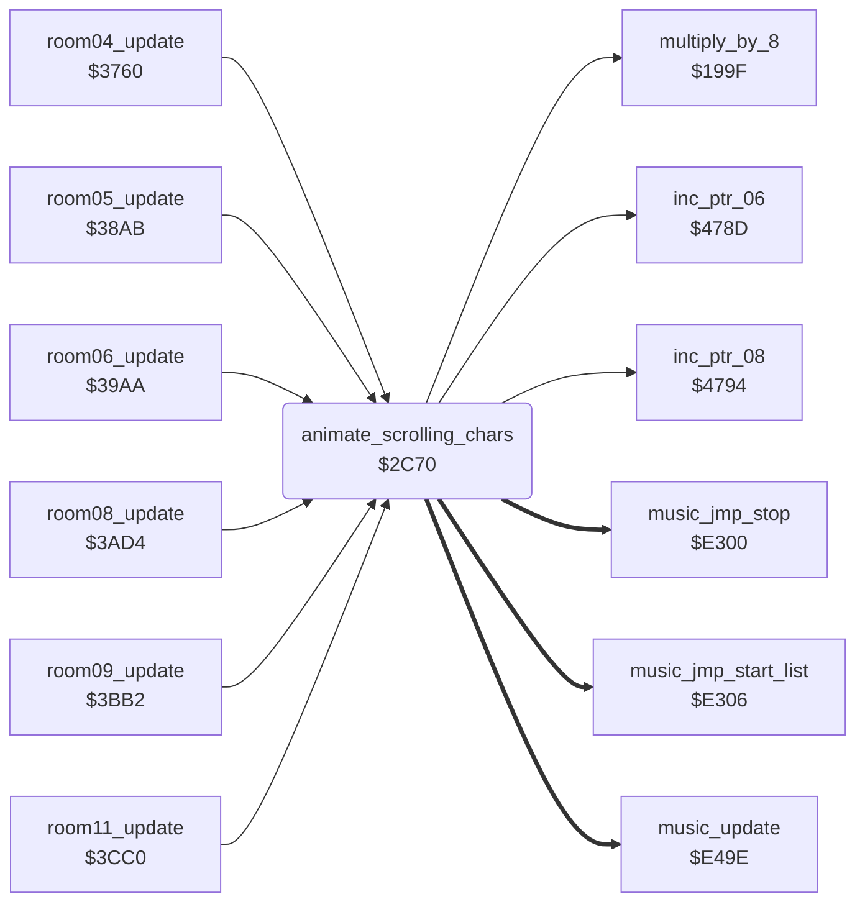

<!-- Generated by c64-docs from knowledge revision 20261016T170255.379-vv114c and src/source-map.json. Do not edit: change the knowledge, generate the source again, then run generate.ts. -->
# animated_chars.asm: Moving climbing-texture character animation

Range `$2C70-$2D54`. Source: [animated_chars.asm](../../../src/animated_chars.asm). Index: [the reference](../index.md).

## Call graph

A solid arrow is a call, a thick arrow a table entry, a dotted arrow a jump. Rounded nodes are in this file.

## Data

| Range | Type | Name | Read by | Written by |
|---|---|---|---|---|
| [`$2CED`](../../../src/animated_chars.asm#L80)-`$2CEE` | dual-use |  |  |  |

## Names

### [`animate_scrolling_chars`](../../../src/animated_chars.asm#L6) `$2C70`

*routine*

Counts the scroll timer $60 down. When it ends: reloads it from scroll_speed_table ($4321 index; the index steps when scroll_moves runs out and the direction $65 flips when it wraps), moves the scroll offset $64 (0-7) and redraws three animated characters from 8-byte patterns at $42F1 (rooms 0-9) or $4309 (rooms 10-19).

- **Called from:** [`room04_update`](room_update.md#room04_update) [`$38A8`](../../../src/room_update.asm#L325), [`room05_update`](room_update.md#room05_update) [`$39A7`](../../../src/room_update.asm#L463), [`room06_update`](room_update.md#room06_update) [`$39C0`](../../../src/room_update.asm#L476), [`room08_update`](room_update.md#room08_update) [`$3BAF`](../../../src/room_update.asm#L746), [`room09_update`](room_update.md#room09_update) [`$3C8D`](../../../src/room_update.asm#L866), [`room11_update`](room_update.md#room11_update) [`$3CD9`](../../../src/room_update.asm#L907)
- **Calls:** [`multiply_by_8`](status.md#multiply_by_8), [`inc_ptr_06`](pointer_helpers.md#inc_ptr_06), [`inc_ptr_08`](pointer_helpers.md#inc_ptr_08)
- **Reads:** [`scroll_timer`](../variables.md#scroll_timer), [`anim_speed_index`](variables.md#anim_speed_index), [`scroll_moves`](../variables.md#scroll_moves), [`current_room`](../variables.md#current_room), [`scroll_direction`](../variables.md#scroll_direction), [`scroll_offset`](../variables.md#scroll_offset), [`actor_upper_contact+2`](../variables.md#actor_upper_contact), [`scroll_patterns_ptr`](../variables.md#scroll_patterns_ptr), [`scroll_patterns_ptr+1`](../variables.md#scroll_patterns_ptr), [`char_addr_lo`](variables.md#char_addr_lo), [`char_addr_hi`](variables.md#char_addr_hi), [`charset_hi`](../variables.md#charset_hi), [`work_ptr_b`](../variables.md#work_ptr_b), [`work_ptr_c`](../variables.md#work_ptr_c), [`current_actor`](../variables.md#current_actor)
- **Writes:** [`scroll_timer`](../variables.md#scroll_timer), [`scroll_moves`](../variables.md#scroll_moves), [`charset_hi`](../variables.md#charset_hi), [`scroll_patterns_ptr`](../variables.md#scroll_patterns_ptr), [`scroll_patterns_ptr+1`](../variables.md#scroll_patterns_ptr), [`anim_speed_index`](variables.md#anim_speed_index), [`scroll_direction`](../variables.md#scroll_direction), [`scroll_offset`](../variables.md#scroll_offset), [`current_actor`](../variables.md#current_actor), [`char_addr_lo`](variables.md#char_addr_lo), [`work_ptr_b`](../variables.md#work_ptr_b), [`work_ptr_c`](../variables.md#work_ptr_c), [`work_ptr_b+1`](../variables.md#work_ptr_b), [`work_ptr_c+1`](../variables.md#work_ptr_c), [`l_22b3`](../../../src/object_actions.asm#L379)
- **Refers to:** [`char_anim_delays`](room_tables.md#char_anim_delays), [`anim_char_patterns_rooms_0_9`](variables.md#anim_char_patterns_rooms_0_9), [`scroll_patterns_ptr`](../variables.md#scroll_patterns_ptr), [`anim_char_patterns_rooms_10_19`](variables.md#anim_char_patterns_rooms_10_19), [`actor_upper_contact`](../variables.md#actor_upper_contact), [`work_ptr_b`](../variables.md#work_ptr_b), [`work_ptr_c`](../variables.md#work_ptr_c), [`music_api_stop`](music_player.md#music_api_stop)

### [`scroll_pause_tick`](../../../src/animated_chars.asm#L13) `$2C79`

*label*

Pause mode (scroll_timer bit 7, speed index 0 = $84): counts the low bits down without moving the texture.

- **Jumped to from:** [`animate_scrolling_chars`](animated_chars.md#animate_scrolling_chars) [`$2C72`](../../../src/animated_chars.asm#L8)

### [`scroll_pause_period_end`](../../../src/animated_chars.asm#L22) `$2C85`

*label*

Pause period over: reload the timer and count scroll_moves; when it runs out go to the next speed index.

- **Jumped to from:** [`animate_scrolling_chars`](animated_chars.md#animate_scrolling_chars) [`$2C7E`](../../../src/animated_chars.asm#L17)

### [`scroll_chars_step`](../../../src/animated_chars.asm#L29) `$2C92`

*label*

- **Jumped to from:** [`animate_scrolling_chars`](animated_chars.md#animate_scrolling_chars) [`$2C76`](../../../src/animated_chars.asm#L10)

### [`scroll_next_speed`](../../../src/animated_chars.asm#L52) `$2CBC`

*label*

17 moves done: anim_speed_index - 1; below 0 it wraps to 7 and scroll_direction flips.

- **Jumped to from:** [`animate_scrolling_chars`](animated_chars.md#animate_scrolling_chars) [`$2C8F`](../../../src/animated_chars.asm#L27)

### [`scroll_load_speed`](../../../src/animated_chars.asm#L60) `$2CCC`

*label*

- **Jumped to from:** [`animate_scrolling_chars`](animated_chars.md#animate_scrolling_chars) [`$2CBF`](../../../src/animated_chars.asm#L54)

### [`scroll_move_offset`](../../../src/animated_chars.asm#L67) `$2CD8`

*label*

Direction 0 (up): scroll_offset + 1 (7 -> 0); direction 1 (down): scroll_offset - 1 (0 -> 7).

- **Jumped to from:** [`animate_scrolling_chars`](animated_chars.md#animate_scrolling_chars) [`$2CBA`](../../../src/animated_chars.asm#L50)

### [`scroll_offset_down`](../../../src/animated_chars.asm#L75) `$2CE6`

*label*

- **Jumped to from:** [`animate_scrolling_chars`](animated_chars.md#animate_scrolling_chars) [`$2CDA`](../../../src/animated_chars.asm#L69)

### [`redraw_scroll_chars`](../../../src/animated_chars.asm#L82) `$2CF1`

*label*

- **Jumped to from:** [`animate_scrolling_chars`](animated_chars.md#animate_scrolling_chars) [`$2CE2`](../../../src/animated_chars.asm#L73), [`animate_scrolling_chars`](animated_chars.md#animate_scrolling_chars) [`$2CE8`](../../../src/animated_chars.asm#L77)
