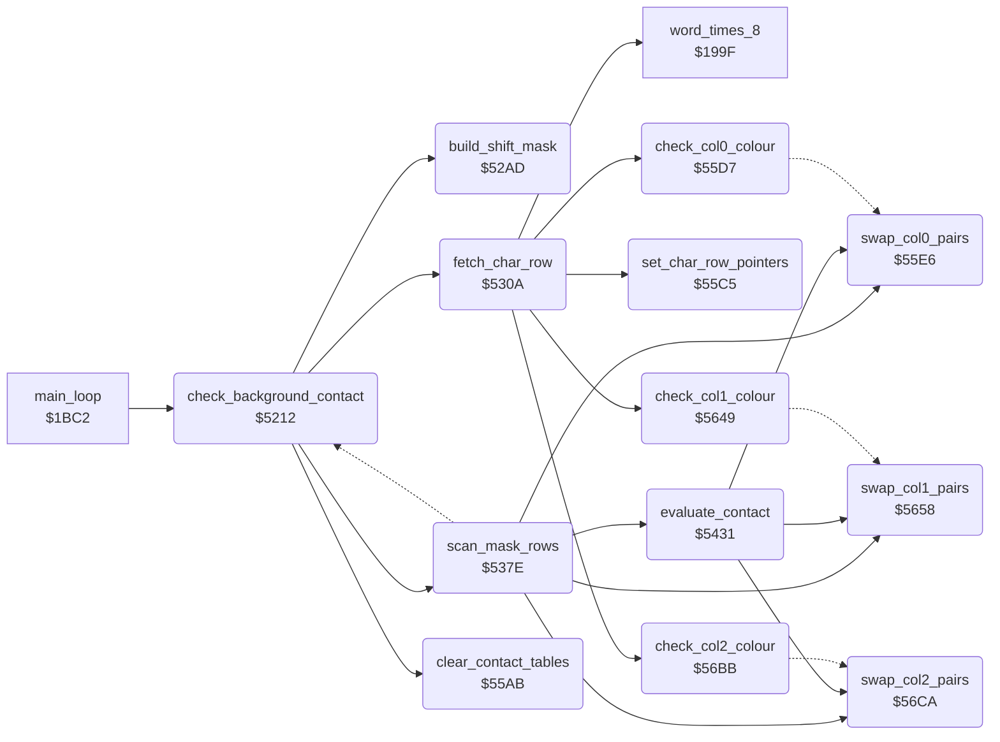

<!-- Generated by c64-docs from knowledge revision 20261017T121733.607-wszjh3 and src/source-map.json. Do not edit: change the knowledge, generate the source again, then run generate.ts. -->
# background_contact.asm: Pixel contact test of the three characters against the background characters

Range `$5212-$572C`. Source: [background_contact.asm](../../../src/background_contact.asm). Index: [the reference](../index.md).

## Call graph

A solid arrow is a call, a thick arrow a table entry, a dotted arrow a jump. Rounded nodes are in this file.

## Names

### [`check_background_contact`](../../../src/background_contact.asm#L17) `$5212`

*routine*

Pixel contact test of the actors against the background chars, called on each main loop pass (main_loop_room_logic). For each actor X = 2..0 that is active (bit 0 of actor_flags,x): - the contact mask of frame actor_frame_a,x is copied into the mask buffer shift_mask_col0..col3 (4 columns of 32 rows), shifted down by (Y - 29) AND 7 rows and right by (X - 12) AND 3 multicolour pixels (build_shift_mask); actor_cell_col,x / actor_cell_row,x = char column and row of its top left corner; - for 4 char rows, the 3 chars under the mask columns are ANDed with the mask row by row (fetch_char_row, scan_mask_rows) and the pixel code pairs are recorded in contact_col0..2; - actor_contact_upper,x gets the result for the rows down to contact_upper_end_row and actor_contact,x for all rows: bit 0 = %01 pixels touched, bit 1 = %10, bit 2 = %11 in a char with colour RAM colour not 0, bit 3 = %11 in a char with colour 0. Uses contact_actor (actor), temp_y (first mask row of the char row), contact_pixel_x / contact_pixel_y (pixel offsets in the char), and zero page next_room as a scratch byte.

- **Called from:** [`main_loop`](game_main_loop.md#main_loop) [`$1C0D`](../../../src/game_main_loop.asm#L62)
- **Calls:** [`build_shift_mask`](background_contact.md#build_shift_mask), [`clear_contact_tables`](background_contact.md#clear_contact_tables), [`fetch_char_row`](background_contact.md#fetch_char_row), [`scan_mask_rows`](background_contact.md#scan_mask_rows)
- **Reads:** [`actor_flags+2`](../variables.md#actor_flags), [`actor_x+2`](../variables.md#actor_x), [`actor_y+2`](../variables.md#actor_y), [`actor_frame_a+2`](../variables.md#actor_frame_a), [`contact_pixel_y`](../variables.md#contact_pixel_y), [`contact_actor`](../variables.md#contact_actor)
- **Writes:** [`contact_actor`](../variables.md#contact_actor), [`actor_cell_col+2`](../variables.md#actor_cell_col), [`contact_pixel_x`](../variables.md#contact_pixel_x), [`actor_cell_row+2`](../variables.md#actor_cell_row), [`contact_pixel_y`](../variables.md#contact_pixel_y), [`shift_mask_copy_src`](background_contact.md#shift_mask_copy_src), [`shift_mask_copy_src_hi`](background_contact.md#shift_mask_copy_src_hi), [`contact_last_row`](../variables.md#contact_last_row), [`contact_upper_end_row`](../variables.md#contact_upper_end_row), [`temp_y`](../variables.md#temp_y), [`contact_char_row_end`](../variables.md#contact_char_row_end)

### [`contact_next_char`](../../../src/background_contact.asm#L19) `$5214`

*label*

- **Jumped to from:** [`check_background_contact`](background_contact.md#check_background_contact) [`$52A9`](../../../src/background_contact.asm#L91)

### [`contact_char_active`](../../../src/background_contact.asm#L25) `$521F`

*label*

- **Jumped to from:** [`check_background_contact`](background_contact.md#check_background_contact) [`$521A`](../../../src/background_contact.asm#L23)

### [`contact_char_done`](../../../src/background_contact.asm#L87) `$52A4`

*label*

- **Jumped to from:** [`check_background_contact`](background_contact.md#check_background_contact) [`$521C`](../../../src/background_contact.asm#L24), [`scan_mask_rows`](background_contact.md#scan_mask_rows) [`$542E`](../../../src/background_contact.asm#L331)

### [`contact_return`](../../../src/background_contact.asm#L92) `$52AC`

*label*

- **Jumped to from:** [`check_background_contact`](background_contact.md#check_background_contact) [`$52A7`](../../../src/background_contact.asm#L90)

### [`build_shift_mask`](../../../src/background_contact.asm#L98) `$52AD`

*routine*

Builds the shifted mask in shift_mask_col0: contact_pixel_y zero bytes (row shift), 32 more zero bytes when contact_pixel_x = 3 (one column right), then the 96 mask bytes (address patched into shift_mask_copy). Then shifts columns 0-2 right by contact_pixel_x multicolour pixels (bits leaving column 2 are lost), or for contact_pixel_x = 3 shifts columns 3-0 left by one pixel (net 3 pixels right; column 3 keeps the rest).

- **Called from:** [`check_background_contact`](background_contact.md#check_background_contact) [`$5245`](../../../src/background_contact.asm#L44)
- **Reads:** [`contact_pixel_y`](../variables.md#contact_pixel_y), [`contact_pixel_x`](../variables.md#contact_pixel_x), [`shift_mask_col0+30`](../variables.md#shift_mask_col0), [`shift_mask_col0+31`](../variables.md#shift_mask_col0), [`shift_mask_col1+30`](../variables.md#shift_mask_col1), [`shift_mask_col1+31`](../variables.md#shift_mask_col1), [`shift_mask_col2+30`](../variables.md#shift_mask_col2), [`shift_mask_col2+31`](../variables.md#shift_mask_col2), [`shift_mask_col3+30`](../variables.md#shift_mask_col3), [`shift_mask_col3+31`](../variables.md#shift_mask_col3)
- **Writes:** [`shift_mask_col0`](../variables.md#shift_mask_col0), [`shift_mask_col0+1`](../variables.md#shift_mask_col0), [`shift_mask_col0+2`](../variables.md#shift_mask_col0), [`shift_mask_col0+3`](../variables.md#shift_mask_col0), [`shift_mask_col0+4`](../variables.md#shift_mask_col0), [`shift_mask_col0+5`](../variables.md#shift_mask_col0), [`shift_mask_col0+30`](../variables.md#shift_mask_col0), [`shift_mask_col0+31`](../variables.md#shift_mask_col0), [`shift_mask_col1+30`](../variables.md#shift_mask_col1), [`shift_mask_col1+31`](../variables.md#shift_mask_col1), [`shift_mask_col2+30`](../variables.md#shift_mask_col2), [`shift_mask_col2+31`](../variables.md#shift_mask_col2), [`shift_mask_col3+30`](../variables.md#shift_mask_col3), [`shift_mask_col3+31`](../variables.md#shift_mask_col3)

### [`shift_mask_pad_rows`](../../../src/background_contact.asm#L101) `$52B0`

*label*

- **Jumped to from:** [`build_shift_mask`](background_contact.md#build_shift_mask) [`$52B8`](../../../src/background_contact.asm#L106)

### [`shift_mask_pad_check`](../../../src/background_contact.asm#L107) `$52BA`

*label*

- **Jumped to from:** [`build_shift_mask`](background_contact.md#build_shift_mask) [`$52B2`](../../../src/background_contact.asm#L103)

### [`shift_mask_pad_column`](../../../src/background_contact.asm#L112) `$52C2`

*label*

- **Jumped to from:** [`build_shift_mask`](background_contact.md#build_shift_mask) [`$52C7`](../../../src/background_contact.asm#L116)

### [`shift_mask_copy_start`](../../../src/background_contact.asm#L117) `$52C9`

*label*

- **Jumped to from:** [`build_shift_mask`](background_contact.md#build_shift_mask) [`$52BE`](../../../src/background_contact.asm#L110)

### [`shift_mask_copy`](../../../src/background_contact.asm#L119) `$52CB`

*label*

contact mask; check_background_contact patches the operand (shift_mask_copy_src); $E000 is a placeholder

- **Jumped to from:** [`build_shift_mask`](background_contact.md#build_shift_mask) [`$52D5`](../../../src/background_contact.asm#L127)

### [`shift_mask_copy_src`](../../../src/background_contact.asm#L120) `$52CC`

*label*

- **Written by:** [`check_background_contact`](background_contact.md#check_background_contact) [`$523C`](../../../src/background_contact.asm#L41)

### [`shift_mask_copy_src_hi`](../../../src/background_contact.asm#L121) `$52CD`

*label*

- **Written by:** [`check_background_contact`](background_contact.md#check_background_contact) [`$5242`](../../../src/background_contact.asm#L43)

### [`shift_mask_shift`](../../../src/background_contact.asm#L128) `$52D7`

*label*

### [`shift_mask_right_bit`](../../../src/background_contact.asm#L135) `$52E1`

*label*

- **Jumped to from:** [`build_shift_mask`](background_contact.md#build_shift_mask) [`$52F0`](../../../src/background_contact.asm#L144)

### [`shift_mask_right_row`](../../../src/background_contact.asm#L137) `$52E3`

*label*

- **Jumped to from:** [`build_shift_mask`](background_contact.md#build_shift_mask) [`$52ED`](../../../src/background_contact.asm#L142)

### [`shift_mask_done`](../../../src/background_contact.asm#L145) `$52F2`

*label*

- **Jumped to from:** [`build_shift_mask`](background_contact.md#build_shift_mask) [`$52D9`](../../../src/background_contact.asm#L130)

### [`shift_mask_left_pixel`](../../../src/background_contact.asm#L147) `$52F3`

*label*

- **Jumped to from:** [`build_shift_mask`](background_contact.md#build_shift_mask) [`$52DD`](../../../src/background_contact.asm#L132)

### [`shift_mask_left_bit`](../../../src/background_contact.asm#L149) `$52F5`

*label*

- **Jumped to from:** [`build_shift_mask`](background_contact.md#build_shift_mask) [`$5307`](../../../src/background_contact.asm#L159)

### [`shift_mask_left_row`](../../../src/background_contact.asm#L151) `$52F7`

*label*

- **Jumped to from:** [`build_shift_mask`](background_contact.md#build_shift_mask) [`$5304`](../../../src/background_contact.asm#L157)

### [`fetch_char_row`](../../../src/background_contact.asm#L165) `$530A`

*routine*

For char row actor_cell_row,x and columns actor_cell_col,x .. +2: sets the colour state of each column (check_col0..2_colour) and patches the operands of scan_col0..2 with room_charset_hi*256 + code*8 - temp_y, so that (operand),Y with the mask row Y reads the right charset byte. A third column beyond column 39 uses char 0.

- **Called from:** [`check_background_contact`](background_contact.md#check_background_contact) [`$5271`](../../../src/background_contact.asm#L67), [`check_background_contact`](background_contact.md#check_background_contact) [`$5280`](../../../src/background_contact.asm#L73), [`check_background_contact`](background_contact.md#check_background_contact) [`$528F`](../../../src/background_contact.asm#L79), [`check_background_contact`](background_contact.md#check_background_contact) [`$529E`](../../../src/background_contact.asm#L85)
- **Calls:** [`set_char_row_pointers`](background_contact.md#set_char_row_pointers), [`check_col0_colour`](background_contact.md#check_col0_colour), [`word_times_8`](lose_fall_game_over.md#word_times_8), [`check_col1_colour`](background_contact.md#check_col1_colour), [`check_col2_colour`](background_contact.md#check_col2_colour)
- **Reads:** [`contact_actor`](../variables.md#contact_actor), [`row_ptr_top`](../variables.md#row_ptr_top), [`mul8_value`](fireball_text_score_vars.md#mul8_value), [`temp_y`](../variables.md#temp_y), [`mul8_result_hi`](fireball_text_score_vars.md#mul8_result_hi), [`room_charset_hi`](../variables.md#room_charset_hi)
- **Writes:** [`mul8_value`](fireball_text_score_vars.md#mul8_value), [`scan_col0_src`](background_contact.md#scan_col0_src), [`scan_col0_src_hi`](background_contact.md#scan_col0_src_hi), [`scan_col1_src`](background_contact.md#scan_col1_src), [`scan_col1_src_hi`](background_contact.md#scan_col1_src_hi), [`scan_col2_src`](background_contact.md#scan_col2_src), [`scan_col2_src_hi`](background_contact.md#scan_col2_src_hi)

### [`fetch_third_col`](../../../src/background_contact.asm#L205) `$535E`

*label*

- **Jumped to from:** [`fetch_char_row`](background_contact.md#fetch_char_row) [`$5358`](../../../src/background_contact.asm#L201)

### [`fetch_set_third`](../../../src/background_contact.asm#L208) `$5363`

*label*

- **Jumped to from:** [`fetch_char_row`](background_contact.md#fetch_char_row) [`$535C`](../../../src/background_contact.asm#L204)

### [`scan_mask_rows`](../../../src/background_contact.asm#L225) `$537E`

*routine*

Scans mask rows Y = temp_y .. : for each column, charset byte AND mask byte; a nonzero result is stored at contact_colN + its high nibble and contact_colN + its low nibble. Stops at contact_char_row_end (saves Y in temp_y), takes the upper-body result at contact_upper_end_row, and at contact_last_row takes the full result and returns straight to contact_char_done (drops its own return address).

- **Called from:** [`check_background_contact`](background_contact.md#check_background_contact) [`$5274`](../../../src/background_contact.asm#L68), [`check_background_contact`](background_contact.md#check_background_contact) [`$5283`](../../../src/background_contact.asm#L74), [`check_background_contact`](background_contact.md#check_background_contact) [`$5292`](../../../src/background_contact.asm#L80), [`check_background_contact`](background_contact.md#check_background_contact) [`$52A1`](../../../src/background_contact.asm#L86)
- **Calls:** [`evaluate_contact`](background_contact.md#evaluate_contact), [`swap_col0_pairs`](background_contact.md#swap_col0_pairs), [`swap_col1_pairs`](background_contact.md#swap_col1_pairs), [`swap_col2_pairs`](background_contact.md#swap_col2_pairs)
- **Jumps to:** [`contact_char_done`](background_contact.md#contact_char_done)
- **Reads:** [`temp_y`](../variables.md#temp_y), [`next_room`](../variables.md#next_room), [`contact_upper_end_row`](../variables.md#contact_upper_end_row), [`contact_last_row`](../variables.md#contact_last_row), [`contact_char_row_end`](../variables.md#contact_char_row_end), [`contact_col1_lit`](../variables.md#contact_col1_lit), [`contact_col2_lit`](../variables.md#contact_col2_lit), [`contact_col0_lit`](../variables.md#contact_col0_lit), [`contact_lit_saved`](../variables.md#contact_lit_saved), [`contact_lit_saved+1`](../variables.md#contact_lit_saved), [`contact_lit_saved+2`](../variables.md#contact_lit_saved)
- **Writes:** [`next_room`](../variables.md#next_room), [`temp_y`](../variables.md#temp_y), [`contact_lit_saved+1`](../variables.md#contact_lit_saved), [`contact_lit_saved+2`](../variables.md#contact_lit_saved), [`contact_col0_lit`](../variables.md#contact_col0_lit), [`contact_col1_lit`](../variables.md#contact_col1_lit), [`contact_col2_lit`](../variables.md#contact_col2_lit)
- **Refers to:** [`shift_mask_col0`](../variables.md#shift_mask_col0), [`contact_col0`](../variables.md#contact_col0), [`shift_mask_col1`](../variables.md#shift_mask_col1), [`contact_col1`](../variables.md#contact_col1), [`shift_mask_col2`](../variables.md#shift_mask_col2), [`contact_col2`](../variables.md#contact_col2), [`contact_lit_saved`](../variables.md#contact_lit_saved)

### [`scan_col0`](../../../src/background_contact.asm#L227) `$5380`

*label*

charset byte of char 0 of the row; fetch_char_row patches the operand (scan_col0_src); $E000 is a placeholder

- **Jumped to from:** [`scan_mask_rows`](background_contact.md#scan_mask_rows) [`$53DE`](../../../src/background_contact.asm#L290)

### [`scan_col0_src`](../../../src/background_contact.asm#L228) `$5381`

*label*

- **Written by:** [`fetch_char_row`](background_contact.md#fetch_char_row) [`$5327`](../../../src/background_contact.asm#L179)

### [`scan_col0_src_hi`](../../../src/background_contact.asm#L229) `$5382`

*label*

- **Written by:** [`fetch_char_row`](background_contact.md#fetch_char_row) [`$5332`](../../../src/background_contact.asm#L184)

### [`scan_col0_hit`](../../../src/background_contact.asm#L233) `$5388`

*label*

scratch: zero page next_room

### [`scan_col1`](../../../src/background_contact.asm#L245) `$539A`

*label*

charset byte of char 1 of the row; fetch_char_row patches the operand (scan_col1_src); $E000 is a placeholder

- **Jumped to from:** [`scan_mask_rows`](background_contact.md#scan_mask_rows) [`$5386`](../../../src/background_contact.asm#L232)

### [`scan_col1_src`](../../../src/background_contact.asm#L246) `$539B`

*label*

- **Written by:** [`fetch_char_row`](background_contact.md#fetch_char_row) [`$5347`](../../../src/background_contact.asm#L193)

### [`scan_col1_src_hi`](../../../src/background_contact.asm#L247) `$539C`

*label*

- **Written by:** [`fetch_char_row`](background_contact.md#fetch_char_row) [`$5352`](../../../src/background_contact.asm#L198)

### [`scan_col1_hit`](../../../src/background_contact.asm#L251) `$53A2`

*label*

scratch: zero page next_room

### [`scan_col2`](../../../src/background_contact.asm#L263) `$53B4`

*label*

charset byte of char 2 of the row; fetch_char_row patches the operand (scan_col2_src); $E000 is a placeholder

- **Jumped to from:** [`scan_mask_rows`](background_contact.md#scan_mask_rows) [`$53A0`](../../../src/background_contact.asm#L250)

### [`scan_col2_src`](../../../src/background_contact.asm#L264) `$53B5`

*label*

- **Written by:** [`fetch_char_row`](background_contact.md#fetch_char_row) [`$536F`](../../../src/background_contact.asm#L214)

### [`scan_col2_src_hi`](../../../src/background_contact.asm#L265) `$53B6`

*label*

- **Written by:** [`fetch_char_row`](background_contact.md#fetch_char_row) [`$537A`](../../../src/background_contact.asm#L219)

### [`scan_col2_hit`](../../../src/background_contact.asm#L269) `$53BC`

*label*

scratch: zero page next_room

### [`scan_next_row`](../../../src/background_contact.asm#L281) `$53CE`

*label*

- **Jumped to from:** [`scan_mask_rows`](background_contact.md#scan_mask_rows) [`$53BA`](../../../src/background_contact.asm#L268)

### [`scan_check_last`](../../../src/background_contact.asm#L285) `$53D4`

*label*

- **Jumped to from:** [`scan_mask_rows`](background_contact.md#scan_mask_rows) [`$541C`](../../../src/background_contact.asm#L322), [`scan_mask_rows`](background_contact.md#scan_mask_rows) [`$5426`](../../../src/background_contact.asm#L326)

### [`scan_char_row_done`](../../../src/background_contact.asm#L291) `$53E1`

*label*

- **Jumped to from:** [`scan_mask_rows`](background_contact.md#scan_mask_rows) [`$53DC`](../../../src/background_contact.asm#L289)

### [`scan_upper_body`](../../../src/background_contact.asm#L296) `$53E4`

*label*

Upper body: save the colour states, evaluate (states reset), copy actor_contact,x to actor_contact_upper,x, then restore the colour states (swapping the tables back where needed).

- **Jumped to from:** [`scan_mask_rows`](background_contact.md#scan_mask_rows) [`$53D2`](../../../src/background_contact.asm#L284)

### [`scan_save_states`](../../../src/background_contact.asm#L298) `$53E6`

*label*

- **Jumped to from:** [`scan_mask_rows`](background_contact.md#scan_mask_rows) [`$53ED`](../../../src/background_contact.asm#L302)

### [`scan_restore_col1`](../../../src/background_contact.asm#L312) `$5406`

*label*

- **Jumped to from:** [`scan_mask_rows`](background_contact.md#scan_mask_rows) [`$53FC`](../../../src/background_contact.asm#L308)

### [`scan_restore_col2`](../../../src/background_contact.asm#L319) `$5416`

*label*

- **Jumped to from:** [`scan_mask_rows`](background_contact.md#scan_mask_rows) [`$540C`](../../../src/background_contact.asm#L315)

### [`scan_full_body`](../../../src/background_contact.asm#L327) `$5429`

*label*

- **Jumped to from:** [`scan_mask_rows`](background_contact.md#scan_mask_rows) [`$53D7`](../../../src/background_contact.asm#L287)

### [`evaluate_contact`](../../../src/background_contact.asm#L336) `$5431`

*routine*

Turns the contact tables into the flags actor_contact,x (X = contact_actor). Puts every column back in the canonical state (the %11 pairs of coloured chars in entries 16-22), then ORs the entries of each pixel code into the four counters and packs them: actor_contact = c11_dark<<3 | c11_lit<<2 | c10<<1 | c01. The colour states are left at 0.

- **Called from:** [`scan_mask_rows`](background_contact.md#scan_mask_rows) [`$53EF`](../../../src/background_contact.asm#L303), [`scan_mask_rows`](background_contact.md#scan_mask_rows) [`$5429`](../../../src/background_contact.asm#L328)
- **Calls:** [`swap_col0_pairs`](background_contact.md#swap_col0_pairs), [`swap_col1_pairs`](background_contact.md#swap_col1_pairs), [`swap_col2_pairs`](background_contact.md#swap_col2_pairs)
- **Reads:** [`contact_col0_lit`](../variables.md#contact_col0_lit), [`contact_col1_lit`](../variables.md#contact_col1_lit), [`contact_col2_lit`](../variables.md#contact_col2_lit), [`contact_col0+1`](../variables.md#contact_col0), [`contact_col0+4`](../variables.md#contact_col0), [`contact_col0+5`](../variables.md#contact_col0), [`contact_col0+6`](../variables.md#contact_col0), [`contact_col0+7`](../variables.md#contact_col0), [`contact_col0+17`](../variables.md#contact_col0), [`contact_col0+9`](../variables.md#contact_col0), [`contact_col0+13`](../variables.md#contact_col0), [`contact_col0+20`](../variables.md#contact_col0), [`contact_col1+1`](../variables.md#contact_col1), [`contact_col1+4`](../variables.md#contact_col1), [`contact_col1+5`](../variables.md#contact_col1), [`contact_col1+6`](../variables.md#contact_col1), [`contact_col1+7`](../variables.md#contact_col1), [`contact_col1+9`](../variables.md#contact_col1), [`contact_col1+13`](../variables.md#contact_col1), [`contact_col1+20`](../variables.md#contact_col1), [`contact_col2+1`](../variables.md#contact_col2), [`contact_col2+4`](../variables.md#contact_col2), [`contact_col2+5`](../variables.md#contact_col2), [`contact_col2+6`](../variables.md#contact_col2), [`contact_col2+7`](../variables.md#contact_col2), [`contact_col2+17`](../variables.md#contact_col2), [`contact_col2+9`](../variables.md#contact_col2), [`contact_col2+13`](../variables.md#contact_col2), [`contact_col2+20`](../variables.md#contact_col2), [`contact_count_c01`](../variables.md#contact_count_c01), [`contact_col0+2`](../variables.md#contact_col0), [`contact_col0+8`](../variables.md#contact_col0), [`contact_col0+10`](../variables.md#contact_col0), [`contact_col0+11`](../variables.md#contact_col0), [`contact_col0+14`](../variables.md#contact_col0), [`contact_col0+18`](../variables.md#contact_col0), [`contact_col0+21`](../variables.md#contact_col0), [`contact_col1+2`](../variables.md#contact_col1), [`contact_col1+8`](../variables.md#contact_col1), [`contact_col1+10`](../variables.md#contact_col1) and 34 more
- **Writes:** [`contact_count_c11_lit`](../variables.md#contact_count_c11_lit), [`contact_count_c11_dark`](../variables.md#contact_count_c11_dark), [`contact_col0_lit`](../variables.md#contact_col0_lit), [`contact_col1_lit`](../variables.md#contact_col1_lit), [`contact_col2_lit`](../variables.md#contact_col2_lit), [`contact_count_c01`](../variables.md#contact_count_c01), [`contact_count_c10`](../variables.md#contact_count_c10)
- **Refers to:** [`contact_count_c01`](../variables.md#contact_count_c01), [`contact_col0`](../variables.md#contact_col0), [`contact_col1`](../variables.md#contact_col1), [`contact_col2`](../variables.md#contact_col2)

### [`evaluate_clear`](../../../src/background_contact.asm#L339) `$5435`

*label*

X = 4..0: clears $4F3B (unused) and the four contact counters

- **Jumped to from:** [`evaluate_contact`](background_contact.md#evaluate_contact) [`$5439`](../../../src/background_contact.asm#L342)

### [`evaluate_reset_col1`](../../../src/background_contact.asm#L347) `$5446`

*label*

- **Jumped to from:** [`evaluate_contact`](background_contact.md#evaluate_contact) [`$543E`](../../../src/background_contact.asm#L344)

### [`evaluate_reset_col2`](../../../src/background_contact.asm#L352) `$5451`

*label*

- **Jumped to from:** [`evaluate_contact`](background_contact.md#evaluate_contact) [`$5449`](../../../src/background_contact.asm#L349)

### [`evaluate_test_c01`](../../../src/background_contact.asm#L358) `$545C`

*label*

Pairs with a %01 pixel: 1, 4, 5, 6, 7, 9, 13 and 17, 20 (swapped 7, 13).

- **Jumped to from:** [`evaluate_contact`](background_contact.md#evaluate_contact) [`$5454`](../../../src/background_contact.asm#L354)

### [`evaluate_test_c10`](../../../src/background_contact.asm#L389) `$54B2`

*label*

Pairs with a %10 pixel: 2, 6, 8, 9, 10, 11, 14 and 18, 21 (swapped 11, 14).

- **Jumped to from:** [`evaluate_contact`](background_contact.md#evaluate_contact) [`$54AD`](../../../src/background_contact.asm#L386)

### [`evaluate_test_c11_lit`](../../../src/background_contact.asm#L420) `$5508`

*label*

%11 pairs of coloured chars: entries 16-22.

- **Jumped to from:** [`evaluate_contact`](background_contact.md#evaluate_contact) [`$5503`](../../../src/background_contact.asm#L417)

### [`evaluate_test_c11_dark`](../../../src/background_contact.asm#L445) `$554C`

*label*

%11 pairs of chars with colour 0: 3, 7, 11, 12, 13, 14, 15.

- **Jumped to from:** [`evaluate_contact`](background_contact.md#evaluate_contact) [`$5547`](../../../src/background_contact.asm#L442)

### [`evaluate_pack`](../../../src/background_contact.asm#L469) `$5590`

*label*

- **Jumped to from:** [`evaluate_contact`](background_contact.md#evaluate_contact) [`$558B`](../../../src/background_contact.asm#L467)

### [`clear_contact_tables`](../../../src/background_contact.asm#L483) `$55AB`

*routine*

Clears contact_col0..2 (23 bytes each) and the colour states contact_col0_lit..contact_col2_lit.

- **Called from:** [`check_background_contact`](background_contact.md#check_background_contact) [`$5256`](../../../src/background_contact.asm#L52)
- **Writes:** [`contact_col0+21`](../variables.md#contact_col0), [`contact_col0+22`](../variables.md#contact_col0), [`contact_col1+21`](../variables.md#contact_col1), [`contact_col1+22`](../variables.md#contact_col1), [`contact_col2+21`](../variables.md#contact_col2), [`contact_col2+22`](../variables.md#contact_col2), [`contact_col0_lit`](../variables.md#contact_col0_lit), [`contact_col1_lit`](../variables.md#contact_col1_lit), [`contact_col2_lit`](../variables.md#contact_col2_lit)

### [`clear_contact_loop`](../../../src/background_contact.asm#L486) `$55AF`

*label*

- **Jumped to from:** [`clear_contact_tables`](background_contact.md#clear_contact_tables) [`$55B9`](../../../src/background_contact.asm#L491)

### [`set_char_row_pointers`](../../../src/background_contact.asm#L497) `$55C5`

*routine*

X = char row: row_ptr_top = screen address and colour_ptr_bottom = colour RAM address of screen row X+1.

- **Called from:** [`fetch_char_row`](background_contact.md#fetch_char_row) [`$530F`](../../../src/background_contact.asm#L169)
- **Writes:** [`row_ptr_top`](../variables.md#row_ptr_top), [`colour_ptr_bottom`](../variables.md#colour_ptr_bottom), [`row_ptr_top+1`](../variables.md#row_ptr_top), [`colour_ptr_bottom+1`](../variables.md#colour_ptr_bottom)
- **Refers to:** [`char_row_screen_lo`](char_row_tables.md#char_row_screen_lo), [`char_row_screen_hi`](char_row_tables.md#char_row_screen_hi), [`row_ptr_top`](../variables.md#row_ptr_top), [`char_row_colour_hi`](char_row_tables.md#char_row_colour_hi), [`colour_ptr_bottom`](../variables.md#colour_ptr_bottom)

### [`check_col0_colour`](../../../src/background_contact.asm#L508) `$55D7`

*routine*

Y = column: reads colour RAM (colour_ptr_bottom),Y. Colour (bits 0-2) not 0 -> contact_col0_lit = 1, colour 0 -> 0; a change swaps the %11 entries of contact_col0 (swap_col0_pairs). X = contact_actor on return.

- **Called from:** [`fetch_char_row`](background_contact.md#fetch_char_row) [`$5316`](../../../src/background_contact.asm#L172)
- **Jumps to:** [`check_col0_dark`](background_contact.md#check_col0_dark)
- **Reads:** [`colour_ptr_bottom`](../variables.md#colour_ptr_bottom), [`contact_col0_lit`](../variables.md#contact_col0_lit)
- **Writes:** [`contact_col0_lit`](../variables.md#contact_col0_lit)

### [`check_col0_set`](../../../src/background_contact.asm#L515) `$55E3`

*label*

- **Jumped to from:** [`check_col0_colour`](background_contact.md#check_col0_colour) [`$55E0`](../../../src/background_contact.asm#L513)

### [`swap_col0_pairs`](../../../src/background_contact.asm#L518) `$55E6`

*routine*

Swaps contact_col0 entries 3/16, 7/17, 11/18, 12/19, 13/20, 14/21, 15/22.

- **Called from:** [`scan_mask_rows`](background_contact.md#scan_mask_rows) [`$5403`](../../../src/background_contact.asm#L311), [`evaluate_contact`](background_contact.md#evaluate_contact) [`$5443`](../../../src/background_contact.asm#L346)
- **Reads:** [`contact_col0+3`](../variables.md#contact_col0), [`contact_col0+16`](../variables.md#contact_col0), [`contact_col0+7`](../variables.md#contact_col0), [`contact_col0+17`](../variables.md#contact_col0), [`contact_col0+11`](../variables.md#contact_col0), [`contact_col0+18`](../variables.md#contact_col0), [`contact_col0+12`](../variables.md#contact_col0), [`contact_col0+19`](../variables.md#contact_col0), [`contact_col0+13`](../variables.md#contact_col0), [`contact_col0+20`](../variables.md#contact_col0), [`contact_col0+14`](../variables.md#contact_col0), [`contact_col0+21`](../variables.md#contact_col0), [`contact_col0+15`](../variables.md#contact_col0), [`contact_col0+22`](../variables.md#contact_col0), [`contact_actor`](../variables.md#contact_actor), [`contact_col0_lit`](../variables.md#contact_col0_lit)
- **Writes:** [`contact_col0+3`](../variables.md#contact_col0), [`contact_col0+16`](../variables.md#contact_col0), [`contact_col0+7`](../variables.md#contact_col0), [`contact_col0+17`](../variables.md#contact_col0), [`contact_col0+11`](../variables.md#contact_col0), [`contact_col0+18`](../variables.md#contact_col0), [`contact_col0+12`](../variables.md#contact_col0), [`contact_col0+19`](../variables.md#contact_col0), [`contact_col0+13`](../variables.md#contact_col0), [`contact_col0+20`](../variables.md#contact_col0), [`contact_col0+14`](../variables.md#contact_col0), [`contact_col0+21`](../variables.md#contact_col0), [`contact_col0+15`](../variables.md#contact_col0), [`contact_col0+22`](../variables.md#contact_col0), [`contact_col0_lit`](../variables.md#contact_col0_lit)
- **Refers to:** [`contact_col0`](../variables.md#contact_col0)

### [`check_col0_dark`](../../../src/background_contact.asm#L549) `$563D`

*label*

- **Jumped to from:** [`check_col0_colour`](background_contact.md#check_col0_colour) [`$55DB`](../../../src/background_contact.asm#L511)

### [`check_col0_clear`](../../../src/background_contact.asm#L553) `$5643`

*label*

- **Jumped to from:** [`swap_col0_pairs`](background_contact.md#swap_col0_pairs) [`$5640`](../../../src/background_contact.asm#L551)

### [`check_col1_colour`](../../../src/background_contact.asm#L557) `$5649`

*routine*

As check_col0_colour for column 1 (contact_col1_lit, swap_col1_pairs).

- **Called from:** [`fetch_char_row`](background_contact.md#fetch_char_row) [`$5336`](../../../src/background_contact.asm#L186)
- **Jumps to:** [`check_col1_dark`](background_contact.md#check_col1_dark)
- **Reads:** [`colour_ptr_bottom`](../variables.md#colour_ptr_bottom), [`contact_col1_lit`](../variables.md#contact_col1_lit)
- **Writes:** [`contact_col1_lit`](../variables.md#contact_col1_lit)

### [`check_col1_set`](../../../src/background_contact.asm#L564) `$5655`

*label*

- **Jumped to from:** [`check_col1_colour`](background_contact.md#check_col1_colour) [`$5652`](../../../src/background_contact.asm#L562)

### [`swap_col1_pairs`](../../../src/background_contact.asm#L567) `$5658`

*routine*

Swaps contact_col1 entries 3/16, 7/17, 11/18, 12/19, 13/20, 14/21, 15/22.

- **Called from:** [`scan_mask_rows`](background_contact.md#scan_mask_rows) [`$5413`](../../../src/background_contact.asm#L318), [`evaluate_contact`](background_contact.md#evaluate_contact) [`$544E`](../../../src/background_contact.asm#L351)
- **Reads:** [`contact_col1+3`](../variables.md#contact_col1), [`contact_col1+16`](../variables.md#contact_col1), [`contact_col1+7`](../variables.md#contact_col1), [`contact_col1+17`](../variables.md#contact_col1), [`contact_col1+11`](../variables.md#contact_col1), [`contact_col1+18`](../variables.md#contact_col1), [`contact_col1+12`](../variables.md#contact_col1), [`contact_col1+19`](../variables.md#contact_col1), [`contact_col1+13`](../variables.md#contact_col1), [`contact_col1+20`](../variables.md#contact_col1), [`contact_col1+14`](../variables.md#contact_col1), [`contact_col1+21`](../variables.md#contact_col1), [`contact_col1+15`](../variables.md#contact_col1), [`contact_col1+22`](../variables.md#contact_col1), [`contact_actor`](../variables.md#contact_actor), [`contact_col1_lit`](../variables.md#contact_col1_lit)
- **Writes:** [`contact_col1+3`](../variables.md#contact_col1), [`contact_col1+16`](../variables.md#contact_col1), [`contact_col1+7`](../variables.md#contact_col1), [`contact_col1+17`](../variables.md#contact_col1), [`contact_col1+11`](../variables.md#contact_col1), [`contact_col1+18`](../variables.md#contact_col1), [`contact_col1+12`](../variables.md#contact_col1), [`contact_col1+19`](../variables.md#contact_col1), [`contact_col1+13`](../variables.md#contact_col1), [`contact_col1+20`](../variables.md#contact_col1), [`contact_col1+14`](../variables.md#contact_col1), [`contact_col1+21`](../variables.md#contact_col1), [`contact_col1+15`](../variables.md#contact_col1), [`contact_col1+22`](../variables.md#contact_col1), [`contact_col1_lit`](../variables.md#contact_col1_lit)
- **Refers to:** [`contact_col1`](../variables.md#contact_col1)

### [`check_col1_dark`](../../../src/background_contact.asm#L598) `$56AF`

*label*

- **Jumped to from:** [`check_col1_colour`](background_contact.md#check_col1_colour) [`$564D`](../../../src/background_contact.asm#L560)

### [`check_col1_clear`](../../../src/background_contact.asm#L602) `$56B5`

*label*

- **Jumped to from:** [`swap_col1_pairs`](background_contact.md#swap_col1_pairs) [`$56B2`](../../../src/background_contact.asm#L600)

### [`check_col2_colour`](../../../src/background_contact.asm#L606) `$56BB`

*routine*

As check_col0_colour for column 2 (contact_col2_lit, swap_col2_pairs).

- **Called from:** [`fetch_char_row`](background_contact.md#fetch_char_row) [`$535E`](../../../src/background_contact.asm#L206)
- **Jumps to:** [`check_col2_dark`](background_contact.md#check_col2_dark)
- **Reads:** [`colour_ptr_bottom`](../variables.md#colour_ptr_bottom), [`contact_col2_lit`](../variables.md#contact_col2_lit)
- **Writes:** [`contact_col2_lit`](../variables.md#contact_col2_lit)

### [`check_col2_set`](../../../src/background_contact.asm#L613) `$56C7`

*label*

- **Jumped to from:** [`check_col2_colour`](background_contact.md#check_col2_colour) [`$56C4`](../../../src/background_contact.asm#L611)

### [`swap_col2_pairs`](../../../src/background_contact.asm#L616) `$56CA`

*routine*

Swaps contact_col2 entries 3/16, 7/17, 11/18, 12/19, 13/20, 14/21, 15/22.

- **Called from:** [`scan_mask_rows`](background_contact.md#scan_mask_rows) [`$5423`](../../../src/background_contact.asm#L325), [`evaluate_contact`](background_contact.md#evaluate_contact) [`$5459`](../../../src/background_contact.asm#L356)
- **Reads:** [`contact_col2+3`](../variables.md#contact_col2), [`contact_col2+16`](../variables.md#contact_col2), [`contact_col2+7`](../variables.md#contact_col2), [`contact_col2+17`](../variables.md#contact_col2), [`contact_col2+11`](../variables.md#contact_col2), [`contact_col2+18`](../variables.md#contact_col2), [`contact_col2+12`](../variables.md#contact_col2), [`contact_col2+19`](../variables.md#contact_col2), [`contact_col2+13`](../variables.md#contact_col2), [`contact_col2+20`](../variables.md#contact_col2), [`contact_col2+14`](../variables.md#contact_col2), [`contact_col2+21`](../variables.md#contact_col2), [`contact_col2+15`](../variables.md#contact_col2), [`contact_col2+22`](../variables.md#contact_col2), [`contact_actor`](../variables.md#contact_actor), [`contact_col2_lit`](../variables.md#contact_col2_lit)
- **Writes:** [`contact_col2+3`](../variables.md#contact_col2), [`contact_col2+16`](../variables.md#contact_col2), [`contact_col2+7`](../variables.md#contact_col2), [`contact_col2+17`](../variables.md#contact_col2), [`contact_col2+11`](../variables.md#contact_col2), [`contact_col2+18`](../variables.md#contact_col2), [`contact_col2+12`](../variables.md#contact_col2), [`contact_col2+19`](../variables.md#contact_col2), [`contact_col2+13`](../variables.md#contact_col2), [`contact_col2+20`](../variables.md#contact_col2), [`contact_col2+14`](../variables.md#contact_col2), [`contact_col2+21`](../variables.md#contact_col2), [`contact_col2+15`](../variables.md#contact_col2), [`contact_col2+22`](../variables.md#contact_col2), [`contact_col2_lit`](../variables.md#contact_col2_lit)
- **Refers to:** [`contact_col2`](../variables.md#contact_col2)

### [`check_col2_dark`](../../../src/background_contact.asm#L647) `$5721`

*label*

- **Jumped to from:** [`check_col2_colour`](background_contact.md#check_col2_colour) [`$56BF`](../../../src/background_contact.asm#L609)

### [`check_col2_clear`](../../../src/background_contact.asm#L651) `$5727`

*label*

- **Jumped to from:** [`swap_col2_pairs`](background_contact.md#swap_col2_pairs) [`$5724`](../../../src/background_contact.asm#L649)
