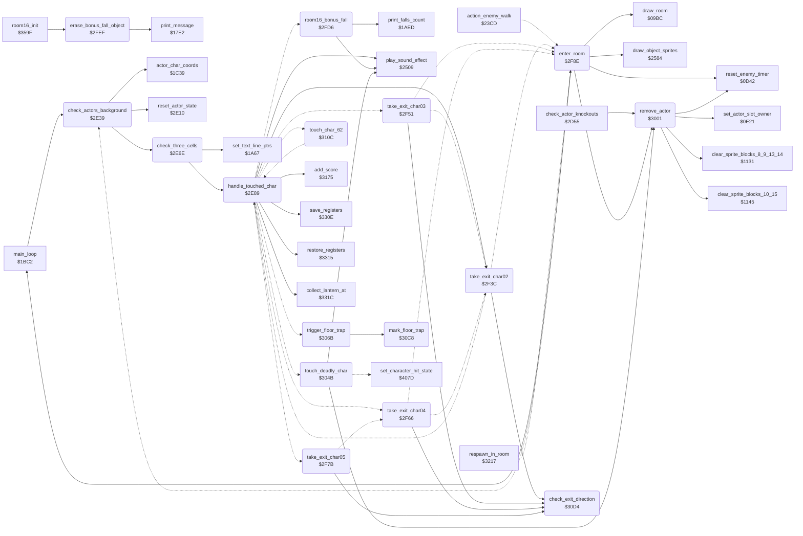

<!-- Generated by c64-docs from knowledge revision 20261016T170255.379-vv114c and src/source-map.json. Do not edit: change the knowledge, generate the source again, then run generate.ts. -->
# background_touch.asm: Actor contact with background chars: exits, lanterns, deadly chars, floor traps, room change

Range `$2E39-$312B`. Source: [background_touch.asm](../../../src/background_touch.asm). Index: [the reference](../index.md).

## Call graph

A solid arrow is a call, a thick arrow a table entry, a dotted arrow a jump. Rounded nodes are in this file.

## Names

### [`check_actors_background`](../../../src/background_touch.asm#L6) `$2E39`

*routine*

Each frame: clears $0100, then for every active actor not dying (state $19): ends state $17, computes its cell position ($1C39) and checks the three cells at its row and the three cells one row lower with handle_touched_char.

- **Called from:** [`main_loop`](main_loop.md#main_loop) [`$1C10`](../../../src/main_loop.asm#L43)
- **Calls:** [`reset_actor_state`](actor_checks.md#reset_actor_state), [`actor_char_coords`](actor_movement.md#actor_char_coords), [`check_three_cells`](background_touch.md#check_three_cells)
- **Reads:** [`actor_flags+1`](../variables.md#actor_flags), [`actor_flags+2`](../variables.md#actor_flags), [`actor_state+1`](../variables.md#actor_state), [`actor_state+2`](../variables.md#actor_state), [`actor_contact+1`](../variables.md#actor_contact), [`actor_contact+2`](../variables.md#actor_contact), [`current_actor`](../variables.md#current_actor), [`actor_char_row+2`](../variables.md#actor_char_row)
- **Writes:** [`text_single_height`](../variables.md#text_single_height), [`current_actor`](../variables.md#current_actor), [`actor_touch_flag`](../variables.md#actor_touch_flag), [`actor_char_row+2`](../variables.md#actor_char_row)

### [`next_actor_background`](../../../src/background_touch.asm#L30) `$2E68`

*label*

- **Jumped to from:** [`check_actors_background`](background_touch.md#check_actors_background) [`$2E46`](../../../src/background_touch.asm#L14), [`check_actors_background`](background_touch.md#check_actors_background) [`$2E4C`](../../../src/background_touch.asm#L17), [`enter_room`](background_touch.md#enter_room) [`$2F97`](../../../src/background_touch.asm#L216)

### [`check_three_cells`](../../../src/background_touch.asm#L36) `$2E6E`

*routine*

Points ($04) at cell row actor_cell_row,X ($1A67) and passes the three chars at columns actor_cell_col..+2 (bit 7 cleared) to handle_touched_char. X = actor index in current_actor.

- **Called from:** [`check_actors_background`](background_touch.md#check_actors_background) [`$2E5E`](../../../src/background_touch.asm#L26), [`check_actors_background`](background_touch.md#check_actors_background) [`$2E65`](../../../src/background_touch.asm#L29)
- **Calls:** [`set_text_line_ptrs`](status.md#set_text_line_ptrs), [`handle_touched_char`](background_touch.md#handle_touched_char)
- **Reads:** [`current_actor`](../variables.md#current_actor), [`work_ptr_a`](../variables.md#work_ptr_a), [`last_key+1`](../variables.md#last_key)
- **Writes:** [`last_key+1`](../variables.md#last_key)
- **Refers to:** [`charset_src_0+433`](room_charset_src.md#charset_src_0)

### [`handle_touched_char`](../../../src/background_touch.asm#L53) `$2E89`

*routine*

Dispatches on background char A touched by actor current_actor: $02-$05 exits, $62 sets state $17, $2D/$2E bonus fall (room 16), and when contact bit 1 is set: lantern chars $13/$14/$31 (Bruce only), deadly chars $0F/$40/$54-$5A (not $57)/$64/$71-$7C (and $66 from room 10), floor trap char $60.
$05 exit D

- **Called from:** [`check_three_cells`](background_touch.md#check_three_cells) [`$2E80`](../../../src/background_touch.asm#L47)
- **Calls:** [`take_exit_char02`](background_touch.md#take_exit_char02), [`save_registers`](score_bcd_regsave.md#save_registers), [`collect_lantern_at`](lanterns.md#collect_lantern_at), [`restore_registers`](score_bcd_regsave.md#restore_registers), [`add_score`](score.md#add_score), [`play_sound_effect`](sound_effects.md#play_sound_effect)
- **Jumps to:** [`take_exit_char05`](background_touch.md#take_exit_char05), [`take_exit_char03`](background_touch.md#take_exit_char03), [`take_exit_char04`](background_touch.md#take_exit_char04), [`room16_bonus_fall`](background_touch.md#room16_bonus_fall), [`touch_char_62`](background_touch.md#touch_char_62), [`trigger_floor_trap`](background_touch.md#trigger_floor_trap), [`touch_deadly_char`](background_touch.md#touch_deadly_char)
- **Reads:** [`actor_touch_flag`](../variables.md#actor_touch_flag), [`current_room`](../variables.md#current_room), [`work_ptr_a`](../variables.md#work_ptr_a)
- **Writes:** [`actor_touch_flag`](../variables.md#actor_touch_flag)
- **Refers to:** [`charset_src_0+433`](room_charset_src.md#charset_src_0)

### [`handle_touched_char_rest`](../../../src/background_touch.asm#L72) `$2EA9`

*label*

- **Jumped to from:** [`touch_char_62`](background_touch.md#touch_char_62) [`$3129`](../../../src/background_touch.asm#L446)

### [`touch_bonus_fall_chars`](../../../src/background_touch.asm#L110) `$2EEA`

*label*

Chars $2D/$2E: the bonus-fall object, only in room 16; tested before the contact-bit check.

- **Jumped to from:** [`handle_touched_char`](background_touch.md#handle_touched_char) [`$2EAB`](../../../src/background_touch.asm#L74), [`handle_touched_char`](background_touch.md#handle_touched_char) [`$2EAF`](../../../src/background_touch.asm#L76)

### [`goto_room16_bonus_fall`](../../../src/background_touch.asm#L115) `$2EF1`

*label*

- **Jumped to from:** [`handle_touched_char`](background_touch.md#handle_touched_char) [`$2EEE`](../../../src/background_touch.asm#L113)

### [`goto_touch_char_62`](../../../src/background_touch.asm#L118) `$2EF4`

*label*

- **Jumped to from:** [`handle_touched_char`](background_touch.md#handle_touched_char) [`$2EA7`](../../../src/background_touch.asm#L71)

### [`goto_trigger_floor_trap`](../../../src/background_touch.asm#L120) `$2EF7`

*label*

- **Jumped to from:** [`handle_touched_char`](background_touch.md#handle_touched_char) [`$2EE7`](../../../src/background_touch.asm#L106)

### [`touch_char_66`](../../../src/background_touch.asm#L122) `$2EFA`

*label*

- **Jumped to from:** [`handle_touched_char`](background_touch.md#handle_touched_char) [`$2EC7`](../../../src/background_touch.asm#L88)

### [`goto_touch_deadly_char`](../../../src/background_touch.asm#L128) `$2F01`

*label*

- **Jumped to from:** [`handle_touched_char`](background_touch.md#handle_touched_char) [`$2EC3`](../../../src/background_touch.asm#L86), [`handle_touched_char`](background_touch.md#handle_touched_char) [`$2ECB`](../../../src/background_touch.asm#L90), [`handle_touched_char`](background_touch.md#handle_touched_char) [`$2ECF`](../../../src/background_touch.asm#L92), [`handle_touched_char`](background_touch.md#handle_touched_char) [`$2EDB`](../../../src/background_touch.asm#L98), [`handle_touched_char`](background_touch.md#handle_touched_char) [`$2EE3`](../../../src/background_touch.asm#L103), [`handle_touched_char`](background_touch.md#handle_touched_char) [`$2EFE`](../../../src/background_touch.asm#L125)

### [`pick_up_lantern`](../../../src/background_touch.asm#L131) `$2F04`

*label*

Lantern char: only Bruce collects it. Restores the background char from the room lantern list into both cell halves, adds 125 points and plays sound $8E.

- **Jumped to from:** [`handle_touched_char`](background_touch.md#handle_touched_char) [`$2EB7`](../../../src/background_touch.asm#L80), [`handle_touched_char`](background_touch.md#handle_touched_char) [`$2EBB`](../../../src/background_touch.asm#L82), [`handle_touched_char`](background_touch.md#handle_touched_char) [`$2EBF`](../../../src/background_touch.asm#L84)

### [`pick_up_lantern_done`](../../../src/background_touch.asm#L162) `$2F39`

*label*

- **Jumped to from:** [`handle_touched_char`](background_touch.md#handle_touched_char) [`$2F0D`](../../../src/background_touch.asm#L136)

### [`take_exit_char02`](../../../src/background_touch.asm#L165) `$2F3C`

*routine*

Exit through char $02 when check_exit_direction allows it: destination exit2_room, entry exit2_x/exit2_y. An entry x of 0 falls through to group 3.

- **Called from:** [`handle_touched_char`](background_touch.md#handle_touched_char) [`$2E94`](../../../src/background_touch.asm#L60)
- **Calls:** [`check_exit_direction`](background_touch.md#check_exit_direction)
- **Jumps to:** [`l_2ee9`](../../../src/background_touch.asm#L107), [`enter_room`](background_touch.md#enter_room)
- **Reads:** [`current_room`](../variables.md#current_room)
- **Writes:** [`last_key+3`](../variables.md#last_key)
- **Refers to:** [`exit2_room`](room_tables.md#exit2_room), [`exit2_y`](room_tables.md#exit2_y), [`exit2_x`](room_tables.md#exit2_x)

### [`take_exit_char03`](../../../src/background_touch.asm#L177) `$2F51`

*routine*

Exit through char $03 when allowed: destination exit3_room, entry exit3_x/exit3_y. An entry x of 0 falls through to group 4.

- **Jumped to from:** [`handle_touched_char`](background_touch.md#handle_touched_char) [`$2E9B`](../../../src/background_touch.asm#L64)
- **Calls:** [`check_exit_direction`](background_touch.md#check_exit_direction)
- **Jumps to:** [`l_2f3f`](../../../src/background_touch.asm#L167), [`enter_room`](background_touch.md#enter_room)
- **Reads:** [`current_room`](../variables.md#current_room)
- **Writes:** [`last_key+3`](../variables.md#last_key)
- **Refers to:** [`exit3_room`](room_tables.md#exit3_room), [`exit3_y`](room_tables.md#exit3_y), [`exit3_x`](room_tables.md#exit3_x)

### [`take_exit_char04`](../../../src/background_touch.asm#L188) `$2F66`

*routine*

Exit through char $04 when allowed: destination exit4_room, entry exit4_x/exit4_y. An entry x of 0 falls through to group 5.

- **Jumped to from:** [`handle_touched_char`](background_touch.md#handle_touched_char) [`$2EA2`](../../../src/background_touch.asm#L68)
- **Calls:** [`check_exit_direction`](background_touch.md#check_exit_direction)
- **Jumps to:** [`l_2f3f`](../../../src/background_touch.asm#L167), [`enter_room`](background_touch.md#enter_room)
- **Reads:** [`current_room`](../variables.md#current_room)
- **Writes:** [`last_key+3`](../variables.md#last_key)
- **Refers to:** [`exit4_room`](room_tables.md#exit4_room), [`exit4_y`](room_tables.md#exit4_y), [`exit4_x`](room_tables.md#exit4_x)

### [`take_exit_char05`](../../../src/background_touch.asm#L200) `$2F7B`

*routine*

Exit through char $05 when allowed: destination exit5_room, entry exit5_x/exit5_y (no fall-through).

- **Jumped to from:** [`handle_touched_char`](background_touch.md#handle_touched_char) [`$2E8D`](../../../src/background_touch.asm#L56)
- **Calls:** [`check_exit_direction`](background_touch.md#check_exit_direction)
- **Jumps to:** [`l_2f69`](../../../src/background_touch.asm#L190)
- **Reads:** [`current_room`](../variables.md#current_room)
- **Writes:** [`last_key+3`](../variables.md#last_key)
- **Refers to:** [`exit5_room`](room_tables.md#exit5_room), [`exit5_y`](room_tables.md#exit5_y), [`exit5_x`](room_tables.md#exit5_x)

### [`enter_room`](../../../src/background_touch.asm#L210) `$2F8E`

*routine*

A = entry x, Y = entry y, $4E = destination room, current_actor = actor. An enemy is removed (it left the room) and the char checks go on with the next actor. Bruce: sets actor_x/actor_y and current_room, saves each active enemy's energy and Bruce's entry point in enemy_saved_energy/enemy_entry_x/enemy_entry_y (0 for an inactive enemy), removes both enemies, SEI, reloads the spawn timers, resets the stack to $FF, draws the room, draws the actor sprites, CLI and restarts main_loop. Also entered from respawn_in_room and action_blocked_step.

- **Jumped to from:** [`action_enemy_walk`](object_actions.md#action_enemy_walk) [`$24EA`](../../../src/object_actions.asm#L713), [`take_exit_char02`](background_touch.md#take_exit_char02) [`$2F4F`](../../../src/background_touch.asm#L175), [`take_exit_char03`](background_touch.md#take_exit_char03) [`$2F64`](../../../src/background_touch.asm#L186), [`take_exit_char04`](background_touch.md#take_exit_char04) [`$2F79`](../../../src/background_touch.asm#L198), [`respawn_in_room`](room_entry_traps.md#respawn_in_room) [`$3225`](../../../src/room_entry_traps.asm#L14)
- **Calls:** [`remove_actor`](background_touch.md#remove_actor), [`reset_enemy_timer`](actors.md#reset_enemy_timer), [`draw_room`](room_draw.md#draw_room), [`draw_object_sprites`](sprite_render.md#draw_object_sprites), [`main_loop`](main_loop.md#main_loop)
- **Jumps to:** [`next_actor_background`](background_touch.md#next_actor_background)
- **Reads:** [`current_actor`](../variables.md#current_actor), [`last_key+3`](../variables.md#last_key), [`actor_flags+1`](../variables.md#actor_flags), [`actor_flags+2`](../variables.md#actor_flags), [`actor_energy+1`](../variables.md#actor_energy), [`actor_energy+2`](../variables.md#actor_energy), [`actor_x`](../variables.md#actor_x), [`actor_y`](../variables.md#actor_y)
- **Writes:** [`current_room`](../variables.md#current_room), [`enemy_saved_energy`](../variables.md#enemy_saved_energy), [`enemy_saved_energy+1`](../variables.md#enemy_saved_energy), [`enemy_entry_x`](../variables.md#enemy_entry_x), [`enemy_entry_x+1`](../variables.md#enemy_entry_x), [`enemy_entry_y`](../variables.md#enemy_entry_y), [`enemy_entry_y+1`](../variables.md#enemy_entry_y)

### [`enter_room_bruce`](../../../src/background_touch.asm#L217) `$2F9A`

*label*

- **Jumped to from:** [`enter_room`](background_touch.md#enter_room) [`$2F90`](../../../src/background_touch.asm#L212)

### [`enter_room_enemy_loop`](../../../src/background_touch.asm#L225) `$2FA5`

*label*

For X = 2 (Ninja) and 1 (Yamo): an active enemy stores its energy and Bruce's new position (enemy_saved_energy, enemy_entry_x/y); an inactive one gets entry 0. Each is then removed.

- **Jumped to from:** [`enter_room`](background_touch.md#enter_room) [`$2FC3`](../../../src/background_touch.asm#L243)

### [`enter_room_no_follow`](../../../src/background_touch.asm#L236) `$2FB9`

*label*

- **Jumped to from:** [`enter_room`](background_touch.md#enter_room) [`$2FA9`](../../../src/background_touch.asm#L228)

### [`enter_room_remove_enemy`](../../../src/background_touch.asm#L240) `$2FBF`

*label*

- **Jumped to from:** [`enter_room`](background_touch.md#enter_room) [`$2FB7`](../../../src/background_touch.asm#L235)

### [`room16_bonus_fall`](../../../src/background_touch.asm#L253) `$2FD6`

*routine*

Room 16 bonus object (chars $2D/$2E): when Bruce touches it with y >= $A0, uses one of the current player's bonus_falls_left, adds one fall, updates the falls display, plays sound $8E and erases the object.

- **Jumped to from:** [`handle_touched_char`](background_touch.md#handle_touched_char) [`$2EF1`](../../../src/background_touch.asm#L117)
- **Calls:** [`print_falls_count`](status.md#print_falls_count), [`play_sound_effect`](sound_effects.md#play_sound_effect)
- **Reads:** [`actor_y`](../variables.md#actor_y), [`current_player`](../variables.md#current_player), [`contact_group_hits+4`](actor_vars.md#contact_group_hits), [`falls_left`](../variables.md#falls_left)
- **Writes:** [`contact_group_hits+4`](actor_vars.md#contact_group_hits), [`falls_left`](../variables.md#falls_left)

### [`erase_bonus_fall_object`](../../../src/background_touch.asm#L270) `$2FEF`

*routine*

Draws tile string $56 (two blanks) at cell rows 10 and 11, column $24: removes the room 16 bonus-fall object.

- **Called from:** [`room16_init`](room_init.md#room16_init) [`$35C0`](../../../src/room_init.asm#L247)
- **Calls:** [`print_message`](text.md#print_message)

### [`remove_actor`](../../../src/background_touch.asm#L280) `$3001`

*routine*

Deactivates actor X: clears bit 0 of actor_flags, disables its one or two sprites in $D015, frees its extra objects ($EC/$EF via $0E21), clears its sprite data ($1131 for actor 1, $1145 otherwise) and continues at $0D42.

- **Called from:** [`check_actor_knockouts`](actor_checks.md#check_actor_knockouts) [`$2D72`](../../../src/actor_checks.asm#L25), [`enter_room`](background_touch.md#enter_room) [`$2F92`](../../../src/background_touch.asm#L213), [`enter_room`](background_touch.md#enter_room) [`$2FBF`](../../../src/background_touch.asm#L241), [`touch_deadly_char`](background_touch.md#touch_deadly_char) [`$3065`](../../../src/background_touch.asm#L337)
- **Calls:** [`set_actor_slot_owner`](actors.md#set_actor_slot_owner), [`clear_sprite_blocks_8_9_13_14`](interrupts.md#clear_sprite_blocks_8_9_13_14), [`clear_sprite_blocks_10_15`](interrupts.md#clear_sprite_blocks_10_15), [`reset_enemy_timer`](actors.md#reset_enemy_timer)
- **Reads:** [`SPENA`](../variables.md#SPENA)
- **Writes:** [`SPENA`](../variables.md#SPENA)
- **Refers to:** [`actor_body_sprite`](sprite_render.md#actor_body_sprite), [`sprite_clear_mask`](sprite_render.md#sprite_clear_mask), [`actor_overlay_sprite`](sprite_render.md#actor_overlay_sprite), [`sprite_owner`](actor_vars.md#sprite_owner)

### [`touch_deadly_char`](../../../src/background_touch.asm#L316) `$304B`

*routine*

Deadly char touched (not in room 18): plays sound $8C; Bruce enters dying state $19 ($407D), an enemy is removed.

- **Jumped to from:** [`handle_touched_char`](background_touch.md#handle_touched_char) [`$2F01`](../../../src/background_touch.asm#L129)
- **Calls:** [`play_sound_effect`](sound_effects.md#play_sound_effect), [`remove_actor`](background_touch.md#remove_actor)
- **Jumps to:** [`set_character_hit_state`](room_tiles.md#set_character_hit_state)
- **Reads:** [`current_room`](../variables.md#current_room), [`current_actor`](../variables.md#current_actor)

### [`trigger_floor_trap`](../../../src/background_touch.asm#L341) `$306B`

*routine*

Floor trap char $60: if its colour RAM cell is not already 5, takes a free slot of trap_timer/trap_col/trap_row (cell minus 1) and sets the cell colour to $FD so the trap fires once.

- **Jumped to from:** [`handle_touched_char`](background_touch.md#handle_touched_char) [`$2EF7`](../../../src/background_touch.asm#L121)
- **Calls:** [`mark_floor_trap`](background_touch.md#mark_floor_trap)
- **Jumps to:** [`floor_trap_restore_ptr`](background_touch.md#floor_trap_restore_ptr)
- **Reads:** [`work_ptr_a+1`](../variables.md#work_ptr_a), [`work_ptr_a`](../variables.md#work_ptr_a), [`tile_anim_timer`](actor_vars.md#tile_anim_timer), [`tile_anim_col`](actor_vars.md#tile_anim_col), [`tile_anim_row`](actor_vars.md#tile_anim_row), [`tile_anim_timer+1`](actor_vars.md#tile_anim_timer), [`tile_anim_col+1`](actor_vars.md#tile_anim_col), [`tile_anim_row+1`](actor_vars.md#tile_anim_row), [`tile_anim_timer+2`](actor_vars.md#tile_anim_timer), [`tile_anim_col+2`](actor_vars.md#tile_anim_col), [`tile_anim_row+2`](actor_vars.md#tile_anim_row)
- **Writes:** [`work_ptr_a+1`](../variables.md#work_ptr_a), [`tile_anim_timer`](actor_vars.md#tile_anim_timer), [`tile_anim_row`](actor_vars.md#tile_anim_row), [`tile_anim_col`](actor_vars.md#tile_anim_col), [`tile_anim_timer+1`](actor_vars.md#tile_anim_timer), [`tile_anim_row+1`](actor_vars.md#tile_anim_row), [`tile_anim_col+1`](actor_vars.md#tile_anim_col), [`tile_anim_timer+2`](actor_vars.md#tile_anim_timer), [`tile_anim_row+2`](actor_vars.md#tile_anim_row), [`tile_anim_col+2`](actor_vars.md#tile_anim_col)
- **Refers to:** [`work_ptr_a`](../variables.md#work_ptr_a), [`charset_src_0+433`](room_charset_src.md#charset_src_0), [`tile_anim_timer`](actor_vars.md#tile_anim_timer), [`tile_anim_row`](actor_vars.md#tile_anim_row), [`tile_anim_col`](actor_vars.md#tile_anim_col)

### [`floor_trap_try_slot1`](../../../src/background_touch.asm#L360) `$3095`

*label*

- **Jumped to from:** [`trigger_floor_trap`](background_touch.md#trigger_floor_trap) [`$307D`](../../../src/background_touch.asm#L351)

### [`floor_trap_try_slot2`](../../../src/background_touch.asm#L371) `$30B0`

*label*

- **Jumped to from:** [`trigger_floor_trap`](background_touch.md#trigger_floor_trap) [`$3098`](../../../src/background_touch.asm#L362)

### [`mark_floor_trap`](../../../src/background_touch.asm#L382) `$30C8`

*label*

- **Called from:** [`trigger_floor_trap`](background_touch.md#trigger_floor_trap) [`$3092`](../../../src/background_touch.asm#L359), [`trigger_floor_trap`](background_touch.md#trigger_floor_trap) [`$30AD`](../../../src/background_touch.asm#L370)
- **Reads:** [`work_ptr_a`](../variables.md#work_ptr_a), [`work_ptr_a+1`](../variables.md#work_ptr_a)
- **Writes:** [`work_ptr_a+1`](../variables.md#work_ptr_a)
- **Refers to:** [`charset_src_0+433`](room_charset_src.md#charset_src_0), [`work_ptr_a`](../variables.md#work_ptr_a)

### [`floor_trap_restore_ptr`](../../../src/background_touch.asm#L385) `$30CC`

*label*

- **Jumped to from:** [`trigger_floor_trap`](background_touch.md#trigger_floor_trap) [`$3078`](../../../src/background_touch.asm#L349), [`trigger_floor_trap`](background_touch.md#trigger_floor_trap) [`$30B3`](../../../src/background_touch.asm#L374)

### [`check_exit_direction`](../../../src/background_touch.asm#L392) `$30D4`

*routine*

Returns C=0 when actor X may take an exit: always in room 11, else when it moves left at x < $10, right at x > $A1, is in state $0E at y > $C5, or moves up at y < $31. C=1 blocks the exit.

- **Called from:** [`take_exit_char02`](background_touch.md#take_exit_char02) [`$2F3C`](../../../src/background_touch.asm#L166), [`take_exit_char03`](background_touch.md#take_exit_char03) [`$2F51`](../../../src/background_touch.asm#L178), [`take_exit_char04`](background_touch.md#take_exit_char04) [`$2F66`](../../../src/background_touch.asm#L189), [`take_exit_char05`](background_touch.md#take_exit_char05) [`$2F7B`](../../../src/background_touch.asm#L201)
- **Reads:** [`current_room`](../variables.md#current_room)
- **Refers to:** [`actor_moved_left`](actor_vars.md#actor_moved_left), [`actor_moved_right`](actor_vars.md#actor_moved_right), [`actor_move_counters`](actor_vars.md#actor_move_counters)

### [`touch_char_62`](../../../src/background_touch.asm#L430) `$310C`

*routine*

Char $62: unless dying, when contact bit 2 is set puts the actor in state $17 with timer $10 (delay 0, $AA,X = 0), then continues the char checks.

- **Jumped to from:** [`handle_touched_char`](background_touch.md#handle_touched_char) [`$2EF4`](../../../src/background_touch.asm#L119)
- **Jumps to:** [`handle_touched_char_rest`](background_touch.md#handle_touched_char_rest)
- **Reads:** [`work_ptr_a`](../variables.md#work_ptr_a)
- **Refers to:** [`charset_src_0+433`](room_charset_src.md#charset_src_0)
