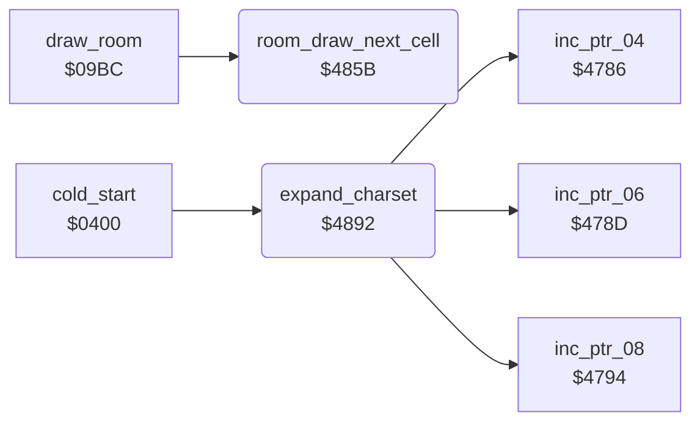

<!-- Generated by c64-docs from knowledge revision 20261016T170255.379-vv114c and src/source-map.json. Do not edit: change the knowledge, generate the source again, then run generate.ts. -->
# charset_expand.asm: Room-draw row advance and room charset expander

Range `$485B-$48C0`. Source: [charset_expand.asm](../../../src/charset_expand.asm). Index: [the reference](../index.md).

## Call graph

A solid arrow is a call, a thick arrow a table entry, a dotted arrow a jump. Rounded nodes are in this file.

## Names

### [`room_draw_next_cell`](../../../src/charset_expand.asm#L6) `$485B`

*routine*

Room draw: decrements the column counter $F3; after 40 cells sets it to 39 and adds 40 to the pointers $04, $08, $10 and $12, so the next map row skips the second screen row. Preserves A.

- **Called from:** [`draw_room`](room_draw.md#draw_room) [`$0AFF`](../../../src/room_draw.asm#L174), [`draw_room`](room_draw.md#draw_room) [`$0B24`](../../../src/room_draw.asm#L193)
- **Reads:** [`draw_count`](../variables.md#draw_count), [`work_ptr_a`](../variables.md#work_ptr_a), [`work_ptr_a+1`](../variables.md#work_ptr_a), [`work_ptr_c`](../variables.md#work_ptr_c), [`work_ptr_c+1`](../variables.md#work_ptr_c), [`colour_ptr_a`](../variables.md#colour_ptr_a), [`colour_ptr_a+1`](../variables.md#colour_ptr_a), [`colour_ptr_b`](../variables.md#colour_ptr_b), [`colour_ptr_b+1`](../variables.md#colour_ptr_b)
- **Writes:** [`draw_count`](../variables.md#draw_count), [`work_ptr_a`](../variables.md#work_ptr_a), [`work_ptr_a+1`](../variables.md#work_ptr_a), [`work_ptr_c`](../variables.md#work_ptr_c), [`work_ptr_c+1`](../variables.md#work_ptr_c), [`colour_ptr_a`](../variables.md#colour_ptr_a), [`colour_ptr_a+1`](../variables.md#colour_ptr_a), [`colour_ptr_b`](../variables.md#colour_ptr_b), [`colour_ptr_b+1`](../variables.md#colour_ptr_b)
- **Refers to:** [`work_ptr_a`](../variables.md#work_ptr_a), [`work_ptr_c`](../variables.md#work_ptr_c), [`colour_ptr_a`](../variables.md#colour_ptr_a), [`colour_ptr_b`](../variables.md#colour_ptr_b)

### [`expand_charset`](../../../src/charset_expand.asm#L43) `$4892`

*routine*

Expands 128 chars ($F3 = count-1) of 8 bytes from ($04): source rows 0-3, each written twice, go to ($06) and rows 4-7, each written twice, to ($08). Called 4 times at init: $9000-$9FFF -> room charsets $A000-$BFFF.

- **Called from:** [`cold_start`](init.md#cold_start) [`$0494`](../../../src/init.asm#L85), [`cold_start`](init.md#cold_start) [`$04B1`](../../../src/init.asm#L99), [`cold_start`](init.md#cold_start) [`$04CE`](../../../src/init.asm#L113), [`cold_start`](init.md#cold_start) [`$04ED`](../../../src/init.asm#L130)
- **Calls:** [`inc_ptr_06`](pointer_helpers.md#inc_ptr_06), [`inc_ptr_04`](pointer_helpers.md#inc_ptr_04), [`inc_ptr_08`](pointer_helpers.md#inc_ptr_08)
- **Reads:** [`work_ptr_a`](../variables.md#work_ptr_a), [`charset_src_0+433`](room_charset_src.md#charset_src_0), [`work_ptr_b`](../variables.md#work_ptr_b), [`work_ptr_c`](../variables.md#work_ptr_c), [`draw_count`](../variables.md#draw_count)
- **Writes:** [`l_22b3`](../../../src/object_actions.asm#L379), [`draw_count`](../variables.md#draw_count)

### [`expand_charset_bottom`](../../../src/charset_expand.asm#L56) `$48AA`

*label*

- **Jumped to from:** [`expand_charset`](charset_expand.md#expand_charset) [`$48BA`](../../../src/charset_expand.asm#L64)
