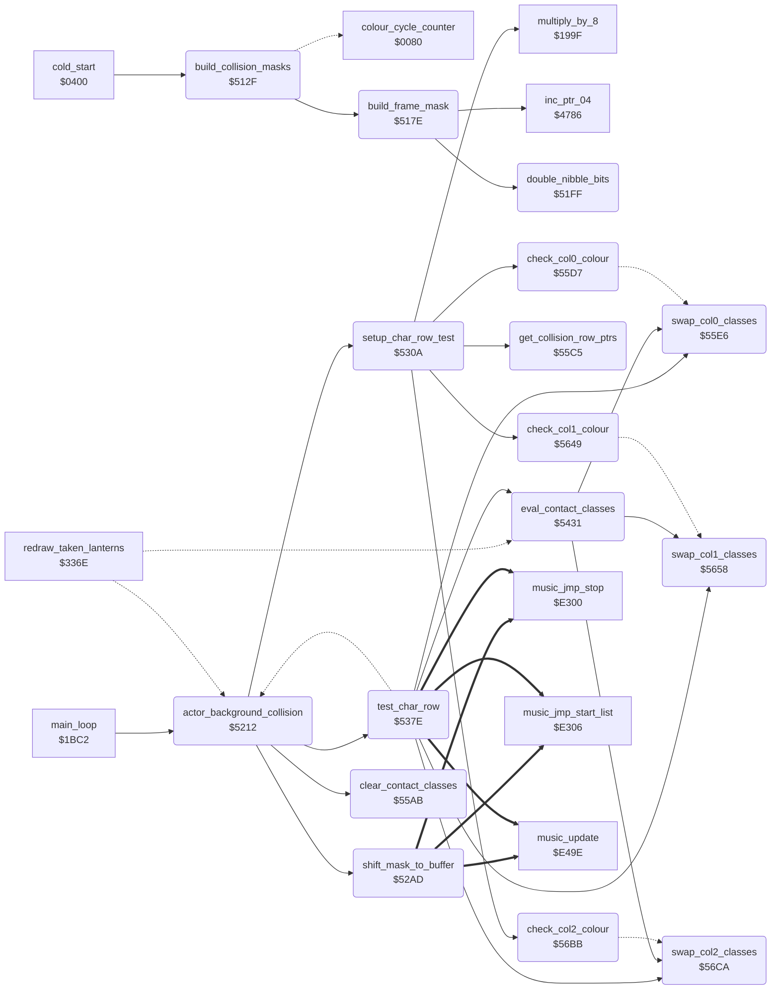

<!-- Generated by c64-docs from knowledge revision 20261016T170255.379-vv114c and src/source-map.json. Do not edit: change the knowledge, generate the source again, then run generate.ts. -->
# collision.asm: Collision masks and actor-background pixel collision

Range `$50E7-$58FF`. Source: [collision.asm](../../../src/collision.asm). Index: [the reference](../index.md).

## Call graph

A solid arrow is a call, a thick arrow a table entry, a dotted arrow a jump. Rounded nodes are in this file.

## Data

| Range | Type | Name | Read by | Written by |
|---|---|---|---|---|
| [`$50E7`](../../../src/collision.asm#L7)-`$512E` | bytes of 24 | [`screen_row_lo`](../../../src/collision.asm#L6) |  |  |
| [`$572D`](../../../src/collision.asm#L766)-`$58FF` | unused |  |  |  |

## Names

### [`screen_row_lo`](../../../src/collision.asm#L6) `$50E7-$50FE`

*data*

Screen rows 1-24: low byte of the screen address (index i = row i+1).

- **Referred to by:** [`get_collision_row_ptrs`](collision.md#get_collision_row_ptrs) [`$55C5`](../../../src/collision.asm#L610)

### [`screen_row_hi`](../../../src/collision.asm#L11) `$50FF-$5116`

*data*

Screen rows 1-24: high byte of the screen address ($8Cxx-$8Fxx).

- **Referred to by:** [`get_collision_row_ptrs`](collision.md#get_collision_row_ptrs) [`$55CC`](../../../src/collision.asm#L613)

### [`colour_row_hi`](../../../src/collision.asm#L16) `$5117-$512E`

*data*

Screen rows 1-24: high byte of the colour RAM address.

- **Referred to by:** [`get_collision_row_ptrs`](collision.md#get_collision_row_ptrs) [`$55D1`](../../../src/collision.asm#L615)

### [`build_collision_masks`](../../../src/collision.asm#L21) `$512F`

*routine*

Init: loops until $CF8F = $B9 and $CFAF = $CF8F (copy-protection bytes in page $CF), then builds the 96-byte collision mask of every even frame ORed with its odd partner (frames $D1 down to 0). Ends with JMP $0080.

- **Called from:** [`cold_start`](init.md#cold_start) [`$04F0`](../../../src/init.asm#L131)
- **Calls:** [`build_frame_mask`](collision.md#build_frame_mask)
- **Jumps to:** [`colour_cycle_counter`](../variables.md#colour_cycle_counter)
- **Reads:** [`protection_sig_a+22`](protection_signature.md#protection_sig_a), [`protection_sig_b+22`](protection_signature.md#protection_sig_b), [`actor_frame_addr_hi+209`](actor_room_tables.md#actor_frame_addr_hi), [`current_actor`](../variables.md#current_actor), [`work_ptr_b`](../variables.md#work_ptr_b), [`l_2311`](../../../src/object_actions.asm#L441), [`l_2312`](../../../src/object_actions.asm#L442), `$CB3E`, `$CB3F`
- **Writes:** [`current_actor`](../variables.md#current_actor), `$CB3E`, `$CB3F`, [`work_ptr_b`](../variables.md#work_ptr_b), [`work_ptr_b+1`](../variables.md#work_ptr_b), [`l_2311`](../../../src/object_actions.asm#L441), [`l_2312`](../../../src/object_actions.asm#L442)
- **Refers to:** [`protection_sig_a`](protection_signature.md#protection_sig_a), [`protection_sig_b`](protection_signature.md#protection_sig_b), [`actor_frame_addr_lo`](actor_room_tables.md#actor_frame_addr_lo), [`actor_frame_addr_hi`](actor_room_tables.md#actor_frame_addr_hi), [`work_ptr_b`](../variables.md#work_ptr_b)

### [`mask_build_loop`](../../../src/collision.asm#L28) `$513D`

*label*

- **Jumped to from:** [`build_collision_masks`](collision.md#build_collision_masks) [`$5178`](../../../src/collision.asm#L60)

### [`mask_build_even`](../../../src/collision.asm#L41) `$5154`

*label*

- **Jumped to from:** [`build_collision_masks`](collision.md#build_collision_masks) [`$5147`](../../../src/collision.asm#L33)

### [`build_frame_mask`](../../../src/collision.asm#L64) `$517E`

*routine*

Expands frame X (1 bpp, source frame_src_lo/hi, height frame_height) into a 96-byte mask at $1167,x/$1239,x: 3 columns of 32 rows, high nibble -> column 0, low nibble -> column 1, each bit doubled. Column 2 stays 0 (the wide-frame path expands the emptied $1F). Rows after the frame are cleared.

- **Called from:** [`build_collision_masks`](collision.md#build_collision_masks) [`$5144`](../../../src/collision.asm#L32), [`build_collision_masks`](collision.md#build_collision_masks) [`$5158`](../../../src/collision.asm#L44)
- **Calls:** [`double_nibble_bits`](collision.md#double_nibble_bits), [`inc_ptr_04`](pointer_helpers.md#inc_ptr_04)
- **Reads:** [`work_ptr_b+1`](../variables.md#work_ptr_b), [`work_ptr_b`](../variables.md#work_ptr_b), [`work_ptr_a`](../variables.md#work_ptr_a), [`charset_src_0+433`](room_charset_src.md#charset_src_0), [`charset_src_0+434`](room_charset_src.md#charset_src_0), [`work_ptr_c`](../variables.md#work_ptr_c), [`work_ptr_c+2`](../variables.md#work_ptr_c), [`demo_input_ptr`](../variables.md#demo_input_ptr)
- **Writes:** [`work_ptr_a`](../variables.md#work_ptr_a), [`work_ptr_a+1`](../variables.md#work_ptr_a), [`demo_input_ptr`](../variables.md#demo_input_ptr), [`work_ptr_b+1`](../variables.md#work_ptr_b), [`work_ptr_b`](../variables.md#work_ptr_b), [`work_ptr_c`](../variables.md#work_ptr_c), [`work_ptr_c+1`](../variables.md#work_ptr_c), [`work_ptr_c+2`](../variables.md#work_ptr_c), [`work_ptr_c+3`](../variables.md#work_ptr_c), [`nibble_bits`](../variables.md#nibble_bits), [`l_22b3`](../../../src/object_actions.asm#L379), [`exit2_x+2`](room_tables.md#exit2_x), [`l_22b4`](../../../src/object_actions.asm#L381), [`l_22b5`](../../../src/object_actions.asm#L383), [`exit2_x+3`](room_tables.md#exit2_x), [`exit2_x+4`](room_tables.md#exit2_x)
- **Refers to:** [`frame_src_lo`](sprite_data.md#frame_src_lo), [`frame_src_hi`](sprite_data.md#frame_src_hi), [`work_ptr_a`](../variables.md#work_ptr_a), [`frame_height`](sprite_data.md#frame_height), [`actor_frame_addr_hi`](actor_room_tables.md#actor_frame_addr_hi), [`work_ptr_b`](../variables.md#work_ptr_b), [`actor_frame_addr_lo`](actor_room_tables.md#actor_frame_addr_lo), [`work_ptr_c`](../variables.md#work_ptr_c), [`frame_wide_flag`](sprite_data.md#frame_wide_flag), [`charset_src_0+433`](room_charset_src.md#charset_src_0), [`exit2_x+2`](room_tables.md#exit2_x)

### [`build_wide_mask_row`](../../../src/collision.asm#L112) `$51DA`

*label*

- **Jumped to from:** [`build_frame_mask`](collision.md#build_frame_mask) [`$51B5`](../../../src/collision.asm#L91), [`build_frame_mask`](collision.md#build_frame_mask) [`$51F9`](../../../src/collision.asm#L129)

### [`double_nibble_bits`](../../../src/collision.asm#L133) `$51FF`

*routine*

Shifts 4 bits out of $1F (bit 0 first) and returns A with every bit doubled to a %11 pair (bit n -> bits 2n+1 and 2n).

- **Called from:** [`build_frame_mask`](collision.md#build_frame_mask) [`$51BB`](../../../src/collision.asm#L95), [`build_frame_mask`](collision.md#build_frame_mask) [`$51C0`](../../../src/collision.asm#L97), [`build_frame_mask`](collision.md#build_frame_mask) [`$51DE`](../../../src/collision.asm#L115), [`build_frame_mask`](collision.md#build_frame_mask) [`$51E3`](../../../src/collision.asm#L117), [`build_frame_mask`](collision.md#build_frame_mask) [`$51F1`](../../../src/collision.asm#L125)
- **Reads:** [`nibble_bits`](../variables.md#nibble_bits)
- **Writes:** [`nibble_bits`](../variables.md#nibble_bits)

### [`actor_background_collision`](../../../src/collision.asm#L149) `$5212`

*routine*

Each pass, for active actors 2 to 0: aligns the collision mask of actor_frame_a to the char grid, ANDs it with the bitmaps of the chars below and sets contact bits by pixel colour in $A7,x (first 15 rows) and $B6,x (21 rows): bit0 colour 1, bit1 colour 2, bit2 colour 3 in room-coloured cells, bit3 colour 3 in $F8 cells.

- **Called from:** [`main_loop`](main_loop.md#main_loop) [`$1C0D`](../../../src/main_loop.asm#L42)
- **Calls:** [`shift_mask_to_buffer`](collision.md#shift_mask_to_buffer), [`clear_contact_classes`](collision.md#clear_contact_classes), [`setup_char_row_test`](collision.md#setup_char_row_test), [`test_char_row`](collision.md#test_char_row)
- **Reads:** [`actor_flags+2`](../variables.md#actor_flags), [`mask_shift_y`](../variables.md#mask_shift_y), [`collision_actor`](../variables.md#collision_actor)
- **Writes:** [`collision_actor`](../variables.md#collision_actor), [`mask_shift_x`](../variables.md#mask_shift_x), [`mask_shift_y`](../variables.md#mask_shift_y), [`l_52cc`](../../../src/collision.asm#L250), [`l_52cd`](../../../src/collision.asm#L251), [`contact_row_end`](actor_vars.md#contact_row_end), [`upper_contact_row_end`](actor_vars.md#upper_contact_row_end), [`temp_y`](../variables.md#temp_y), [`char_row_end`](actor_vars.md#char_row_end)
- **Refers to:** [`actor_frame_a`](actor_vars.md#actor_frame_a), [`actor_frame_addr_lo`](actor_room_tables.md#actor_frame_addr_lo), [`mask_copy_loop`](collision.md#mask_copy_loop), [`actor_frame_addr_hi`](actor_room_tables.md#actor_frame_addr_hi)

### [`collision_actor_loop`](../../../src/collision.asm#L151) `$5214`

*label*

- **Jumped to from:** [`actor_background_collision`](collision.md#actor_background_collision) [`$52A9`](../../../src/collision.asm#L224)

### [`collision_next_actor`](../../../src/collision.asm#L220) `$52A4`

*label*

- **Jumped to from:** [`actor_background_collision`](collision.md#actor_background_collision) [`$521C`](../../../src/collision.asm#L156), [`test_char_row`](collision.md#test_char_row) [`$542E`](../../../src/collision.asm#L449)

### [`shift_mask_to_buffer`](../../../src/collision.asm#L228) `$52AD`

*routine*

Copies the 96-byte mask (address patched into mask_copy_loop) to $CAE0 after $1C zero rows (32 more zeros first when $1B = 3), then shifts the 4 x 32 buffer right by 2*$1B bits, or left by 2 bits when $1B = 3.

- **Called from:** [`actor_background_collision`](collision.md#actor_background_collision) [`$5245`](../../../src/collision.asm#L176)
- **Reads:** [`mask_shift_y`](../variables.md#mask_shift_y), [`mask_shift_x`](../variables.md#mask_shift_x), [`music_api_stop`](music_player.md#music_api_stop), [`l_e001`](../../../src/music_player.asm#L7), [`mask_buffer+30`](../variables.md#mask_buffer), [`mask_buffer+31`](../variables.md#mask_buffer), `$CB1E`, `$CB1F`, `$CB3E`, `$CB3F`, `$CB5E`, `$CB5F`
- **Writes:** [`mask_buffer`](../variables.md#mask_buffer), [`mask_buffer+1`](../variables.md#mask_buffer), [`mask_buffer+2`](../variables.md#mask_buffer), [`mask_buffer+3`](../variables.md#mask_buffer), [`mask_buffer+4`](../variables.md#mask_buffer), [`mask_buffer+30`](../variables.md#mask_buffer), [`mask_buffer+31`](../variables.md#mask_buffer), `$CB1E`, `$CB1F`, `$CB3E`, `$CB3F`, `$CB5E`, `$CB5F`
- **Refers to:** [`mask_buffer`](../variables.md#mask_buffer)

### [`mask_copy_loop`](../../../src/collision.asm#L249) `$52CB`

*label*

operand patched by actor_background_collision

- **Jumped to from:** [`shift_mask_to_buffer`](collision.md#shift_mask_to_buffer) [`$52D5`](../../../src/collision.asm#L257)
- **Referred to by:** [`actor_background_collision`](collision.md#actor_background_collision) [`$523C`](../../../src/collision.asm#L173), [`actor_background_collision`](collision.md#actor_background_collision) [`$5242`](../../../src/collision.asm#L175)

### [`setup_char_row_test`](../../../src/collision.asm#L291) `$530A`

*routine*

For char row $E9,x: gets the screen and colour RAM row pointers, selects the colour-3 class layout of each of the 3 columns from colour RAM, and patches the 3 char bitmap addresses (charset page $7C, minus buffer row $52) into test_row_loop, test_col1 and test_col2.

- **Called from:** [`actor_background_collision`](collision.md#actor_background_collision) [`$5271`](../../../src/collision.asm#L200), [`actor_background_collision`](collision.md#actor_background_collision) [`$5280`](../../../src/collision.asm#L206), [`actor_background_collision`](collision.md#actor_background_collision) [`$528F`](../../../src/collision.asm#L212), [`actor_background_collision`](collision.md#actor_background_collision) [`$529E`](../../../src/collision.asm#L218)
- **Calls:** [`get_collision_row_ptrs`](collision.md#get_collision_row_ptrs), [`check_col0_colour`](collision.md#check_col0_colour), [`multiply_by_8`](status.md#multiply_by_8), [`check_col1_colour`](collision.md#check_col1_colour), [`check_col2_colour`](collision.md#check_col2_colour)
- **Reads:** [`collision_actor`](../variables.md#collision_actor), [`work_ptr_a`](../variables.md#work_ptr_a), [`char_addr_lo`](variables.md#char_addr_lo), [`temp_y`](../variables.md#temp_y), [`char_addr_hi`](variables.md#char_addr_hi), [`charset_hi`](../variables.md#charset_hi)
- **Writes:** [`char_addr_lo`](variables.md#char_addr_lo), [`l_5381`](../../../src/collision.asm#L351), [`l_5382`](../../../src/collision.asm#L352), [`l_539b`](../../../src/collision.asm#L368), [`l_539c`](../../../src/collision.asm#L369), [`l_53b5`](../../../src/collision.asm#L385), [`l_53b6`](../../../src/collision.asm#L386)
- **Refers to:** [`charset_src_0+433`](room_charset_src.md#charset_src_0), [`test_row_loop`](collision.md#test_row_loop), [`test_col1`](collision.md#test_col1), [`test_col2`](collision.md#test_col2)

### [`test_char_row`](../../../src/collision.asm#L348) `$537E`

*routine*

ANDs buffer rows from $52 with the 3 char bitmaps and flags each non-zero nibble in contact_classes_col0-2. At upper_contact_row_end it stores the contact so far in $A7,x; at contact_row_end it stores $B6,x and ends the actor; returns at char_row_end.

- **Called from:** [`actor_background_collision`](collision.md#actor_background_collision) [`$5274`](../../../src/collision.asm#L201), [`actor_background_collision`](collision.md#actor_background_collision) [`$5283`](../../../src/collision.asm#L207), [`actor_background_collision`](collision.md#actor_background_collision) [`$5292`](../../../src/collision.asm#L213), [`actor_background_collision`](collision.md#actor_background_collision) [`$52A1`](../../../src/collision.asm#L219)
- **Calls:** [`eval_contact_classes`](collision.md#eval_contact_classes), [`swap_col0_classes`](collision.md#swap_col0_classes), [`swap_col1_classes`](collision.md#swap_col1_classes), [`swap_col2_classes`](collision.md#swap_col2_classes)
- **Jumps to:** [`collision_next_actor`](collision.md#collision_next_actor)
- **Reads:** [`temp_y`](../variables.md#temp_y), [`last_key+3`](../variables.md#last_key), [`upper_contact_row_end`](actor_vars.md#upper_contact_row_end), [`contact_row_end`](actor_vars.md#contact_row_end), [`char_row_end`](actor_vars.md#char_row_end), [`class_layout_alt+1`](actor_vars.md#class_layout_alt), [`class_layout_alt+2`](actor_vars.md#class_layout_alt), [`class_layout_alt`](actor_vars.md#class_layout_alt), [`class_layout_saved`](actor_vars.md#class_layout_saved), [`class_layout_saved+1`](actor_vars.md#class_layout_saved), [`class_layout_saved+2`](actor_vars.md#class_layout_saved)
- **Writes:** [`last_key+3`](../variables.md#last_key), [`temp_y`](../variables.md#temp_y), [`class_layout_saved+1`](actor_vars.md#class_layout_saved), [`class_layout_saved+2`](actor_vars.md#class_layout_saved), [`class_layout_alt`](actor_vars.md#class_layout_alt), [`class_layout_alt+1`](actor_vars.md#class_layout_alt), [`class_layout_alt+2`](actor_vars.md#class_layout_alt)
- **Refers to:** [`music_api_stop`](music_player.md#music_api_stop), [`mask_buffer`](../variables.md#mask_buffer), [`contact_classes_col0`](actor_vars.md#contact_classes_col0), `$CB00`, [`contact_classes_col1`](actor_vars.md#contact_classes_col1), `$CB20`, [`contact_classes_col2`](actor_vars.md#contact_classes_col2), [`class_layout_alt`](actor_vars.md#class_layout_alt), [`class_layout_saved`](actor_vars.md#class_layout_saved)

### [`test_row_loop`](../../../src/collision.asm#L350) `$5380`

*label*

operand patched by setup_char_row_test

- **Jumped to from:** [`test_char_row`](collision.md#test_char_row) [`$53DE`](../../../src/collision.asm#L410)
- **Referred to by:** [`setup_char_row_test`](collision.md#setup_char_row_test) [`$5327`](../../../src/collision.asm#L305), [`setup_char_row_test`](collision.md#setup_char_row_test) [`$5332`](../../../src/collision.asm#L310)

### [`test_col1`](../../../src/collision.asm#L367) `$539A`

*label*

operand patched by setup_char_row_test

- **Jumped to from:** [`test_char_row`](collision.md#test_char_row) [`$5386`](../../../src/collision.asm#L355)
- **Referred to by:** [`setup_char_row_test`](collision.md#setup_char_row_test) [`$5347`](../../../src/collision.asm#L319), [`setup_char_row_test`](collision.md#setup_char_row_test) [`$5352`](../../../src/collision.asm#L324)

### [`test_col2`](../../../src/collision.asm#L384) `$53B4`

*label*

operand patched by setup_char_row_test

- **Jumped to from:** [`test_char_row`](collision.md#test_char_row) [`$53A0`](../../../src/collision.asm#L372)
- **Referred to by:** [`setup_char_row_test`](collision.md#setup_char_row_test) [`$536F`](../../../src/collision.asm#L340), [`setup_char_row_test`](collision.md#setup_char_row_test) [`$537A`](../../../src/collision.asm#L345)

### [`record_upper_contact`](../../../src/collision.asm#L414) `$53E4`

*label*

- **Jumped to from:** [`test_char_row`](collision.md#test_char_row) [`$53D2`](../../../src/collision.asm#L404)

### [`finish_actor_contact`](../../../src/collision.asm#L445) `$5429`

*label*

- **Jumped to from:** [`test_char_row`](collision.md#test_char_row) [`$53D7`](../../../src/collision.asm#L407)

### [`eval_contact_classes`](../../../src/collision.asm#L451) `$5431`

*routine*

Returns all 3 columns to the normal class layout, then sets $B6,x bits 0-3 from the class flags: colour 1, colour 2, colour 3 in room-coloured cells, colour 3 in $F8 cells.

- **Called from:** [`test_char_row`](collision.md#test_char_row) [`$53EF`](../../../src/collision.asm#L421), [`test_char_row`](collision.md#test_char_row) [`$5429`](../../../src/collision.asm#L446)
- **Calls:** [`swap_col0_classes`](collision.md#swap_col0_classes), [`swap_col1_classes`](collision.md#swap_col1_classes), [`swap_col2_classes`](collision.md#swap_col2_classes)
- **Reads:** [`class_layout_alt`](actor_vars.md#class_layout_alt), [`class_layout_alt+1`](actor_vars.md#class_layout_alt), [`class_layout_alt+2`](actor_vars.md#class_layout_alt), [`contact_classes_col0+1`](actor_vars.md#contact_classes_col0), [`contact_classes_col0+4`](actor_vars.md#contact_classes_col0), [`contact_classes_col0+5`](actor_vars.md#contact_classes_col0), [`contact_classes_col0+6`](actor_vars.md#contact_classes_col0), [`contact_classes_col0+7`](actor_vars.md#contact_classes_col0), [`contact_classes_col0+17`](actor_vars.md#contact_classes_col0), [`contact_classes_col0+9`](actor_vars.md#contact_classes_col0), [`contact_classes_col0+13`](actor_vars.md#contact_classes_col0), [`contact_classes_col0+20`](actor_vars.md#contact_classes_col0), [`contact_classes_col1+1`](actor_vars.md#contact_classes_col1), [`contact_classes_col1+4`](actor_vars.md#contact_classes_col1), [`contact_classes_col1+5`](actor_vars.md#contact_classes_col1), [`contact_classes_col1+6`](actor_vars.md#contact_classes_col1), [`contact_classes_col1+7`](actor_vars.md#contact_classes_col1), [`contact_classes_col1+9`](actor_vars.md#contact_classes_col1), [`contact_classes_col1+13`](actor_vars.md#contact_classes_col1), [`contact_classes_col1+20`](actor_vars.md#contact_classes_col1), [`contact_classes_col2+1`](actor_vars.md#contact_classes_col2), [`contact_classes_col2+4`](actor_vars.md#contact_classes_col2), [`contact_classes_col2+5`](actor_vars.md#contact_classes_col2), [`contact_classes_col2+6`](actor_vars.md#contact_classes_col2), [`contact_classes_col2+7`](actor_vars.md#contact_classes_col2), [`contact_classes_col2+17`](actor_vars.md#contact_classes_col2), [`contact_classes_col2+9`](actor_vars.md#contact_classes_col2), [`contact_classes_col2+13`](actor_vars.md#contact_classes_col2), [`contact_classes_col2+20`](actor_vars.md#contact_classes_col2), [`contact_group_hits+1`](actor_vars.md#contact_group_hits), [`contact_classes_col0+2`](actor_vars.md#contact_classes_col0), [`contact_classes_col0+8`](actor_vars.md#contact_classes_col0), [`contact_classes_col0+10`](actor_vars.md#contact_classes_col0), [`contact_classes_col0+11`](actor_vars.md#contact_classes_col0), [`contact_classes_col0+14`](actor_vars.md#contact_classes_col0), [`contact_classes_col0+18`](actor_vars.md#contact_classes_col0), [`contact_classes_col0+21`](actor_vars.md#contact_classes_col0), [`contact_classes_col1+2`](actor_vars.md#contact_classes_col1), [`contact_classes_col1+8`](actor_vars.md#contact_classes_col1), [`contact_classes_col1+10`](actor_vars.md#contact_classes_col1) and 34 more
- **Writes:** [`contact_group_hits+3`](actor_vars.md#contact_group_hits), [`contact_group_hits+4`](actor_vars.md#contact_group_hits), [`class_layout_alt`](actor_vars.md#class_layout_alt), [`class_layout_alt+1`](actor_vars.md#class_layout_alt), [`class_layout_alt+2`](actor_vars.md#class_layout_alt), [`contact_group_hits+1`](actor_vars.md#contact_group_hits), [`contact_group_hits+2`](actor_vars.md#contact_group_hits)
- **Refers to:** [`class_layout_alt`](actor_vars.md#class_layout_alt), [`contact_classes_col0`](actor_vars.md#contact_classes_col0), [`contact_classes_col1`](actor_vars.md#contact_classes_col1), [`contact_classes_col2`](actor_vars.md#contact_classes_col2), [`contact_group_hits`](actor_vars.md#contact_group_hits)

### [`clear_contact_classes`](../../../src/collision.asm#L595) `$55AB`

*routine*

Clears contact_classes_col0-2 and class_layout_alt.

- **Called from:** [`actor_background_collision`](collision.md#actor_background_collision) [`$5256`](../../../src/collision.asm#L185)
- **Writes:** [`contact_classes_col0+21`](actor_vars.md#contact_classes_col0), [`contact_classes_col0+22`](actor_vars.md#contact_classes_col0), [`contact_classes_col1+21`](actor_vars.md#contact_classes_col1), [`contact_classes_col1+22`](actor_vars.md#contact_classes_col1), [`contact_classes_col2+21`](actor_vars.md#contact_classes_col2), [`contact_classes_col2+22`](actor_vars.md#contact_classes_col2), [`class_layout_alt`](actor_vars.md#class_layout_alt), [`class_layout_alt+1`](actor_vars.md#class_layout_alt), [`class_layout_alt+2`](actor_vars.md#class_layout_alt)
- **Refers to:** [`class_layout_alt`](actor_vars.md#class_layout_alt)

### [`get_collision_row_ptrs`](../../../src/collision.asm#L609) `$55C5`

*routine*

X = row index (0 = screen row 1): sets $04/$05 to the screen row and $12/$13 to the colour RAM row.

- **Called from:** [`setup_char_row_test`](collision.md#setup_char_row_test) [`$530F`](../../../src/collision.asm#L295)
- **Writes:** [`work_ptr_a`](../variables.md#work_ptr_a), [`colour_ptr_b`](../variables.md#colour_ptr_b), [`work_ptr_a+1`](../variables.md#work_ptr_a), [`colour_ptr_b+1`](../variables.md#colour_ptr_b)
- **Refers to:** [`screen_row_lo`](collision.md#screen_row_lo), [`screen_row_hi`](collision.md#screen_row_hi), [`work_ptr_a`](../variables.md#work_ptr_a), [`colour_row_hi`](collision.md#colour_row_hi), [`colour_ptr_b`](../variables.md#colour_ptr_b)

### [`check_col0_colour`](../../../src/collision.asm#L619) `$55D7`

*routine*

Column Y of the colour RAM row ($12): bits 0-2 clear selects the normal class layout of mask column 0, otherwise the alternate layout.

- **Called from:** [`setup_char_row_test`](collision.md#setup_char_row_test) [`$5316`](../../../src/collision.asm#L298)
- **Jumps to:** [`col0_normal_layout`](collision.md#col0_normal_layout)
- **Reads:** [`colour_ptr_b`](../variables.md#colour_ptr_b), [`class_layout_alt`](actor_vars.md#class_layout_alt)
- **Writes:** [`class_layout_alt`](actor_vars.md#class_layout_alt)

### [`swap_col0_classes`](../../../src/collision.asm#L629) `$55E6`

*routine*

Swaps the colour-3 class entries 3, 7, 11-15 of mask column 0 with the alternate entries 16-22.

- **Called from:** [`test_char_row`](collision.md#test_char_row) [`$5403`](../../../src/collision.asm#L429), [`eval_contact_classes`](collision.md#eval_contact_classes) [`$5443`](../../../src/collision.asm#L462)
- **Reads:** [`contact_classes_col0+3`](actor_vars.md#contact_classes_col0), [`contact_classes_col0+16`](actor_vars.md#contact_classes_col0), [`contact_classes_col0+7`](actor_vars.md#contact_classes_col0), [`contact_classes_col0+17`](actor_vars.md#contact_classes_col0), [`contact_classes_col0+11`](actor_vars.md#contact_classes_col0), [`contact_classes_col0+18`](actor_vars.md#contact_classes_col0), [`contact_classes_col0+12`](actor_vars.md#contact_classes_col0), [`contact_classes_col0+19`](actor_vars.md#contact_classes_col0), [`contact_classes_col0+13`](actor_vars.md#contact_classes_col0), [`contact_classes_col0+20`](actor_vars.md#contact_classes_col0), [`contact_classes_col0+14`](actor_vars.md#contact_classes_col0), [`contact_classes_col0+21`](actor_vars.md#contact_classes_col0), [`contact_classes_col0+15`](actor_vars.md#contact_classes_col0), [`contact_classes_col0+22`](actor_vars.md#contact_classes_col0), [`collision_actor`](../variables.md#collision_actor), [`class_layout_alt`](actor_vars.md#class_layout_alt)
- **Writes:** [`contact_classes_col0+3`](actor_vars.md#contact_classes_col0), [`contact_classes_col0+16`](actor_vars.md#contact_classes_col0), [`contact_classes_col0+7`](actor_vars.md#contact_classes_col0), [`contact_classes_col0+17`](actor_vars.md#contact_classes_col0), [`contact_classes_col0+11`](actor_vars.md#contact_classes_col0), [`contact_classes_col0+18`](actor_vars.md#contact_classes_col0), [`contact_classes_col0+12`](actor_vars.md#contact_classes_col0), [`contact_classes_col0+19`](actor_vars.md#contact_classes_col0), [`contact_classes_col0+13`](actor_vars.md#contact_classes_col0), [`contact_classes_col0+20`](actor_vars.md#contact_classes_col0), [`contact_classes_col0+14`](actor_vars.md#contact_classes_col0), [`contact_classes_col0+21`](actor_vars.md#contact_classes_col0), [`contact_classes_col0+15`](actor_vars.md#contact_classes_col0), [`contact_classes_col0+22`](actor_vars.md#contact_classes_col0), [`class_layout_alt`](actor_vars.md#class_layout_alt)
- **Refers to:** [`contact_classes_col0`](actor_vars.md#contact_classes_col0)

### [`col0_normal_layout`](../../../src/collision.asm#L660) `$563D`

*label*

- **Jumped to from:** [`check_col0_colour`](collision.md#check_col0_colour) [`$55DB`](../../../src/collision.asm#L622)

### [`check_col1_colour`](../../../src/collision.asm#L668) `$5649`

*routine*

Column Y of the colour RAM row ($12): bits 0-2 clear selects the normal class layout of mask column 1, otherwise the alternate layout.

- **Called from:** [`setup_char_row_test`](collision.md#setup_char_row_test) [`$5336`](../../../src/collision.asm#L312)
- **Jumps to:** [`col1_normal_layout`](collision.md#col1_normal_layout)
- **Reads:** [`colour_ptr_b`](../variables.md#colour_ptr_b), [`class_layout_alt+1`](actor_vars.md#class_layout_alt)
- **Writes:** [`class_layout_alt+1`](actor_vars.md#class_layout_alt)
- **Refers to:** [`class_layout_alt`](actor_vars.md#class_layout_alt)

### [`swap_col1_classes`](../../../src/collision.asm#L678) `$5658`

*routine*

Swaps the colour-3 class entries 3, 7, 11-15 of mask column 1 with the alternate entries 16-22.

- **Called from:** [`test_char_row`](collision.md#test_char_row) [`$5413`](../../../src/collision.asm#L436), [`eval_contact_classes`](collision.md#eval_contact_classes) [`$544E`](../../../src/collision.asm#L467)
- **Reads:** [`contact_classes_col1+3`](actor_vars.md#contact_classes_col1), [`contact_classes_col1+16`](actor_vars.md#contact_classes_col1), [`contact_classes_col1+7`](actor_vars.md#contact_classes_col1), [`contact_classes_col1+17`](actor_vars.md#contact_classes_col1), [`contact_classes_col1+11`](actor_vars.md#contact_classes_col1), [`contact_classes_col1+18`](actor_vars.md#contact_classes_col1), [`contact_classes_col1+12`](actor_vars.md#contact_classes_col1), [`contact_classes_col1+19`](actor_vars.md#contact_classes_col1), [`contact_classes_col1+13`](actor_vars.md#contact_classes_col1), [`contact_classes_col1+20`](actor_vars.md#contact_classes_col1), [`contact_classes_col1+14`](actor_vars.md#contact_classes_col1), [`contact_classes_col1+21`](actor_vars.md#contact_classes_col1), [`contact_classes_col1+15`](actor_vars.md#contact_classes_col1), [`contact_classes_col1+22`](actor_vars.md#contact_classes_col1), [`collision_actor`](../variables.md#collision_actor), [`class_layout_alt+1`](actor_vars.md#class_layout_alt)
- **Writes:** [`contact_classes_col1+3`](actor_vars.md#contact_classes_col1), [`contact_classes_col1+16`](actor_vars.md#contact_classes_col1), [`contact_classes_col1+7`](actor_vars.md#contact_classes_col1), [`contact_classes_col1+17`](actor_vars.md#contact_classes_col1), [`contact_classes_col1+11`](actor_vars.md#contact_classes_col1), [`contact_classes_col1+18`](actor_vars.md#contact_classes_col1), [`contact_classes_col1+12`](actor_vars.md#contact_classes_col1), [`contact_classes_col1+19`](actor_vars.md#contact_classes_col1), [`contact_classes_col1+13`](actor_vars.md#contact_classes_col1), [`contact_classes_col1+20`](actor_vars.md#contact_classes_col1), [`contact_classes_col1+14`](actor_vars.md#contact_classes_col1), [`contact_classes_col1+21`](actor_vars.md#contact_classes_col1), [`contact_classes_col1+15`](actor_vars.md#contact_classes_col1), [`contact_classes_col1+22`](actor_vars.md#contact_classes_col1), [`class_layout_alt+1`](actor_vars.md#class_layout_alt)
- **Refers to:** [`contact_classes_col1`](actor_vars.md#contact_classes_col1), [`class_layout_alt`](actor_vars.md#class_layout_alt)

### [`col1_normal_layout`](../../../src/collision.asm#L709) `$56AF`

*label*

- **Jumped to from:** [`check_col1_colour`](collision.md#check_col1_colour) [`$564D`](../../../src/collision.asm#L671)

### [`check_col2_colour`](../../../src/collision.asm#L717) `$56BB`

*routine*

Column Y of the colour RAM row ($12): bits 0-2 clear selects the normal class layout of mask column 2, otherwise the alternate layout.

- **Called from:** [`setup_char_row_test`](collision.md#setup_char_row_test) [`$535E`](../../../src/collision.asm#L332)
- **Jumps to:** [`col2_normal_layout`](collision.md#col2_normal_layout)
- **Reads:** [`colour_ptr_b`](../variables.md#colour_ptr_b), [`class_layout_alt+2`](actor_vars.md#class_layout_alt)
- **Writes:** [`class_layout_alt+2`](actor_vars.md#class_layout_alt)
- **Refers to:** [`class_layout_alt`](actor_vars.md#class_layout_alt)

### [`swap_col2_classes`](../../../src/collision.asm#L727) `$56CA`

*routine*

Swaps the colour-3 class entries 3, 7, 11-15 of mask column 2 with the alternate entries 16-22.

- **Called from:** [`test_char_row`](collision.md#test_char_row) [`$5423`](../../../src/collision.asm#L443), [`eval_contact_classes`](collision.md#eval_contact_classes) [`$5459`](../../../src/collision.asm#L472)
- **Reads:** [`contact_classes_col2+3`](actor_vars.md#contact_classes_col2), [`contact_classes_col2+16`](actor_vars.md#contact_classes_col2), [`contact_classes_col2+7`](actor_vars.md#contact_classes_col2), [`contact_classes_col2+17`](actor_vars.md#contact_classes_col2), [`contact_classes_col2+11`](actor_vars.md#contact_classes_col2), [`contact_classes_col2+18`](actor_vars.md#contact_classes_col2), [`contact_classes_col2+12`](actor_vars.md#contact_classes_col2), [`contact_classes_col2+19`](actor_vars.md#contact_classes_col2), [`contact_classes_col2+13`](actor_vars.md#contact_classes_col2), [`contact_classes_col2+20`](actor_vars.md#contact_classes_col2), [`contact_classes_col2+14`](actor_vars.md#contact_classes_col2), [`contact_classes_col2+21`](actor_vars.md#contact_classes_col2), [`contact_classes_col2+15`](actor_vars.md#contact_classes_col2), [`contact_classes_col2+22`](actor_vars.md#contact_classes_col2), [`collision_actor`](../variables.md#collision_actor), [`class_layout_alt+2`](actor_vars.md#class_layout_alt)
- **Writes:** [`contact_classes_col2+3`](actor_vars.md#contact_classes_col2), [`contact_classes_col2+16`](actor_vars.md#contact_classes_col2), [`contact_classes_col2+7`](actor_vars.md#contact_classes_col2), [`contact_classes_col2+17`](actor_vars.md#contact_classes_col2), [`contact_classes_col2+11`](actor_vars.md#contact_classes_col2), [`contact_classes_col2+18`](actor_vars.md#contact_classes_col2), [`contact_classes_col2+12`](actor_vars.md#contact_classes_col2), [`contact_classes_col2+19`](actor_vars.md#contact_classes_col2), [`contact_classes_col2+13`](actor_vars.md#contact_classes_col2), [`contact_classes_col2+20`](actor_vars.md#contact_classes_col2), [`contact_classes_col2+14`](actor_vars.md#contact_classes_col2), [`contact_classes_col2+21`](actor_vars.md#contact_classes_col2), [`contact_classes_col2+15`](actor_vars.md#contact_classes_col2), [`contact_classes_col2+22`](actor_vars.md#contact_classes_col2), [`class_layout_alt+2`](actor_vars.md#class_layout_alt)
- **Refers to:** [`contact_classes_col2`](actor_vars.md#contact_classes_col2), [`class_layout_alt`](actor_vars.md#class_layout_alt)

### [`col2_normal_layout`](../../../src/collision.asm#L758) `$5721`

*label*

- **Jumped to from:** [`check_col2_colour`](collision.md#check_col2_colour) [`$56BF`](../../../src/collision.asm#L720)
