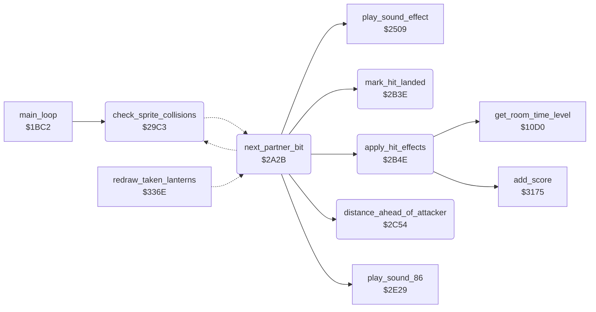

<!-- Generated by c64-docs from knowledge revision 20261016T170255.379-vv114c and src/source-map.json. Do not edit: change the knowledge, generate the source again, then run generate.ts. -->
# combat_hits.asm: Sprite collision, hit detection, damage and knock-out

Range `$29C3-$2C6F`. Source: [combat_hits.asm](../../../src/combat_hits.asm). Index: [the reference](../index.md).

## Call graph

A solid arrow is a call, a thick arrow a table entry, a dotted arrow a jump. Rounded nodes are in this file.

## Names

### [`check_sprite_collisions`](../../../src/combat_hits.asm#L6) `$29C3`

*routine*

Reads sprite-sprite collisions ($D01E) into partner bits $B3-$B5. For each colliding object X whose partner attacks (kick $16, punch $11, flying kick $0C/$0D, drop $0E) and is in reach, sets hit bits in $BC,X; then applies the hits.

- **Called from:** [`main_loop`](main_loop.md#main_loop) [`$1C23`](../../../src/main_loop.asm#L53)
- **Jumps to:** [`check_collision_partner`](combat_hits.md#check_collision_partner)
- **Reads:** [`SPSPCL`](../variables.md#SPSPCL), [`sprite_collisions`](../variables.md#sprite_collisions), [`actor_collisions`](../variables.md#actor_collisions), [`actor_collisions+1`](../variables.md#actor_collisions), [`actor_collisions+2`](../variables.md#actor_collisions), [`last_key+1`](../variables.md#last_key)
- **Writes:** [`actor_collisions+1`](../variables.md#actor_collisions), [`actor_collisions+2`](../variables.md#actor_collisions), [`actor_hit_flags+1`](../variables.md#actor_hit_flags), [`actor_hit_flags+2`](../variables.md#actor_hit_flags), [`sprite_collisions`](../variables.md#sprite_collisions), [`actor_collisions`](../variables.md#actor_collisions), [`last_key+1`](../variables.md#last_key)
- **Refers to:** [`actor_collisions`](../variables.md#actor_collisions)

### [`collision_object_loop`](../../../src/combat_hits.asm#L61) `$2A21`

*label*

- **Jumped to from:** [`next_partner_bit`](combat_hits.md#next_partner_bit) [`$2A31`](../../../src/combat_hits.asm#L73)

### [`next_partner_bit`](../../../src/combat_hits.asm#L68) `$2A2B`

*label*

- **Jumped to from:** [`redraw_taken_lanterns`](lanterns.md#redraw_taken_lanterns) [`$33C9`](../../../src/lanterns.asm#L124)
- **Calls:** [`apply_hit_effects`](combat_hits.md#apply_hit_effects), [`distance_ahead_of_attacker`](combat_hits.md#distance_ahead_of_attacker), [`play_sound_effect`](sound_effects.md#play_sound_effect), [`mark_hit_landed`](combat_hits.md#mark_hit_landed), [`play_sound_86`](actor_checks.md#play_sound_86)
- **Jumps to:** [`l_2a27`](../../../src/combat_hits.asm#L65), [`collision_object_loop`](combat_hits.md#collision_object_loop)
- **Reads:** [`temp_y`](../variables.md#temp_y)
- **Writes:** [`temp_y`](../variables.md#temp_y), [`attack_reach`](../variables.md#attack_reach)
- **Refers to:** [`sprite_owner`](actor_vars.md#sprite_owner), [`actor_hit_budget`](actor_vars.md#actor_hit_budget)

### [`check_collision_partner`](../../../src/combat_hits.asm#L76) `$2A36`

*label*

Skips victim X in states $0F, $13, $18, $19, $1A and $1B; reads the attacker actor from sprite_owner,Y ($FF = none) and tests its attack state.

- **Jumped to from:** [`check_sprite_collisions`](combat_hits.md#check_sprite_collisions) [`$2A29`](../../../src/combat_hits.asm#L67)

### [`partner_no_hit`](../../../src/combat_hits.asm#L108) `$2A76`

*label*

- **Jumped to from:** [`next_partner_bit`](combat_hits.md#next_partner_bit) [`$2A55`](../../../src/combat_hits.asm#L92), [`next_partner_bit`](combat_hits.md#next_partner_bit) [`$2A5D`](../../../src/combat_hits.asm#L96), [`next_partner_bit`](combat_hits.md#next_partner_bit) [`$2A71`](../../../src/combat_hits.asm#L106), [`next_partner_bit`](combat_hits.md#next_partner_bit) [`$2A80`](../../../src/combat_hits.asm#L114), [`next_partner_bit`](combat_hits.md#next_partner_bit) [`$2A89`](../../../src/combat_hits.asm#L118), [`next_partner_bit`](combat_hits.md#next_partner_bit) [`$2A8B`](../../../src/combat_hits.asm#L119), [`next_partner_bit`](combat_hits.md#next_partner_bit) [`$2AA3`](../../../src/combat_hits.asm#L134), [`next_partner_bit`](combat_hits.md#next_partner_bit) [`$2AAC`](../../../src/combat_hits.asm#L139), [`next_partner_bit`](combat_hits.md#next_partner_bit) [`$2AAE`](../../../src/combat_hits.asm#L140), [`next_partner_bit`](combat_hits.md#next_partner_bit) [`$2ABE`](../../../src/combat_hits.asm#L149), [`next_partner_bit`](combat_hits.md#next_partner_bit) [`$2AD2`](../../../src/combat_hits.asm#L160), [`next_partner_bit`](combat_hits.md#next_partner_bit) [`$2B3B`](../../../src/combat_hits.asm#L216)

### [`partner_kicks`](../../../src/combat_hits.asm#L111) `$2A7B`

*label*

- **Jumped to from:** [`next_partner_bit`](combat_hits.md#next_partner_bit) [`$2A61`](../../../src/combat_hits.asm#L98)

### [`partner_punches`](../../../src/combat_hits.asm#L135) `$2AA5`

*label*

- **Jumped to from:** [`next_partner_bit`](combat_hits.md#next_partner_bit) [`$2A65`](../../../src/combat_hits.asm#L100)

### [`partner_flying_kicks`](../../../src/combat_hits.asm#L161) `$2AD4`

*label*

- **Jumped to from:** [`next_partner_bit`](combat_hits.md#next_partner_bit) [`$2A69`](../../../src/combat_hits.asm#L102), [`next_partner_bit`](combat_hits.md#next_partner_bit) [`$2A6D`](../../../src/combat_hits.asm#L104)

### [`partner_drops_on`](../../../src/combat_hits.asm#L181) `$2AFA`

*label*

- **Jumped to from:** [`next_partner_bit`](combat_hits.md#next_partner_bit) [`$2A73`](../../../src/combat_hits.asm#L107)

### [`mark_hit_landed`](../../../src/combat_hits.asm#L218) `$2B3E`

*routine*

Y = attacker, X = victim. Sets bit 0 (hit landed) in the attacker's $BC,Y and turns the victim to face the attacker.

- **Called from:** [`next_partner_bit`](combat_hits.md#next_partner_bit) [`$2A9A`](../../../src/combat_hits.asm#L130), [`next_partner_bit`](combat_hits.md#next_partner_bit) [`$2AC3`](../../../src/combat_hits.asm#L151), [`next_partner_bit`](combat_hits.md#next_partner_bit) [`$2AE9`](../../../src/combat_hits.asm#L171)

### [`apply_hit_effects`](../../../src/combat_hits.asm#L227) `$2B4E`

*label*

Per object: bit 0 = attacker recovery; bit 1 = kick hit (energy -2, state $0F); bit 2 = punch (-3, state $0F); bit 3 = flying kick (-7, state $13); bit 4 = dropped on (-5, state $1B). Bit 7 = hit by object 0, adds score ($3175). Energy below 0 = knocked out (state $13).

- **Called from:** [`next_partner_bit`](combat_hits.md#next_partner_bit) [`$2A33`](../../../src/combat_hits.asm#L74)
- **Calls:** [`get_room_time_level`](room_state.md#get_room_time_level), [`add_score`](score.md#add_score)
- **Reads:** [`actor_hit_flags+2`](../variables.md#actor_hit_flags), [`actor_frame_updated+2`](actor_vars.md#actor_frame_updated), [`game_cycle`](../variables.md#game_cycle), [`current_actor`](../variables.md#current_actor)
- **Writes:** [`current_actor`](../variables.md#current_actor), [`actor_state+2`](../variables.md#actor_state), [`actor_step_delay+2`](../variables.md#actor_step_delay), [`actor_state_timer+2`](../variables.md#actor_state_timer), [`actor_frame_updated+2`](actor_vars.md#actor_frame_updated)

### [`apply_kick_hit`](../../../src/combat_hits.asm#L272) `$2B9A`

*label*

- **Jumped to from:** [`apply_hit_effects`](combat_hits.md#apply_hit_effects) [`$2B56`](../../../src/combat_hits.asm#L233), [`apply_hit_effects`](combat_hits.md#apply_hit_effects) [`$2B76`](../../../src/combat_hits.asm#L248), [`apply_hit_effects`](combat_hits.md#apply_hit_effects) [`$2B7D`](../../../src/combat_hits.asm#L253), [`apply_hit_effects`](combat_hits.md#apply_hit_effects) [`$2B8E`](../../../src/combat_hits.asm#L263), [`apply_hit_effects`](combat_hits.md#apply_hit_effects) [`$2B94`](../../../src/combat_hits.asm#L268)

### [`apply_punch_hit`](../../../src/combat_hits.asm#L285) `$2BB1`

*label*

- **Jumped to from:** [`apply_hit_effects`](combat_hits.md#apply_hit_effects) [`$2B9E`](../../../src/combat_hits.asm#L275)

### [`apply_flying_kick_hit`](../../../src/combat_hits.asm#L306) `$2BD5`

*label*

- **Jumped to from:** [`apply_hit_effects`](combat_hits.md#apply_hit_effects) [`$2BB5`](../../../src/combat_hits.asm#L288)

### [`apply_drop_hit`](../../../src/combat_hits.asm#L328) `$2BF9`

*label*

- **Jumped to from:** [`apply_hit_effects`](combat_hits.md#apply_hit_effects) [`$2BD9`](../../../src/combat_hits.asm#L309), [`apply_hit_effects`](combat_hits.md#apply_hit_effects) [`$2C51`](../../../src/combat_hits.asm#L381)

### [`object_knocked_out`](../../../src/combat_hits.asm#L356) `$2C24`

*label*

Energy below 0: knock-out score for hits by object 0 (more for object 1), state $13 with timer 12.

- **Jumped to from:** [`apply_hit_effects`](combat_hits.md#apply_hit_effects) [`$2BCB`](../../../src/combat_hits.asm#L301), [`apply_hit_effects`](combat_hits.md#apply_hit_effects) [`$2BEF`](../../../src/combat_hits.asm#L323), [`apply_hit_effects`](combat_hits.md#apply_hit_effects) [`$2C13`](../../../src/combat_hits.asm#L344)

### [`distance_ahead_of_attacker`](../../../src/combat_hits.asm#L383) `$2C54`

*routine*

Y = attacker, X = victim. A = X distance of the victim in front of the attacker (sign by the attacker's facing), compared with the reach $61: C set when A >= reach.

- **Called from:** [`next_partner_bit`](combat_hits.md#next_partner_bit) [`$2A86`](../../../src/combat_hits.asm#L117), [`next_partner_bit`](combat_hits.md#next_partner_bit) [`$2AA9`](../../../src/combat_hits.asm#L138), [`next_partner_bit`](combat_hits.md#next_partner_bit) [`$2ADF`](../../../src/combat_hits.asm#L167)
- **Reads:** [`attack_reach`](../variables.md#attack_reach)
