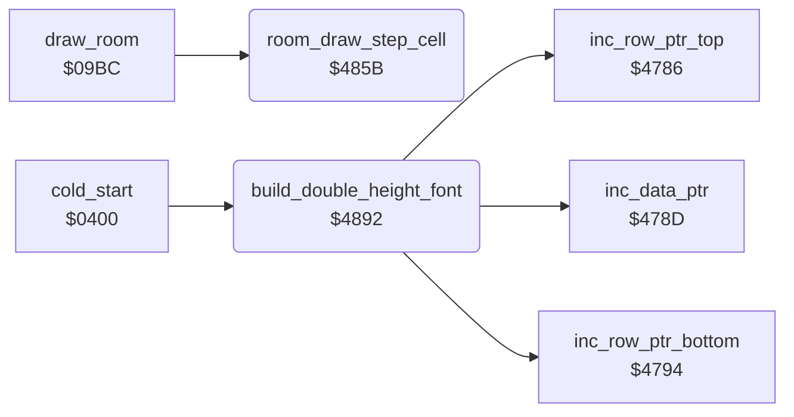

<!-- Generated by c64-docs from knowledge revision 20261017T123532.893-hcxwuv and src/source-map.json. Do not edit: change the knowledge, generate the source again, then run generate.ts. -->
# draw_helpers.asm: Room draw row step and the double-height font builder

Range `$485B-$48C0`. Source: [draw_helpers.asm](../../../src/draw_helpers.asm). Index: [the reference](../index.md).

## Call graph

A solid arrow is a call, a thick arrow a table entry, a dotted arrow a jump. Rounded nodes are in this file.

## Names

### [`room_draw_step_cell`](../../../src/draw_helpers.asm#L9) `$485B`

*routine*

Called by draw_room after each map cell. Counts column_counter down; when it passes 0 it reloads 39 and adds 40 to row_ptr_top, row_ptr_bottom, colour_ptr_top and colour_ptr_bottom, so the next cell starts two screen rows lower (a map cell is a double-height character and the per-cell increments have already crossed one row). Preserves A, X, Y.

- **Called from:** [`draw_room`](draw_room.md#draw_room) [`$0AFF`](../../../src/draw_room.asm#L198), [`draw_room`](draw_room.md#draw_room) [`$0B24`](../../../src/draw_room.asm#L217)
- **Reads:** [`column_counter`](../variables.md#column_counter), [`row_ptr_top`](../variables.md#row_ptr_top), [`row_ptr_top+1`](../variables.md#row_ptr_top), [`row_ptr_bottom`](../variables.md#row_ptr_bottom), [`row_ptr_bottom+1`](../variables.md#row_ptr_bottom), [`colour_ptr_top`](../variables.md#colour_ptr_top), [`colour_ptr_top+1`](../variables.md#colour_ptr_top), [`colour_ptr_bottom`](../variables.md#colour_ptr_bottom), [`colour_ptr_bottom+1`](../variables.md#colour_ptr_bottom)
- **Writes:** [`column_counter`](../variables.md#column_counter), [`row_ptr_top`](../variables.md#row_ptr_top), [`row_ptr_top+1`](../variables.md#row_ptr_top), [`row_ptr_bottom`](../variables.md#row_ptr_bottom), [`row_ptr_bottom+1`](../variables.md#row_ptr_bottom), [`colour_ptr_top`](../variables.md#colour_ptr_top), [`colour_ptr_top+1`](../variables.md#colour_ptr_top), [`colour_ptr_bottom`](../variables.md#colour_ptr_bottom), [`colour_ptr_bottom+1`](../variables.md#colour_ptr_bottom)
- **Refers to:** [`row_ptr_top`](../variables.md#row_ptr_top), [`row_ptr_bottom`](../variables.md#row_ptr_bottom), [`colour_ptr_top`](../variables.md#colour_ptr_top), [`colour_ptr_bottom`](../variables.md#colour_ptr_bottom)

### [`room_draw_step_ptr08`](../../../src/draw_helpers.asm#L21) `$486F`

*label*

- **Jumped to from:** [`room_draw_step_cell`](draw_helpers.md#room_draw_step_cell) [`$486B`](../../../src/draw_helpers.asm#L19)

### [`room_draw_step_ptr10`](../../../src/draw_helpers.asm#L28) `$487A`

*label*

- **Jumped to from:** [`room_draw_step_cell`](draw_helpers.md#room_draw_step_cell) [`$4876`](../../../src/draw_helpers.asm#L26)

### [`room_draw_step_ptr12`](../../../src/draw_helpers.asm#L35) `$4885`

*label*

- **Jumped to from:** [`room_draw_step_cell`](draw_helpers.md#room_draw_step_cell) [`$4881`](../../../src/draw_helpers.asm#L33)

### [`room_draw_step_done`](../../../src/draw_helpers.asm#L42) `$4890`

*label*

- **Jumped to from:** [`room_draw_step_cell`](draw_helpers.md#room_draw_step_cell) [`$485E`](../../../src/draw_helpers.asm#L12), [`room_draw_step_cell`](draw_helpers.md#room_draw_step_cell) [`$488C`](../../../src/draw_helpers.asm#L40)

### [`build_double_height_font`](../../../src/draw_helpers.asm#L51) `$4892`

*routine*

Builds a double-height charset from an 8x8 font. Input: row_ptr_top = source (128 chars of 8 bytes), data_ptr = output for the top halves, row_ptr_bottom = output for the bottom halves, column_counter = number of chars - 1 ($7F). For each source char, rows 0-3 are written twice each to (data_ptr) and rows 4-7 twice each to (row_ptr_bottom), so char c of the output charset is the top half and char c+$80 the bottom half of source char c. cold_start calls it 4 times: room_charset_a -> charset_rooms_0_9, room_charset_b -> charset_rooms_10_19, room_charset_c -> charset_wizard, room_charset_d -> charset_wizard_flash (top halves at +0, bottom at +$400).

- **Called from:** [`cold_start`](cold_start.md#cold_start) [`$0494`](../../../src/cold_start.asm#L117), [`cold_start`](cold_start.md#cold_start) [`$04B1`](../../../src/cold_start.asm#L132), [`cold_start`](cold_start.md#cold_start) [`$04CE`](../../../src/cold_start.asm#L147), [`cold_start`](cold_start.md#cold_start) [`$04ED`](../../../src/cold_start.asm#L165)
- **Calls:** [`inc_data_ptr`](pointer_helpers.md#inc_data_ptr), [`inc_row_ptr_top`](pointer_helpers.md#inc_row_ptr_top), [`inc_row_ptr_bottom`](pointer_helpers.md#inc_row_ptr_bottom)
- **Reads:** [`row_ptr_top`](../variables.md#row_ptr_top), [`data_ptr`](../variables.md#data_ptr), [`row_ptr_bottom`](../variables.md#row_ptr_bottom), [`column_counter`](../variables.md#column_counter)
- **Writes:** [`column_counter`](../variables.md#column_counter)

### [`font_top_half_row`](../../../src/draw_helpers.asm#L55) `$4896`

*label*

Rows 0-3: each source row twice into the top-half char.

- **Jumped to from:** [`build_double_height_font`](draw_helpers.md#build_double_height_font) [`$48A6`](../../../src/draw_helpers.asm#L63)

### [`font_bottom_half_row`](../../../src/draw_helpers.asm#L66) `$48AA`

*label*

Rows 4-7: each source row twice into the bottom-half char.

- **Jumped to from:** [`build_double_height_font`](draw_helpers.md#build_double_height_font) [`$48BA`](../../../src/draw_helpers.asm#L74)
