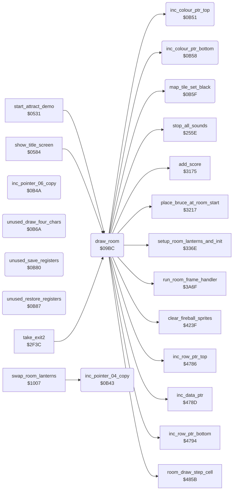

<!-- Generated by c64-docs from knowledge revision 20261017T121733.607-wszjh3 and src/source-map.json. Do not edit: change the knowledge, generate the source again, then run generate.ts. -->
# draw_room.asm: Room drawing: colours, run-length map decoder and per-room state reset

Range `$09BC-$0B8D`. Source: [draw_room.asm](../../../src/draw_room.asm). Index: [the reference](../index.md).

## Call graph

A solid arrow is a call, a thick arrow a table entry, a dotted arrow a jump. Rounded nodes are in this file.

## Names

### [`draw_room`](../../../src/draw_room.asm#L28) `$09BC`

*routine*

Draw the current room and reset the per-room state. Called by change_room, start_new_game and start_attract_demo. Screen and sprites are off while it draws. 1. Clears status row 0, fills colour RAM rows 3-24 with room_colour_fill[room], clears the fireball sprites and silences the sound effects. 2. Room 11 when room_lanterns_left of rooms 12, 14 and 16 are all 0: goes to room 13 instead (place_bruce_at_room_start with X = 13). 3. First visit of the room by the current player (room_unvisited[room*2 + current_player] = 1): clears the flag and adds 2000 points. 4. Clears actor_move_queue (the move history of the actors, $4F57-$4FDA), room_time and anim_chars_direction; anim_chars_speed_step = 7. 5. room_no_enemy_flag = room_no_enemies[room] (nonzero also clears enemy_follow_x). Loads the spawn timers from ninja_room_delay / yamo_room_delay (3 for both when game_loop_count is nonzero, Yamo 8 when player 2 controls him). 6. Resets Bruce's actor_contact, actor_timer, actor_state and actor_step_delay and the burst_trap_timer slots, copies the 20-byte block of room_aux_ptr to room_band_colours and sets room_vmcsb: charset_rooms_0_9 for rooms 0-9, charset_wizard for room 18, charset_rooms_10_19 for the others. 7. Decodes the run-length room map (room_map_ptr_lo/hi) into screen rows 3-24. 8. setup_room_lanterns_and_init (lanterns, room init), screen and sprites 0-4 on, then tail-jumps to run_room_frame_handler (the room's frame handler runs once and returns to the caller). Map format: a stream of codes. $80 ends the map. $81-$FF: (code AND $7F) literal tile bytes follow. $01-$7F: one tile byte follows, repeated code times. A tile byte draws one double-height cell: bits 0-6 = character c (upper row c, lower row c+128), bit 7 = colour RAM $F8 (multicolour, colour 0) for the cell instead of the room colour. Cells fill 40 columns, then the next double row.
screen off

- **Called from:** [`start_attract_demo`](title_demo_start.md#start_attract_demo) [`$056D`](../../../src/title_demo_start.asm#L59), [`show_title_screen`](title_demo_start.md#show_title_screen) [`$074C`](../../../src/title_demo_start.asm#L308), [`take_exit2`](background_touch.md#take_exit2) [`$2FCC`](../../../src/background_touch.asm#L264)
- **Calls:** [`clear_fireball_sprites`](wizard_fireballs.md#clear_fireball_sprites), [`stop_all_sounds`](sound_request.md#stop_all_sounds), [`place_bruce_at_room_start`](room_misc_support.md#place_bruce_at_room_start), [`add_score`](score.md#add_score), [`inc_data_ptr`](pointer_helpers.md#inc_data_ptr), [`map_tile_set_black`](draw_room.md#map_tile_set_black), [`inc_row_ptr_top`](pointer_helpers.md#inc_row_ptr_top), [`inc_row_ptr_bottom`](pointer_helpers.md#inc_row_ptr_bottom), [`inc_colour_ptr_top`](draw_room.md#inc_colour_ptr_top), [`inc_colour_ptr_bottom`](draw_room.md#inc_colour_ptr_bottom), [`room_draw_step_cell`](draw_helpers.md#room_draw_step_cell), [`setup_room_lanterns_and_init`](lantern_pickup.md#setup_room_lanterns_and_init), [`run_room_frame_handler`](passage_open.md#run_room_frame_handler)
- **Reads:** [`SCROLY`](../variables.md#SCROLY), [`SPENA`](../variables.md#SPENA), [`room`](../variables.md#room), [`room_lanterns_left+12`](../variables.md#room_lanterns_left), [`room_lanterns_left+14`](../variables.md#room_lanterns_left), [`room_lanterns_left+16`](../variables.md#room_lanterns_left), [`saved_sprite_enable`](../variables.md#saved_sprite_enable), [`current_player`](../variables.md#current_player), [`game_loop_count`](../variables.md#game_loop_count), [`option_yamo_player2`](options_and_patterns.md#option_yamo_player2), [`data_ptr`](../variables.md#data_ptr), [`row_ptr_top`](../variables.md#row_ptr_top), [`row_ptr_bottom`](../variables.md#row_ptr_bottom)
- **Writes:** [`SCROLY`](../variables.md#SCROLY), [`saved_sprite_enable`](../variables.md#saved_sprite_enable), [`SPENA`](../variables.md#SPENA), [`game_screen+38`](../variables.md#game_screen), [`game_screen+39`](../variables.md#game_screen), [`RANDOM+1117`](../variables.md#RANDOM), [`RANDOM+1118`](../variables.md#RANDOM), [`RANDOM+1253`](../variables.md#RANDOM), [`RANDOM+1254`](../variables.md#RANDOM), [`RANDOM+1509`](../variables.md#RANDOM), [`RANDOM+1510`](../variables.md#RANDOM), [`RANDOM+1765`](../variables.md#RANDOM), [`RANDOM+1766`](../variables.md#RANDOM), [`actor_move_queue+130`](../variables.md#actor_move_queue), [`actor_move_queue+131`](../variables.md#actor_move_queue), [`room_time`](../variables.md#room_time), [`room_time+1`](../variables.md#room_time), [`anim_chars_direction`](../variables.md#anim_chars_direction), [`anim_chars_speed_step`](options_and_patterns.md#anim_chars_speed_step), [`room_no_enemy_flag`](../variables.md#room_no_enemy_flag), [`enemy_follow_x`](../variables.md#enemy_follow_x), [`enemy_follow_x+1`](../variables.md#enemy_follow_x), [`ninja_spawn_timer`](../variables.md#ninja_spawn_timer), [`yamo_spawn_timer`](../variables.md#yamo_spawn_timer), [`actor_contact`](../variables.md#actor_contact), [`actor_timer`](../variables.md#actor_timer), [`burst_trap_timer`](../variables.md#burst_trap_timer), [`burst_trap_timer+1`](../variables.md#burst_trap_timer), [`burst_trap_timer+2`](../variables.md#burst_trap_timer), [`actor_state`](../variables.md#actor_state), [`actor_step_delay`](../variables.md#actor_step_delay), [`data_ptr`](../variables.md#data_ptr), [`data_ptr+1`](../variables.md#data_ptr), [`room_band_colours+18`](../variables.md#room_band_colours), [`room_band_colours+19`](../variables.md#room_band_colours), [`room_vmcsb`](../variables.md#room_vmcsb), [`row_ptr_top`](../variables.md#row_ptr_top), [`colour_ptr_top`](../variables.md#colour_ptr_top), [`row_ptr_bottom`](../variables.md#row_ptr_bottom), [`colour_ptr_bottom`](../variables.md#colour_ptr_bottom) and 5 more
- **Refers to:** [`room_colour_fill`](room_palettes.md#room_colour_fill), [`room_lanterns_left`](../variables.md#room_lanterns_left), [`room_unvisited`](../variables.md#room_unvisited), [`room_time`](../variables.md#room_time), [`room_no_enemies`](room_tables.md#room_no_enemies), [`enemy_follow_x`](../variables.md#enemy_follow_x), [`ninja_room_delay`](room_enemy_tables.md#ninja_room_delay), [`yamo_room_delay`](room_enemy_tables.md#yamo_room_delay), [`burst_trap_timer`](../variables.md#burst_trap_timer), [`room_aux_ptr`](room_tables.md#room_aux_ptr), [`room_aux_ptr+1`](room_tables.md#room_aux_ptr), [`data_ptr`](../variables.md#data_ptr), [`room_map_ptr_lo`](room_tables.md#room_map_ptr_lo), [`room_map_ptr_hi`](room_tables.md#room_map_ptr_hi), [`game_screen`](../variables.md#game_screen), [`row_ptr_top`](../variables.md#row_ptr_top), [`row_ptr_bottom`](../variables.md#row_ptr_bottom), [`colour_ptr_top`](../variables.md#colour_ptr_top), [`colour_ptr_bottom`](../variables.md#colour_ptr_bottom)

### [`draw_room_clear_top_row`](../../../src/draw_room.asm#L39) `$09D4`

*label*

- **Jumped to from:** [`draw_room`](draw_room.md#draw_room) [`$09D8`](../../../src/draw_room.asm#L42)

### [`draw_room_fill_colours`](../../../src/draw_room.asm#L46) `$09E1`

*label*

colour RAM rows 3-24

- **Jumped to from:** [`draw_room`](draw_room.md#draw_room) [`$09EE`](../../../src/draw_room.asm#L52)

### [`draw_room_first_visit_check`](../../../src/draw_room.asm#L68) `$0A0E`

*label*

- **Jumped to from:** [`draw_room`](draw_room.md#draw_room) [`$09FA`](../../../src/draw_room.asm#L58), [`draw_room`](draw_room.md#draw_room) [`$0A02`](../../../src/draw_room.asm#L62)

### [`draw_room_reset_state`](../../../src/draw_room.asm#L82) `$0A2A`

*label*

- **Jumped to from:** [`draw_room`](draw_room.md#draw_room) [`$0A17`](../../../src/draw_room.asm#L74)

### [`draw_room_clear_object_state`](../../../src/draw_room.asm#L85) `$0A2E`

*label*

clear actor_move_queue: 11 records x 4 directions x 3 actors ($4F57-$4FDA)

- **Jumped to from:** [`draw_room`](draw_room.md#draw_room) [`$0A32`](../../../src/draw_room.asm#L88)

### [`draw_room_load_spawn_timers`](../../../src/draw_room.asm#L101) `$0A4E`

*label*

Ninja spawn timer

- **Jumped to from:** [`draw_room`](draw_room.md#draw_room) [`$0A46`](../../../src/draw_room.asm#L97)

### [`draw_room_check_two_player_yamo`](../../../src/draw_room.asm#L111) `$0A62`

*label*

player 2 controls Yamo: Yamo comes after 8 passes

- **Jumped to from:** [`draw_room`](draw_room.md#draw_room) [`$0A5A`](../../../src/draw_room.asm#L107)

### [`draw_room_reset_bruce`](../../../src/draw_room.asm#L119) `$0A6B`

*label*

Reset Bruce (actor 0): actor_contact = 1 (floor), actor_timer = 4, actor_state = 0, actor_step_delay = 0; free the three burst trap slots (burst_trap_timer).

- **Jumped to from:** [`draw_room`](draw_room.md#draw_room) [`$0A65`](../../../src/draw_room.asm#L113)

### [`draw_room_copy_room_record`](../../../src/draw_room.asm#L140) `$0A93`

*label*

- **Jumped to from:** [`draw_room`](draw_room.md#draw_room) [`$0A99`](../../../src/draw_room.asm#L144)

### [`draw_room_wizard_charset`](../../../src/draw_room.asm#L153) `$0AAB`

*label*

$3C: charset_wizard (room 18)

- **Jumped to from:** [`draw_room`](draw_room.md#draw_room) [`$0AA5`](../../../src/draw_room.asm#L150)

### [`draw_room_set_charset`](../../../src/draw_room.asm#L155) `$0AAD`

*label*

- **Jumped to from:** [`draw_room`](draw_room.md#draw_room) [`$0AA1`](../../../src/draw_room.asm#L148), [`draw_room`](draw_room.md#draw_room) [`$0AA9`](../../../src/draw_room.asm#L152)

### [`draw_room_next_code`](../../../src/draw_room.asm#L178) `$0AD7`

*label*

- **Jumped to from:** [`draw_room`](draw_room.md#draw_room) [`$0B05`](../../../src/draw_room.asm#L201), [`draw_room`](draw_room.md#draw_room) [`$0B2D`](../../../src/draw_room.asm#L221)

### [`draw_room_literal_loop`](../../../src/draw_room.asm#L185) `$0AE3`

*label*

- **Jumped to from:** [`draw_room`](draw_room.md#draw_room) [`$0B03`](../../../src/draw_room.asm#L200)

### [`draw_room_store_literal`](../../../src/draw_room.asm#L189) `$0AEA`

*label*

top half: character c

- **Jumped to from:** [`draw_room`](draw_room.md#draw_room) [`$0AE5`](../../../src/draw_room.asm#L187)

### [`draw_room_repeat_run`](../../../src/draw_room.asm#L202) `$0B07`

*label*

- **Jumped to from:** [`draw_room`](draw_room.md#draw_room) [`$0AD9`](../../../src/draw_room.asm#L180)

### [`draw_room_repeat_loop`](../../../src/draw_room.asm#L205) `$0B0B`

*label*

- **Jumped to from:** [`draw_room`](draw_room.md#draw_room) [`$0B28`](../../../src/draw_room.asm#L219)

### [`draw_room_store_repeat`](../../../src/draw_room.asm#L209) `$0B12`

*label*

- **Jumped to from:** [`draw_room`](draw_room.md#draw_room) [`$0B0D`](../../../src/draw_room.asm#L207)

### [`draw_room_done`](../../../src/draw_room.asm#L222) `$0B30`

*label*

draw the lanterns of the room

- **Jumped to from:** [`draw_room`](draw_room.md#draw_room) [`$0ADD`](../../../src/draw_room.asm#L182)

### [`inc_pointer_04_copy`](../../../src/draw_room.asm#L232) `$0B43`

*routine*

Increment the 16-bit pointer row_ptr_top. Same code as inc_row_ptr_top. Only caller: swap_room_lanterns (not executed).

- **Called from:** [`swap_room_lanterns`](game_setup.md#swap_room_lanterns) [`$1024`](../../../src/game_setup.asm#L132)
- **Reads:** [`row_ptr_top`](../variables.md#row_ptr_top), [`row_ptr_top+1`](../variables.md#row_ptr_top)
- **Writes:** [`row_ptr_top`](../variables.md#row_ptr_top), [`row_ptr_top+1`](../variables.md#row_ptr_top)
- **Refers to:** [`row_ptr_top`](../variables.md#row_ptr_top)

### [`inc_pointer_04_copy_done`](../../../src/draw_room.asm#L237) `$0B49`

*label*

- **Jumped to from:** [`inc_pointer_04_copy`](draw_room.md#inc_pointer_04_copy) [`$0B45`](../../../src/draw_room.asm#L235)

### [`inc_pointer_06_copy`](../../../src/draw_room.asm#L240) `$0B4A`

*routine*

Increment the 16-bit pointer data_ptr. Same code as inc_data_ptr. Nothing calls it.

- **Refers to:** [`data_ptr`](../variables.md#data_ptr)

### [`inc_pointer_06_copy_done`](../../../src/draw_room.asm#L244) `$0B50`

*label*

### [`inc_colour_ptr_top`](../../../src/draw_room.asm#L247) `$0B51`

*routine*

Increment the colour RAM pointer colour_ptr_top (upper row of the map cell). Called by draw_room.

- **Called from:** [`draw_room`](draw_room.md#draw_room) [`$0AF9`](../../../src/draw_room.asm#L196), [`draw_room`](draw_room.md#draw_room) [`$0B1E`](../../../src/draw_room.asm#L215)
- **Reads:** [`colour_ptr_top`](../variables.md#colour_ptr_top), [`colour_ptr_top+1`](../variables.md#colour_ptr_top)
- **Writes:** [`colour_ptr_top`](../variables.md#colour_ptr_top), [`colour_ptr_top+1`](../variables.md#colour_ptr_top)
- **Refers to:** [`colour_ptr_top`](../variables.md#colour_ptr_top)

### [`inc_colour_ptr_top_done`](../../../src/draw_room.asm#L251) `$0B57`

*label*

- **Jumped to from:** [`inc_colour_ptr_top`](draw_room.md#inc_colour_ptr_top) [`$0B53`](../../../src/draw_room.asm#L249)

### [`inc_colour_ptr_bottom`](../../../src/draw_room.asm#L254) `$0B58`

*routine*

Increment the colour RAM pointer colour_ptr_bottom (lower row of the map cell). Called by draw_room.

- **Called from:** [`draw_room`](draw_room.md#draw_room) [`$0AFC`](../../../src/draw_room.asm#L197), [`draw_room`](draw_room.md#draw_room) [`$0B21`](../../../src/draw_room.asm#L216)
- **Reads:** [`colour_ptr_bottom`](../variables.md#colour_ptr_bottom), [`colour_ptr_bottom+1`](../variables.md#colour_ptr_bottom)
- **Writes:** [`colour_ptr_bottom`](../variables.md#colour_ptr_bottom), [`colour_ptr_bottom+1`](../variables.md#colour_ptr_bottom)
- **Refers to:** [`colour_ptr_bottom`](../variables.md#colour_ptr_bottom)

### [`inc_colour_ptr_bottom_done`](../../../src/draw_room.asm#L258) `$0B5E`

*label*

- **Jumped to from:** [`inc_colour_ptr_bottom`](draw_room.md#inc_colour_ptr_bottom) [`$0B5A`](../../../src/draw_room.asm#L256)

### [`map_tile_set_black`](../../../src/draw_room.asm#L262) `$0B5F`

*routine*

Map tile with bit 7: write colour $F8 (multicolour, colour 0) to both colour RAM cells of the tile. Input: A = tile byte, Y = 0. Output: A = tile byte & $7F.

- **Called from:** [`draw_room`](draw_room.md#draw_room) [`$0AE7`](../../../src/draw_room.asm#L188), [`draw_room`](draw_room.md#draw_room) [`$0B0F`](../../../src/draw_room.asm#L208)
- **Reads:** [`colour_ptr_top`](../variables.md#colour_ptr_top), [`colour_ptr_bottom`](../variables.md#colour_ptr_bottom)

### [`unused_draw_four_chars`](../../../src/draw_room.asm#L272) `$0B6A`

*routine*

Unused code: nothing calls it. Saves A/X/Y, writes character $86 to four cells from (row_ptr_top),y, sets temp_counter = $27 and restores A/X/Y.

### [`unused_draw_four_chars_loop`](../../../src/draw_room.asm#L277) `$0B71`

*label*

### [`unused_save_registers`](../../../src/draw_room.asm#L286) `$0B80`

*routine*

Unused: save A, X, Y in unused_saved_a/x/y.

### [`unused_restore_registers`](../../../src/draw_room.asm#L292) `$0B87`

*routine*

Unused: restore Y, X, A from unused_saved_y/x/a.
