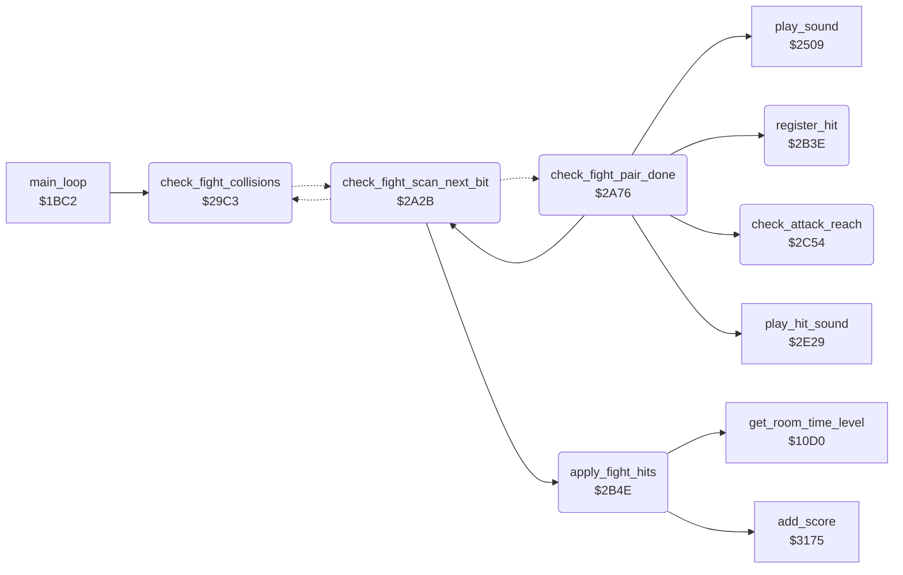

<!-- Generated by c64-docs from knowledge revision 20261017T121733.607-wszjh3 and src/source-map.json. Do not edit: change the knowledge, generate the source again, then run generate.ts. -->
# fight_hits.asm: Fights: sprite-sprite collisions, hits, damage, knock-outs and hit points

Range `$29C3-$2C6F`. Source: [fight_hits.asm](../../../src/fight_hits.asm). Index: [the reference](../index.md).

## Call graph

A solid arrow is a call, a thick arrow a table entry, a dotted arrow a jump. Rounded nodes are in this file.

## Names

### [`check_fight_collisions`](../../../src/fight_hits.asm#L14) `$29C3`

*routine*

Fight collision check, once per main loop pass (the main loop skips it in rooms whose room_no_enemies entry is nonzero). Reads SPSPCL (sprite-sprite collisions; the read clears it) into sprite_collisions. Bits $03 count as Bruce, $0C as Yamo, $30 as the Ninja. For each pair of actors that touch, actor_touch_mask,X of each gets the bit of the other actor's sprite: bit 1 = Bruce (sprite 1), bit 3 = Yamo (sprite 3), bit 4 = Ninja (sprite 4). Then each actor X is tested as the victim of each actor Y it touches (check_fight_pair): a hit needs the attacker in an attack state and the victim in front of it (check_attack_reach). A hit sets actor_hit_flags,Y bit 0 (attacker landed a hit) and on the victim actor_hit_flags,X bit 1 (Ninja strike), bit 2 (punch), bit 3 (flying kick) or bit 4 (fall attack), plus bit 7 when the attacker is Bruce. Then it continues in apply_fight_hits. actor_touch_mask and actor_hit_flags are cleared first.

- **Called from:** [`main_loop`](game_main_loop.md#main_loop) [`$1C23`](../../../src/game_main_loop.asm#L76)
- **Jumps to:** [`check_fight_pair`](fight_hits.md#check_fight_pair)
- **Reads:** [`SPSPCL`](../variables.md#SPSPCL), [`sprite_collisions`](../variables.md#sprite_collisions), [`actor_touch_mask`](../variables.md#actor_touch_mask), [`actor_touch_mask+1`](../variables.md#actor_touch_mask), [`actor_touch_mask+2`](../variables.md#actor_touch_mask), [`temp_counter`](../variables.md#temp_counter)
- **Writes:** [`actor_touch_mask+1`](../variables.md#actor_touch_mask), [`actor_touch_mask+2`](../variables.md#actor_touch_mask), [`actor_hit_flags+1`](../variables.md#actor_hit_flags), [`actor_hit_flags+2`](../variables.md#actor_hit_flags), [`sprite_collisions`](../variables.md#sprite_collisions), [`actor_touch_mask`](../variables.md#actor_touch_mask), [`temp_counter`](../variables.md#temp_counter)
- **Refers to:** [`actor_touch_mask`](../variables.md#actor_touch_mask)

### [`check_fight_collisions_clear`](../../../src/fight_hits.asm#L17) `$29C7`

*label*

- **Jumped to from:** [`check_fight_collisions`](fight_hits.md#check_fight_collisions) [`$29CC`](../../../src/fight_hits.asm#L21)

### [`check_fight_collisions_found`](../../../src/fight_hits.asm#L26) `$29D4`

*label*

Observed (room 0 run): values $12, $1C, $1D, $1E, $1F; never $03 or $0C alone, so the main and overlay sprite of one actor do not collide.

- **Jumped to from:** [`check_fight_collisions`](fight_hits.md#check_fight_collisions) [`$29D1`](../../../src/fight_hits.asm#L23)

### [`check_fight_bruce_yamo`](../../../src/fight_hits.asm#L31) `$29DD`

*label*

- **Jumped to from:** [`check_fight_collisions`](fight_hits.md#check_fight_collisions) [`$29D8`](../../../src/fight_hits.asm#L29)

### [`check_fight_bruce_yamo_touch`](../../../src/fight_hits.asm#L36) `$29E6`

*label*

- **Jumped to from:** [`check_fight_collisions`](fight_hits.md#check_fight_collisions) [`$29E1`](../../../src/fight_hits.asm#L34)

### [`check_fight_bruce_ninja`](../../../src/fight_hits.asm#L43) `$29F2`

*label*

- **Jumped to from:** [`check_fight_collisions`](fight_hits.md#check_fight_collisions) [`$29E3`](../../../src/fight_hits.asm#L35)

### [`check_fight_bruce_ninja_touch`](../../../src/fight_hits.asm#L48) `$29FB`

*label*

- **Jumped to from:** [`check_fight_collisions`](fight_hits.md#check_fight_collisions) [`$29F6`](../../../src/fight_hits.asm#L46)

### [`check_fight_yamo_ninja`](../../../src/fight_hits.asm#L56) `$2A07`

*label*

When both Yamo's and the Ninja's bits are set, they count as touching each other.

- **Jumped to from:** [`check_fight_collisions`](fight_hits.md#check_fight_collisions) [`$29DA`](../../../src/fight_hits.asm#L30), [`check_fight_collisions`](fight_hits.md#check_fight_collisions) [`$29F8`](../../../src/fight_hits.asm#L47)

### [`check_fight_scan`](../../../src/fight_hits.asm#L70) `$2A1F`

*label*

For each victim X = 2..0, test each sprite bit 0-4 of actor_touch_mask,X (shifted out of temp_counter).

- **Jumped to from:** [`check_fight_collisions`](fight_hits.md#check_fight_collisions) [`$2A0B`](../../../src/fight_hits.asm#L59), [`check_fight_collisions`](fight_hits.md#check_fight_collisions) [`$2A11`](../../../src/fight_hits.asm#L62)

### [`check_fight_scan_actor`](../../../src/fight_hits.asm#L72) `$2A21`

*label*

- **Jumped to from:** [`check_fight_scan_next_bit`](fight_hits.md#check_fight_scan_next_bit) [`$2A31`](../../../src/fight_hits.asm#L84)

### [`check_fight_scan_bit`](../../../src/fight_hits.asm#L76) `$2A27`

*label*

- **Jumped to from:** [`check_fight_scan_next_bit`](fight_hits.md#check_fight_scan_next_bit) [`$2A2E`](../../../src/fight_hits.asm#L82)

### [`check_fight_scan_next_bit`](../../../src/fight_hits.asm#L79) `$2A2B`

*label*

- **Called from:** [`check_fight_pair_done`](fight_hits.md#check_fight_pair_done) [`$2A78`](../../../src/fight_hits.asm#L123)
- **Calls:** [`apply_fight_hits`](fight_hits.md#apply_fight_hits)
- **Jumps to:** [`check_fight_scan_bit`](fight_hits.md#check_fight_scan_bit), [`check_fight_scan_actor`](fight_hits.md#check_fight_scan_actor), [`check_fight_pair_done`](fight_hits.md#check_fight_pair_done), [`check_fight_strike`](fight_hits.md#check_fight_strike), [`check_fight_punch`](fight_hits.md#check_fight_punch), [`check_fight_kick`](fight_hits.md#check_fight_kick), [`check_fight_fall`](fight_hits.md#check_fight_fall)
- **Writes:** [`temp_y`](../variables.md#temp_y)

### [`check_fight_pair`](../../../src/fight_hits.asm#L89) `$2A36`

*label*

Victim X touches sprite Y (kept in temp_y). A victim in state $18 wall bump, $1A duck, $0F recoil, $13 knocked down, $19 dying or $1B hit by a fall attack is not hit. The attacker is the owner of the sprite (sprite_owner,Y); its state selects the attack test.

- **Jumped to from:** [`check_fight_collisions`](fight_hits.md#check_fight_collisions) [`$2A29`](../../../src/fight_hits.asm#L78)

### [`check_fight_pair_done`](../../../src/fight_hits.asm#L121) `$2A76`

*label*

- **Jumped to from:** [`check_fight_scan_next_bit`](fight_hits.md#check_fight_scan_next_bit) [`$2A55`](../../../src/fight_hits.asm#L105), [`check_fight_scan_next_bit`](fight_hits.md#check_fight_scan_next_bit) [`$2A5D`](../../../src/fight_hits.asm#L109), [`check_fight_scan_next_bit`](fight_hits.md#check_fight_scan_next_bit) [`$2A71`](../../../src/fight_hits.asm#L119)
- **Calls:** [`check_fight_scan_next_bit`](fight_hits.md#check_fight_scan_next_bit), [`check_attack_reach`](fight_hits.md#check_attack_reach), [`play_sound`](sound_request.md#play_sound), [`register_hit`](fight_hits.md#register_hit), [`play_hit_sound`](actor_helpers.md#play_hit_sound)
- **Reads:** [`temp_y`](../variables.md#temp_y)
- **Writes:** [`attack_reach`](../variables.md#attack_reach)
- **Refers to:** [`fall_attack_budget`](../variables.md#fall_attack_budget)

### [`check_fight_strike`](../../../src/fight_hits.asm#L126) `$2A7B`

*label*

Ninja strike (state $16): hits while the attacker's timer is below 8 at reach 4 or more. Sound $87, hit bit 1, no points.

- **Jumped to from:** [`check_fight_scan_next_bit`](fight_hits.md#check_fight_scan_next_bit) [`$2A61`](../../../src/fight_hits.asm#L111)

### [`check_fight_punch`](../../../src/fight_hits.asm#L151) `$2AA5`

*label*

Punch (state $11): reach 6 or more and a height difference below $16. Hit sound, hit bit 2.

- **Jumped to from:** [`check_fight_scan_next_bit`](fight_hits.md#check_fight_scan_next_bit) [`$2A65`](../../../src/fight_hits.asm#L113)

### [`check_fight_punch_height`](../../../src/fight_hits.asm#L163) `$2ABC`

*label*

- **Jumped to from:** [`check_fight_pair_done`](fight_hits.md#check_fight_pair_done) [`$2AB6`](../../../src/fight_hits.asm#L160)

### [`check_fight_punch_store`](../../../src/fight_hits.asm#L173) `$2AD0`

*label*

- **Jumped to from:** [`check_fight_pair_done`](fight_hits.md#check_fight_pair_done) [`$2ACC`](../../../src/fight_hits.asm#L171)

### [`check_fight_kick`](../../../src/fight_hits.asm#L177) `$2AD4`

*label*

Flying kick (state $0C/$0D): hits while the timer is below $0A at reach 6 or more. Hit sound, hit bit 3.

- **Jumped to from:** [`check_fight_scan_next_bit`](fight_hits.md#check_fight_scan_next_bit) [`$2A69`](../../../src/fight_hits.asm#L115), [`check_fight_scan_next_bit`](fight_hits.md#check_fight_scan_next_bit) [`$2A6D`](../../../src/fight_hits.asm#L117)

### [`check_fight_kick_store`](../../../src/fight_hits.asm#L193) `$2AF6`

*label*

- **Jumped to from:** [`check_fight_pair_done`](fight_hits.md#check_fight_pair_done) [`$2AF2`](../../../src/fight_hits.asm#L191)

### [`check_fight_fall`](../../../src/fight_hits.asm#L200) `$2AFA`

*label*

Fall attack (state $0E, falling): the attacker is $0A or more above the victim and its fall attack counter fall_attack_budget,Y is not 0 (decremented for each test that gets this far; frame_update refills it to 2). No hit when either actor already has hit bit 4 or the victim is kicking or punching. Hit bit 4. The attacker does not get bit 0 and the victim does not turn.

- **Jumped to from:** [`check_fight_scan_next_bit`](fight_hits.md#check_fight_scan_next_bit) [`$2A73`](../../../src/fight_hits.asm#L120)

### [`check_fight_fall_store`](../../../src/fight_hits.asm#L231) `$2B39`

*label*

- **Jumped to from:** [`check_fight_pair_done`](fight_hits.md#check_fight_pair_done) [`$2B35`](../../../src/fight_hits.asm#L229)

### [`check_fight_pair_next`](../../../src/fight_hits.asm#L233) `$2B3B`

*label*

- **Jumped to from:** [`check_fight_pair_done`](fight_hits.md#check_fight_pair_done) [`$2AD9`](../../../src/fight_hits.asm#L180), [`check_fight_pair_done`](fight_hits.md#check_fight_pair_done) [`$2AE2`](../../../src/fight_hits.asm#L184), [`check_fight_pair_done`](fight_hits.md#check_fight_pair_done) [`$2AE4`](../../../src/fight_hits.asm#L185), [`check_fight_pair_done`](fight_hits.md#check_fight_pair_done) [`$2AF8`](../../../src/fight_hits.asm#L195), [`check_fight_pair_done`](fight_hits.md#check_fight_pair_done) [`$2B02`](../../../src/fight_hits.asm#L205), [`check_fight_pair_done`](fight_hits.md#check_fight_pair_done) [`$2B04`](../../../src/fight_hits.asm#L206), [`check_fight_pair_done`](fight_hits.md#check_fight_pair_done) [`$2B09`](../../../src/fight_hits.asm#L208), [`check_fight_pair_done`](fight_hits.md#check_fight_pair_done) [`$2B15`](../../../src/fight_hits.asm#L214), [`check_fight_pair_done`](fight_hits.md#check_fight_pair_done) [`$2B1C`](../../../src/fight_hits.asm#L217), [`check_fight_pair_done`](fight_hits.md#check_fight_pair_done) [`$2B22`](../../../src/fight_hits.asm#L220), [`check_fight_pair_done`](fight_hits.md#check_fight_pair_done) [`$2B26`](../../../src/fight_hits.asm#L222), [`check_fight_pair_done`](fight_hits.md#check_fight_pair_done) [`$2B2A`](../../../src/fight_hits.asm#L224)

### [`register_hit`](../../../src/fight_hits.asm#L237) `$2B3E`

*routine*

Marks a hit of attacker Y on victim X: actor_hit_flags,Y bit 0 = landed a hit, and the victim turns to face the attacker (actor_facing,X = actor_facing,Y XOR 1).

- **Called from:** [`check_fight_pair_done`](fight_hits.md#check_fight_pair_done) [`$2A9A`](../../../src/fight_hits.asm#L145), [`check_fight_pair_done`](fight_hits.md#check_fight_pair_done) [`$2AC3`](../../../src/fight_hits.asm#L167), [`check_fight_pair_done`](fight_hits.md#check_fight_pair_done) [`$2AE9`](../../../src/fight_hits.asm#L187)

### [`apply_fight_hits`](../../../src/fight_hits.asm#L252) `$2B4E`

*routine*

Applies the hits that check_fight_collisions found, for each actor X = 2..0 (current_actor = actor). Bit 0 (landed a hit): the attacker goes to state 0 with actor_step_delay = 4 and a pause in actor_timer by the time in the room (get_room_time_level: V = room_time+1 >= $20, C = room_time+1 >= $19): Bruce 3, 8 (C) or 10 (V); an enemy 10 (C or V), else 3 when game_loop_count is nonzero, else $18. Damage on actor_energy,X: bit 1 Ninja strike 2 (state $0F recoil, timer 3), bit 2 punch 3 (state $0F, timer 4), bit 3 flying kick 7 (state $13 knocked down, timer 12), bit 4 fall attack 5 (state $1B, timer 8). Points for Bruce's hits (bit 7): punch 100, kick 75, fall attack 50. Energy below 0: knock-out (apply_fight_ko).

- **Called from:** [`check_fight_scan_next_bit`](fight_hits.md#check_fight_scan_next_bit) [`$2A33`](../../../src/fight_hits.asm#L85)
- **Calls:** [`get_room_time_level`](game_setup.md#get_room_time_level), [`add_score`](score.md#add_score)
- **Reads:** [`actor_hit_flags+1`](../variables.md#actor_hit_flags), [`actor_hit_flags+2`](../variables.md#actor_hit_flags), [`actor_pose_done+1`](../variables.md#actor_pose_done), [`actor_pose_done+2`](../variables.md#actor_pose_done), [`game_loop_count`](../variables.md#game_loop_count), [`actor_energy+1`](../variables.md#actor_energy), [`actor_energy+2`](../variables.md#actor_energy), [`current_actor`](../variables.md#current_actor)
- **Writes:** [`current_actor`](../variables.md#current_actor), [`actor_state+1`](../variables.md#actor_state), [`actor_state+2`](../variables.md#actor_state), [`actor_step_delay+1`](../variables.md#actor_step_delay), [`actor_step_delay+2`](../variables.md#actor_step_delay), [`actor_timer+1`](../variables.md#actor_timer), [`actor_timer+2`](../variables.md#actor_timer), [`actor_pose_done+1`](../variables.md#actor_pose_done), [`actor_pose_done+2`](../variables.md#actor_pose_done), [`actor_energy+1`](../variables.md#actor_energy), [`actor_energy+2`](../variables.md#actor_energy)

### [`apply_fight_hits_loop`](../../../src/fight_hits.asm#L254) `$2B50`

*label*

- **Jumped to from:** [`apply_fight_hits`](fight_hits.md#apply_fight_hits) [`$2C20`](../../../src/fight_hits.asm#L377)

### [`apply_fight_hits_pause_long`](../../../src/fight_hits.asm#L275) `$2B79`

*label*

- **Jumped to from:** [`apply_fight_hits`](fight_hits.md#apply_fight_hits) [`$2B70`](../../../src/fight_hits.asm#L271)

### [`apply_fight_hits_pause_short`](../../../src/fight_hits.asm#L279) `$2B7F`

*label*

2 is replaced at once by apply_fight_hits_pause_by_time

- **Jumped to from:** [`apply_fight_hits`](fight_hits.md#apply_fight_hits) [`$2B6E`](../../../src/fight_hits.asm#L270), [`apply_fight_hits`](fight_hits.md#apply_fight_hits) [`$2B74`](../../../src/fight_hits.asm#L273)

### [`apply_fight_hits_pause_by_time`](../../../src/fight_hits.asm#L282) `$2B83`

*label*

- **Jumped to from:** [`apply_fight_hits`](fight_hits.md#apply_fight_hits) [`$2B69`](../../../src/fight_hits.asm#L268)

### [`apply_fight_hits_pause_8`](../../../src/fight_hits.asm#L289) `$2B90`

*label*

- **Jumped to from:** [`apply_fight_hits`](fight_hits.md#apply_fight_hits) [`$2B88`](../../../src/fight_hits.asm#L285)

### [`apply_fight_hits_pause_10`](../../../src/fight_hits.asm#L293) `$2B96`

*label*

- **Jumped to from:** [`apply_fight_hits`](fight_hits.md#apply_fight_hits) [`$2B86`](../../../src/fight_hits.asm#L284)

### [`apply_fight_hits_strike`](../../../src/fight_hits.asm#L297) `$2B9A`

*label*

Bit 1: Ninja strike, 2 energy, recoil (state $0F, timer 3).

- **Jumped to from:** [`apply_fight_hits`](fight_hits.md#apply_fight_hits) [`$2B56`](../../../src/fight_hits.asm#L258), [`apply_fight_hits`](fight_hits.md#apply_fight_hits) [`$2B76`](../../../src/fight_hits.asm#L274), [`apply_fight_hits`](fight_hits.md#apply_fight_hits) [`$2B7D`](../../../src/fight_hits.asm#L278), [`apply_fight_hits`](fight_hits.md#apply_fight_hits) [`$2B8E`](../../../src/fight_hits.asm#L288), [`apply_fight_hits`](fight_hits.md#apply_fight_hits) [`$2B94`](../../../src/fight_hits.asm#L292)

### [`apply_fight_hits_punch`](../../../src/fight_hits.asm#L311) `$2BB1`

*label*

Bit 2: punch, 100 points when Bruce hit, 3 energy, recoil (state $0F, timer 4).

- **Jumped to from:** [`apply_fight_hits`](fight_hits.md#apply_fight_hits) [`$2B9E`](../../../src/fight_hits.asm#L300)

### [`apply_fight_hits_punch_damage`](../../../src/fight_hits.asm#L321) `$2BC4`

*label*

- **Jumped to from:** [`apply_fight_hits`](fight_hits.md#apply_fight_hits) [`$2BB9`](../../../src/fight_hits.asm#L316)

### [`apply_fight_hits_kick`](../../../src/fight_hits.asm#L332) `$2BD5`

*label*

Bit 3: flying kick, 75 points when Bruce hit, 7 energy, knocked down (state $13, timer 12).

- **Jumped to from:** [`apply_fight_hits`](fight_hits.md#apply_fight_hits) [`$2BB5`](../../../src/fight_hits.asm#L314)

### [`apply_fight_hits_kick_damage`](../../../src/fight_hits.asm#L342) `$2BE8`

*label*

- **Jumped to from:** [`apply_fight_hits`](fight_hits.md#apply_fight_hits) [`$2BDD`](../../../src/fight_hits.asm#L337)

### [`apply_fight_hits_check_ko`](../../../src/fight_hits.asm#L347) `$2BEF`

*label*

- **Jumped to from:** [`apply_fight_hits`](fight_hits.md#apply_fight_hits) [`$2BA7`](../../../src/fight_hits.asm#L305)

### [`apply_fight_hits_fall`](../../../src/fight_hits.asm#L354) `$2BF9`

*label*

Bit 4: fall attack, 50 points when Bruce hit, 5 energy, state $1B with timer 8.

- **Jumped to from:** [`apply_fight_hits`](fight_hits.md#apply_fight_hits) [`$2BD9`](../../../src/fight_hits.asm#L335), [`apply_fight_hits`](fight_hits.md#apply_fight_hits) [`$2C51`](../../../src/fight_hits.asm#L408)

### [`apply_fight_hits_fall_damage`](../../../src/fight_hits.asm#L364) `$2C0C`

*label*

- **Jumped to from:** [`apply_fight_hits`](fight_hits.md#apply_fight_hits) [`$2C01`](../../../src/fight_hits.asm#L359)

### [`apply_fight_hits_next`](../../../src/fight_hits.asm#L374) `$2C1D`

*label*

- **Jumped to from:** [`apply_fight_hits`](fight_hits.md#apply_fight_hits) [`$2BFD`](../../../src/fight_hits.asm#L357)

### [`apply_fight_hits_done`](../../../src/fight_hits.asm#L378) `$2C23`

*label*

- **Jumped to from:** [`apply_fight_hits`](fight_hits.md#apply_fight_hits) [`$2C1E`](../../../src/fight_hits.asm#L376)

### [`apply_fight_ko`](../../../src/fight_hits.asm#L384) `$2C24`

*label*

Knock-out (energy below 0). Bruce's knock-out of Yamo scores 256+194 = 450 points, of the Ninja 200. The victim goes to state $13 (knocked down) with timer $0c; check_actor_knockouts removes it later. It continues at apply_fight_hits_fall, which still sees hit bit 4: a knock-out by a fall attack repeats the damage, the 50 points and the knock-out points until the energy wraps to a positive value.

- **Jumped to from:** [`apply_fight_hits`](fight_hits.md#apply_fight_hits) [`$2BCB`](../../../src/fight_hits.asm#L326), [`apply_fight_hits`](fight_hits.md#apply_fight_hits) [`$2BEF`](../../../src/fight_hits.asm#L348), [`apply_fight_hits`](fight_hits.md#apply_fight_hits) [`$2C13`](../../../src/fight_hits.asm#L369)

### [`apply_fight_ko_ninja`](../../../src/fight_hits.asm#L398) `$2C40`

*label*

Ninja: 200 points

- **Jumped to from:** [`apply_fight_hits`](fight_hits.md#apply_fight_hits) [`$2C2E`](../../../src/fight_hits.asm#L390)

### [`apply_fight_ko_knockdown`](../../../src/fight_hits.asm#L402) `$2C47`

*label*

- **Jumped to from:** [`apply_fight_hits`](fight_hits.md#apply_fight_hits) [`$2C28`](../../../src/fight_hits.asm#L387), [`apply_fight_hits`](fight_hits.md#apply_fight_hits) [`$2C3D`](../../../src/fight_hits.asm#L397)

### [`check_attack_reach`](../../../src/fight_hits.asm#L412) `$2C54`

*routine*

Distance check of attacker Y against victim X: A = victim X - attacker X when the attacker faces right (actor_facing,Y = 1), else attacker X - victim X. Compares A with attack_reach. Returns carry set and N clear when the victim is in front of the attacker at a distance of attack_reach or more.

- **Called from:** [`check_fight_pair_done`](fight_hits.md#check_fight_pair_done) [`$2A86`](../../../src/fight_hits.asm#L132), [`check_fight_pair_done`](fight_hits.md#check_fight_pair_done) [`$2AA9`](../../../src/fight_hits.asm#L154), [`check_fight_pair_done`](fight_hits.md#check_fight_pair_done) [`$2ADF`](../../../src/fight_hits.asm#L183)
- **Reads:** [`attack_reach`](../variables.md#attack_reach)

### [`check_attack_reach_compare`](../../../src/fight_hits.asm#L427) `$2C6B`

*label*

- **Jumped to from:** [`check_attack_reach`](fight_hits.md#check_attack_reach) [`$2C61`](../../../src/fight_hits.asm#L420)
