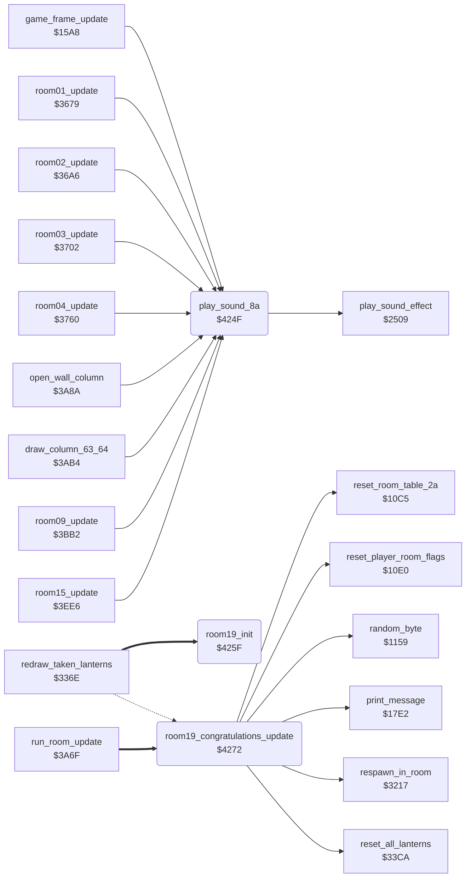

<!-- Generated by c64-docs from knowledge revision 20261016T170255.379-vv114c and src/source-map.json. Do not edit: change the knowledge, generate the source again, then run generate.ts. -->
# final_room.asm: Sound helper and room 19 (congratulations)

Range `$424F-$42C4`. Source: [final_room.asm](../../../src/final_room.asm). Index: [the reference](../index.md).

## Call graph

A solid arrow is a call, a thick arrow a table entry, a dotted arrow a jump. Rounded nodes are in this file.

## Names

### [`play_sound_8a`](../../../src/final_room.asm#L6) `$424F`

*routine*

Starts sound effect $8a ($2509); keeps A, X and Y.

- **Called from:** [`game_frame_update`](frame_update.md#game_frame_update) [`$1771`](../../../src/frame_update.asm#L267), [`room01_update`](room_update.md#room01_update) [`$3698`](../../../src/room_update.asm#L50), [`room02_update`](room_update.md#room02_update) [`$36BA`](../../../src/room_update.asm#L70), [`room03_update`](room_update.md#room03_update) [`$3719`](../../../src/room_update.asm#L117), [`room04_update`](room_update.md#room04_update) [`$379A`](../../../src/room_update.asm#L183), [`room04_update`](room_update.md#room04_update) [`$37F7`](../../../src/room_update.asm#L225), [`open_wall_column`](room_update.md#open_wall_column) [`$3A8A`](../../../src/room_update.asm#L592), [`draw_column_63_64`](room_update.md#draw_column_63_64) [`$3AB4`](../../../src/room_update.asm#L615), [`room09_update`](room_update.md#room09_update) [`$3BFA`](../../../src/room_update.asm#L781), [`room15_update`](room_update.md#room15_update) [`$3F05`](../../../src/room_update.asm#L1189), [`room15_update`](room_update.md#room15_update) [`$3F2D`](../../../src/room_update.asm#L1206), [`room15_update`](room_update.md#room15_update) [`$3F54`](../../../src/room_update.asm#L1224)
- **Calls:** [`play_sound_effect`](sound_effects.md#play_sound_effect)

### [`room19_init`](../../../src/final_room.asm#L21) `$425F`

*routine*

Init of room 19 (from table $4e9c): sets the countdown $49/$4a to $0458 and clears the top text line $8c00-$8c27.

- **Jumped to from:** [`redraw_taken_lanterns`](lanterns.md#redraw_taken_lanterns) [`$33C9`](../../../src/lanterns.asm#L124)
- **Entry of:** [`room_setup_handlers`](../tables.md#room_setup_handlers)
- **Writes:** [`attract_countdown`](../variables.md#attract_countdown), [`title_timeout_hi`](../variables.md#title_timeout_hi), [`screen_ram+38`](vic_bank2.md#screen_ram), [`screen_ram+39`](vic_bank2.md#screen_ram)

### [`room19_clear_top_line_loop`](../../../src/final_room.asm#L28) `$426B`

*label*

- **Jumped to from:** [`room19_init`](final_room.md#room19_init) [`$426F`](../../../src/final_room.asm#L31)

### [`room19_congratulations_update`](../../../src/final_room.asm#L34) `$4272`

*routine*

Room 19 frame handler. While attract_countdown/title_timeout_hi (frames, $0458 from room19_init) is not 0: one random colour over colour RAM rows 17-24, columns 4-32 (flames) and message 4 (CONGRATULATIONS) at text row 0, column 10. At 0: game_cycle + 1, the current player's room13_floor_bonus_flags = 1, lantern counters and records reset, the current player's entry bonus flags reset, and Bruce respawns in room 0.

- **Jumped to from:** [`redraw_taken_lanterns`](lanterns.md#redraw_taken_lanterns) [`$33C9`](../../../src/lanterns.asm#L124), [`run_room_update`](room_update.md#run_room_update) [`$3A7B`](../../../src/room_update.asm#L579)
- **Entry of:** [`room_frame_handlers`](../tables.md#room_frame_handlers)
- **Calls:** [`reset_room_table_2a`](room_state.md#reset_room_table_2a), [`reset_all_lanterns`](lanterns.md#reset_all_lanterns), [`reset_player_room_flags`](room_state.md#reset_player_room_flags), [`respawn_in_room`](room_entry_traps.md#respawn_in_room), [`random_byte`](interrupts.md#random_byte), [`print_message`](text.md#print_message)
- **Reads:** [`attract_countdown`](../variables.md#attract_countdown), [`title_timeout_hi`](../variables.md#title_timeout_hi), [`game_cycle`](../variables.md#game_cycle), [`current_player`](../variables.md#current_player)
- **Writes:** [`game_cycle`](../variables.md#game_cycle), [`raster_colours+160`](../variables.md#raster_colours), [`raster_colours+161`](../variables.md#raster_colours), [`lda00+199`](../variables.md#lda00), [`lda00+200`](../variables.md#lda00), [`lda00+239`](../variables.md#lda00), [`lda00+240`](../variables.md#lda00), [`ldb00+23`](../variables.md#ldb00), [`ldb00+24`](../variables.md#ldb00), [`ldb1e+33`](../variables.md#ldb1e), [`ldb1e+34`](../variables.md#ldb1e), [`ldb44+35`](../variables.md#ldb44), [`ldb44+36`](../variables.md#ldb44), [`ldb44+75`](../variables.md#ldb44), [`ldb44+76`](../variables.md#ldb44), [`ldb94+35`](../variables.md#ldb94), [`ldb94+36`](../variables.md#ldb94), [`ldb94+75`](../variables.md#ldb94), [`ldb94+76`](../variables.md#ldb94)

### [`room19_reset_floor_bonus_loop`](../../../src/final_room.asm#L45) `$4283`

*label*

- **Jumped to from:** [`room19_congratulations_update`](final_room.md#room19_congratulations_update) [`$4288`](../../../src/final_room.asm#L49)

### [`room19_flash_and_message`](../../../src/final_room.asm#L55) `$4298`

*label*

- **Jumped to from:** [`room19_congratulations_update`](final_room.md#room19_congratulations_update) [`$4276`](../../../src/final_room.asm#L37)

### [`room19_flame_colour_loop`](../../../src/final_room.asm#L60) `$42A1`

*label*

- **Jumped to from:** [`room19_congratulations_update`](final_room.md#room19_congratulations_update) [`$42BA`](../../../src/final_room.asm#L70)
