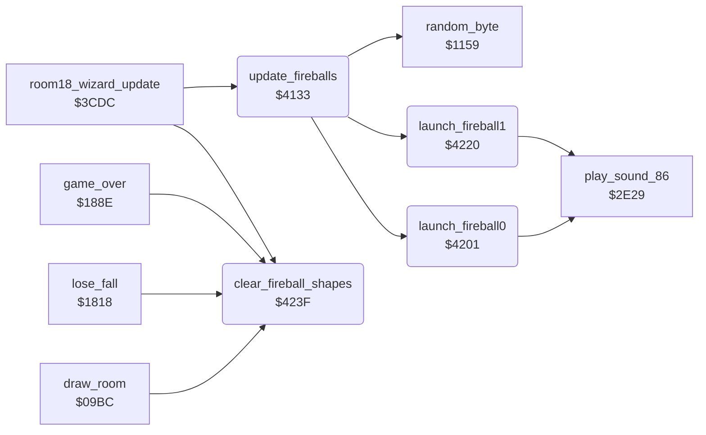

<!-- Generated by c64-docs from knowledge revision 20261016T170255.379-vv114c and src/source-map.json. Do not edit: change the knowledge, generate the source again, then run generate.ts. -->
# fireballs.asm: Room 18 wizard fireballs

Range `$4133-$424E`. Source: [fireballs.asm](../../../src/fireballs.asm). Index: [the reference](../index.md).

## Call graph

A solid arrow is a call, a thick arrow a table entry, a dotted arrow a jump. Rounded nodes are in this file.

## Names

### [`update_fireballs`](../../../src/fireballs.asm#L6) `$4133`

*routine*

Room 18 fireballs (sprites 6 and 7, shapes at $8340/$8380): randomises the ball shapes with the masks at $4322, launches an inactive fireball when its delay reaches 0, moves each active one down 5 lines per pass until y=$e0 (then a delay of 2), steers x toward Bruce's x $9e, and writes position, MSB and a random colour to the VIC.

- **Called from:** [`room18_wizard_update`](room_update.md#room18_wizard_update) [`$3D1D`](../../../src/room_update.asm#L940)
- **Calls:** [`random_byte`](interrupts.md#random_byte), [`launch_fireball0`](fireballs.md#launch_fireball0), [`launch_fireball1`](fireballs.md#launch_fireball1)
- **Reads:** [`fireball_shape_masks+2`](variables.md#fireball_shape_masks), [`fireball_shape_masks+3`](variables.md#fireball_shape_masks), [`fireball_active`](variables.md#fireball_active), [`fireball_launch_delay`](variables.md#fireball_launch_delay), [`fireball_active+1`](variables.md#fireball_active), [`fireball_launch_delay+1`](variables.md#fireball_launch_delay), [`fireball_y`](variables.md#fireball_y), [`fireball_y+1`](variables.md#fireball_y), [`fireball_x+1`](variables.md#fireball_x), [`actor_x`](../variables.md#actor_x), [`MSIGX`](../variables.md#MSIGX)
- **Writes:** [`sprite_blocks+448`](vic_bank2.md#sprite_blocks), [`sprite_blocks+451`](vic_bank2.md#sprite_blocks), [`sprite_blocks+512`](vic_bank2.md#sprite_blocks), [`fireball_launch_delay`](variables.md#fireball_launch_delay), [`fireball_launch_delay+1`](variables.md#fireball_launch_delay), [`fireball_y`](variables.md#fireball_y), [`fireball_y+1`](variables.md#fireball_y), [`fireball_active`](variables.md#fireball_active), [`fireball_active+1`](variables.md#fireball_active), [`fireball_x+1`](variables.md#fireball_x), [`MSIGX`](../variables.md#MSIGX)
- **Refers to:** [`sprite_blocks`](vic_bank2.md#sprite_blocks), [`fireball_active`](variables.md#fireball_active), [`fireball_launch_delay`](variables.md#fireball_launch_delay), [`fireball_x`](variables.md#fireball_x), [`sprite67_msb_set_masks`](variables.md#sprite67_msb_set_masks), [`sprite67_msb_clear_masks`](variables.md#sprite67_msb_clear_masks), [`SP6X`](../variables.md#SP6X), [`fireball_y`](variables.md#fireball_y), [`SP6Y`](../variables.md#SP6Y), [`SP6COL`](../variables.md#SP6COL)

### [`fireball_shape_loop`](../../../src/fireballs.asm#L9) `$4137`

*label*

- **Jumped to from:** [`update_fireballs`](fireballs.md#update_fireballs) [`$414D`](../../../src/fireballs.asm#L20)

### [`fireball0_wait`](../../../src/fireballs.asm#L27) `$415F`

*label*

- **Jumped to from:** [`update_fireballs`](fireballs.md#update_fireballs) [`$4157`](../../../src/fireballs.asm#L24)

### [`fireball1_launch_check`](../../../src/fireballs.asm#L29) `$4162`

*label*

- **Jumped to from:** [`update_fireballs`](fireballs.md#update_fireballs) [`$4152`](../../../src/fireballs.asm#L22)

### [`fireball1_wait`](../../../src/fireballs.asm#L36) `$4172`

*label*

- **Jumped to from:** [`update_fireballs`](fireballs.md#update_fireballs) [`$416A`](../../../src/fireballs.asm#L33)

### [`fireballs_move`](../../../src/fireballs.asm#L38) `$4175`

*label*

- **Jumped to from:** [`update_fireballs`](fireballs.md#update_fireballs) [`$415C`](../../../src/fireballs.asm#L26), [`update_fireballs`](fireballs.md#update_fireballs) [`$4165`](../../../src/fireballs.asm#L31), [`update_fireballs`](fireballs.md#update_fireballs) [`$416F`](../../../src/fireballs.asm#L35)

### [`fireball_fall_loop`](../../../src/fireballs.asm#L40) `$4177`

*label*

- **Jumped to from:** [`update_fireballs`](fireballs.md#update_fireballs) [`$4194`](../../../src/fireballs.asm#L55)

### [`fireball_fall_next`](../../../src/fireballs.asm#L53) `$4193`

*label*

- **Jumped to from:** [`update_fireballs`](fireballs.md#update_fireballs) [`$417A`](../../../src/fireballs.asm#L42), [`update_fireballs`](fireballs.md#update_fireballs) [`$4187`](../../../src/fireballs.asm#L48)

### [`fireballs_set_sprites`](../../../src/fireballs.asm#L61) `$41A0`

*label*

- **Jumped to from:** [`update_fireballs`](fireballs.md#update_fireballs) [`$419E`](../../../src/fireballs.asm#L60)

### [`fireball_sprite_loop`](../../../src/fireballs.asm#L63) `$41A2`

*label*

- **Jumped to from:** [`update_fireballs`](fireballs.md#update_fireballs) [`$41FE`](../../../src/fireballs.asm#L121)

### [`fireball_steer_loop`](../../../src/fireballs.asm#L71) `$41B1`

*label*

- **Jumped to from:** [`update_fireballs`](fireballs.md#update_fireballs) [`$41AE`](../../../src/fireballs.asm#L69), [`update_fireballs`](fireballs.md#update_fireballs) [`$41C3`](../../../src/fireballs.asm#L83)

### [`fireball_steer_next`](../../../src/fireballs.asm#L81) `$41C2`

*label*

- **Jumped to from:** [`update_fireballs`](fireballs.md#update_fireballs) [`$41BB`](../../../src/fireballs.asm#L77), [`update_fireballs`](fireballs.md#update_fireballs) [`$41BD`](../../../src/fireballs.asm#L79)

### [`fireball_store_msb`](../../../src/fireballs.asm#L94) `$41D7`

*label*

- **Jumped to from:** [`update_fireballs`](fireballs.md#update_fireballs) [`$41D2`](../../../src/fireballs.asm#L91)

### [`fireball_sprite_next`](../../../src/fireballs.asm#L119) `$41FD`

*label*

- **Jumped to from:** [`update_fireballs`](fireballs.md#update_fireballs) [`$41A5`](../../../src/fireballs.asm#L65)

### [`launch_fireball0`](../../../src/fireballs.asm#L124) `$4201`

*routine*

Launches fireball 0: sprite 6 pointer $0d, sprite 6 on, active, x=$50, y=$37, sound $86 ($2e29).

- **Called from:** [`update_fireballs`](fireballs.md#update_fireballs) [`$4159`](../../../src/fireballs.asm#L25)
- **Calls:** [`play_sound_86`](actor_checks.md#play_sound_86)
- **Reads:** [`SPENA`](../variables.md#SPENA)
- **Writes:** [`sprite_pointers+6`](vic_bank2.md#sprite_pointers), [`SPENA`](../variables.md#SPENA), [`fireball_active`](variables.md#fireball_active), [`fireball_x`](variables.md#fireball_x), [`fireball_y`](variables.md#fireball_y)
- **Refers to:** [`sprite_pointers`](vic_bank2.md#sprite_pointers)

### [`launch_fireball1`](../../../src/fireballs.asm#L138) `$4220`

*routine*

Launches fireball 1: sprite 7 pointer $0e, sprite 7 on, active, x=$5e, y=$37, sound $86 ($2e29).

- **Called from:** [`update_fireballs`](fireballs.md#update_fireballs) [`$416C`](../../../src/fireballs.asm#L34)
- **Calls:** [`play_sound_86`](actor_checks.md#play_sound_86)
- **Reads:** [`SPENA`](../variables.md#SPENA)
- **Writes:** [`sprite_pointers+7`](vic_bank2.md#sprite_pointers), [`SPENA`](../variables.md#SPENA), [`fireball_active+1`](variables.md#fireball_active), [`fireball_x+1`](variables.md#fireball_x), [`fireball_y+1`](variables.md#fireball_y)
- **Refers to:** [`sprite_pointers`](vic_bank2.md#sprite_pointers), [`fireball_active`](variables.md#fireball_active), [`fireball_x`](variables.md#fireball_x), [`fireball_y`](variables.md#fireball_y)

### [`clear_fireball_shapes`](../../../src/fireballs.asm#L152) `$423F`

*routine*

Clears the top rows (bytes 0,3,6,9) of the fireball sprite shapes at $8340 and $8380.

- **Called from:** [`draw_room`](room_draw.md#draw_room) [`$09F0`](../../../src/room_draw.asm#L31), [`lose_fall`](game_over.md#lose_fall) [`$1838`](../../../src/game_over.asm#L23), [`game_over`](game_over.md#game_over) [`$188E`](../../../src/game_over.asm#L68), [`room18_wizard_update`](room_update.md#room18_wizard_update) [`$3CEC`](../../../src/room_update.asm#L919)
- **Writes:** [`sprite_blocks+454`](vic_bank2.md#sprite_blocks), [`sprite_blocks+457`](vic_bank2.md#sprite_blocks), [`sprite_blocks+518`](vic_bank2.md#sprite_blocks), [`sprite_blocks+521`](vic_bank2.md#sprite_blocks)
- **Refers to:** [`sprite_blocks`](vic_bank2.md#sprite_blocks)
