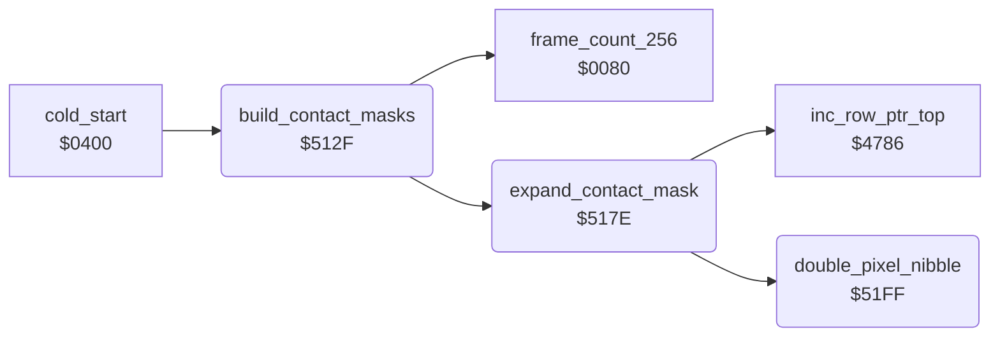

<!-- Generated by c64-docs from knowledge revision 20261017T123532.893-hcxwuv and src/source-map.json. Do not edit: change the knowledge, generate the source again, then run generate.ts. -->
# frame_builder.asm: Start-up builder of the 96-byte background contact masks of the animation frames

Range `$512F-$5211`. Source: [frame_builder.asm](../../../src/frame_builder.asm). Index: [the reference](../index.md).

## Call graph

A solid arrow is a call, a thick arrow a table entry, a dotted arrow a jump. Rounded nodes are in this file.

## Names

### [`build_contact_masks`](../../../src/frame_builder.asm#L16) `$512F`

*routine*

Start-up builder of the background contact masks, called once by cold_start after the room charsets are expanded. First it loops for ever unless prot_signature_a = $B9 and prot_signature_b = prot_signature_a (protection key page). Then for each pair of frame numbers X = $D1, $CF, ... 1 (odd) and X-1 (even): frame X is expanded into the 96-byte buffer shift_mask_col0 ($CAE0; the odd entries of contact_mask_addr_lo/hi point there), or the buffer is cleared when contact_mask_addr_hi,X is 0 (the Ninja has no second sprite); frame X-1 is expanded to its own address contact_mask_addr_lo/hi and the buffer is ORed into it. So the mask of an even frame covers both sprites of the pose. check_background_contact uses these masks. Mask format: 96 bytes = 3 columns of 32 rows, column after column; each source pixel becomes a %11 multicolour pixel. The masks fill $9000-$9FBF (over the room charset sources, already expanded) and contact_masks_high ($C000-$CADF). current_actor ($51) holds the frame number. Ends with JMP $0080 (an RTS).

- **Called from:** [`cold_start`](cold_start.md#cold_start) [`$04F0`](../../../src/cold_start.asm#L166)
- **Calls:** [`expand_contact_mask`](frame_builder.md#expand_contact_mask), [`frame_count_256`](../variables.md#frame_count_256)
- **Reads:** [`prot_signature_a`](protection_key_page.md#prot_signature_a), [`prot_signature_b`](protection_key_page.md#prot_signature_b), [`current_actor`](../variables.md#current_actor), [`data_ptr`](../variables.md#data_ptr), `$C83E`, `$C83F`, [`shift_mask_col2+30`](../variables.md#shift_mask_col2), [`shift_mask_col2+31`](../variables.md#shift_mask_col2)
- **Writes:** [`current_actor`](../variables.md#current_actor), [`shift_mask_col2+30`](../variables.md#shift_mask_col2), [`shift_mask_col2+31`](../variables.md#shift_mask_col2), [`data_ptr`](../variables.md#data_ptr), [`data_ptr+1`](../variables.md#data_ptr), `$C83E`, `$C83F`
- **Refers to:** [`data_ptr`](../variables.md#data_ptr)

### [`build_masks_pair`](../../../src/frame_builder.asm#L41) `$513D`

*label*

frame number (zero page current_actor reused)

- **Jumped to from:** [`build_contact_masks`](frame_builder.md#build_contact_masks) [`$5178`](../../../src/frame_builder.asm#L75)

### [`build_masks_clear_buffer`](../../../src/frame_builder.asm#L48) `$514A`

*label*

No second sprite: clear the 96-byte buffer.

- **Jumped to from:** [`build_contact_masks`](frame_builder.md#build_contact_masks) [`$5142`](../../../src/frame_builder.asm#L44)

### [`build_masks_clear_loop`](../../../src/frame_builder.asm#L51) `$514E`

*label*

- **Jumped to from:** [`build_contact_masks`](frame_builder.md#build_contact_masks) [`$5152`](../../../src/frame_builder.asm#L54)

### [`build_masks_even`](../../../src/frame_builder.asm#L55) `$5154`

*label*

- **Jumped to from:** [`build_contact_masks`](frame_builder.md#build_contact_masks) [`$5147`](../../../src/frame_builder.asm#L46)

### [`build_masks_overlay`](../../../src/frame_builder.asm#L66) `$5169`

*label*

OR the odd frame in the buffer into the even frame (96 bytes).

- **Jumped to from:** [`build_contact_masks`](frame_builder.md#build_contact_masks) [`$5171`](../../../src/frame_builder.asm#L71)

### [`build_masks_done`](../../../src/frame_builder.asm#L76) `$517B`

*label*

$0080 holds an RTS

- **Jumped to from:** [`build_contact_masks`](frame_builder.md#build_contact_masks) [`$5176`](../../../src/frame_builder.asm#L74)

### [`expand_contact_mask`](../../../src/frame_builder.asm#L93) `$517E`

*routine*

Expands the 1-bit shape of frame X into its 96-byte contact mask at contact_mask_addr_lo/hi,X. Source = frame_gfx_lo/hi,X, height = frame_last_row,X + 1 rows (kept in zero page $1D, demo_input_ptr, which is free at start-up), width flag frame_is_wide,X: 0 = 1 source byte per row (8 pixels -> columns 0 and 1, column 2 empty), else 2 source bytes per row (the high nibble of the second byte -> column 2). Rows from the height to 31 are cleared. Pointers: row_ptr_top = source, data_ptr / row_ptr_bottom / aux_ptr = mask columns 0 / 1 / 2.

- **Called from:** [`build_contact_masks`](frame_builder.md#build_contact_masks) [`$5144`](../../../src/frame_builder.asm#L45), [`build_contact_masks`](frame_builder.md#build_contact_masks) [`$5158`](../../../src/frame_builder.asm#L58)
- **Calls:** [`double_pixel_nibble`](frame_builder.md#double_pixel_nibble), [`inc_row_ptr_top`](pointer_helpers.md#inc_row_ptr_top)
- **Reads:** [`data_ptr+1`](../variables.md#data_ptr), [`data_ptr`](../variables.md#data_ptr), [`row_ptr_top`](../variables.md#row_ptr_top), [`row_ptr_bottom`](../variables.md#row_ptr_bottom), [`aux_ptr`](../variables.md#aux_ptr), [`demo_input_ptr`](../variables.md#demo_input_ptr)
- **Writes:** [`row_ptr_top`](../variables.md#row_ptr_top), [`row_ptr_top+1`](../variables.md#row_ptr_top), [`demo_input_ptr`](../variables.md#demo_input_ptr), [`data_ptr+1`](../variables.md#data_ptr), [`data_ptr`](../variables.md#data_ptr), [`row_ptr_bottom`](../variables.md#row_ptr_bottom), [`row_ptr_bottom+1`](../variables.md#row_ptr_bottom), [`aux_ptr`](../variables.md#aux_ptr), [`aux_ptr+1`](../variables.md#aux_ptr), [`double_pixel_bits`](../variables.md#double_pixel_bits)
- **Refers to:** [`frame_gfx_lo`](actor_frame_gfx_tables.md#frame_gfx_lo), [`frame_gfx_hi`](actor_frame_gfx_tables.md#frame_gfx_hi), [`row_ptr_top`](../variables.md#row_ptr_top), [`frame_last_row`](actor_frame_gfx_tables.md#frame_last_row), [`contact_mask_addr_hi`](room_enemy_tables.md#contact_mask_addr_hi), [`data_ptr`](../variables.md#data_ptr), [`contact_mask_addr_lo`](room_enemy_tables.md#contact_mask_addr_lo), [`row_ptr_bottom`](../variables.md#row_ptr_bottom), [`aux_ptr`](../variables.md#aux_ptr), [`frame_is_wide`](actor_frame_gfx_tables.md#frame_is_wide)

### [`expand_narrow_row`](../../../src/frame_builder.asm#L122) `$51B7`

*label*

Narrow frame: one source byte per row.

- **Jumped to from:** [`expand_contact_mask`](frame_builder.md#expand_contact_mask) [`$51CC`](../../../src/frame_builder.asm#L133)

### [`expand_clear_rows`](../../../src/frame_builder.asm#L135) `$51CE`

*label*

Clear the rest of the 32 rows (A = 0).

- **Jumped to from:** [`expand_contact_mask`](frame_builder.md#expand_contact_mask) [`$51D7`](../../../src/frame_builder.asm#L141), [`expand_contact_mask`](frame_builder.md#expand_contact_mask) [`$51FD`](../../../src/frame_builder.asm#L164)

### [`expand_wide_row`](../../../src/frame_builder.asm#L144) `$51DA`

*label*

Wide frame: two source bytes per row (row_ptr_top steps one extra byte per row).

- **Jumped to from:** [`expand_contact_mask`](frame_builder.md#expand_contact_mask) [`$51B5`](../../../src/frame_builder.asm#L120), [`expand_contact_mask`](frame_builder.md#expand_contact_mask) [`$51F9`](../../../src/frame_builder.asm#L161)

### [`expand_wide_done`](../../../src/frame_builder.asm#L162) `$51FB`

*label*

### [`double_pixel_nibble`](../../../src/frame_builder.asm#L168) `$51FF`

*routine*

Doubles 4 pixels: returns in A one byte where bit n of double_pixel_bits (n = 0-3) became the bit pair 2n+1..2n (%11 for a set bit). double_pixel_bits is shifted right by 4, so a second call does the high nibble. X = $FF on return.

- **Called from:** [`expand_contact_mask`](frame_builder.md#expand_contact_mask) [`$51BB`](../../../src/frame_builder.asm#L125), [`expand_contact_mask`](frame_builder.md#expand_contact_mask) [`$51C0`](../../../src/frame_builder.asm#L127), [`expand_contact_mask`](frame_builder.md#expand_contact_mask) [`$51DE`](../../../src/frame_builder.asm#L147), [`expand_contact_mask`](frame_builder.md#expand_contact_mask) [`$51E3`](../../../src/frame_builder.asm#L149), [`expand_contact_mask`](frame_builder.md#expand_contact_mask) [`$51F1`](../../../src/frame_builder.asm#L157)
- **Reads:** [`double_pixel_bits`](../variables.md#double_pixel_bits)
- **Writes:** [`double_pixel_bits`](../variables.md#double_pixel_bits)

### [`double_pixel_loop`](../../../src/frame_builder.asm#L171) `$5203`

*label*

- **Jumped to from:** [`double_pixel_nibble`](frame_builder.md#double_pixel_nibble) [`$520E`](../../../src/frame_builder.asm#L180)

### [`double_pixel_next`](../../../src/frame_builder.asm#L175) `$5209`

*label*

- **Jumped to from:** [`double_pixel_nibble`](frame_builder.md#double_pixel_nibble) [`$5205`](../../../src/frame_builder.asm#L173)

### [`double_pixel_done`](../../../src/frame_builder.asm#L181) `$5211`

*label*

- **Jumped to from:** [`double_pixel_nibble`](frame_builder.md#double_pixel_nibble) [`$520A`](../../../src/frame_builder.asm#L177)
