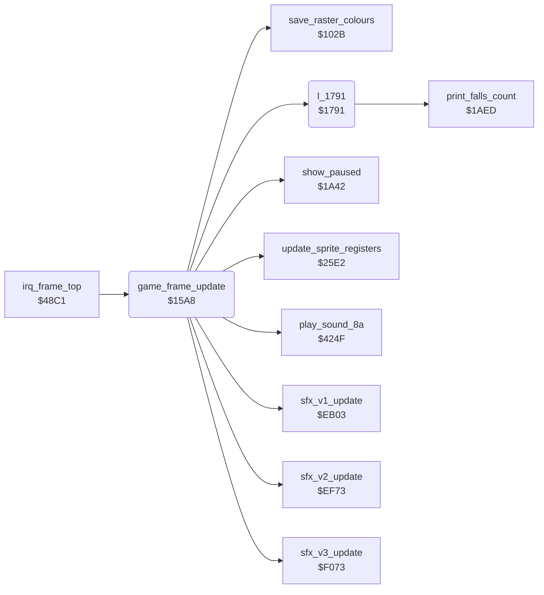

<!-- Generated by c64-docs from knowledge revision 20261016T170255.379-vv114c and src/source-map.json. Do not edit: change the knowledge, generate the source again, then run generate.ts. -->
# frame_update.asm: Per-frame work called from the game raster IRQ: sound, timers, joysticks, idle screen saver, protection checks

Range `$15A8-$179D`. Source: [frame_update.asm](../../../src/frame_update.asm). Index: [the reference](../index.md).

## Call graph

A solid arrow is a call, a thick arrow a table entry, a dotted arrow a jump. Rounded nodes are in this file.

## Names

### [`game_frame_update`](../../../src/frame_update.asm#L6) `$15A8`

*routine*

Called once per frame by the game raster IRQ irq_frame_top (line $FD). Runs the sound engine ($EB03/$EF73/$F073 with the room in X), advances random_ptr, sets charset_hi from room_charset_d018, shows the left-handed markers, advances room_timer, the idle timer and screen saver, the frame and attract countdowns, reads the joysticks into actor_joy_dir/actor_joy_fire and returns a human Yamo to the computer after a long idle time. Holds two copy-protection checks.

- **Called from:** [`irq_frame_top`](raster_irq_game.md#irq_frame_top) [`$4915`](../../../src/raster_irq_game.asm#L46)
- **Calls:** [`sfx_v1_update`](sfx_voice1.md#sfx_v1_update), [`sfx_v2_update`](sfx_voice2.md#sfx_v2_update), [`sfx_v3_update`](sfx_voice3.md#sfx_v3_update), [`update_sprite_registers`](sprite_render.md#update_sprite_registers), [`show_paused`](status.md#show_paused), [`save_raster_colours`](room_state.md#save_raster_colours), [`play_sound_8a`](final_room.md#play_sound_8a), [`l_1791`](../../../src/frame_update.asm#L286)
- **Jumps to:** [`l_179d`](../../../src/frame_update.asm#L293), [`l_1797`](../../../src/frame_update.asm#L289)
- **Reads:** [`current_room`](../variables.md#current_room), [`random_ptr`](../variables.md#random_ptr), [`hit_budget_countdown`](actor_vars.md#hit_budget_countdown), [`room_charset_d018`](../variables.md#room_charset_d018), [`joy_handedness_p1`](actor_room_tables.md#joy_handedness_p1), [`human_opponent_mode`](variables.md#human_opponent_mode), [`two_player_mode`](variables.md#two_player_mode), [`joy_handedness_p2`](actor_room_tables.md#joy_handedness_p2), [`game_playing`](../variables.md#game_playing), [`pause_state`](../variables.md#pause_state), [`room_timer_lo`](../variables.md#room_timer_lo), [`room_timer`](../variables.md#room_timer), [`idle_ticks`](../variables.md#idle_ticks), [`idle_timer`](../variables.md#idle_timer), [`colour_cycle_counter`](../variables.md#colour_cycle_counter), `$0081`, [`saved_band_colours+18`](room_colours.md#saved_band_colours), [`saved_band_colours+19`](room_colours.md#saved_band_colours), [`saver_xor`](../variables.md#saver_xor), [`saver_mask`](../variables.md#saver_mask), [`frame_countdown`](../variables.md#frame_countdown), [`attract_countdown`](../variables.md#attract_countdown), [`title_timeout_hi`](../variables.md#title_timeout_hi), [`CIADDRA`](../variables.md#CIADDRA), [`CIADDRB`](../variables.md#CIADDRB), [`CIAPRB`](../variables.md#CIAPRB), [`current_player`](../variables.md#current_player), [`CIAPRA`](../variables.md#CIAPRA), [`l_142d`](../../../src/keyboard.asm#L89), [`CIAICR+158`](../variables.md#CIAICR), [`l_142e`](../../../src/keyboard.asm#L91), [`CIAICR+157`](../variables.md#CIAICR), [`protection_marker`](../variables.md#protection_marker), [`work_ptr_a`](../variables.md#work_ptr_a), [`work_ptr_a+1`](../variables.md#work_ptr_a), [`l_0539`](../../../src/restart.asm#L28), [`saved_cia1_ddra`](actor_movement.md#saved_cia1_ddra), [`saved_cia1_ddrb`](actor_movement.md#saved_cia1_ddrb), [`actor_joy_dir`](../variables.md#actor_joy_dir), [`actor_joy_dir+1`](../variables.md#actor_joy_dir) and 6 more
- **Writes:** [`split_index`](../variables.md#split_index), [`random_ptr`](../variables.md#random_ptr), [`actor_hit_budget`](actor_vars.md#actor_hit_budget), [`actor_hit_budget+1`](actor_vars.md#actor_hit_budget), [`actor_hit_budget+2`](actor_vars.md#actor_hit_budget), [`hit_budget_countdown`](actor_vars.md#hit_budget_countdown), [`charset_hi`](../variables.md#charset_hi), [`screen_ram+42`](vic_bank2.md#screen_ram), [`screen_ram+77`](vic_bank2.md#screen_ram), [`room_timer_lo`](../variables.md#room_timer_lo), [`room_timer`](../variables.md#room_timer), [`idle_ticks`](../variables.md#idle_ticks), [`idle_timer`](../variables.md#idle_timer), [`pause_state`](../variables.md#pause_state), [`colour_cycle_counter`](../variables.md#colour_cycle_counter), `$0081`, [`saver_mask`](../variables.md#saver_mask), [`saver_xor`](../variables.md#saver_xor), [`raster_colours+18`](../variables.md#raster_colours), [`raster_colours+19`](../variables.md#raster_colours), [`frame_countdown`](../variables.md#frame_countdown), [`attract_countdown`](../variables.md#attract_countdown), [`title_timeout_hi`](../variables.md#title_timeout_hi), [`saved_cia1_ddra`](actor_movement.md#saved_cia1_ddra), [`saved_cia1_ddrb`](actor_movement.md#saved_cia1_ddrb), [`CIADDRA`](../variables.md#CIADDRA), [`CIADDRB`](../variables.md#CIADDRB), [`actor_joy_dir`](../variables.md#actor_joy_dir), [`actor_joy_fire`](../variables.md#actor_joy_fire), [`actor_joy_dir+1`](../variables.md#actor_joy_dir), [`actor_joy_fire+1`](../variables.md#actor_joy_fire), [`work_ptr_a+1`](../variables.md#work_ptr_a), [`l_0539`](../../../src/restart.asm#L28), [`yamo_idle_timer`](../variables.md#yamo_idle_timer), [`yamo_idle_timer+1`](../variables.md#yamo_idle_timer), [`human_opponent_mode`](variables.md#human_opponent_mode), [`falls_left`](../variables.md#falls_left)
- **Refers to:** [`actor_hit_budget`](actor_vars.md#actor_hit_budget), [`screen_ram`](vic_bank2.md#screen_ram), [`colour_cycle_counter`](../variables.md#colour_cycle_counter), [`joystick_rotate_bits`](room_tables.md#joystick_rotate_bits), [`actor_joy_dir`](../variables.md#actor_joy_dir), [`actor_joy_fire`](../variables.md#actor_joy_fire), [`work_ptr_a`](../variables.md#work_ptr_a), [`charset_src_0+433`](room_charset_src.md#charset_src_0), [`yamo_idle_timer`](../variables.md#yamo_idle_timer)

### [`room_timer_tick`](../../../src/frame_update.asm#L66) `$1614`

*label*

while playing and not paused: room_timer_lo/room_timer count up until room_timer reaches $80

### [`idle_timer_tick`](../../../src/frame_update.asm#L77) `$1628`

*label*

Every 256 frames idle_timer counts up; at $80 the game pauses itself (pause_state=$86) and saves the colours for the screen saver.

- **Jumped to from:** [`game_frame_update`](frame_update.md#game_frame_update) [`$1617`](../../../src/frame_update.asm#L68), [`game_frame_update`](frame_update.md#game_frame_update) [`$161C`](../../../src/frame_update.asm#L70), [`game_frame_update`](frame_update.md#game_frame_update) [`$1620`](../../../src/frame_update.asm#L72), [`game_frame_update`](frame_update.md#game_frame_update) [`$1624`](../../../src/frame_update.asm#L74), [`game_frame_update`](frame_update.md#game_frame_update) [`$1670`](../../../src/frame_update.asm#L122)

### [`screen_saver_colours`](../../../src/frame_update.asm#L95) `$1645`

*label*

While the screen saver is on: raster_colours = (saved colours XOR colour_cycle_counter) AND $F7.

- **Jumped to from:** [`game_frame_update`](frame_update.md#game_frame_update) [`$162A`](../../../src/frame_update.asm#L79), [`game_frame_update`](frame_update.md#game_frame_update) [`$1641`](../../../src/frame_update.asm#L91)

### [`protection_ddr_check`](../../../src/frame_update.asm#L118) `$166A`

*label*

Copy protection: loops back for ever unless the CPU port DDR $00 reads $EF (left by the original loader)

- **Jumped to from:** [`game_frame_update`](frame_update.md#game_frame_update) [`$1659`](../../../src/frame_update.asm#L108)

### [`frame_countdowns_tick`](../../../src/frame_update.asm#L124) `$1672`

*label*

Every frame, also in the game: frame_countdown - 1 down to 0, and attract_countdown/title_timeout_hi - 1 as one 16-bit value down to 0.

### [`read_joysticks`](../../../src/frame_update.asm#L139) `$1689`

*label*

Saves the CIA1 data direction registers, sets both ports to input and reads the current player's port (player 1 port 1, player 2 port 2) into actor_joy_dir/actor_joy_fire for Bruce, and the other port for a human Yamo.

- **Jumped to from:** [`game_frame_update`](frame_update.md#game_frame_update) [`$167E`](../../../src/frame_update.asm#L132), [`game_frame_update`](frame_update.md#game_frame_update) [`$1683`](../../../src/frame_update.asm#L135)

### [`protection_marker_check`](../../../src/frame_update.asm#L209) `$1703`

*label*

Copy protection: when $02 is not $32, fills memory downward from page $02 with that value; the page count is the code byte $0539 ($D0)

- **Jumped to from:** [`game_frame_update`](frame_update.md#game_frame_update) [`$16A0`](../../../src/frame_update.asm#L148), [`game_frame_update`](frame_update.md#game_frame_update) [`$16D2`](../../../src/frame_update.asm#L178)

### [`protection_wipe_loop`](../../../src/frame_update.asm#L215) `$170B`

*label*

- **Jumped to from:** [`game_frame_update`](frame_update.md#game_frame_update) [`$170E`](../../../src/frame_update.asm#L218), [`game_frame_update`](frame_update.md#game_frame_update) [`$1715`](../../../src/frame_update.asm#L221)

### [`joystick_read_done`](../../../src/frame_update.asm#L222) `$1717`

*label*

- **Jumped to from:** [`game_frame_update`](frame_update.md#game_frame_update) [`$1707`](../../../src/frame_update.asm#L212)

### [`idle_reset_check`](../../../src/frame_update.asm#L227) `$1723`

*label*

any joystick input (or demo mode) clears idle_timer

### [`idle_timer_clear`](../../../src/frame_update.asm#L239) `$173B`

*label*

- **Jumped to from:** [`game_frame_update`](frame_update.md#game_frame_update) [`$1726`](../../../src/frame_update.asm#L229), [`game_frame_update`](frame_update.md#game_frame_update) [`$1733`](../../../src/frame_update.asm#L235)

### [`human_yamo_idle_check`](../../../src/frame_update.asm#L243) `$173F`

*label*

With a human Yamo: after 7*256 frames with no direction and no fire on Yamo's port, switches Yamo back to the computer, sets room_timer to $20 and takes 5 falls from both players (9 -> 4).

- **Jumped to from:** [`game_frame_update`](frame_update.md#game_frame_update) [`$172B`](../../../src/frame_update.asm#L231), [`game_frame_update`](frame_update.md#game_frame_update) [`$1739`](../../../src/frame_update.asm#L238)
