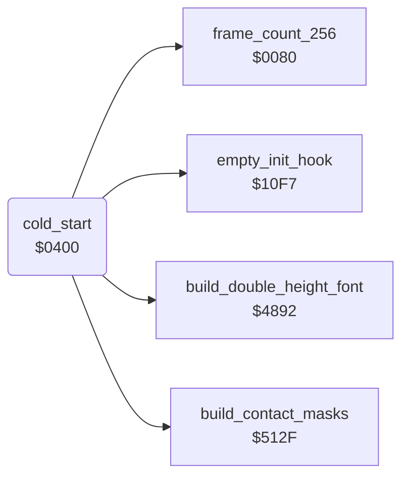

<!-- Generated by c64-docs from knowledge revision 20261023T151738.098-ndlxeh and .c64-re-tools/local/generated/src/source-map.json. Do not edit: change the knowledge, generate the source again, then run docs.ts generate. -->
# game/cold_start.asm: Cold start: warm-start flag, random table, ROM font copy and charset expansion

Range `$03FF-$050E`. Source: [game/cold_start.asm](../../../../src/game/cold_start.asm). Index: [the reference](../../index.md).

## Call graph

A solid arrow is a call, a thick arrow a table entry, a dotted arrow a jump. Rounded nodes are in this file.

## Data

| Range | Type | Name | Read by | Written by |
|---|---|---|---|---|
| [`$03FF`](../../../../src/game/cold_start.asm#L8) | bytes | [`warm_start_flag`](../../../../src/game/cold_start.asm#L7) | [`cold_start`](cold_start.md#cold_start) |  |
| [`$0408`](../../../../src/game/cold_start.asm#L33)-`$0409` | dual-use | [`irq_vector`](../../../../src/game/cold_start.asm#L31) | [`irq_entry`](../irq/interrupt_entry.md#irq_entry) | [`show_title_screen`](title_demo_start.md#show_title_screen), [`init_game_irq`](play_init.md#init_game_irq), [`show_player_screen`](title_player_screens.md#show_player_screen), [`irq_title_frame`](../irq/screen_raster_irqs.md#irq_title_frame), [`irq_title_split`](../irq/screen_raster_irqs.md#irq_title_split), [`game_over`](lose_fall_game_over.md#game_over), [`irq_game_bottom`](../irq/game_irq.md#irq_game_bottom), [`irq_game_playfield`](../irq/game_irq.md#irq_game_playfield) |

## Names

### [`warm_start_flag`](../../../../src/game/cold_start.asm#L7) `$03FF`

*variable*

Warm-start flag read by cold_start: nonzero skips the random table, the ROM font copy and the expansion of charset_rooms_0_9, charset_rooms_10_19 and charset_wizard. Nothing in the program writes it; the image holds 0.
must be 0

- **Read by:** [`cold_start`](cold_start.md#cold_start) [`$040D`](../../../../src/game/cold_start.asm#L35)

### [`cold_start`](../../../../src/game/cold_start.asm#L22) `$0400`

*routine*

Cold start (program entry). Runs once after loading. - Disables interrupts, sets the stack and blanks the screen. - When warm_start_flag is 0 (always in this image): fills random_table with 256 bytes of SID voice 3 noise, copies characters 0-63 of the character ROM into text_font ($8800-$89FF) with inverted copies in text_font_inverse ($8A00-$8BFF) (the hires font of the title menu and the status line), patches three characters of that font, and expands room_charset_a/b/c into charset_rooms_0_9, charset_rooms_10_19 and charset_wizard. - Always expands room_charset_d into charset_wizard_flash, calls build_contact_masks (protection wait on prot_signature_a/b, then it builds the background contact masks of the actor frames), sets $01 = $35 (RAM with I/O) and the fixed sprite colours, then falls into restart_to_title. Each font source holds 128 characters of 8 bytes. build_double_height_font writes every pixel row twice: rows 0-3 of character n give character n of the output charset (top half), rows 4-7 give character n+128 (bottom half). A map cell of the rooms is the pair c / c+128.

- **Calls:** [`frame_count_256`](../../memory-map.md#frame_count_256), [`build_double_height_font`](../room/draw_helpers.md#build_double_height_font), [`build_contact_masks`](../actor/frame_builder.md#build_contact_masks), [`empty_init_hook`](game_setup.md#empty_init_hook)
- **Reads:** [`SCROLY`](../../memory-map.md#SCROLY), [`warm_start_flag`](cold_start.md#warm_start_flag), [`RANDOM`](../../memory-map.md#RANDOM), [`SP0X`](../../memory-map.md#SP0X), [`char_rom_chars_32_63`](../../memory-map.md#char_rom_chars_32_63)
- **Writes:** [`SCROLY`](../../memory-map.md#SCROLY), [`sfx_voice1_state`](../sfx/sfx_voice1.md#sfx_voice1_state), [`sfx_voice2_state`](../sfx/sfx_voice2.md#sfx_voice2_state), [`sfx_voice3_state`](../sfx/sfx_voice3.md#sfx_voice3_state), [`RANDOM`](../../memory-map.md#RANDOM), [`FREHI3`](../../memory-map.md#FREHI3), [`FRELO3`](../../memory-map.md#FRELO3), [`VCREG3`](../../memory-map.md#VCREG3), [`random_table`](../../memory-map.md#random_table), [`R6510`](../../memory-map.md#R6510), [`text_font_letters`](../../memory-map.md#text_font_letters), [`text_font_inverse_letters`](../../memory-map.md#text_font_inverse_letters), [`text_font`](../../memory-map.md#text_font), [`text_font_inverse`](../../memory-map.md#text_font_inverse), [`text_font_keycap_left`](../../memory-map.md#text_font_keycap_left), [`text_font_keycap_right`](../../memory-map.md#text_font_keycap_right), [`column_counter`](../../memory-map.md#column_counter), [`row_ptr_top`](../../memory-map.md#row_ptr_top), [`row_ptr_top+1`](../../memory-map.md#row_ptr_top), [`data_ptr`](../../memory-map.md#data_ptr), [`row_ptr_bottom`](../../memory-map.md#row_ptr_bottom), [`data_ptr+1`](../../memory-map.md#data_ptr), [`row_ptr_bottom+1`](../../memory-map.md#row_ptr_bottom), [`SP1COL`](../../memory-map.md#SP1COL), [`SP3COL`](../../memory-map.md#SP3COL), [`SP4COL`](../../memory-map.md#SP4COL), [`SP0COL`](../../memory-map.md#SP0COL), [`SP2COL`](../../memory-map.md#SP2COL)
- **Refers to:** [`room_charset_a`](../graphics/room_charset_a.md#room_charset_a), [`row_ptr_top`](../../memory-map.md#row_ptr_top), [`charset_rooms_0_9`](../../memory-map.md#charset_rooms_0_9), [`data_ptr`](../../memory-map.md#data_ptr), [`row_ptr_bottom`](../../memory-map.md#row_ptr_bottom), [`room_charset_b`](../graphics/room_charset_b.md#room_charset_b), [`charset_rooms_10_19`](../../memory-map.md#charset_rooms_10_19), [`room_charset_c`](../graphics/room_charset_c.md#room_charset_c), [`charset_wizard`](../../memory-map.md#charset_wizard), [`room_charset_d`](../graphics/room_charset_d.md#room_charset_d), [`charset_wizard_flash`](../../memory-map.md#charset_wizard_flash)

### [`irq_vector`](../../../../src/game/cold_start.asm#L31) `$0408`

*vector*

These two bytes are the AND #$EF instruction of the cold start and after it the IRQ vector: irq_entry does JMP (irq_vector). init_game_irq, show_title_screen, show_player_screen and the raster IRQ handlers store the address of the next raster handler here.

- **Read by:** [`irq_entry`](../irq/interrupt_entry.md#irq_entry) [`$1113`](../../../../src/irq/interrupt_entry.asm#L23)
- **Written by:** [`show_title_screen`](title_demo_start.md#show_title_screen) [`$05DC`](../../../../src/game/title_demo_start.asm#L123), [`init_game_irq`](play_init.md#init_game_irq) [`$083E`](../../../../src/game/play_init.asm#L122), [`show_player_screen`](title_player_screens.md#show_player_screen) [`$0F02`](../../../../src/game/title_player_screens.asm#L119), [`irq_title_frame`](../irq/screen_raster_irqs.md#irq_title_frame) [`$1551`](../../../../src/irq/screen_raster_irqs.asm#L101), [`irq_title_split`](../irq/screen_raster_irqs.md#irq_title_split) [`$1585`](../../../../src/irq/screen_raster_irqs.asm#L131), [`game_over`](lose_fall_game_over.md#game_over) [`$18A4`](../../../../src/game/lose_fall_game_over.asm#L93), [`irq_game_bottom`](../irq/game_irq.md#irq_game_bottom) [`$48CD`](../../../../src/irq/game_irq.asm#L18), [`irq_game_playfield`](../irq/game_irq.md#irq_game_playfield) [`$494B`](../../../../src/irq/game_irq.asm#L84), [`irq_game_playfield`](../irq/game_irq.md#irq_game_playfield) [`$4977`](../../../../src/irq/game_irq.asm#L110)

### [`irq_vector_hi`](../../../../src/game/cold_start.asm#L32) `$0409`

*vector*

- **Written by:** [`show_title_screen`](title_demo_start.md#show_title_screen) [`$05E1`](../../../../src/game/title_demo_start.asm#L125), [`init_game_irq`](play_init.md#init_game_irq) [`$0843`](../../../../src/game/play_init.asm#L124), [`show_player_screen`](title_player_screens.md#show_player_screen) [`$0F07`](../../../../src/game/title_player_screens.asm#L121), [`irq_title_frame`](../irq/screen_raster_irqs.md#irq_title_frame) [`$1556`](../../../../src/irq/screen_raster_irqs.asm#L103), [`irq_title_split`](../irq/screen_raster_irqs.md#irq_title_split) [`$158A`](../../../../src/irq/screen_raster_irqs.asm#L133), [`game_over`](lose_fall_game_over.md#game_over) [`$18A9`](../../../../src/game/lose_fall_game_over.asm#L95), [`irq_game_bottom`](../irq/game_irq.md#irq_game_bottom) [`$48D2`](../../../../src/irq/game_irq.asm#L20), [`irq_game_playfield`](../irq/game_irq.md#irq_game_playfield) [`$4950`](../../../../src/irq/game_irq.asm#L86), [`irq_game_playfield`](../irq/game_irq.md#irq_game_playfield) [`$497C`](../../../../src/irq/game_irq.asm#L112)

### [`cold_start_full_init`](../../../../src/game/cold_start.asm#L39) `$0415`

*label*

- **Jumped to from:** [`cold_start`](cold_start.md#cold_start) [`$0410`](../../../../src/game/cold_start.asm#L36)

### [`cold_start_random_loop`](../../../../src/game/cold_start.asm#L52) `$0432`

*label*

Fill random_table ($0200-$02FF) with 256 OSC3 samples, with a delay between samples.

- **Jumped to from:** [`cold_start`](cold_start.md#cold_start) [`$043E`](../../../../src/game/cold_start.asm#L60)

### [`cold_start_random_delay`](../../../../src/game/cold_start.asm#L54) `$0434`

*label*

- **Jumped to from:** [`cold_start`](cold_start.md#cold_start) [`$0435`](../../../../src/game/cold_start.asm#L56)

### [`cold_start_copy_rom_font`](../../../../src/game/cold_start.asm#L77) `$0449`

*label*

Copy ROM characters 0-31 (@, A-Z ...) to text_font_letters and ROM characters 32-63 (space, punctuation, digits) to text_font, with inverted copies in text_font_inverse_letters / text_font_inverse. With text_font as charset a screen code is ASCII - $20, and adding $40 gives the inverted character.
$D000 is the character ROM here ($01 = $32), not SP0X

- **Jumped to from:** [`cold_start`](cold_start.md#cold_start) [`$0460`](../../../../src/game/cold_start.asm#L87)

### [`cold_start_patch_font_chars`](../../../../src/game/cold_start.asm#L94) `$0468`

*label*

Patch three characters of the text font: code 32 ('@', text_font_letters) becomes a solid block, code 66 (text_font_keycap_left) a 2-pixel bar at the right edge, code 86 (text_font_keycap_right) a 2-pixel bar at the left edge.

- **Jumped to from:** [`cold_start`](cold_start.md#cold_start) [`$0478`](../../../../src/game/cold_start.asm#L102)

### [`cold_start_expand_last_font`](../../../../src/game/cold_start.asm#L149) `$04D1`

*label*

Expand room_charset_d ($9C00) into charset_wizard_flash ($B800/$BC00). The warm path starts here.

- **Jumped to from:** [`cold_start`](cold_start.md#cold_start) [`$0412`](../../../../src/game/cold_start.asm#L38)
