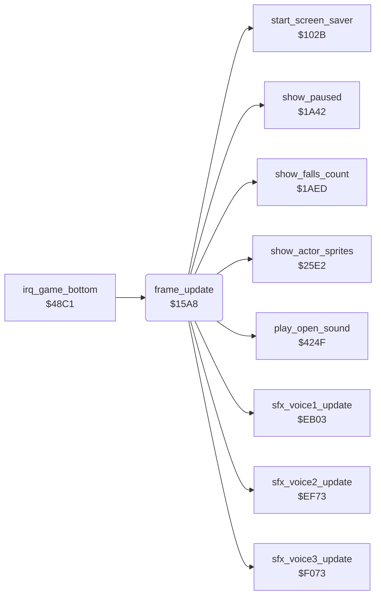

<!-- Generated by c64-docs from knowledge revision 20261029T162352.521-4j8tu8 and .c64-re-tools/local/generated/src/source-map.json. Do not edit: change the knowledge, generate the source again, then run docs.ts generate. -->
# game/frame_update.asm: Per-frame update called by the game interrupt: counters, input, idle timer and environment checks

Range `$15A8-$179D`. Source: [game/frame_update.asm](../../../../src/game/frame_update.asm). Index: [the reference](../../index.md).

## Routines

| Routine | Address | Reached from | Summary |
|---|---|---|---|
| [`frame_update`](frame_update.md#frame_update) | `$15A8` | [`irq_game_bottom`](../irq/game_irq.md#irq_game_bottom) | Per-frame work of the game screen, called by irq_game_bottom (raster line $FD). |

## Call graph

A solid arrow is a call, a thick arrow a table entry. Rounded nodes are in this file.

## Details

### [`frame_update`](../../../../src/game/frame_update.asm#L20) `$15A8`

*routine*

Per-frame work of the game screen, called by irq_game_bottom (raster line $FD). In order: - raster_split_index = 0; runs the three sound effect voices; increments random_ptr; show_actor_sprites (sprite positions of the actors). - Every 256 frames (fall_attack_refill_timer): fall_attack_budget of the three actors = 2. - room_charset_hi from room_vmcsb. - The L marks of left-handed joysticks on status row 1. - room_time (play only, not paused); frame_counter and frame_count_256; idle_timer: at $80 the game pauses itself and starts the screen saver; the saver colour masks and the flashing band colours. - Protection: loops for ever unless D6510 = $EF. - frame_countdown and title_countdown. - Reads the joysticks into actor_joy_dir / actor_fire of Bruce (port of current_player) and of a player-controlled Yamo (the other port), turned 90 degrees for a left-handed joystick. - Protection: wipes memory unless prot_loader_mark = $32. - Input resets idle_timer; a player-controlled Yamo without input for 7*256 frames goes back to the computer.

- **Called from:** [`irq_game_bottom`](../irq/game_irq.md#irq_game_bottom)
- **Calls:** [`sfx_voice1_update`](../sfx/sfx_voice1.md#sfx_voice1_update), [`sfx_voice2_update`](../sfx/sfx_voice2.md#sfx_voice2_update), [`sfx_voice3_update`](../sfx/sfx_voice3.md#sfx_voice3_update), [`show_actor_sprites`](../actor/actor_sprites.md#show_actor_sprites), [`show_paused`](pause_status_line.md#show_paused), [`start_screen_saver`](game_setup.md#start_screen_saver), [`play_open_sound`](../room/wizard_fireballs.md#play_open_sound), [`show_falls_count`](status_and_keys.md#show_falls_count)
- **Reads:** [`room`](../../memory-map.md#room), [`random_ptr`](../../memory-map.md#random_ptr), [`fall_attack_refill_timer`](../actor/actor_workspace.md#fall_attack_refill_timer), [`room_vmcsb`](../../memory-map.md#room_vmcsb), [`joystick_right_handed`](../room/room_enemy_tables.md#joystick_right_handed), [`option_yamo_player2`](options_and_patterns.md#option_yamo_player2), [`option_two_players`](options_and_patterns.md#option_two_players), [`game_mode`](../../memory-map.md#game_mode), [`pause_state`](../../memory-map.md#pause_state), [`room_time`](../../memory-map.md#room_time), [`frame_counter`](../../memory-map.md#frame_counter), [`idle_timer`](../../memory-map.md#idle_timer) and 25 more
- **Writes:** [`raster_split_index`](../../memory-map.md#raster_split_index), [`random_ptr`](../../memory-map.md#random_ptr), [`fall_attack_budget`](../../memory-map.md#fall_attack_budget), [`fall_attack_refill_timer`](../actor/actor_workspace.md#fall_attack_refill_timer), [`room_charset_hi`](../../memory-map.md#room_charset_hi), [`game_screen`](../../memory-map.md#game_screen), [`room_time`](../../memory-map.md#room_time), [`frame_counter`](../../memory-map.md#frame_counter), [`idle_timer`](../../memory-map.md#idle_timer), [`pause_state`](../../memory-map.md#pause_state), [`frame_count_256`](../../memory-map.md#frame_count_256), `$0081` and 17 more
- **Refers to:** [`fall_attack_budget`](../../memory-map.md#fall_attack_budget), [`charset_rooms_0_9`](../../memory-map.md#charset_rooms_0_9), [`charset_rooms_10_19`](../../memory-map.md#charset_rooms_10_19), [`charset_wizard`](../../memory-map.md#charset_wizard), [`charset_wizard_flash`](../../memory-map.md#charset_wizard_flash), [`game_screen`](../../memory-map.md#game_screen), [`joystick_right_handed`](../room/room_enemy_tables.md#joystick_right_handed), [`room_time`](../../memory-map.md#room_time), [`frame_count_256`](../../memory-map.md#frame_count_256), [`title_countdown`](../../memory-map.md#title_countdown), [`actor_joy_dir`](../../memory-map.md#actor_joy_dir), [`actor_fire`](../../memory-map.md#actor_fire) and 2 more

| Label | Address | Comment |
|---|---|---|
| [`frame_update_dec_fall_attack_timer`](../../../../src/game/frame_update.asm#L37) | `$15CD` |  |
| [`frame_update_charset_3a`](../../../../src/game/frame_update.asm#L45) | `$15DA` |  |
| [`frame_update_charset_3c`](../../../../src/game/frame_update.asm#L50) | `$15E2` |  |
| [`frame_update_charset_3e`](../../../../src/game/frame_update.asm#L55) | `$15EA` | charset $B800 |
| [`frame_update_store_charset`](../../../../src/game/frame_update.asm#L57) | `$15EC` |  |
| [`frame_update_joy1_mark`](../../../../src/game/frame_update.asm#L64) | `$15F7` |  |
| [`frame_update_store_joy1_mark`](../../../../src/game/frame_update.asm#L67) | `$15F9` |  |
| [`frame_update_joy2_mode`](../../../../src/game/frame_update.asm#L75) | `$1606` |  |
| [`frame_update_joy2_mark`](../../../../src/game/frame_update.asm#L80) | `$160F` |  |
| [`frame_update_store_joy2_mark`](../../../../src/game/frame_update.asm#L83) | `$1611` |  |
| [`frame_update_count_frames`](../../../../src/game/frame_update.asm#L95) | `$1628` | frame counter; the idle timer runs every 256 frames |
| [`frame_update_count_256`](../../../../src/game/frame_update.asm#L109) | `$163F` |  |
| [`frame_update_saver_masks`](../../../../src/game/frame_update.asm#L117) | `$1645` | Screen saver colour masks: off: saver_eor_mask = 0, saver_and_mask = $FE. On (idle_timer bit 7 set): saver_eor_mask = frame_count_256, saver_and_mask = $F7, and the 20 bytes of room_band_colours are recomputed from palette_backup. |
| [`frame_update_store_masks`](../../../../src/game/frame_update.asm#L126) | `$1653` |  |
| [`frame_update_saver_loop`](../../../../src/game/frame_update.asm#L133) | `$165D` |  |
| [`frame_update_check_ddr`](../../../../src/game/frame_update.asm#L140) | `$166A` |  |
| [`frame_update_dec_countdowns`](../../../../src/game/frame_update.asm#L156) | `$1672` |  |
| [`frame_update_title_countdown`](../../../../src/game/frame_update.asm#L160) | `$1678` |  |
| [`frame_update_countdown_high`](../../../../src/game/frame_update.asm#L165) | `$1681` |  |
| [`frame_update_read_input`](../../../../src/game/frame_update.asm#L171) | `$1689` | Joystick input: save the CIA 1 port directions, make both ports inputs. |
| [`frame_update_bruce_joystick`](../../../../src/game/frame_update.asm#L185) | `$16AC` | bits 0-3: up, down, left, right (0 = pressed) |
| [`frame_update_store_bruce_joy`](../../../../src/game/frame_update.asm#L199) | `$16BD` |  |
| [`frame_update_yamo_joystick`](../../../../src/game/frame_update.asm#L222) | `$16E3` |  |
| [`frame_update_store_yamo_joy`](../../../../src/game/frame_update.asm#L234) | `$16F4` |  |
| [`frame_update_check_loader_mark`](../../../../src/game/frame_update.asm#L244) | `$1703` | the loader leaves $32 in $02 |
| [`frame_update_wipe_loop`](../../../../src/game/frame_update.asm#L264) | `$170B` |  |
| [`frame_update_restore_ddr`](../../../../src/game/frame_update.asm#L271) | `$1717` |  |
| [`frame_update_reset_idle`](../../../../src/game/frame_update.asm#L288) | `$173B` |  |
| [`frame_update_yamo_idle`](../../../../src/game/frame_update.asm#L294) | `$173F` | Player-controlled Yamo without input for 7*256 frames: Yamo goes back to computer control (option_yamo_player2 = 0), the room_time high byte is set to $20 (the top level of get_room_time_level), and the 5 extra falls of the opponent mode are taken from both players. |
| [`frame_update_falls_zero`](../../../../src/game/frame_update.asm#L327) | `$177F` |  |
| [`frame_update_store_falls`](../../../../src/game/frame_update.asm#L329) | `$1781` |  |
| [`frame_update_parked_falls_zero`](../../../../src/game/frame_update.asm#L336) | `$178F` |  |
| [`frame_update_store_parked_falls`](../../../../src/game/frame_update.asm#L338) | `$1791` |  |
| [`frame_update_reset_yamo_idle`](../../../../src/game/frame_update.asm#L341) | `$1797` |  |
| [`frame_update_done`](../../../../src/game/frame_update.asm#L345) | `$179D` |  |
