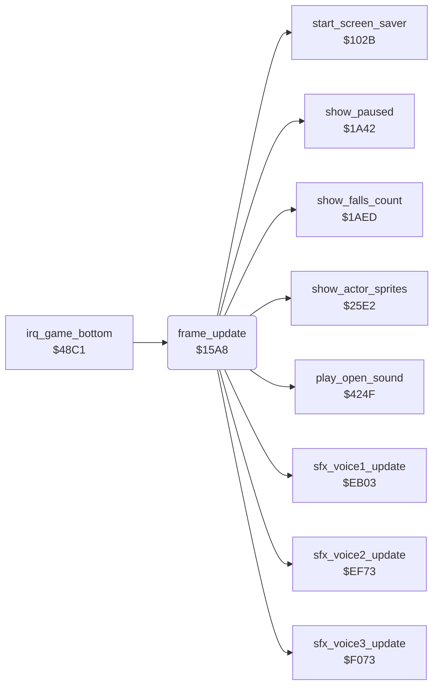

<!-- Generated by c64-docs from knowledge revision 20261023T151738.098-ndlxeh and .c64-re-tools/local/generated/src/source-map.json. Do not edit: change the knowledge, generate the source again, then run docs.ts generate. -->
# game/frame_update.asm: Per-frame update called by the game interrupt: counters, input, idle timer and environment checks

Range `$15A8-$179D`. Source: [game/frame_update.asm](../../../../src/game/frame_update.asm). Index: [the reference](../../index.md).

## Call graph

A solid arrow is a call, a thick arrow a table entry, a dotted arrow a jump. Rounded nodes are in this file.

## Names

### [`frame_update`](../../../../src/game/frame_update.asm#L20) `$15A8`

*routine*

Per-frame work of the game screen, called by irq_game_bottom (raster line $FD). In order: - raster_split_index = 0; runs the three sound effect voices; increments random_ptr; show_actor_sprites (sprite positions of the actors). - Every 256 frames (fall_attack_refill_timer): fall_attack_budget of the three actors = 2. - room_charset_hi from room_vmcsb. - The L marks of left-handed joysticks on status row 1. - room_time (play only, not paused); frame_counter and frame_count_256; idle_timer: at $80 the game pauses itself and starts the screen saver; the saver colour masks and the flashing band colours. - Protection: loops for ever unless D6510 = $EF. - frame_countdown and title_countdown. - Reads the joysticks into actor_joy_dir / actor_fire of Bruce (port of current_player) and of a player-controlled Yamo (the other port), turned 90 degrees for a left-handed joystick. - Protection: wipes memory unless prot_loader_mark = $32. - Input resets idle_timer; a player-controlled Yamo without input for 7*256 frames goes back to the computer.

- **Called from:** [`irq_game_bottom`](../irq/game_irq.md#irq_game_bottom) [`$4915`](../../../../src/irq/game_irq.asm#L52)
- **Calls:** [`sfx_voice1_update`](../sfx/sfx_voice1.md#sfx_voice1_update), [`sfx_voice2_update`](../sfx/sfx_voice2.md#sfx_voice2_update), [`sfx_voice3_update`](../sfx/sfx_voice3.md#sfx_voice3_update), [`show_actor_sprites`](../actor/actor_sprites.md#show_actor_sprites), [`show_paused`](pause_status_line.md#show_paused), [`start_screen_saver`](game_setup.md#start_screen_saver), [`play_open_sound`](../room/wizard_fireballs.md#play_open_sound), [`show_falls_count`](status_and_keys.md#show_falls_count)
- **Reads:** [`room`](../../memory-map.md#room), [`random_ptr`](../../memory-map.md#random_ptr), [`fall_attack_refill_timer`](../actor/actor_workspace.md#fall_attack_refill_timer), [`room_vmcsb`](../../memory-map.md#room_vmcsb), [`joystick_right_handed`](../room/room_enemy_tables.md#joystick_right_handed), [`option_yamo_player2`](options_and_patterns.md#option_yamo_player2), [`option_two_players`](options_and_patterns.md#option_two_players), [`joystick_right_handed+1`](../room/room_enemy_tables.md#joystick_right_handed), [`game_mode`](../../memory-map.md#game_mode), [`pause_state`](../../memory-map.md#pause_state), [`room_time`](../../memory-map.md#room_time), [`room_time+1`](../../memory-map.md#room_time), [`frame_counter`](../../memory-map.md#frame_counter), [`idle_timer`](../../memory-map.md#idle_timer), [`frame_count_256`](../../memory-map.md#frame_count_256), `$0081`, [`palette_backup`](../room/room_palettes_47a0.md#palette_backup), [`saver_eor_mask`](../../memory-map.md#saver_eor_mask), [`saver_and_mask`](../../memory-map.md#saver_and_mask), [`D6510`](../../memory-map.md#D6510), [`frame_countdown`](../../memory-map.md#frame_countdown), [`title_countdown`](../../memory-map.md#title_countdown), [`title_countdown+1`](../../memory-map.md#title_countdown), [`CIADDRA`](../../memory-map.md#CIADDRA), [`CIADDRB`](../../memory-map.md#CIADDRB), [`CIAPRB`](../../memory-map.md#CIAPRB), [`current_player`](../../memory-map.md#current_player), [`CIAPRA`](../../memory-map.md#CIAPRA), [`joy_rotate_bits`](../room/room_tables.md#joy_rotate_bits), [`prot_loader_mark`](../../memory-map.md#prot_loader_mark), [`row_ptr_top`](../../memory-map.md#row_ptr_top), [`row_ptr_top+1`](../../memory-map.md#row_ptr_top), [`frame_update_wipe_counter`](title_demo_start.md#frame_update_wipe_counter), [`cia1_ddra_save`](../actor/actor_step.md#cia1_ddra_save), [`cia1_ddrb_save`](../actor/actor_step.md#cia1_ddrb_save), [`actor_joy_dir`](../../memory-map.md#actor_joy_dir), [`actor_joy_dir+1`](../../memory-map.md#actor_joy_dir), [`actor_fire`](../../memory-map.md#actor_fire), [`actor_fire+1`](../../memory-map.md#actor_fire), [`room_no_enemy_flag`](../../memory-map.md#room_no_enemy_flag) and 4 more
- **Writes:** [`raster_split_index`](../../memory-map.md#raster_split_index), [`random_ptr`](../../memory-map.md#random_ptr), [`fall_attack_budget`](../../memory-map.md#fall_attack_budget), [`fall_attack_budget+1`](../../memory-map.md#fall_attack_budget), [`fall_attack_budget+2`](../../memory-map.md#fall_attack_budget), [`fall_attack_refill_timer`](../actor/actor_workspace.md#fall_attack_refill_timer), [`room_charset_hi`](../../memory-map.md#room_charset_hi), [`game_screen+42`](../../memory-map.md#game_screen), [`game_screen+77`](../../memory-map.md#game_screen), [`room_time`](../../memory-map.md#room_time), [`room_time+1`](../../memory-map.md#room_time), [`frame_counter`](../../memory-map.md#frame_counter), [`idle_timer`](../../memory-map.md#idle_timer), [`pause_state`](../../memory-map.md#pause_state), [`frame_count_256`](../../memory-map.md#frame_count_256), `$0081`, [`saver_and_mask`](../../memory-map.md#saver_and_mask), [`saver_eor_mask`](../../memory-map.md#saver_eor_mask), [`room_band_colours`](../../memory-map.md#room_band_colours), [`frame_countdown`](../../memory-map.md#frame_countdown), [`title_countdown`](../../memory-map.md#title_countdown), [`title_countdown+1`](../../memory-map.md#title_countdown), [`cia1_ddra_save`](../actor/actor_step.md#cia1_ddra_save), [`cia1_ddrb_save`](../actor/actor_step.md#cia1_ddrb_save), [`CIADDRA`](../../memory-map.md#CIADDRA), [`CIADDRB`](../../memory-map.md#CIADDRB), [`actor_joy_dir`](../../memory-map.md#actor_joy_dir), [`actor_fire`](../../memory-map.md#actor_fire), [`actor_joy_dir+1`](../../memory-map.md#actor_joy_dir), [`actor_fire+1`](../../memory-map.md#actor_fire), [`row_ptr_top+1`](../../memory-map.md#row_ptr_top), [`frame_update_wipe_counter`](title_demo_start.md#frame_update_wipe_counter), [`yamo_idle_time`](../../memory-map.md#yamo_idle_time), [`yamo_idle_time+1`](../../memory-map.md#yamo_idle_time), [`option_yamo_player2`](options_and_patterns.md#option_yamo_player2), [`falls_left`](../../memory-map.md#falls_left), [`inactive_player_state`](fireball_text_score_vars_4392.md#inactive_player_state)
- **Refers to:** [`fall_attack_budget`](../../memory-map.md#fall_attack_budget), [`charset_rooms_0_9`](../../memory-map.md#charset_rooms_0_9), [`charset_rooms_10_19`](../../memory-map.md#charset_rooms_10_19), [`charset_wizard`](../../memory-map.md#charset_wizard), [`charset_wizard_flash`](../../memory-map.md#charset_wizard_flash), [`game_screen`](../../memory-map.md#game_screen), [`joystick_right_handed`](../room/room_enemy_tables.md#joystick_right_handed), [`room_time`](../../memory-map.md#room_time), [`frame_count_256`](../../memory-map.md#frame_count_256), [`title_countdown`](../../memory-map.md#title_countdown), [`actor_joy_dir`](../../memory-map.md#actor_joy_dir), [`actor_fire`](../../memory-map.md#actor_fire), [`row_ptr_top`](../../memory-map.md#row_ptr_top), [`yamo_idle_time`](../../memory-map.md#yamo_idle_time)

### [`frame_update_dec_fall_attack_timer`](../../../../src/game/frame_update.asm#L37) `$15CD`

*label*

- **Jumped to from:** [`frame_update`](frame_update.md#frame_update) [`$15C0`](../../../../src/game/frame_update.asm#L32)

### [`frame_update_charset_3a`](../../../../src/game/frame_update.asm#L45) `$15DA`

*label*

- **Jumped to from:** [`frame_update`](frame_update.md#frame_update) [`$15D4`](../../../../src/game/frame_update.asm#L42)

### [`frame_update_charset_3c`](../../../../src/game/frame_update.asm#L50) `$15E2`

*label*

- **Jumped to from:** [`frame_update`](frame_update.md#frame_update) [`$15DC`](../../../../src/game/frame_update.asm#L47)

### [`frame_update_charset_3e`](../../../../src/game/frame_update.asm#L55) `$15EA`

*label*

charset $B800

- **Jumped to from:** [`frame_update`](frame_update.md#frame_update) [`$15E4`](../../../../src/game/frame_update.asm#L52)

### [`frame_update_store_charset`](../../../../src/game/frame_update.asm#L57) `$15EC`

*label*

- **Jumped to from:** [`frame_update`](frame_update.md#frame_update) [`$15D8`](../../../../src/game/frame_update.asm#L44), [`frame_update`](frame_update.md#frame_update) [`$15E0`](../../../../src/game/frame_update.asm#L49), [`frame_update`](frame_update.md#frame_update) [`$15E8`](../../../../src/game/frame_update.asm#L54)

### [`frame_update_joy1_mark`](../../../../src/game/frame_update.asm#L64) `$15F7`

*label*

- **Jumped to from:** [`frame_update`](frame_update.md#frame_update) [`$15F1`](../../../../src/game/frame_update.asm#L61)

### [`frame_update_store_joy1_mark`](../../../../src/game/frame_update.asm#L67) `$15F9`

*label*

- **Jumped to from:** [`frame_update`](frame_update.md#frame_update) [`$15F5`](../../../../src/game/frame_update.asm#L63)

### [`frame_update_joy2_mode`](../../../../src/game/frame_update.asm#L75) `$1606`

*label*

- **Jumped to from:** [`frame_update`](frame_update.md#frame_update) [`$15FF`](../../../../src/game/frame_update.asm#L72)

### [`frame_update_joy2_mark`](../../../../src/game/frame_update.asm#L80) `$160F`

*label*

- **Jumped to from:** [`frame_update`](frame_update.md#frame_update) [`$1609`](../../../../src/game/frame_update.asm#L77)

### [`frame_update_store_joy2_mark`](../../../../src/game/frame_update.asm#L83) `$1611`

*label*

- **Jumped to from:** [`frame_update`](frame_update.md#frame_update) [`$1604`](../../../../src/game/frame_update.asm#L74), [`frame_update`](frame_update.md#frame_update) [`$160D`](../../../../src/game/frame_update.asm#L79)

### [`frame_update_count_frames`](../../../../src/game/frame_update.asm#L95) `$1628`

*label*

frame counter; the idle timer runs every 256 frames

- **Jumped to from:** [`frame_update`](frame_update.md#frame_update) [`$1617`](../../../../src/game/frame_update.asm#L87), [`frame_update`](frame_update.md#frame_update) [`$161C`](../../../../src/game/frame_update.asm#L89), [`frame_update`](frame_update.md#frame_update) [`$1620`](../../../../src/game/frame_update.asm#L91), [`frame_update`](frame_update.md#frame_update) [`$1624`](../../../../src/game/frame_update.asm#L93), [`frame_update`](frame_update.md#frame_update) [`$1670`](../../../../src/game/frame_update.asm#L153)

### [`frame_update_count_256`](../../../../src/game/frame_update.asm#L109) `$163F`

*label*

- **Jumped to from:** [`frame_update`](frame_update.md#frame_update) [`$162E`](../../../../src/game/frame_update.asm#L101), [`frame_update`](frame_update.md#frame_update) [`$1632`](../../../../src/game/frame_update.asm#L103)

### [`frame_update_saver_masks`](../../../../src/game/frame_update.asm#L117) `$1645`

*label*

Screen saver colour masks: off: saver_eor_mask = 0, saver_and_mask = $FE. On (idle_timer bit 7 set): saver_eor_mask = frame_count_256, saver_and_mask = $F7, and the 20 bytes of room_band_colours are recomputed from palette_backup.

- **Jumped to from:** [`frame_update`](frame_update.md#frame_update) [`$162A`](../../../../src/game/frame_update.asm#L97), [`frame_update`](frame_update.md#frame_update) [`$1641`](../../../../src/game/frame_update.asm#L111)

### [`frame_update_store_masks`](../../../../src/game/frame_update.asm#L126) `$1653`

*label*

- **Jumped to from:** [`frame_update`](frame_update.md#frame_update) [`$164B`](../../../../src/game/frame_update.asm#L121)

### [`frame_update_saver_loop`](../../../../src/game/frame_update.asm#L133) `$165D`

*label*

- **Jumped to from:** [`frame_update`](frame_update.md#frame_update) [`$1668`](../../../../src/game/frame_update.asm#L139)

### [`frame_update_check_ddr`](../../../../src/game/frame_update.asm#L140) `$166A`

*label*

- **Jumped to from:** [`frame_update`](frame_update.md#frame_update) [`$1659`](../../../../src/game/frame_update.asm#L130)

### [`frame_update_dec_countdowns`](../../../../src/game/frame_update.asm#L156) `$1672`

*label*

### [`frame_update_title_countdown`](../../../../src/game/frame_update.asm#L160) `$1678`

*label*

- **Jumped to from:** [`frame_update`](frame_update.md#frame_update) [`$1674`](../../../../src/game/frame_update.asm#L158)

### [`frame_update_countdown_high`](../../../../src/game/frame_update.asm#L165) `$1681`

*label*

- **Jumped to from:** [`frame_update`](frame_update.md#frame_update) [`$167A`](../../../../src/game/frame_update.asm#L162)

### [`frame_update_read_input`](../../../../src/game/frame_update.asm#L171) `$1689`

*label*

Joystick input: save the CIA 1 port directions, make both ports inputs.

- **Jumped to from:** [`frame_update`](frame_update.md#frame_update) [`$167E`](../../../../src/game/frame_update.asm#L164), [`frame_update`](frame_update.md#frame_update) [`$1683`](../../../../src/game/frame_update.asm#L167)

### [`frame_update_bruce_joystick`](../../../../src/game/frame_update.asm#L186) `$16AC`

*label*

bits 0-3: up, down, left, right (0 = pressed)

- **Jumped to from:** [`frame_update`](frame_update.md#frame_update) [`$16A7`](../../../../src/game/frame_update.asm#L183)

### [`frame_update_store_bruce_joy`](../../../../src/game/frame_update.asm#L200) `$16BD`

*label*

- **Jumped to from:** [`frame_update`](frame_update.md#frame_update) [`$16B1`](../../../../src/game/frame_update.asm#L189)

### [`frame_update_yamo_joystick`](../../../../src/game/frame_update.asm#L223) `$16E3`

*label*

- **Jumped to from:** [`frame_update`](frame_update.md#frame_update) [`$16DE`](../../../../src/game/frame_update.asm#L221)

### [`frame_update_store_yamo_joy`](../../../../src/game/frame_update.asm#L235) `$16F4`

*label*

- **Jumped to from:** [`frame_update`](frame_update.md#frame_update) [`$16E8`](../../../../src/game/frame_update.asm#L226)

### [`frame_update_check_loader_mark`](../../../../src/game/frame_update.asm#L245) `$1703`

*label*

the loader leaves $32 in $02

- **Jumped to from:** [`frame_update`](frame_update.md#frame_update) [`$16A0`](../../../../src/game/frame_update.asm#L180), [`frame_update`](frame_update.md#frame_update) [`$16D2`](../../../../src/game/frame_update.asm#L213)

### [`frame_update_wipe_loop`](../../../../src/game/frame_update.asm#L265) `$170B`

*label*

- **Jumped to from:** [`frame_update`](frame_update.md#frame_update) [`$170E`](../../../../src/game/frame_update.asm#L268), [`frame_update`](frame_update.md#frame_update) [`$1715`](../../../../src/game/frame_update.asm#L271)

### [`frame_update_restore_ddr`](../../../../src/game/frame_update.asm#L272) `$1717`

*label*

- **Jumped to from:** [`frame_update`](frame_update.md#frame_update) [`$1707`](../../../../src/game/frame_update.asm#L258)

### [`frame_update_reset_idle`](../../../../src/game/frame_update.asm#L289) `$173B`

*label*

- **Jumped to from:** [`frame_update`](frame_update.md#frame_update) [`$1726`](../../../../src/game/frame_update.asm#L279), [`frame_update`](frame_update.md#frame_update) [`$1733`](../../../../src/game/frame_update.asm#L285)

### [`frame_update_yamo_idle`](../../../../src/game/frame_update.asm#L295) `$173F`

*label*

Player-controlled Yamo without input for 7*256 frames: Yamo goes back to computer control (option_yamo_player2 = 0), the room_time high byte is set to $20 (the top level of get_room_time_level), and the 5 extra falls of the opponent mode are taken from both players.

- **Jumped to from:** [`frame_update`](frame_update.md#frame_update) [`$172B`](../../../../src/game/frame_update.asm#L281), [`frame_update`](frame_update.md#frame_update) [`$1739`](../../../../src/game/frame_update.asm#L288)

### [`frame_update_falls_zero`](../../../../src/game/frame_update.asm#L328) `$177F`

*label*

- **Jumped to from:** [`frame_update`](frame_update.md#frame_update) [`$1778`](../../../../src/game/frame_update.asm#L325)

### [`frame_update_store_falls`](../../../../src/game/frame_update.asm#L330) `$1781`

*label*

- **Jumped to from:** [`frame_update`](frame_update.md#frame_update) [`$177C`](../../../../src/game/frame_update.asm#L327)

### [`frame_update_parked_falls_zero`](../../../../src/game/frame_update.asm#L337) `$178F`

*label*

- **Jumped to from:** [`frame_update`](frame_update.md#frame_update) [`$1788`](../../../../src/game/frame_update.asm#L334)

### [`frame_update_store_parked_falls`](../../../../src/game/frame_update.asm#L339) `$1791`

*label*

- **Jumped to from:** [`frame_update`](frame_update.md#frame_update) [`$178C`](../../../../src/game/frame_update.asm#L336)

### [`frame_update_reset_yamo_idle`](../../../../src/game/frame_update.asm#L342) `$1797`

*label*

- **Jumped to from:** [`frame_update`](frame_update.md#frame_update) [`$1756`](../../../../src/game/frame_update.asm#L306), [`frame_update`](frame_update.md#frame_update) [`$175A`](../../../../src/game/frame_update.asm#L308)

### [`frame_update_done`](../../../../src/game/frame_update.asm#L346) `$179D`

*label*

- **Jumped to from:** [`frame_update`](frame_update.md#frame_update) [`$1741`](../../../../src/game/frame_update.asm#L297), [`frame_update`](frame_update.md#frame_update) [`$1746`](../../../../src/game/frame_update.asm#L299), [`frame_update`](frame_update.md#frame_update) [`$174B`](../../../../src/game/frame_update.asm#L301), [`frame_update`](frame_update.md#frame_update) [`$1750`](../../../../src/game/frame_update.asm#L303), [`frame_update`](frame_update.md#frame_update) [`$175E`](../../../../src/game/frame_update.asm#L310), [`frame_update`](frame_update.md#frame_update) [`$1766`](../../../../src/game/frame_update.asm#L315)
