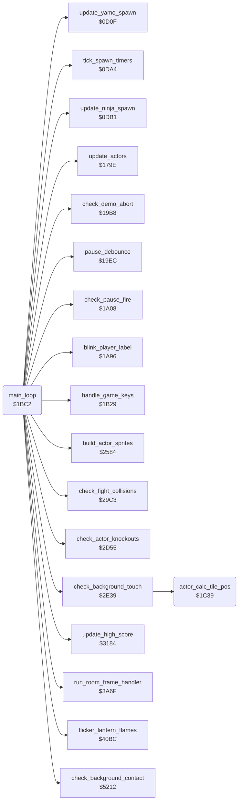

<!-- Generated by c64-docs from knowledge revision 20261025T214801.837-ucnw24 and .c64-re-tools/local/generated/src/source-map.json. Do not edit: change the knowledge, generate the source again, then run docs.ts generate. -->
# game/game_main_loop.asm: Main game loop (one pass per 3 frames) and the actor tile position

Range `$1BC2-$1C5A`. Source: [game/game_main_loop.asm](../../../../src/game/game_main_loop.asm). Index: [the reference](../../index.md).

## Routines

| Routine | Address | Reached from | Summary |
|---|---|---|---|
| [`main_loop`](game_main_loop.md#main_loop) | `$1BC2` | [`start_attract_demo`](title_demo_start.md#start_attract_demo), [`show_title_screen`](title_demo_start.md#show_title_screen), [`handle_touched_tile`](../actor/background_touch.md#handle_touched_tile) | Main game loop, for the real game and the attract demo (game_mode = 0). |
| [`main_loop_prot_key_lo`](game_main_loop.md#main_loop_prot_key_lo) | `$1C14` |  |  |
| [`main_loop_prot_pair_lo`](game_main_loop.md#main_loop_prot_pair_lo) | `$1C17` |  |  |
| [`actor_calc_tile_pos`](game_main_loop.md#actor_calc_tile_pos) | `$1C39` | [`check_background_touch`](../actor/background_touch.md#check_background_touch) | Computes the screen tile position of actor X (0 Bruce, 1 Yamo, 2 Ninja) from its position: actor_cell_col,X = (actor_x,X - 12) / 4   (character column) actor_cell_row,X = (actor_y,X - 12) / 16  (tile row of two characters), with actor_y + 4 in room 13 Called by check_background_touch for each actor. |

## Call graph

A solid arrow is a call, a thick arrow a table entry. Rounded nodes are in this file.

## Details

### [`main_loop`](../../../../src/game/game_main_loop.asm#L23) `$1BC2`

*routine*

Main game loop, for the real game and the attract demo (game_mode = 0). One pass every 3 frames: it sets frame_countdown to 3 (the raster IRQ counts it down) and waits for zero at the end of the pass. A pass: 1. check_demo_abort: in the demo, fire or F1 ends the demo. 2. In a game: handle_game_keys, pause_debounce and check_pause_fire (while paused, fire on the current player's joystick ends the pause); while pause_state bit 7 is set the rest of the pass is skipped. 3. Clears bit 6 of Yamo's and bits 3-6 of the Ninja's actor_energy; blink_player_label (1UP/2UP), flicker_lantern_flames. 4. When room_no_enemy_flag is 0: tick_spawn_timers, update_yamo_spawn, update_ninja_spawn. 5. Toggles pass_parity (1, 0, 1, 0 ...). 6. run_room_frame_handler (per-room logic), check_background_contact (terrain flags of the actors), check_background_touch (lanterns, exits, deadly tiles). 7. Copy protection: protection_check_value = prot_key_tick EOR prot_key_tick_pair (actor_play_step_sound checks it). 8. check_fight_collisions when room_no_enemies of the room is 0. 9. update_high_score, update_actors (input, AI and actor_action_step of each actor), build_actor_sprites, check_actor_knockouts. change_room and the fall/restart code reset the stack and jump back here.
one pass = 3 frames

- **Jumped to from:** [`start_attract_demo`](title_demo_start.md#start_attract_demo), [`show_title_screen`](title_demo_start.md#show_title_screen), [`handle_touched_tile`](../actor/background_touch.md#handle_touched_tile)
- **Calls:** [`check_demo_abort`](pause_status_line.md#check_demo_abort), [`handle_game_keys`](status_and_keys.md#handle_game_keys), [`pause_debounce`](pause_status_line.md#pause_debounce), [`check_pause_fire`](pause_status_line.md#check_pause_fire), [`blink_player_label`](pause_status_line.md#blink_player_label), [`flicker_lantern_flames`](../room/room_hazard_draw_40bc.md#flicker_lantern_flames), [`tick_spawn_timers`](../actor/actor_spawn.md#tick_spawn_timers), [`update_yamo_spawn`](../actor/actor_spawn.md#update_yamo_spawn), [`update_ninja_spawn`](../actor/actor_spawn.md#update_ninja_spawn), [`run_room_frame_handler`](../room/passage_open.md#run_room_frame_handler), [`check_background_contact`](../actor/background_contact.md#check_background_contact), [`check_background_touch`](../actor/background_touch.md#check_background_touch) and 5 more
- **Reads:** [`game_mode`](../../memory-map.md#game_mode), [`pause_state`](../../memory-map.md#pause_state), [`actor_energy`](../../memory-map.md#actor_energy), [`room_no_enemy_flag`](../../memory-map.md#room_no_enemy_flag), [`pass_parity`](../../memory-map.md#pass_parity), [`prot_key_tick`](../protection/protection_key_page.md#prot_key_tick), [`prot_key_tick_pair`](../protection/protection_key_page.md#prot_key_tick_pair), [`room`](../../memory-map.md#room), [`room_no_enemies`](../room/room_tables.md#room_no_enemies), [`frame_countdown`](../../memory-map.md#frame_countdown)
- **Writes:** [`frame_countdown`](../../memory-map.md#frame_countdown), [`actor_energy`](../../memory-map.md#actor_energy), [`pass_parity`](../../memory-map.md#pass_parity), [`protection_check_value`](../actor/actor_step.md#protection_check_value)
- **Refers to:** [`actor_energy`](../../memory-map.md#actor_energy)

| Label | Address | Comment |
|---|---|---|
| [`main_loop_update`](../../../../src/game/game_main_loop.asm#L37) | `$1BDF` | Clear bit 6 of Yamo's energy and bits 3-6 of the Ninja's energy (bit 7, knocked out, stays), so a positive Ninja energy is at most 7. |
| [`main_loop_toggle_phase`](../../../../src/game/game_main_loop.asm#L52) | `$1BFE` | pass_parity alternates 1, 0, 1, 0 on successive passes; room handlers use it to act on every other pass. |
| [`main_loop_phase_to_zero`](../../../../src/game/game_main_loop.asm#L58) | `$1C08` |  |
| [`main_loop_room_logic`](../../../../src/game/game_main_loop.asm#L60) | `$1C0A` |  |
| [`main_loop_protection_check`](../../../../src/game/game_main_loop.asm#L67) | `$1C13` | Copy protection: the bytes prot_key_tick and prot_key_tick_pair of the protection page must differ. The EOR goes to protection_check_value; actor_play_step_sound damages this instruction (and later the stack) when it is zero. operand low byte main_loop_prot_key_lo: step_sound_check_protection2 increments it and reads it back |
| [`main_loop_actors`](../../../../src/game/game_main_loop.asm#L77) | `$1C26` |  |
| [`main_loop_wait_frame`](../../../../src/game/game_main_loop.asm#L83) | `$1C32` | Observed (PAL): a new pass starts every 3 frames, right after frame_update of the third frame (raster about 264-277). A pass that needs more than 3 frames makes that pass longer; the next pass starts at once (seen once in 300 frames of room 7: 4 frames). |

### [`main_loop_prot_key_lo`](../../../../src/game/game_main_loop.asm#L68) `$1C14`

*label*

- **Read by:** [`actor_play_step_sound`](../actor/actor_step.md#actor_play_step_sound)
- **Written by:** [`actor_play_step_sound`](../actor/actor_step.md#actor_play_step_sound)

### [`main_loop_prot_pair_lo`](../../../../src/game/game_main_loop.asm#L70) `$1C17`

*label*

- **Read by:** [`actor_play_step_sound`](../actor/actor_step.md#actor_play_step_sound)
- **Written by:** [`actor_play_step_sound`](../actor/actor_step.md#actor_play_step_sound)

### [`actor_calc_tile_pos`](../../../../src/game/game_main_loop.asm#L91) `$1C39`

*routine*

Computes the screen tile position of actor X (0 Bruce, 1 Yamo, 2 Ninja) from its position: actor_cell_col,X = (actor_x,X - 12) / 4   (character column) actor_cell_row,X = (actor_y,X - 12) / 16  (tile row of two characters), with actor_y + 4 in room 13 Called by check_background_touch for each actor. Changes A.

- **Called from:** [`check_background_touch`](../actor/background_touch.md#check_background_touch)
- **Reads:** [`actor_x`](../../memory-map.md#actor_x), [`room`](../../memory-map.md#room), [`actor_y`](../../memory-map.md#actor_y)
- **Writes:** [`actor_cell_col`](../../memory-map.md#actor_cell_col), [`actor_cell_row`](../../memory-map.md#actor_cell_row)

| Label | Address | Comment |
|---|---|---|
| [`actor_calc_tile_pos_row`](../../../../src/game/game_main_loop.asm#L105) | `$1C4F` |  |
| [`actor_calc_tile_pos_store_row`](../../../../src/game/game_main_loop.asm#L107) | `$1C51` |  |
