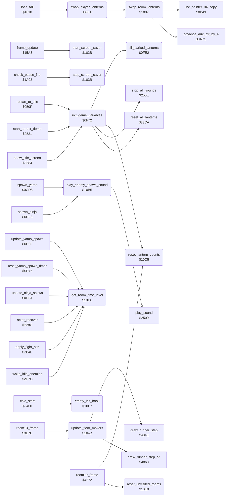

<!-- Generated by c64-docs from knowledge revision 20261023T151738.098-ndlxeh and .c64-re-tools/local/generated/src/source-map.json. Do not edit: change the knowledge, generate the source again, then run docs.ts generate. -->
# game/game_setup.asm: Game variable setup, lantern state swap, screen saver colours, floor movers and small helpers

Range `$0F72-$10F7`. Source: [game/game_setup.asm](../../../../src/game/game_setup.asm). Index: [the reference](../../index.md).

## Call graph

A solid arrow is a call, a thick arrow a table entry, a dotted arrow a jump. Rounded nodes are in this file.

## Names

### [`init_game_variables`](../../../../src/game/game_setup.asm#L18) `$0F72`

*routine*

Reset the game variables for a new game or demo. Called by restart_to_title, start_attract_demo and start_new_game. Changes A, X, Y. - Clears zero page $03-$F5 (current_player ... room, score, all actor fields) and the workspace $4EED-$4FE7 (contact_col0 ... burst_trap_row). - Sets $0100-$0107 (text_single_height, the flame timers, game_mode = 1, pause_state, actor_step_delay) and the room13_band_bonus flags to 1; silences the sound. - extra_fall_pickups_left = 5 for both players; room_lanterns_left from room_lantern_count_init; all rooms but room 0 unvisited for both players (room_unvisited); every lantern present (reset_all_lanterns, fill_parked_lanterns). - falls_left = 4 (9 when player 2 controls Yamo); bonus_fall_next_score of both players = bonus_fall_first_score (40000). - Copies the player block $28-$43 (falls_left ... score) to inactive_player_state, the parked block of player 2.
A = 0, X = 0

- **Called from:** [`restart_to_title`](title_demo_start.md#restart_to_title) [`$0528`](../../../../src/game/title_demo_start.asm#L23), [`start_attract_demo`](title_demo_start.md#start_attract_demo) [`$0550`](../../../../src/game/title_demo_start.asm#L48), [`show_title_screen`](title_demo_start.md#show_title_screen) [`$0746`](../../../../src/game/title_demo_start.asm#L306)
- **Calls:** [`stop_all_sounds`](../sfx/sound_request.md#stop_all_sounds), [`reset_lantern_counts`](game_setup.md#reset_lantern_counts), [`reset_all_lanterns`](../room/lantern_pickup.md#reset_all_lanterns), [`fill_parked_lanterns`](game_setup.md#fill_parked_lanterns)
- **Reads:** [`option_yamo_player2`](options_and_patterns.md#option_yamo_player2), [`bonus_fall_first_score`](fireball_text_score_vars.md#bonus_fall_first_score), [`falls_left`](../../memory-map.md#falls_left)
- **Writes:** [`current_player`](../../memory-map.md#current_player), [`contact_col0`](../../memory-map.md#contact_col0), [`yamo_idle_time`](../../memory-map.md#yamo_idle_time), [`yamo_idle_time+1`](../../memory-map.md#yamo_idle_time), [`room13_band_bonus`](../../memory-map.md#room13_band_bonus), [`text_single_height`](../../memory-map.md#text_single_height), [`extra_fall_pickups_left`](../room/lantern_lists.md#extra_fall_pickups_left), [`extra_fall_pickups_left+1`](../room/lantern_lists.md#extra_fall_pickups_left), [`room_unvisited`](../../memory-map.md#room_unvisited), [`room_unvisited+1`](../../memory-map.md#room_unvisited), [`falls_left`](../../memory-map.md#falls_left), [`bonus_fall_next_score`](fireball_text_score_vars_4392.md#bonus_fall_next_score), [`bonus_fall_next_score_other`](fireball_text_score_vars_4392.md#bonus_fall_next_score_other), [`inactive_player_state`](fireball_text_score_vars_4392.md#inactive_player_state)
- **Refers to:** [`yamo_idle_time`](../../memory-map.md#yamo_idle_time), [`extra_fall_pickups_left`](../room/lantern_lists.md#extra_fall_pickups_left), [`room_unvisited`](../../memory-map.md#room_unvisited)

### [`init_game_clear_loop`](../../../../src/game/game_setup.asm#L21) `$0F75`

*label*

X < $F3: clear $03-$F5

- **Jumped to from:** [`init_game_variables`](game_setup.md#init_game_variables) [`$0F83`](../../../../src/game/game_setup.asm#L31)

### [`init_game_clear_4eed`](../../../../src/game/game_setup.asm#L25) `$0F7B`

*label*

X < $FB: clear $4EED-$4FE7

- **Jumped to from:** [`init_game_variables`](game_setup.md#init_game_variables) [`$0F77`](../../../../src/game/game_setup.asm#L23)

### [`init_game_clear_next`](../../../../src/game/game_setup.asm#L29) `$0F82`

*label*

- **Jumped to from:** [`init_game_variables`](game_setup.md#init_game_variables) [`$0F7D`](../../../../src/game/game_setup.asm#L27)

### [`init_game_flags_loop`](../../../../src/game/game_setup.asm#L36) `$0F8D`

*label*

$014B-$0152: room 13 band bonus flags of both players

- **Jumped to from:** [`init_game_variables`](game_setup.md#init_game_variables) [`$0F94`](../../../../src/game/game_setup.asm#L40)

### [`init_game_room_flags_loop`](../../../../src/game/game_setup.asm#L49) `$0FA8`

*label*

- **Jumped to from:** [`init_game_variables`](game_setup.md#init_game_variables) [`$0FAC`](../../../../src/game/game_setup.asm#L52)

### [`init_game_copy_scores`](../../../../src/game/game_setup.asm#L66) `$0FC9`

*label*

bonus_fall_next_score of both players = bonus_fall_first_score (40000 points).

- **Jumped to from:** [`init_game_variables`](game_setup.md#init_game_variables) [`$0FC3`](../../../../src/game/game_setup.asm#L61)

### [`init_game_score_loop`](../../../../src/game/game_setup.asm#L68) `$0FCB`

*label*

- **Jumped to from:** [`init_game_variables`](game_setup.md#init_game_variables) [`$0FD5`](../../../../src/game/game_setup.asm#L73)

### [`init_game_park_player_loop`](../../../../src/game/game_setup.asm#L75) `$0FD9`

*label*

- **Jumped to from:** [`init_game_variables`](game_setup.md#init_game_variables) [`$0FDF`](../../../../src/game/game_setup.asm#L79)

### [`fill_parked_lanterns`](../../../../src/game/game_setup.asm#L83) `$0FE2`

*routine*

Set the 97 parked_lantern_flags ($0340-$03A0) to 1 (every lantern present). The parked copy holds the lanterns of the player who is not playing in a two-player game. Called by init_game_variables. Changes A, X.

- **Called from:** [`init_game_variables`](game_setup.md#init_game_variables) [`$0FB9`](../../../../src/game/game_setup.asm#L57)
- **Writes:** [`parked_lantern_flags`](../../memory-map.md#parked_lantern_flags)

### [`fill_parked_lanterns_loop`](../../../../src/game/game_setup.asm#L86) `$0FE6`

*label*

- **Jumped to from:** [`fill_parked_lanterns`](game_setup.md#fill_parked_lanterns) [`$0FEA`](../../../../src/game/game_setup.asm#L89)

### [`swap_player_lanterns`](../../../../src/game/game_setup.asm#L96) `$0FED`

*routine*

Two-player game: exchange the lantern states of all 20 rooms with parked_lantern_flags. For each room it walks the lantern list of the room (lantern_list_ptr, 4-byte records, end at a byte with bit 7 set) and swaps byte 0 of each record with the next parked flag. row_ptr_top = parked flag pointer, aux_ptr = record pointer, next_room = room loop counter. Called by lose_fall (next_turn_enter_room) when the turn passes to the other player.
row_ptr_top = parked_lantern_flags

- **Called from:** [`lose_fall`](lose_fall_game_over.md#lose_fall) [`$1870`](../../../../src/game/lose_fall_game_over.asm#L60)
- **Calls:** [`swap_room_lanterns`](game_setup.md#swap_room_lanterns)
- **Reads:** [`next_room`](../../memory-map.md#next_room)
- **Writes:** [`row_ptr_top`](../../memory-map.md#row_ptr_top), [`row_ptr_top+1`](../../memory-map.md#row_ptr_top), [`next_room`](../../memory-map.md#next_room)
- **Refers to:** [`parked_lantern_flags`](../../memory-map.md#parked_lantern_flags), [`row_ptr_top`](../../memory-map.md#row_ptr_top)

### [`swap_player_lanterns_loop`](../../../../src/game/game_setup.asm#L104) `$0FF9`

*label*

- **Jumped to from:** [`swap_player_lanterns`](game_setup.md#swap_player_lanterns) [`$1004`](../../../../src/game/game_setup.asm#L111)

### [`swap_room_lanterns`](../../../../src/game/game_setup.asm#L115) `$1007`

*routine*

Swap byte 0 of each record of one room lantern list with the parked flags. Input: X = room * 2, row_ptr_top = next parked flag (advanced by one per record).

- **Called from:** [`swap_player_lanterns`](game_setup.md#swap_player_lanterns) [`$0FFB`](../../../../src/game/game_setup.asm#L107)
- **Calls:** [`advance_aux_ptr_by_4`](../room/passage_open.md#advance_aux_ptr_by_4), [`inc_pointer_04_copy`](../room/draw_room.md#inc_pointer_04_copy)
- **Reads:** [`lantern_list_ptr`](../room/lantern_lists.md#lantern_list_ptr), [`lantern_list_ptr+1`](../room/lantern_lists.md#lantern_list_ptr), [`aux_ptr`](../../memory-map.md#aux_ptr), [`row_ptr_top`](../../memory-map.md#row_ptr_top)
- **Writes:** [`aux_ptr`](../../memory-map.md#aux_ptr), [`aux_ptr+1`](../../memory-map.md#aux_ptr)
- **Refers to:** [`lantern_list_ptr`](../room/lantern_lists.md#lantern_list_ptr), [`aux_ptr`](../../memory-map.md#aux_ptr)

### [`swap_room_lanterns_loop`](../../../../src/game/game_setup.asm#L121) `$1013`

*label*

- **Jumped to from:** [`swap_room_lanterns`](game_setup.md#swap_room_lanterns) [`$1027`](../../../../src/game/game_setup.asm#L133)

### [`swap_room_lanterns_done`](../../../../src/game/game_setup.asm#L134) `$102A`

*label*

- **Jumped to from:** [`swap_room_lanterns`](game_setup.md#swap_room_lanterns) [`$1015`](../../../../src/game/game_setup.asm#L123)

### [`start_screen_saver`](../../../../src/game/game_setup.asm#L139) `$102B`

*routine*

Start the screen saver: save the 20 bytes of room_band_colours in palette_backup and set idle_timer to $FE (bit 7 set = saver running). frame_update then flashes the band colours. Called by frame_update when idle_timer reaches $80 (32768 frames without input).

- **Called from:** [`frame_update`](frame_update.md#frame_update) [`$163C`](../../../../src/game/frame_update.asm#L108)
- **Reads:** [`room_band_colours`](../../memory-map.md#room_band_colours)
- **Writes:** [`palette_backup`](../room/room_palettes_47a0.md#palette_backup), [`idle_timer`](../../memory-map.md#idle_timer)

### [`start_screen_saver_loop`](../../../../src/game/game_setup.asm#L141) `$102D`

*label*

- **Jumped to from:** [`start_screen_saver`](game_setup.md#start_screen_saver) [`$1034`](../../../../src/game/game_setup.asm#L145)

### [`stop_screen_saver`](../../../../src/game/game_setup.asm#L151) `$103B`

*routine*

End the screen saver: restore room_band_colours from palette_backup and set idle_timer to 0. Called by toggle_pause when the game leaves the pause.

- **Called from:** [`check_pause_fire`](pause_status_line.md#check_pause_fire) [`$1A35`](../../../../src/game/pause_status_line.asm#L79)
- **Reads:** [`palette_backup`](../room/room_palettes_47a0.md#palette_backup)
- **Writes:** [`room_band_colours`](../../memory-map.md#room_band_colours), [`idle_timer`](../../memory-map.md#idle_timer)

### [`stop_screen_saver_loop`](../../../../src/game/game_setup.asm#L153) `$103D`

*label*

- **Jumped to from:** [`stop_screen_saver`](game_setup.md#stop_screen_saver) [`$1044`](../../../../src/game/game_setup.asm#L157)

### [`update_floor_movers`](../../../../src/game/game_setup.asm#L169) `$104B`

*routine*

Move the floor movers of room 13 (room13_frame): slots 8..0 (slot 9 is never processed), each a runner that runs along a text row and wraps around at the ends of its span. Per slot x: mover_dir 0 = inactive, bit 7 clear = moves left, bit 7 set = moves right; mover_col = column; mover_row = text row; mover_old_col = previous column; mover_min_col = lowest column; mover_wrap_col = highest column. Each active slot moves one column (a left mover below mover_min_col restarts at mover_wrap_col, a right mover at mover_wrap_col restarts at mover_min_col), then draw_runner_step (rows 5 and 10: draw_runner_step_alt) redraws the old column as track and draws the runner at the new one. runner_col, runner_row and runner_old_col pass the positions to the draw routines. Changes A, X, Y.

- **Called from:** [`room13_frame`](../room/room_frames_12_17.md#room13_frame) [`$3EC0`](../../../../src/room/room_frames_12_17.asm#L80)
- **Calls:** [`draw_runner_step`](../room/room_hazard_draw.md#draw_runner_step), [`draw_runner_step_alt`](../room/room_hazard_draw.md#draw_runner_step_alt)
- **Reads:** [`mover_dir`](../../memory-map.md#mover_dir), [`mover_col`](../../memory-map.md#mover_col), [`mover_row`](../../memory-map.md#mover_row), [`mover_min_col`](../../memory-map.md#mover_min_col), [`mover_wrap_col`](../../memory-map.md#mover_wrap_col), [`runner_row`](../../memory-map.md#runner_row)
- **Writes:** [`mover_old_col`](../../memory-map.md#mover_old_col), [`runner_old_col`](../../memory-map.md#runner_old_col), [`runner_row`](../../memory-map.md#runner_row), [`mover_col`](../../memory-map.md#mover_col), [`runner_col`](../../memory-map.md#runner_col)

### [`update_floor_movers_loop`](../../../../src/game/game_setup.asm#L171) `$104D`

*label*

- **Jumped to from:** [`update_floor_movers`](game_setup.md#update_floor_movers) [`$10B2`](../../../../src/game/game_setup.asm#L221)

### [`update_floor_movers_draw`](../../../../src/game/game_setup.asm#L189) `$1077`

*label*

- **Jumped to from:** [`update_floor_movers`](game_setup.md#update_floor_movers) [`$106F`](../../../../src/game/game_setup.asm#L186)

### [`update_floor_movers_draw_alt`](../../../../src/game/game_setup.asm#L198) `$1089`

*label*

- **Jumped to from:** [`update_floor_movers`](game_setup.md#update_floor_movers) [`$107D`](../../../../src/game/game_setup.asm#L193), [`update_floor_movers`](game_setup.md#update_floor_movers) [`$1081`](../../../../src/game/game_setup.asm#L195), [`update_floor_movers`](game_setup.md#update_floor_movers) [`$10A6`](../../../../src/game/game_setup.asm#L212), [`update_floor_movers`](game_setup.md#update_floor_movers) [`$10AA`](../../../../src/game/game_setup.asm#L214)

### [`update_floor_movers_right`](../../../../src/game/game_setup.asm#L201) `$108F`

*label*

- **Jumped to from:** [`update_floor_movers`](game_setup.md#update_floor_movers) [`$1064`](../../../../src/game/game_setup.asm#L182)

### [`update_floor_movers_draw_right`](../../../../src/game/game_setup.asm#L208) `$10A0`

*label*

- **Jumped to from:** [`update_floor_movers`](game_setup.md#update_floor_movers) [`$1098`](../../../../src/game/game_setup.asm#L205)

### [`update_floor_movers_restore_x`](../../../../src/game/game_setup.asm#L216) `$10AF`

*label*

- **Jumped to from:** [`update_floor_movers`](game_setup.md#update_floor_movers) [`$1086`](../../../../src/game/game_setup.asm#L197), [`update_floor_movers`](game_setup.md#update_floor_movers) [`$108C`](../../../../src/game/game_setup.asm#L200)

### [`update_floor_movers_next`](../../../../src/game/game_setup.asm#L219) `$10B1`

*label*

- **Jumped to from:** [`update_floor_movers`](game_setup.md#update_floor_movers) [`$1050`](../../../../src/game/game_setup.asm#L173)

### [`play_enemy_spawn_sound`](../../../../src/game/game_setup.asm#L225) `$10B5`

*routine*

Start sound effect $82 (enemy appears) with play_sound and keep A, X and Y. Called by spawn_yamo and spawn_ninja.

- **Called from:** [`spawn_yamo`](../actor/actor_spawn.md#spawn_yamo) [`$0CD5`](../../../../src/actor/actor_spawn.asm#L204), [`spawn_ninja`](../actor/actor_spawn.md#spawn_ninja) [`$0DF8`](../../../../src/actor/actor_spawn.asm#L399)
- **Calls:** [`play_sound`](../sfx/sound_request.md#play_sound)

### [`reset_lantern_counts`](../../../../src/game/game_setup.asm#L242) `$10C5`

*routine*

Copy the start lantern count of each of the 20 rooms from room_lantern_count_init to room_lanterns_left (part of the player block that is parked in a two-player game). Called by init_game_variables and by room19_frame. Changes A, X.

- **Called from:** [`init_game_variables`](game_setup.md#init_game_variables) [`$0FA1`](../../../../src/game/game_setup.asm#L45), [`room19_frame`](../room/ending_room.md#room19_frame) [`$428A`](../../../../src/room/ending_room.asm#L44)
- **Reads:** [`room_lantern_count_init`](../room/lantern_counts.md#room_lantern_count_init)
- **Writes:** [`room_lanterns_left`](../../memory-map.md#room_lanterns_left)

### [`reset_lantern_counts_loop`](../../../../src/game/game_setup.asm#L244) `$10C7`

*label*

- **Jumped to from:** [`reset_lantern_counts`](game_setup.md#reset_lantern_counts) [`$10CD`](../../../../src/game/game_setup.asm#L248)

### [`get_room_time_level`](../../../../src/game/game_setup.asm#L253) `$10D0`

*routine*

Classify the time spent in the current room (room_time high byte, 256-frame units) for the enemy logic. Output: below $19: C = 0, V = 0. $19-$1F (6400 frames): C = 1, V = 0. $20 or more (8192 frames): C = 1, V = 1, A = $FF. The spawn timers and the enemy AI use C and V to shorten their delays.

- **Called from:** [`update_yamo_spawn`](../actor/actor_spawn.md#update_yamo_spawn) [`$0D2E`](../../../../src/actor/actor_spawn.asm#L255), [`reset_yamo_spawn_timer`](../actor/actor_spawn.md#reset_yamo_spawn_timer) [`$0D63`](../../../../src/actor/actor_spawn.asm#L297), [`reset_yamo_spawn_timer`](../actor/actor_spawn.md#reset_yamo_spawn_timer) [`$0D8A`](../../../../src/actor/actor_spawn.asm#L324), [`update_ninja_spawn`](../actor/actor_spawn.md#update_ninja_spawn) [`$0DC4`](../../../../src/actor/actor_spawn.asm#L366), [`update_ninja_spawn`](../actor/actor_spawn.md#update_ninja_spawn) [`$0DE9`](../../../../src/actor/actor_spawn.asm#L385), [`actor_recover`](../actor/actor_timed_actions.md#actor_recover) [`$229C`](../../../../src/actor/actor_timed_actions.asm#L385), [`actor_recover`](../actor/actor_timed_actions.md#actor_recover) [`$22A6`](../../../../src/actor/actor_timed_actions.asm#L391), [`apply_fight_hits`](../actor/fight_hits.md#apply_fight_hits) [`$2B6B`](../../../../src/actor/fight_hits.asm#L269), [`apply_fight_hits`](../actor/fight_hits.md#apply_fight_hits) [`$2B83`](../../../../src/actor/fight_hits.asm#L283), [`wake_idle_enemies`](../actor/actor_helpers.md#wake_idle_enemies) [`$2DC7`](../../../../src/actor/actor_helpers.asm#L84)
- **Reads:** [`room_time+1`](../../memory-map.md#room_time)
- **Refers to:** [`room_time`](../../memory-map.md#room_time)

### [`room_time_level_top`](../../../../src/game/game_setup.asm#L260) `$10DA`

*label*

- **Jumped to from:** [`get_room_time_level`](game_setup.md#get_room_time_level) [`$10D4`](../../../../src/game/game_setup.asm#L256)

### [`room_time_level_rts`](../../../../src/game/game_setup.asm#L263) `$10DF`

*label*

- **Read by:** [`get_room_time_level`](game_setup.md#get_room_time_level) [`$10DC`](../../../../src/game/game_setup.asm#L262)

### [`reset_unvisited_rooms`](../../../../src/game/game_setup.asm#L268) `$10E0`

*routine*

Mark rooms 1-19 not visited for current_player: sets every second byte of room_unvisited from room_unvisited+$26+player down, then clears the room 0 byte. Called by room19_frame when the next game loop starts. Changes A, X.

- **Called from:** [`room19_frame`](../room/ending_room.md#room19_frame) [`$4290`](../../../../src/room/ending_room.asm#L46)
- **Reads:** [`current_player`](../../memory-map.md#current_player)
- **Writes:** [`room_unvisited`](../../memory-map.md#room_unvisited)

### [`reset_unvisited_rooms_loop`](../../../../src/game/game_setup.asm#L274) `$10E8`

*label*

- **Jumped to from:** [`reset_unvisited_rooms`](game_setup.md#reset_unvisited_rooms) [`$10ED`](../../../../src/game/game_setup.asm#L278)

### [`empty_init_hook`](../../../../src/game/game_setup.asm#L284) `$10F7`

*routine*

Empty routine: cold_start calls it after build_contact_masks.

- **Called from:** [`cold_start`](cold_start.md#cold_start) [`$04F3`](../../../../src/game/cold_start.asm#L167)
