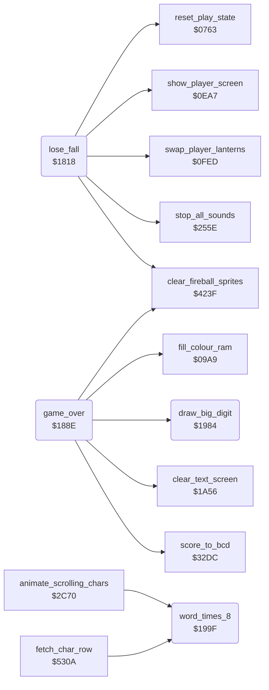

<!-- Generated by c64-docs from knowledge revision 20261025T214801.837-ucnw24 and .c64-re-tools/local/generated/src/source-map.json. Do not edit: change the knowledge, generate the source again, then run docs.ts generate. -->
# game/lose_fall_game_over.asm: Losing a fall, switching players and the game over screen

Range `$1818-$19B7`. Source: [game/lose_fall_game_over.asm](../../../../src/game/lose_fall_game_over.asm). Index: [the reference](../../index.md).

## Routines

| Routine | Address | Reached from | Summary |
|---|---|---|---|
| [`lose_fall`](lose_fall_game_over.md#lose_fall) | `$1818` | [`actor_continue_action`](../actor/actor_timed_actions.md#actor_continue_action), [`check_actor_knockouts`](../actor/actor_helpers.md#check_actor_knockouts) | Bruce has lost a fall. |
| [`game_over`](lose_fall_game_over.md#game_over) | `$188E` |  | Game over screen of the current player. |
| [`draw_big_digit`](lose_fall_game_over.md#draw_big_digit) | `$1984` | [`game_over`](lose_fall_game_over.md#game_over) | Draw digit A (low nybble) as 2x2 characters of the logo charset: base character c = digit*4 + $B4. |
| [`word_times_8`](lose_fall_game_over.md#word_times_8) | `$199F` | [`animate_scrolling_chars`](../room/animated_chars.md#animate_scrolling_chars), [`fetch_char_row`](../actor/background_contact.md#fetch_char_row) | Multiply mul8_value by 8 into the 16-bit value mul8_result_hi (high) : mul8_value (low). |

## Call graph

A solid arrow is a call, a thick arrow a table entry. Rounded nodes are in this file.

## Details

### [`lose_fall`](../../../../src/game/lose_fall_game_over.asm#L14) `$1818`

*routine*

Bruce has lost a fall. Silences the sound. In the demo: back to the title (title music next time). Else decrements falls_left; negative goes to game_over. Else (next_turn): actor_energy of all three actors = $24, enemy_follow_x cleared, fireball sprite rows cleared. In a two-player game where the other player still has falls (falls_left in inactive_player_state not negative) it switches current_player. Shows the PLAYER n screen; on a switch it also exchanges the player block $28-$43 (falls_left ... score) with inactive_player_state, the lantern states (swap_player_lanterns) and bonus_fall_next_score of the two players. Then resets the game screen (reset_play_state, spawns Bruce) and enters the room again (place_bruce_at_room_start). Called by actor_continue_action (end of a death) and check_actor_knockouts (Bruce knocked out).
silence all sound

- **Jumped to from:** [`actor_continue_action`](../actor/actor_timed_actions.md#actor_continue_action), [`check_actor_knockouts`](../actor/actor_helpers.md#check_actor_knockouts)
- **Calls:** [`stop_all_sounds`](../sfx/sound_request.md#stop_all_sounds), [`clear_fireball_sprites`](../room/wizard_fireballs.md#clear_fireball_sprites), [`show_player_screen`](title_player_screens.md#show_player_screen), [`swap_player_lanterns`](game_setup.md#swap_player_lanterns), [`reset_play_state`](play_init.md#reset_play_state)
- **Jumps to:** [`show_title_screen`](title_demo_start.md#show_title_screen), [`game_over`](lose_fall_game_over.md#game_over), [`place_bruce_at_room_start`](../room/room_misc_support.md#place_bruce_at_room_start)
- **Reads:** [`game_mode`](../../memory-map.md#game_mode), [`falls_left`](../../memory-map.md#falls_left), [`option_two_players`](options_and_patterns.md#option_two_players), [`inactive_player_state`](fireball_text_score_vars_4392.md#inactive_player_state), [`current_player`](../../memory-map.md#current_player), [`SCROLY`](../../memory-map.md#SCROLY), [`bonus_fall_next_score`](fireball_text_score_vars_4392.md#bonus_fall_next_score), [`bonus_fall_next_score_other`](fireball_text_score_vars_4392.md#bonus_fall_next_score_other), [`room`](../../memory-map.md#room)
- **Writes:** [`title_music_skip_count`](title_menu.md#title_music_skip_count), [`falls_left`](../../memory-map.md#falls_left), [`actor_energy`](../../memory-map.md#actor_energy), [`enemy_follow_x`](../../memory-map.md#enemy_follow_x), [`current_player`](../../memory-map.md#current_player), [`SCROLY`](../../memory-map.md#SCROLY), [`inactive_player_state`](fireball_text_score_vars_4392.md#inactive_player_state), [`bonus_fall_next_score`](fireball_text_score_vars_4392.md#bonus_fall_next_score), [`bonus_fall_next_score_other`](fireball_text_score_vars_4392.md#bonus_fall_next_score_other)
- **Refers to:** [`actor_energy`](../../memory-map.md#actor_energy), [`enemy_follow_x`](../../memory-map.md#enemy_follow_x)

| Label | Address | Comment |
|---|---|---|
| [`lose_fall_count`](../../../../src/game/lose_fall_game_over.asm#L20) | `$1826` |  |
| [`next_turn`](../../../../src/game/lose_fall_game_over.asm#L23) | `$182A` | full energy for all three actors |
| [`next_turn_player_screen`](../../../../src/game/lose_fall_game_over.asm#L39) | `$184B` |  |
| [`next_turn_swap_block_loop`](../../../../src/game/lose_fall_game_over.asm#L50) | `$1862` |  |
| [`next_turn_swap_score_loop`](../../../../src/game/lose_fall_game_over.asm#L61) | `$1875` |  |
| [`next_turn_enter_room`](../../../../src/game/lose_fall_game_over.asm#L70) | `$1886` | reset the game screen and spawn Bruce |

### [`game_over`](../../../../src/game/lose_fall_game_over.asm#L80) `$188E`

*routine*

Game over screen of the current player. Clears the fireball sprite rows and the text screen, installs irq_title_frame at raster line $FB with a blue screen, fills screen rows 0-9 with the blank logo character, draws the big GAME OVER text (game_over_letters_top/bottom) on rows 1-2, PLAYER n on rows 5-6 and the 6-digit score in big digits on rows 8-9, then waits 254 frames. In a two-player game where the other player still has falls it continues with next_turn; else it waits 64 more frames and goes to show_title_screen.

- **Jumped to from:** [`lose_fall`](lose_fall_game_over.md#lose_fall)
- **Calls:** [`clear_fireball_sprites`](../room/wizard_fireballs.md#clear_fireball_sprites), [`clear_text_screen`](pause_status_line.md#clear_text_screen), [`fill_colour_ram`](title_menu.md#fill_colour_ram), [`score_to_bcd`](../room/room_misc_support.md#score_to_bcd), [`draw_big_digit`](lose_fall_game_over.md#draw_big_digit)
- **Jumps to:** [`next_turn`](lose_fall_game_over.md#next_turn), [`show_title_screen`](title_demo_start.md#show_title_screen)
- **Reads:** [`SCROLY`](../../memory-map.md#SCROLY), [`game_over_letters_top`](options_and_patterns.md#game_over_letters_top), [`game_over_letters_bottom`](options_and_patterns.md#game_over_letters_bottom), [`current_player`](../../memory-map.md#current_player), [`player_banner_digit_top`](../graphics/banners.md#player_banner_digit_top), [`player_banner_digit_bottom`](../graphics/banners.md#player_banner_digit_bottom), [`player_banner_top`](../graphics/banners.md#player_banner_top), [`player_banner_bottom`](../graphics/banners.md#player_banner_bottom), [`bcd_conv_digits`](fireball_text_score_vars_4392.md#bcd_conv_digits), [`frame_countdown`](../../memory-map.md#frame_countdown), [`option_two_players`](options_and_patterns.md#option_two_players), [`inactive_player_state`](fireball_text_score_vars_4392.md#inactive_player_state)
- **Writes:** [`SCROLY`](../../memory-map.md#SCROLY), [`SPENA`](../../memory-map.md#SPENA), [`irq_vector`](cold_start.md#irq_vector), [`irq_vector_hi`](cold_start.md#irq_vector_hi), [`IRQMSK`](../../memory-map.md#IRQMSK), [`VICIRQ`](../../memory-map.md#VICIRQ), [`RASTER`](../../memory-map.md#RASTER), [`EXTCOL`](../../memory-map.md#EXTCOL), [`BGCOL0`](../../memory-map.md#BGCOL0), [`BGCOL1`](../../memory-map.md#BGCOL1), [`BGCOL2`](../../memory-map.md#BGCOL2), [`SCROLX`](../../memory-map.md#SCROLX) and 8 more
- **Refers to:** [`irq_title_frame`](../irq/screen_raster_irqs.md#irq_title_frame), [`game_screen`](../../memory-map.md#game_screen), [`player_banner_top`](../graphics/banners.md#player_banner_top), [`player_banner_bottom`](../graphics/banners.md#player_banner_bottom), [`row_ptr_top`](../../memory-map.md#row_ptr_top), [`data_ptr`](../../memory-map.md#data_ptr)

| Label | Address | Comment |
|---|---|---|
| [`game_over_clear_loop`](../../../../src/game/lose_fall_game_over.asm#L113) | `$18DB` | white for rows 12-24 |
| [`game_over_text_loop`](../../../../src/game/lose_fall_game_over.asm#L124) | `$18F0` |  |
| [`game_over_digit_loop`](../../../../src/game/lose_fall_game_over.asm#L142) | `$1909` | Bug: the loop runs once (DEY/BPL from Y = 0), so only the left half of the player digit is copied. No visible effect: lose_fall shows the PLAYER n screen of the current player at the start of each fall, so the right half is already the digit of the same player. |
| [`game_over_player_loop`](../../../../src/game/lose_fall_game_over.asm#L151) | `$191A` |  |
| [`game_over_score_loop`](../../../../src/game/lose_fall_game_over.asm#L171) | `$1942` | high digit |
| [`game_over_wait`](../../../../src/game/lose_fall_game_over.asm#L193) | `$1968` |  |
| [`game_over_to_title`](../../../../src/game/lose_fall_game_over.asm#L202) | `$1979` |  |
| [`game_over_wait_title`](../../../../src/game/lose_fall_game_over.asm#L205) | `$197D` |  |

### [`draw_big_digit`](../../../../src/game/lose_fall_game_over.asm#L212) `$1984`

*routine*

Draw digit A (low nybble) as 2x2 characters of the logo charset: base character c = digit*4 + $B4. Upper row (row_ptr_top),y = c, lower row (data_ptr),y = c+1, then at Y+1: upper c+2, lower c+3. Output: Y advanced by 1. Called by game_over.

- **Called from:** [`game_over`](lose_fall_game_over.md#game_over)
- **Reads:** [`row_ptr_top`](../../memory-map.md#row_ptr_top), [`data_ptr`](../../memory-map.md#data_ptr)

### [`word_times_8`](../../../../src/game/lose_fall_game_over.asm#L232) `$199F`

*routine*

Multiply mul8_value by 8 into the 16-bit value mul8_result_hi (high) : mul8_value (low). Used to turn a character code into a charset offset. Changes A.

- **Called from:** [`animate_scrolling_chars`](../room/animated_chars.md#animate_scrolling_chars), [`fetch_char_row`](../actor/background_contact.md#fetch_char_row)
- **Reads:** [`mul8_value`](fireball_text_score_vars_4392.md#mul8_value), [`mul8_result_hi`](fireball_text_score_vars_4392.md#mul8_result_hi)
- **Writes:** [`mul8_result_hi`](fireball_text_score_vars_4392.md#mul8_result_hi), [`mul8_value`](fireball_text_score_vars_4392.md#mul8_value)
