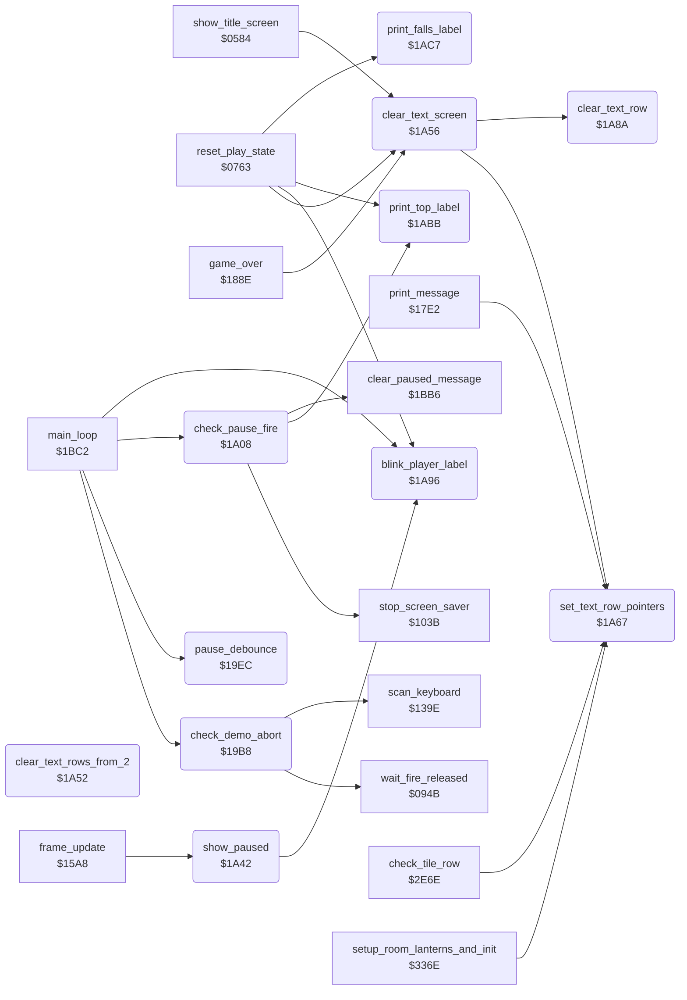

<!-- Generated by c64-docs from knowledge revision 20261025T141148.619-ij2l1b and .c64-re-tools/local/generated/src/source-map.json. Do not edit: change the knowledge, generate the source again, then run docs.ts generate. -->
# game/pause_status_line.asm: Demo abort, pause handling, text screen clearing and status line labels

Range `$19B8-$1ACF`. Source: [game/pause_status_line.asm](../../../../src/game/pause_status_line.asm). Index: [the reference](../../index.md).

## Routines

| Routine | Address | Reached from | Summary |
|---|---|---|---|
| [`check_demo_abort`](pause_status_line.md#check_demo_abort) | `$19B8` | [`main_loop`](game_main_loop.md#main_loop) | Main loop, in the demo only: fire on joystick port 1 or the F1 key ends the demo. |
| [`pause_debounce`](pause_status_line.md#pause_debounce) | `$19EC` | [`main_loop`](game_main_loop.md#main_loop) | Main loop: count down the pause debounce. |
| [`check_pause_fire`](pause_status_line.md#check_pause_fire) | `$1A08` | [`main_loop`](game_main_loop.md#main_loop) | Main loop: while paused and not debouncing, fire on the joystick of the current player ends the pause. |
| [`toggle_pause`](pause_status_line.md#toggle_pause) | `$1A22` | [`handle_game_keys`](status_and_keys.md#handle_game_keys) | Toggle the pause (also the SPACE key, handle_game_keys). |
| [`show_paused`](pause_status_line.md#show_paused) | `$1A42` | [`frame_update`](frame_update.md#frame_update) | Show the pause: draws the 1UP/2UP label steadily (up_blink_timer = $11), sets idle_timer to $51 (the screen saver starts 47*256 frames later) and prints ** PAUSED ** on the status line. |
| [`clear_text_rows_from_2`](pause_status_line.md#clear_text_rows_from_2) | `$1A52` |  | Unused entry: clears the text rows 2-12 only. |
| [`clear_text_screen`](pause_status_line.md#clear_text_screen) | `$1A56` | [`show_title_screen`](title_demo_start.md#show_title_screen), [`reset_play_state`](play_init.md#reset_play_state), [`game_over`](lose_fall_game_over.md#game_over) | Clear the text rows 0-12 (screen rows 0-24, both halves of each text row) with character 0. |
| [`set_text_row_pointers`](pause_status_line.md#set_text_row_pointers) | `$1A67` | [`print_message`](../actor/actor_driver_text.md#print_message), [`clear_text_screen`](pause_status_line.md#clear_text_screen), [`check_tile_row`](../actor/background_touch.md#check_tile_row), [`setup_room_lanterns_and_init`](../room/lantern_pickup.md#setup_room_lanterns_and_init) | Input: X = text row. |
| [`clear_text_row`](pause_status_line.md#clear_text_row) | `$1A8A` | [`clear_text_screen`](pause_status_line.md#clear_text_screen) | Write character 0 to the 40 bytes at (row_ptr_top) and (row_ptr_bottom). |
| [`blink_player_label`](pause_status_line.md#blink_player_label) | `$1A96` | [`reset_play_state`](play_init.md#reset_play_state), [`show_paused`](pause_status_line.md#show_paused), [`main_loop`](game_main_loop.md#main_loop) | Main loop: blink the 1UP / 2UP label at row 1 column 4 with up_blink_timer (period 32 calls): at 0 it prints blanks (message 0), at 16 it prints message 1 + current_player (1UP or 2UP). |
| [`print_top_label`](pause_status_line.md#print_top_label) | `$1ABB` | [`reset_play_state`](play_init.md#reset_play_state), [`check_pause_fire`](pause_status_line.md#check_pause_fire) | Print TOP (message 3) at row 1 column 16, one row high (text_single_height = 3). |
| [`print_falls_label`](pause_status_line.md#print_falls_label) | `$1AC7` | [`reset_play_state`](play_init.md#reset_play_state) | Print FALLS (message 5) at row 1 column 28. |

## Call graph

A solid arrow is a call, a thick arrow a table entry. Rounded nodes are in this file.

## Details

### [`check_demo_abort`](../../../../src/game/pause_status_line.asm#L7) `$19B8`

*routine*

Main loop, in the demo only: fire on joystick port 1 or the F1 key ends the demo. It waits until fire is released, waits 6 frames and jumps to restart_to_title. In a game it returns at once.

- **Called from:** [`main_loop`](game_main_loop.md#main_loop)
- **Calls:** [`scan_keyboard`](../input/keyboard_scan.md#scan_keyboard), [`wait_fire_released`](title_menu.md#wait_fire_released)
- **Jumps to:** [`restart_to_title`](title_demo_start.md#restart_to_title)
- **Reads:** [`game_mode`](../../memory-map.md#game_mode), [`CIAPRB`](../../memory-map.md#CIAPRB), [`key_ready`](../../memory-map.md#key_ready), [`key_code`](../../memory-map.md#key_code), [`frame_countdown`](../../memory-map.md#frame_countdown)
- **Writes:** [`key_scan_mode`](../../memory-map.md#key_scan_mode), [`key_ready`](../../memory-map.md#key_ready), [`frame_countdown`](../../memory-map.md#frame_countdown)

| Label | Address | Comment |
|---|---|---|
| [`demo_abort_to_title`](../../../../src/game/pause_status_line.asm#L23) | `$19DD` | wait until fire is released |
| [`demo_abort_wait`](../../../../src/game/pause_status_line.asm#L27) | `$19E4` |  |
| [`check_demo_abort_done`](../../../../src/game/pause_status_line.asm#L31) | `$19EB` |  |

### [`pause_debounce`](../../../../src/game/pause_status_line.asm#L35) `$19EC`

*routine*

Main loop: count down the pause debounce. pause_state bit 7 = paused, bits 0-2 = debounce count (6 after a change). Each call lowers the count (6 -> 5 -> 3 -> 1 -> 0) and sets last_game_key to $FF while it runs.

- **Called from:** [`main_loop`](game_main_loop.md#main_loop)
- **Reads:** [`pause_state`](../../memory-map.md#pause_state)
- **Writes:** [`pause_state`](../../memory-map.md#pause_state), [`last_game_key`](../../memory-map.md#last_game_key)

| Label | Address | Comment |
|---|---|---|
| [`pause_debounce_done`](../../../../src/game/pause_status_line.asm#L49) | `$1A07` |  |

### [`check_pause_fire`](../../../../src/game/pause_status_line.asm#L52) `$1A08`

*routine*

Main loop: while paused and not debouncing, fire on the joystick of the current player ends the pause.

- **Called from:** [`main_loop`](game_main_loop.md#main_loop)
- **Calls:** [`clear_paused_message`](status_and_keys.md#clear_paused_message), [`stop_screen_saver`](game_setup.md#stop_screen_saver), [`print_top_label`](pause_status_line.md#print_top_label)
- **Jumps to:** [`check_pause_fire_done`](pause_status_line.md#check_pause_fire_done), [`show_paused`](pause_status_line.md#show_paused), [`show_high_score`](score.md#show_high_score)
- **Reads:** [`pause_state`](../../memory-map.md#pause_state), [`current_player`](../../memory-map.md#current_player), [`CIAPRA`](../../memory-map.md#CIAPRA), [`idle_timer`](../../memory-map.md#idle_timer)
- **Writes:** [`pause_state`](../../memory-map.md#pause_state), [`idle_timer`](../../memory-map.md#idle_timer)

| Label | Address | Comment |
|---|---|---|
| [`toggle_pause_resume`](../../../../src/game/pause_status_line.asm#L79) | `$1A38` |  |

### [`toggle_pause`](../../../../src/game/pause_status_line.asm#L68) `$1A22`

*label*

Toggle the pause (also the SPACE key, handle_game_keys). Sets the debounce count. Entering the pause shows ** PAUSED **. Leaving it clears the message, stops the screen saver, resets idle_timer and draws the TOP label and the top score again.

- **Jumped to from:** [`handle_game_keys`](status_and_keys.md#handle_game_keys)

### [`show_paused`](../../../../src/game/pause_status_line.asm#L87) `$1A42`

*routine*

Show the pause: draws the 1UP/2UP label steadily (up_blink_timer = $11), sets idle_timer to $51 (the screen saver starts 47*256 frames later) and prints ** PAUSED ** on the status line. Called by toggle_pause and by frame_update (automatic pause).

- **Called from:** [`frame_update`](frame_update.md#frame_update)
- **Jumped to from:** [`check_pause_fire`](pause_status_line.md#check_pause_fire)
- **Calls:** [`blink_player_label`](pause_status_line.md#blink_player_label)
- **Jumps to:** [`show_paused_message`](status_and_keys.md#show_paused_message)
- **Writes:** [`up_blink_timer`](fireball_text_score_vars_4392.md#up_blink_timer), [`idle_timer`](../../memory-map.md#idle_timer)

| Label | Address | Comment |
|---|---|---|
| [`check_pause_fire_done`](../../../../src/game/pause_status_line.asm#L94) | `$1A51` |  |

### [`clear_text_rows_from_2`](../../../../src/game/pause_status_line.asm#L97) `$1A52`

*routine*

Unused entry: clears the text rows 2-12 only. Nothing jumps here.

- **Jumps to:** [`clear_text_screen_loop`](pause_status_line.md#clear_text_screen_loop)

### [`clear_text_screen`](../../../../src/game/pause_status_line.asm#L103) `$1A56`

*routine*

Clear the text rows 0-12 (screen rows 0-24, both halves of each text row) with character 0. Sets text_single_height = 0 (double-height text). Changes A, X, Y.

- **Called from:** [`show_title_screen`](title_demo_start.md#show_title_screen), [`reset_play_state`](play_init.md#reset_play_state), [`game_over`](lose_fall_game_over.md#game_over)
- **Calls:** [`set_text_row_pointers`](pause_status_line.md#set_text_row_pointers), [`clear_text_row`](pause_status_line.md#clear_text_row)
- **Writes:** [`text_single_height`](../../memory-map.md#text_single_height)

| Label | Address | Comment |
|---|---|---|
| [`clear_text_screen_loop`](../../../../src/game/pause_status_line.asm#L106) | `$1A5B` |  |

### [`set_text_row_pointers`](../../../../src/game/pause_status_line.asm#L116) `$1A67`

*routine*

Input: X = text row. Sets row_ptr_top = address of the upper screen row (text_line_top_lo/hi) and row_ptr_bottom = address of the lower screen row (text_line_bottom_lo/hi). When text_single_height is nonzero, row_ptr_bottom = io1_dummy so the lower half is not drawn.

- **Called from:** [`print_message`](../actor/actor_driver_text.md#print_message), [`clear_text_screen`](pause_status_line.md#clear_text_screen), [`check_tile_row`](../actor/background_touch.md#check_tile_row), [`setup_room_lanterns_and_init`](../room/lantern_pickup.md#setup_room_lanterns_and_init)
- **Reads:** [`text_line_top_lo`](fireball_text_score_vars.md#text_line_top_lo), [`text_line_top_hi`](fireball_text_score_vars.md#text_line_top_hi), [`text_line_bottom_lo`](fireball_text_score_vars.md#text_line_bottom_lo), [`text_line_bottom_hi`](fireball_text_score_vars.md#text_line_bottom_hi), [`text_single_height`](../../memory-map.md#text_single_height)
- **Writes:** [`row_ptr_top`](../../memory-map.md#row_ptr_top), [`row_ptr_bottom`](../../memory-map.md#row_ptr_bottom)
- **Refers to:** [`row_ptr_top`](../../memory-map.md#row_ptr_top), [`row_ptr_bottom`](../../memory-map.md#row_ptr_bottom), [`io1_dummy`](../../memory-map.md#io1_dummy)

| Label | Address | Comment |
|---|---|---|
| [`set_text_row_one_high`](../../../../src/game/pause_status_line.asm#L128) | `$1A81` |  |

### [`clear_text_row`](../../../../src/game/pause_status_line.asm#L135) `$1A8A`

*routine*

Write character 0 to the 40 bytes at (row_ptr_top) and (row_ptr_bottom). Changes A, Y.

- **Called from:** [`clear_text_screen`](pause_status_line.md#clear_text_screen)
- **Reads:** [`row_ptr_top`](../../memory-map.md#row_ptr_top), [`row_ptr_bottom`](../../memory-map.md#row_ptr_bottom)

| Label | Address | Comment |
|---|---|---|
| [`clear_text_row_loop`](../../../../src/game/pause_status_line.asm#L138) | `$1A8E` |  |

### [`blink_player_label`](../../../../src/game/pause_status_line.asm#L146) `$1A96`

*routine*

Main loop: blink the 1UP / 2UP label at row 1 column 4 with up_blink_timer (period 32 calls): at 0 it prints blanks (message 0), at 16 it prints message 1 + current_player (1UP or 2UP).

- **Called from:** [`reset_play_state`](play_init.md#reset_play_state), [`show_paused`](pause_status_line.md#show_paused), [`main_loop`](game_main_loop.md#main_loop)
- **Jumps to:** [`print_message`](../actor/actor_driver_text.md#print_message)
- **Reads:** [`up_blink_timer`](fireball_text_score_vars_4392.md#up_blink_timer), [`current_player`](../../memory-map.md#current_player)
- **Writes:** [`up_blink_timer`](fireball_text_score_vars_4392.md#up_blink_timer)

| Label | Address | Comment |
|---|---|---|
| [`blink_player_label_show`](../../../../src/game/pause_status_line.asm#L155) | `$1AA8` |  |
| [`blink_player_label_done`](../../../../src/game/pause_status_line.asm#L165) | `$1ABA` |  |

### [`print_top_label`](../../../../src/game/pause_status_line.asm#L169) `$1ABB`

*routine*

Print TOP (message 3) at row 1 column 16, one row high (text_single_height = 3). Ends through print_status_row_message.

- **Called from:** [`reset_play_state`](play_init.md#reset_play_state), [`check_pause_fire`](pause_status_line.md#check_pause_fire)
- **Jumps to:** [`print_status_row_message`](status_and_keys.md#print_status_row_message)
- **Writes:** [`text_single_height`](../../memory-map.md#text_single_height)

### [`print_falls_label`](../../../../src/game/pause_status_line.asm#L176) `$1AC7`

*routine*

Print FALLS (message 5) at row 1 column 28.

- **Called from:** [`reset_play_state`](play_init.md#reset_play_state)
- **Jumps to:** [`print_message`](../actor/actor_driver_text.md#print_message)
