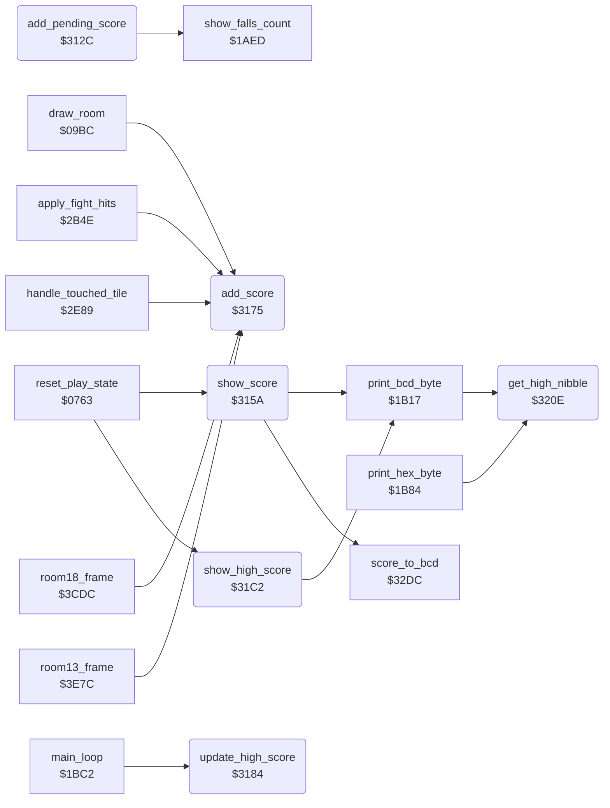

<!-- Generated by c64-docs from knowledge revision 20261029T162352.521-4j8tu8 and .c64-re-tools/local/generated/src/source-map.json. Do not edit: change the knowledge, generate the source again, then run docs.ts generate. -->
# game/score.asm: Score: add points, extra falls, score and high score display

Range `$312C-$3216`. Source: [game/score.asm](../../../../src/game/score.asm). Index: [the reference](../../index.md).

## Routines

| Routine | Address | Reached from | Summary |
|---|---|---|---|
| [`add_pending_score`](score.md#add_pending_score) | `$312C` |  | Adds the 24-bit points_to_add to score (binary, high byte first). |
| [`show_score`](score.md#show_score) | `$315A` | [`reset_play_state`](play_init.md#reset_play_state) | Shows the score: score_to_bcd makes 6 BCD digits in bcd_conv_digits+1..+3, print_bcd_byte writes them at game_screen offsets $30, $32, $34 (status line, after 1UP). |
| [`add_score`](score.md#add_score) | `$3175` | [`draw_room`](../room/draw_room.md#draw_room), [`apply_fight_hits`](../actor/fight_hits.md#apply_fight_hits), [`handle_touched_tile`](../actor/background_touch.md#handle_touched_tile), [`room18_frame`](../room/wizard_room.md#room18_frame), [`room13_frame`](../room/room_frames_12_17.md#room13_frame) | Adds A points at byte X of the 24-bit score (X = 2 low byte, 1 = 256 points, 0 = 65536 points): points_to_add = 0, points_to_add+X = A, then add_pending_score. |
| [`update_high_score`](score.md#update_high_score) | `$3184` | [`main_loop`](game_main_loop.md#main_loop) | Main loop: in a game (game_mode <> 0) a score above top_score becomes the high score and both are shown; in the demo only the score is shown. |
| [`show_high_score`](score.md#show_high_score) | `$31C2` | [`reset_play_state`](play_init.md#reset_play_state), [`check_pause_fire`](pause_status_line.md#check_pause_fire) | Shows top_score: converts the 24-bit binary value to BCD digits in bcd_conv_digits (shift left 24 times, doubling the BCD result in decimal mode) and writes the 6 low digits at game_screen offsets $3C, $3E, $40 (after TOP) with print_bcd_byte. |
| [`get_high_nibble`](score.md#get_high_nibble) | `$320E` | [`print_bcd_byte`](status_and_keys.md#print_bcd_byte), [`print_hex_byte`](status_and_keys.md#print_hex_byte) | Returns the high nibble of A in the low 4 bits. |

## Call graph

A solid arrow is a call, a thick arrow a table entry. Rounded nodes are in this file.

## Details

### [`add_pending_score`](../../../../src/game/score.asm#L8) `$312C`

*routine*

Adds the 24-bit points_to_add to score (binary, high byte first). Then checks the extra fall: when score reaches bonus_fall_next_score, that limit goes up by bonus_fall_score_step (30000), falls_left goes up by 1 and is shown. Then it shows the score (show_score).

- **Jumped to from:** [`add_score`](score.md#add_score)
- **Calls:** [`show_falls_count`](status_and_keys.md#show_falls_count)
- **Jumps to:** [`show_score`](score.md#show_score)
- **Reads:** [`score`](../../memory-map.md#score), [`points_to_add`](../../memory-map.md#points_to_add), [`bonus_fall_next_score`](fireball_text_score_vars_4392.md#bonus_fall_next_score), [`bonus_fall_score_step`](fireball_text_score_vars.md#bonus_fall_score_step), [`falls_left`](../../memory-map.md#falls_left)
- **Writes:** [`score`](../../memory-map.md#score), [`bonus_fall_next_score`](fireball_text_score_vars_4392.md#bonus_fall_next_score), [`falls_left`](../../memory-map.md#falls_left)

| Label | Address | Comment |
|---|---|---|
| [`add_pending_score_loop`](../../../../src/game/score.asm#L11) | `$312F` |  |
| [`check_extra_fall_loop`](../../../../src/game/score.asm#L18) | `$313A` |  |
| [`award_extra_fall`](../../../../src/game/score.asm#L25) | `$3146` |  |
| [`award_extra_fall_loop`](../../../../src/game/score.asm#L29) | `$3149` |  |

### [`show_score`](../../../../src/game/score.asm#L39) `$315A`

*routine*

Shows the score: score_to_bcd makes 6 BCD digits in bcd_conv_digits+1..+3, print_bcd_byte writes them at game_screen offsets $30, $32, $34 (status line, after 1UP).

- **Called from:** [`reset_play_state`](play_init.md#reset_play_state)
- **Jumped to from:** [`add_pending_score`](score.md#add_pending_score), [`update_high_score`](score.md#update_high_score)
- **Calls:** [`score_to_bcd`](../room/room_misc_support.md#score_to_bcd), [`print_bcd_byte`](status_and_keys.md#print_bcd_byte)
- **Jumps to:** [`print_bcd_byte`](status_and_keys.md#print_bcd_byte)
- **Reads:** [`bcd_conv_digits`](fireball_text_score_vars_4392.md#bcd_conv_digits)
- **Refers to:** [`bcd_conv_digits`](fireball_text_score_vars_4392.md#bcd_conv_digits)

### [`add_score`](../../../../src/game/score.asm#L52) `$3175`

*routine*

Adds A points at byte X of the 24-bit score (X = 2 low byte, 1 = 256 points, 0 = 65536 points): points_to_add = 0, points_to_add+X = A, then add_pending_score.

- **Called from:** [`draw_room`](../room/draw_room.md#draw_room), [`apply_fight_hits`](../actor/fight_hits.md#apply_fight_hits), [`handle_touched_tile`](../actor/background_touch.md#handle_touched_tile), [`room18_frame`](../room/wizard_room.md#room18_frame), [`room13_frame`](../room/room_frames_12_17.md#room13_frame)
- **Jumped to from:** [`room13_frame`](../room/room_frames_12_17.md#room13_frame)
- **Jumps to:** [`add_pending_score`](score.md#add_pending_score)
- **Writes:** [`points_to_add`](../../memory-map.md#points_to_add)
- **Refers to:** [`points_to_add`](../../memory-map.md#points_to_add)

### [`update_high_score`](../../../../src/game/score.asm#L65) `$3184`

*routine*

Main loop: in a game (game_mode <> 0) a score above top_score becomes the high score and both are shown; in the demo only the score is shown. First a check of protection data: when prot_key_trap1 = prot_key_trap1_pair, prot_key_trap2 = prot_key_trap2_pair and prot_key_trap3 = prot_key_trap3_pair, it jumps through io1_dummy ($DE00, I/O area, no valid vector).

- **Called from:** [`main_loop`](game_main_loop.md#main_loop)
- **Jumps to:** [`show_score`](score.md#show_score)
- **Reads:** [`game_mode`](../../memory-map.md#game_mode), [`prot_key_trap1`](../protection/protection_key_page.md#prot_key_trap1), [`prot_key_trap1_pair`](../protection/protection_key_page.md#prot_key_trap1_pair), [`prot_key_trap2`](../protection/protection_key_page.md#prot_key_trap2), [`prot_key_trap2_pair`](../protection/protection_key_page.md#prot_key_trap2_pair), [`prot_key_trap3`](../protection/protection_key_page.md#prot_key_trap3), [`prot_key_trap3_pair`](../protection/protection_key_page.md#prot_key_trap3_pair), [`io1_dummy`](../../memory-map.md#io1_dummy), [`top_score`](fireball_text_score_vars.md#top_score), [`score`](../../memory-map.md#score)
- **Writes:** [`top_score`](fireball_text_score_vars.md#top_score)

| Label | Address | Comment |
|---|---|---|
| [`update_high_score_compare`](../../../../src/game/score.asm#L89) | `$31A4` |  |
| [`update_high_score_compare_loop`](../../../../src/game/score.asm#L91) | `$31A6` |  |
| [`update_high_score_compare_next`](../../../../src/game/score.asm#L97) | `$31B1` |  |
| [`update_high_score_store`](../../../../src/game/score.asm#L102) | `$31B8` | copies 4 bytes: score..score+2 and raster_split_index to top_score..+2 and bonus_fall_first_score |
| [`update_high_score_store_loop`](../../../../src/game/score.asm#L104) | `$31BA` |  |

### [`show_high_score`](../../../../src/game/score.asm#L112) `$31C2`

*routine*

Shows top_score: converts the 24-bit binary value to BCD digits in bcd_conv_digits (shift left 24 times, doubling the BCD result in decimal mode) and writes the 6 low digits at game_screen offsets $3C, $3E, $40 (after TOP) with print_bcd_byte.

- **Called from:** [`reset_play_state`](play_init.md#reset_play_state)
- **Jumped to from:** [`check_pause_fire`](pause_status_line.md#check_pause_fire)
- **Calls:** [`print_bcd_byte`](status_and_keys.md#print_bcd_byte)
- **Jumps to:** [`print_bcd_byte`](status_and_keys.md#print_bcd_byte), [`get_low_nibble`](score.md#get_low_nibble)
- **Reads:** [`top_score`](fireball_text_score_vars.md#top_score), [`bcd_conv_binary`](fireball_text_score_vars_4392.md#bcd_conv_binary), [`bcd_conv_digits`](fireball_text_score_vars_4392.md#bcd_conv_digits)
- **Writes:** [`bcd_conv_binary`](fireball_text_score_vars_4392.md#bcd_conv_binary), [`bcd_conv_digits`](fireball_text_score_vars_4392.md#bcd_conv_digits)
- **Refers to:** [`bcd_conv_digits`](fireball_text_score_vars_4392.md#bcd_conv_digits), [`bcd_conv_binary`](fireball_text_score_vars_4392.md#bcd_conv_binary)

| Label | Address | Comment |
|---|---|---|
| [`show_high_score_copy_loop`](../../../../src/game/score.asm#L114) | `$31C4` |  |
| [`show_high_score_bit_loop`](../../../../src/game/score.asm#L125) | `$31D9` |  |
| [`show_high_score_add_loop`](../../../../src/game/score.asm#L130) | `$31E4` |  |
| [`get_nibble_by_carry`](../../../../src/game/score.asm#L149) | `$320C` | Entry that nothing calls: carry set returns the low nibble of A, else the high nibble. |

### [`get_high_nibble`](../../../../src/game/score.asm#L153) `$320E`

*routine*

Returns the high nibble of A in the low 4 bits.

- **Called from:** [`print_bcd_byte`](status_and_keys.md#print_bcd_byte), [`print_hex_byte`](status_and_keys.md#print_hex_byte)
- **Reads:** [`room`](../../memory-map.md#room)

| Label | Address | Comment |
|---|---|---|
| [`get_low_nibble`](../../../../src/game/score.asm#L158) | `$3212` |  |
| [`enter_current_room`](../../../../src/game/score.asm#L162) | `$3215` | Entry that nothing calls: X = current room, then place_bruce_at_room_start puts Bruce in room X. |
