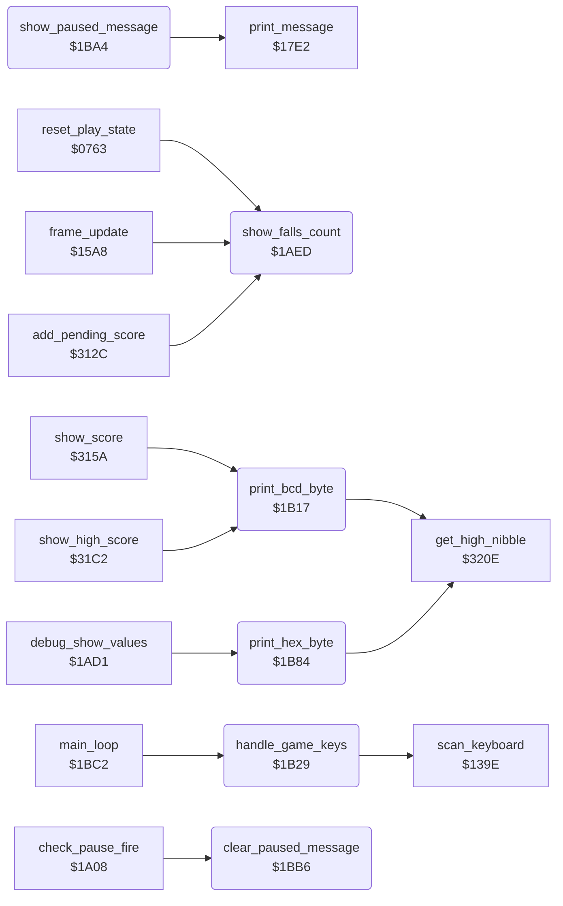

<!-- Generated by c64-docs from knowledge revision 20261029T162352.521-4j8tu8 and .c64-re-tools/local/generated/src/source-map.json. Do not edit: change the knowledge, generate the source again, then run docs.ts generate. -->
# game/status_and_keys.asm: Falls counter, digit printing, in-game keys (F1/S/SPACE/V) and the pause message

Range `$1AED-$1BC1`. Source: [game/status_and_keys.asm](../../../../src/game/status_and_keys.asm). Index: [the reference](../../index.md).

## Routines

| Routine | Address | Reached from | Summary |
|---|---|---|---|
| [`show_falls_count`](status_and_keys.md#show_falls_count) | `$1AED` | [`reset_play_state`](play_init.md#reset_play_state), [`frame_update`](frame_update.md#frame_update), [`add_pending_score`](score.md#add_pending_score), [`$2FE7`](../../../../src/actor/touch_effects.asm#L21) | Prints falls_left (falls/lives left of the current player, 0-99) as two decimal digits on the status line ("FALLS 04"), at game_screen offset $4A (row 1, column 34). |
| [`print_bcd_byte`](status_and_keys.md#print_bcd_byte) | `$1B17` | [`show_score`](score.md#show_score), [`show_high_score`](score.md#show_high_score) | Prints the packed BCD byte in A as two digit characters at game_screen+Y (tens) and game_screen+1+Y (units). |
| [`handle_game_keys`](status_and_keys.md#handle_game_keys) | `$1B29` | [`main_loop`](game_main_loop.md#main_loop) | In-game key handler. |
| [`print_hex_byte`](status_and_keys.md#print_hex_byte) | `$1B84` | [`debug_show_values`](../leftovers/leftover_1ad0.md#debug_show_values) | Prints A as two hexadecimal digit characters at game_screen+Y and game_screen+1+Y. |
| [`show_paused_message`](status_and_keys.md#show_paused_message) | `$1BA4` | [`show_paused`](pause_status_line.md#show_paused) | Prints message $0B "** PAUSED **" in text line 1 (the status line, screen row 1) at column 15 with print_message. |
| [`print_status_row_message`](status_and_keys.md#print_status_row_message) | `$1BAD` | [`print_top_label`](pause_status_line.md#print_top_label) | Shared tail: prints message A at text line X, column Y with print_message, then clears text_single_height (back to double-height text). |
| [`clear_paused_message`](status_and_keys.md#clear_paused_message) | `$1BB6` | [`check_pause_fire`](pause_status_line.md#check_pause_fire) | Prints message $0C (12 blanks) in text line 1 at column 15, single height, to remove the pause message. |

## Call graph

A solid arrow is a call, a thick arrow a table entry. Rounded nodes are in this file.

## Details

### [`show_falls_count`](../../../../src/game/status_and_keys.asm#L10) `$1AED`

*routine*

Prints falls_left (falls/lives left of the current player, 0-99) as two decimal digits on the status line ("FALLS 04"), at game_screen offset $4A (row 1, column 34). Converts by repeated subtraction of 10: bcd_conv_digits counts the tens, bcd_conv_binary keeps the units; the packed BCD byte goes to print_hex_byte, which prints it as two digits (both nibbles are 0-9). Called at game start and whenever falls_left changes (fall lost, extra fall). Changes A, Y.

- **Called from:** [`reset_play_state`](play_init.md#reset_play_state), [`frame_update`](frame_update.md#frame_update), [`$2FE7`](../../../../src/actor/touch_effects.asm#L21), [`add_pending_score`](score.md#add_pending_score)
- **Jumps to:** [`print_hex_byte`](status_and_keys.md#print_hex_byte)
- **Reads:** [`falls_left`](../../memory-map.md#falls_left), [`bcd_conv_digits`](fireball_text_score_vars_4392.md#bcd_conv_digits), [`bcd_conv_binary`](fireball_text_score_vars_4392.md#bcd_conv_binary)
- **Writes:** [`bcd_conv_digits`](fireball_text_score_vars_4392.md#bcd_conv_digits), [`bcd_conv_binary`](fireball_text_score_vars_4392.md#bcd_conv_binary)

| Label | Address | Comment |
|---|---|---|
| [`show_falls_tens_loop`](../../../../src/game/status_and_keys.asm#L16) | `$1AF7` | Binary to decimal: subtract 10 until the value goes negative, counting the tens. |
| [`show_falls_pack_digits`](../../../../src/game/status_and_keys.asm#L24) | `$1B02` | Undo the last subtraction, then pack tens (high nibble) and units (low nibble) into A. |

### [`print_bcd_byte`](../../../../src/game/status_and_keys.asm#L39) `$1B17`

*routine*

Prints the packed BCD byte in A as two digit characters at game_screen+Y (tens) and game_screen+1+Y (units). The digit characters of the game font are $10-$19, so each nibble is ORed with $10. Used by the score display (1UP score and TOP score, three BCD bytes each). Changes A.

- **Called from:** [`show_score`](score.md#show_score), [`show_high_score`](score.md#show_high_score)
- **Jumped to from:** [`show_score`](score.md#show_score), [`show_high_score`](score.md#show_high_score)
- **Calls:** [`get_high_nibble`](score.md#get_high_nibble)
- **Writes:** [`game_screen`](../../memory-map.md#game_screen)

### [`handle_game_keys`](../../../../src/game/status_and_keys.asm#L57) `$1B29`

*routine*

In-game key handler. The main loop calls it once per pass in a real game (game_mode = 1), not in the attract demo. Sets key_scan_mode (only F1, S, SPACE and V are decoded), runs scan_keyboard, and acts on a new key (key_ready = 1), which it acknowledges: F1 ($04)    restart_to_title (does not return) S ($0D)     toggle title_music_off (the title tune on/off) and clear title_music_skip_count SPACE ($3C) toggle_pause (does not return here) V ($1F)     toggle_credit_line (credit text in screen row 0) The key code without the shift bit is also stored in last_game_key (nothing reads it).

- **Called from:** [`main_loop`](game_main_loop.md#main_loop)
- **Calls:** [`scan_keyboard`](../input/keyboard_scan.md#scan_keyboard)
- **Jumps to:** [`restart_to_title`](title_demo_start.md#restart_to_title), [`toggle_pause`](pause_status_line.md#toggle_pause)
- **Reads:** [`key_ready`](../../memory-map.md#key_ready), [`key_code`](../../memory-map.md#key_code), [`title_music_off`](../room/room_enemy_tables.md#title_music_off), [`game_screen`](../../memory-map.md#game_screen), [`version_banner`](../text/messages_rooms.md#version_banner)
- **Writes:** [`key_scan_mode`](../../memory-map.md#key_scan_mode), [`key_ready`](../../memory-map.md#key_ready), [`last_game_key`](../../memory-map.md#last_game_key), [`title_music_off`](../room/room_enemy_tables.md#title_music_off), [`title_music_skip_count`](title_menu.md#title_music_skip_count), [`game_screen`](../../memory-map.md#game_screen)

| Label | Address | Comment |
|---|---|---|
| [`handle_game_keys_new_key`](../../../../src/game/status_and_keys.asm#L64) | `$1B37` |  |
| [`handle_game_keys_check_s`](../../../../src/game/status_and_keys.asm#L73) | `$1B4A` | S |
| [`handle_game_keys_check_space`](../../../../src/game/status_and_keys.asm#L82) | `$1B5C` | SPACE |
| [`handle_game_keys_pause`](../../../../src/game/status_and_keys.asm#L89) | `$1B65` | toggle pause (does not return here) |
| [`toggle_credit_line`](../../../../src/game/status_and_keys.asm#L94) | `$1B68` | V key: when the first character of screen row 0 is the blank $20, copies the 40-character credit line "BRUCE LEE (C) 1984 DATASOFT REV.2 BY RJF" from version_banner into row 0 of game_screen; otherwise fills row 0 with $20. Changes A, X. |
| [`toggle_credit_line_copy`](../../../../src/game/status_and_keys.asm#L99) | `$1B71` |  |
| [`toggle_credit_line_clear`](../../../../src/game/status_and_keys.asm#L105) | `$1B7B` |  |
| [`toggle_credit_line_clear_loop`](../../../../src/game/status_and_keys.asm#L107) | `$1B7D` | A = $20 (blank) |

### [`print_hex_byte`](../../../../src/game/status_and_keys.asm#L116) `$1B84`

*routine*

Prints A as two hexadecimal digit characters at game_screen+Y and game_screen+1+Y. Nibbles 0-9 become characters $10-$19; nibbles A-F become $21-$26 (the letters A-F of the font). show_falls_count passes a packed decimal value, so the letter case never occurs there; the unused debug_show_values passes real hexadecimal values. Changes A.

- **Called from:** [`debug_show_values`](../leftovers/leftover_1ad0.md#debug_show_values)
- **Jumped to from:** [`debug_show_values`](../leftovers/leftover_1ad0.md#debug_show_values), [`show_falls_count`](status_and_keys.md#show_falls_count)
- **Calls:** [`get_high_nibble`](score.md#get_high_nibble)
- **Writes:** [`game_screen`](../../memory-map.md#game_screen)

| Label | Address | Comment |
|---|---|---|
| [`print_hex_store_high`](../../../../src/game/status_and_keys.asm#L125) | `$1B91` |  |
| [`print_hex_store_low`](../../../../src/game/status_and_keys.asm#L135) | `$1BA0` |  |

### [`show_paused_message`](../../../../src/game/status_and_keys.asm#L141) `$1BA4`

*routine*

Prints message $0B "** PAUSED **" in text line 1 (the status line, screen row 1) at column 15 with print_message. The nonzero message number in text_single_height makes the text one row high (set_text_row_pointers sends the lower half to io1_dummy). Called by show_paused in toggle_pause.
message number

- **Jumped to from:** [`show_paused`](pause_status_line.md#show_paused)
- **Calls:** [`print_message`](../actor/actor_driver_text.md#print_message)
- **Writes:** [`text_single_height`](../../memory-map.md#text_single_height)

### [`print_status_row_message`](../../../../src/game/status_and_keys.asm#L148) `$1BAD`

*label*

Shared tail: prints message A at text line X, column Y with print_message, then clears text_single_height (back to double-height text).

- **Jumped to from:** [`print_top_label`](pause_status_line.md#print_top_label), [`clear_paused_message`](status_and_keys.md#clear_paused_message)

### [`clear_paused_message`](../../../../src/game/status_and_keys.asm#L154) `$1BB6`

*routine*

Prints message $0C (12 blanks) in text line 1 at column 15, single height, to remove the pause message.
message number

- **Called from:** [`check_pause_fire`](pause_status_line.md#check_pause_fire)
- **Jumps to:** [`print_status_row_message`](status_and_keys.md#print_status_row_message)
- **Writes:** [`text_single_height`](../../memory-map.md#text_single_height)
