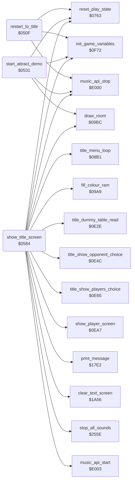

<!-- Generated by c64-docs from knowledge revision 20261029T162352.521-4j8tu8 and .c64-re-tools/local/generated/src/source-map.json. Do not edit: change the knowledge, generate the source again, then run docs.ts generate. -->
# game/title_demo_start.asm: Restart, attract demo start, title screen setup and new game start

Range `$050F-$0762`. Source: [game/title_demo_start.asm](../../../../src/game/title_demo_start.asm). Index: [the reference](../../index.md).

## Routines

| Routine | Address | Reached from | Summary |
|---|---|---|---|
| [`restart_to_title`](title_demo_start.md#restart_to_title) | `$050F` | [`check_demo_abort`](pause_status_line.md#check_demo_abort), [`handle_game_keys`](status_and_keys.md#handle_game_keys) | Restart entry: the end of the cold start, F1 during play (handle_game_keys) and F1 while paused (pause_debounce). |
| [`start_attract_demo`](title_demo_start.md#start_attract_demo) | `$0531` | [`title_menu_loop`](title_menu.md#title_menu_loop) | Attract demo start: title_menu_loop jumps here when title_countdown reaches zero. |
| [`show_title_screen`](title_demo_start.md#show_title_screen) | `$0584` | [`lose_fall`](lose_fall_game_over.md#lose_fall), [`game_over`](lose_fall_game_over.md#game_over), [`room10_frame`](../room/room_frames_8_11.md#room10_frame) | Title screen setup. |

## Call graph

A solid arrow is a call, a thick arrow a table entry. Rounded nodes are in this file.

## Details

### [`restart_to_title`](../../../../src/game/title_demo_start.asm#L9) `$050F`

*routine*

Restart entry: the end of the cold start, F1 during play (handle_game_keys) and F1 while paused (pause_debounce). Resets the stack, blanks the screen, stops the music, points random_ptr at random_table, clears the game variables (init_game_variables, game_mode = 1) and the play state (reset_play_state), then jumps to show_title_screen.

- **Jumped to from:** [`check_demo_abort`](pause_status_line.md#check_demo_abort), [`handle_game_keys`](status_and_keys.md#handle_game_keys)
- **Calls:** [`music_api_stop`](../music/music_player_state.md#music_api_stop), [`init_game_variables`](game_setup.md#init_game_variables), [`reset_play_state`](play_init.md#reset_play_state)
- **Jumps to:** [`show_title_screen`](title_demo_start.md#show_title_screen)
- **Reads:** [`SCROLY`](../../memory-map.md#SCROLY)
- **Writes:** [`SCROLY`](../../memory-map.md#SCROLY), [`random_ptr`](../../memory-map.md#random_ptr)
- **Refers to:** [`random_table`](../../memory-map.md#random_table), [`random_ptr`](../../memory-map.md#random_ptr)

### [`start_attract_demo`](../../../../src/game/title_demo_start.asm#L32) `$0531`

*routine*

Attract demo start: title_menu_loop jumps here when title_countdown reaches zero. Stops the music, clears the game variables and the play state, then clears game_mode (0 = demo: random_byte returns 1 and Bruce follows the recorded input at demo_input_stream). It saves the menu options in option_two_players_saved / option_yamo_player2_saved (show_title_screen restores them) and forces one player with a computer Yamo, draws room 0 and enters main_loop. The demo ends at the first lost fall (lose_fall returns to show_title_screen in the demo, with falls left) or on fire (port 1) or F1 (check_demo_abort).

- **Jumped to from:** [`title_menu_loop`](title_menu.md#title_menu_loop)
- **Calls:** [`music_api_stop`](../music/music_player_state.md#music_api_stop), [`init_game_variables`](game_setup.md#init_game_variables), [`reset_play_state`](play_init.md#reset_play_state), [`draw_room`](../room/draw_room.md#draw_room)
- **Jumps to:** [`main_loop`](game_main_loop.md#main_loop)
- **Reads:** [`SCROLY`](../../memory-map.md#SCROLY), [`game_mode`](../../memory-map.md#game_mode), [`option_two_players`](options_and_patterns.md#option_two_players), [`option_yamo_player2`](options_and_patterns.md#option_yamo_player2)
- **Writes:** [`SCROLY`](../../memory-map.md#SCROLY), [`SPENA`](../../memory-map.md#SPENA), [`SP0X`](../../memory-map.md#SP0X), [`SP0Y`](../../memory-map.md#SP0Y), [`music_stop_request`](../music/music_player.md#music_stop_request), [`game_mode`](../../memory-map.md#game_mode), [`option_two_players_saved`](options_and_patterns.md#option_two_players_saved), [`option_yamo_player2_saved`](options_and_patterns.md#option_yamo_player2_saved), [`option_yamo_player2`](options_and_patterns.md#option_yamo_player2), [`option_two_players`](options_and_patterns.md#option_two_players), [`demo_input_ptr`](../../memory-map.md#demo_input_ptr)
- **Refers to:** [`demo_input_stream`](../input/demo_input.md#demo_input_stream), [`demo_input_ptr`](../../memory-map.md#demo_input_ptr)

| Label | Address | Comment |
|---|---|---|
| [`demo_start_blank_screen`](../../../../src/game/title_demo_start.asm#L36) | `$0537` | the high byte of this operand ($D0, frame_update_wipe_counter) is also the page counter of the memory wipe in frame_update |
| [`frame_update_wipe_counter`](../../../../src/game/title_demo_start.asm#L37) | `$0539` |  |

### [`show_title_screen`](../../../../src/game/title_demo_start.asm#L83) `$0584`

*routine*

Title screen setup. Entered from restart_to_title, from lose_fall when the demo ends, from game_over and from the protection failure in room10_frame. - Silences the sound, clears the text rows, shows the TM sign as sprite 0 (X-expanded, X = 266, Y = 86, image in sprite_buf_b_spr4) beside the logo. - Sets the title raster IRQ (irq_title_frame), a blue screen, colour RAM light grey with white rows 12-24. - Fills rows 0-8 with the blank logo character $DC and copies four 40-byte text rows (logo font, codes with bit 7 set) to screen rows 2, 5, 6 and 9: "DATASOFT PRESENTS", the two rows of the big "BRUCE LEE" and "BY RON J FORTIER". - Prints the three menu lines (messages $4F/$50/$51) in single height and inverts "F3", "F5", "F7", "1 PLAYER" and "COMPUTER"; then restores the saved options and shows them. - Starts the title tune on the first title and then every fifth time (title_music_skip_count) unless title_music_off is set. - Runs the protection check on prot_signature_a/b, starts the 2400-frame title_countdown and calls title_menu_loop. That returns when the player starts a game: execution falls into start_new_game.

- **Jumped to from:** [`restart_to_title`](title_demo_start.md#restart_to_title), [`lose_fall`](lose_fall_game_over.md#lose_fall), [`game_over`](lose_fall_game_over.md#game_over), [`room10_frame`](../room/room_frames_8_11.md#room10_frame)
- **Calls:** [`stop_all_sounds`](../sfx/sound_request.md#stop_all_sounds), [`clear_text_screen`](pause_status_line.md#clear_text_screen), [`title_dummy_table_read`](title_sprite.md#title_dummy_table_read), [`fill_colour_ram`](title_menu.md#fill_colour_ram), [`print_message`](../actor/actor_driver_text.md#print_message), [`title_show_players_choice`](title_player_screens.md#title_show_players_choice), [`title_show_opponent_choice`](title_player_screens.md#title_show_opponent_choice), [`music_api_start`](../music/music_player_state.md#music_api_start), [`title_menu_loop`](title_menu.md#title_menu_loop), [`music_api_stop`](../music/music_player_state.md#music_api_stop), [`show_player_screen`](title_player_screens.md#show_player_screen), [`init_game_variables`](game_setup.md#init_game_variables) and 2 more
- **Jumps to:** [`main_loop`](game_main_loop.md#main_loop)
- **Reads:** [`SCROLY`](../../memory-map.md#SCROLY), [`title_tm_sprite_rows`](title_sprite.md#title_tm_sprite_rows), [`title_logo_row2`](../graphics/banners.md#title_logo_row2), [`title_logo_row5`](../graphics/banners.md#title_logo_row5), [`title_logo_row6`](../graphics/banners.md#title_logo_row6), [`title_logo_row9`](../graphics/banners.md#title_logo_row9), [`game_screen`](../../memory-map.md#game_screen), [`option_two_players_saved`](options_and_patterns.md#option_two_players_saved), [`option_yamo_player2_saved`](options_and_patterns.md#option_yamo_player2_saved), [`option_two_players`](options_and_patterns.md#option_two_players), [`option_yamo_player2`](options_and_patterns.md#option_yamo_player2), [`title_music_off`](../room/room_enemy_tables.md#title_music_off) and 8 more
- **Writes:** [`SCROLY`](../../memory-map.md#SCROLY), [`text_single_height`](../../memory-map.md#text_single_height), [`sprite_buf_b_spr4`](../../memory-map.md#sprite_buf_b_spr4), [`SPENA`](../../memory-map.md#SPENA), [`XXPAND`](../../memory-map.md#XXPAND), [`MSIGX`](../../memory-map.md#MSIGX), [`YXPAND`](../../memory-map.md#YXPAND), [`SPBGPR`](../../memory-map.md#SPBGPR), [`SPMC`](../../memory-map.md#SPMC), [`SP0X`](../../memory-map.md#SP0X), [`SP0Y`](../../memory-map.md#SP0Y), [`SP0COL`](../../memory-map.md#SP0COL) and 26 more
- **Refers to:** [`sprite_buf_b_spr4`](../../memory-map.md#sprite_buf_b_spr4), [`irq_title_frame`](../irq/screen_raster_irqs.md#irq_title_frame), [`game_screen`](../../memory-map.md#game_screen), [`demo_input_ptr`](../../memory-map.md#demo_input_ptr), [`title_countdown`](../../memory-map.md#title_countdown), [`demo_input_stream`](../input/demo_input.md#demo_input_stream)

| Label | Address | Comment |
|---|---|---|
| [`title_clear_sprite_loop`](../../../../src/game/title_demo_start.asm#L96) | `$059F` |  |
| [`title_copy_tm_sprite`](../../../../src/game/title_demo_start.asm#L117) | `$05D1` |  |
| [`title_fill_screen_loop`](../../../../src/game/title_demo_start.asm#L144) | `$0613` |  |
| [`title_copy_logo_rows`](../../../../src/game/title_demo_start.asm#L156) | `$0628` |  |
| [`title_highlight_defaults`](../../../../src/game/title_demo_start.asm#L188) | `$066D` |  |
| [`title_highlight_next`](../../../../src/game/title_demo_start.asm#L211) | `$069E` |  |
| [`title_check_opponent_option`](../../../../src/game/title_demo_start.asm#L223) | `$06B5` |  |
| [`title_music_check`](../../../../src/game/title_demo_start.asm#L228) | `$06BD` | nonzero: sound is off (S key) |
| [`title_protection_check`](../../../../src/game/title_demo_start.asm#L245) | `$06DD` | Protection: prot_signature_a ^ prot_signature_b_3 ^ prot_signature_a_2 ^ prot_signature_b ^ prot_signature_a_3 ^ prot_signature_b_2 must be 0 (the two copies of the key in the protection page agree). Otherwise the code below writes A over memory page by page from (demo_input_ptr) and never returns. |
| [`title_protection_wipe`](../../../../src/game/title_demo_start.asm#L253) | `$06F3` |  |
| [`title_start_countdown`](../../../../src/game/title_demo_start.asm#L269) | `$06FA` | title_countdown = $0960 = 2400 frames, then the demo |
| [`start_new_game`](../../../../src/game/title_demo_start.asm#L283) | `$070E` | Start a game. show_title_screen falls into this when title_menu_loop returns (F7 or fire on port 1). Blanks the screen, selects player 1 (current_player = 0), stops the music, saves the menu options, shows the "PLAYER 1" screen (show_player_screen), clears the game variables (init_game_variables, game_mode = 1), resets the play state, draws room 0 and enters main_loop. |
