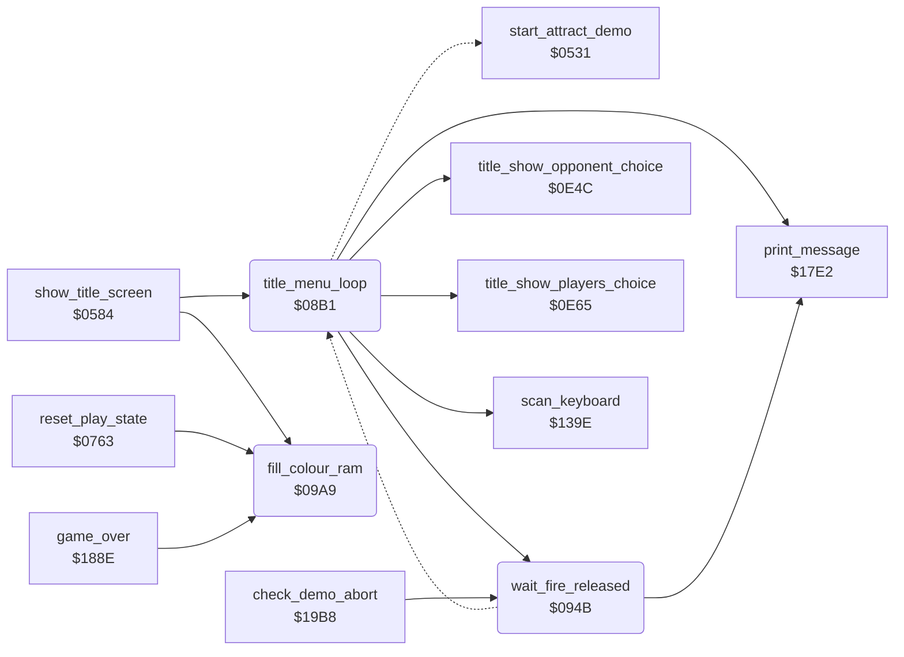

<!-- Generated by c64-docs from knowledge revision 20261023T151738.098-ndlxeh and .c64-re-tools/local/generated/src/source-map.json. Do not edit: change the knowledge, generate the source again, then run docs.ts generate. -->
# game/title_menu.asm: Title menu loop: option keys, joystick handedness and fire to start

Range `$08B1-$09BB`. Source: [game/title_menu.asm](../../../../src/game/title_menu.asm). Index: [the reference](../../index.md).

## Call graph

A solid arrow is a call, a thick arrow a table entry, a dotted arrow a jump. Rounded nodes are in this file.

## Data

| Range | Type | Name | Read by | Written by |
|---|---|---|---|---|
| [`$09BB`](../../../../src/game/title_menu.asm#L164) | bytes | [`title_music_skip_count`](../../../../src/game/title_menu.asm#L163) | [`show_title_screen`](title_demo_start.md#show_title_screen) | [`show_title_screen`](title_demo_start.md#show_title_screen), [`lose_fall`](lose_fall_game_over.md#lose_fall), [`handle_game_keys`](status_and_keys.md#handle_game_keys) |

## Names

### [`title_menu_loop`](../../../../src/game/title_menu.asm#L14) `$08B1`

*routine*

Title menu loop (state machine of the title screen). Called by show_title_screen; returns when a game starts (the caller falls into start_new_game). Each pass: - title_countdown (decremented by irq_title_frame) zero: jump to start_attract_demo. - a key: F7 starts the game; F3 toggles 1/2 players (option_two_players); F5 toggles computer/human Yamo (option_yamo_player2); L, R, shift-L, shift-R set the joystick handedness and print a message. Each option key restarts the countdown. - about 350 frames after the last option key the message row is cleared (message $0E). - fire on joystick port 1 starts the game. Starting waits until fire is released on both ports, then 16 frames, and returns.

- **Called from:** [`show_title_screen`](title_demo_start.md#show_title_screen) [`$070B`](../../../../src/game/title_demo_start.asm#L278)
- **Calls:** [`scan_keyboard`](../input/keyboard_scan.md#scan_keyboard), [`print_message`](../actor/actor_driver_text.md#print_message), [`wait_fire_released`](title_menu.md#wait_fire_released), [`title_show_opponent_choice`](title_player_screens.md#title_show_opponent_choice), [`title_show_players_choice`](title_player_screens.md#title_show_players_choice)
- **Jumps to:** [`start_attract_demo`](title_demo_start.md#start_attract_demo), [`title_menu_handedness_keys`](title_menu.md#title_menu_handedness_keys)
- **Reads:** [`title_countdown`](../../memory-map.md#title_countdown), [`title_countdown+1`](../../memory-map.md#title_countdown), [`key_ready`](../../memory-map.md#key_ready), [`key_code`](../../memory-map.md#key_code), [`CIAPRB`](../../memory-map.md#CIAPRB), [`frame_countdown`](../../memory-map.md#frame_countdown), [`option_yamo_player2`](options_and_patterns.md#option_yamo_player2), [`option_two_players`](options_and_patterns.md#option_two_players)
- **Writes:** [`key_scan_mode`](../../memory-map.md#key_scan_mode), [`key_ready`](../../memory-map.md#key_ready), [`frame_countdown`](../../memory-map.md#frame_countdown), [`option_yamo_player2`](options_and_patterns.md#option_yamo_player2), [`option_yamo_player2_saved`](options_and_patterns.md#option_yamo_player2_saved), [`title_countdown+1`](../../memory-map.md#title_countdown), [`title_countdown`](../../memory-map.md#title_countdown), [`option_two_players`](options_and_patterns.md#option_two_players), [`option_two_players_saved`](options_and_patterns.md#option_two_players_saved)
- **Refers to:** [`title_countdown`](../../memory-map.md#title_countdown)

### [`title_menu_scan_keys`](../../../../src/game/title_menu.asm#L19) `$08BA`

*label*

- **Jumped to from:** [`title_menu_loop`](title_menu.md#title_menu_loop) [`$08B5`](../../../../src/game/title_menu.asm#L17)

### [`title_menu_function_keys`](../../../../src/game/title_menu.asm#L29) `$08D2`

*label*

ignore shift

- **Jumped to from:** [`wait_fire_released`](title_menu.md#wait_fire_released) [`$0966`](../../../../src/game/title_menu.asm#L116)

### [`title_menu_check_message_timeout`](../../../../src/game/title_menu.asm#L37) `$08E0`

*label*

countdown at $08xx with low byte 0-1: about 350 frames after the reset

- **Jumped to from:** [`title_menu_loop`](title_menu.md#title_menu_loop) [`$08C5`](../../../../src/game/title_menu.asm#L24)

### [`title_menu_check_fire`](../../../../src/game/title_menu.asm#L48) `$08F5`

*label*

joystick port 1 fire (bit 4 = 0 when pressed)

- **Jumped to from:** [`title_menu_loop`](title_menu.md#title_menu_loop) [`$08E4`](../../../../src/game/title_menu.asm#L40), [`title_menu_loop`](title_menu.md#title_menu_loop) [`$08EA`](../../../../src/game/title_menu.asm#L43)

### [`title_menu_start_game`](../../../../src/game/title_menu.asm#L52) `$08FC`

*label*

- **Jumped to from:** [`title_menu_loop`](title_menu.md#title_menu_loop) [`$08D6`](../../../../src/game/title_menu.asm#L32)

### [`title_menu_wait_start_delay`](../../../../src/game/title_menu.asm#L56) `$0903`

*label*

- **Jumped to from:** [`title_menu_loop`](title_menu.md#title_menu_loop) [`$0905`](../../../../src/game/title_menu.asm#L58)

### [`title_menu_toggle_opponent`](../../../../src/game/title_menu.asm#L61) `$0908`

*label*

F5: toggle the opponent option (computer Yamo / Yamo played by player 2).

- **Jumped to from:** [`title_menu_loop`](title_menu.md#title_menu_loop) [`$08DA`](../../../../src/game/title_menu.asm#L34)

### [`title_menu_option_changed`](../../../../src/game/title_menu.asm#L68) `$0916`

*label*

After an option key: wait for fire release, restart the 2400-frame countdown, wait 4 frames.

- **Jumped to from:** [`wait_fire_released`](title_menu.md#wait_fire_released) [`$09A6`](../../../../src/game/title_menu.asm#L149)

### [`title_menu_wait_option_delay`](../../../../src/game/title_menu.asm#L76) `$0925`

*label*

- **Jumped to from:** [`title_menu_loop`](title_menu.md#title_menu_loop) [`$0927`](../../../../src/game/title_menu.asm#L78), [`title_menu_loop`](title_menu.md#title_menu_loop) [`$0949`](../../../../src/game/title_menu.asm#L94)

### [`title_menu_toggle_players`](../../../../src/game/title_menu.asm#L81) `$092C`

*label*

F3: toggle the players option, then the steps of title_menu_option_changed inline.

- **Jumped to from:** [`title_menu_loop`](title_menu.md#title_menu_loop) [`$08DE`](../../../../src/game/title_menu.asm#L36)

### [`wait_fire_released`](../../../../src/game/title_menu.asm#L97) `$094B`

*routine*

Wait until the fire buttons of both joysticks are released (bit 4 of CIAPRA and CIAPRB both 1). Changes A. Called by title_menu_loop and by check_demo_abort (demo_abort_to_title).

- **Called from:** [`title_menu_loop`](title_menu.md#title_menu_loop) [`$08FC`](../../../../src/game/title_menu.asm#L53), [`title_menu_loop`](title_menu.md#title_menu_loop) [`$0916`](../../../../src/game/title_menu.asm#L69), [`title_menu_loop`](title_menu.md#title_menu_loop) [`$093A`](../../../../src/game/title_menu.asm#L87), [`check_demo_abort`](pause_status_line.md#check_demo_abort) [`$19DD`](../../../../src/game/pause_status_line.asm#L25)
- **Calls:** [`print_message`](../actor/actor_driver_text.md#print_message)
- **Jumps to:** [`title_menu_function_keys`](title_menu.md#title_menu_function_keys), [`title_menu_option_changed`](title_menu.md#title_menu_option_changed)
- **Reads:** [`CIAPRA`](../../memory-map.md#CIAPRA), [`CIAPRB`](../../memory-map.md#CIAPRB)
- **Writes:** [`joystick_right_handed`](../room/room_enemy_tables.md#joystick_right_handed), [`joystick_right_handed+1`](../room/room_enemy_tables.md#joystick_right_handed)
- **Refers to:** [`joystick_right_handed`](../room/room_enemy_tables.md#joystick_right_handed)

### [`title_menu_handedness_keys`](../../../../src/game/title_menu.asm#L107) `$0956`

*label*

Handedness keys. Input: A = key code. L ($2A) and R ($11, matrix column 2 row 1; D would be $12) set joystick 1 (joystick_right_handed), shift-L ($AA) and shift-R ($91) set joystick 2 (joystick_right_handed+1): 0 = left-handed, 1 = right-handed (the default). Each prints its message (8, 9, $0A, $0D) at double row 10, column 2, then goes to title_menu_option_changed. Other keys go to title_menu_function_keys.

- **Jumped to from:** [`title_menu_loop`](title_menu.md#title_menu_loop) [`$08CF`](../../../../src/game/title_menu.asm#L28)

### [`title_set_joy1_left_handed`](../../../../src/game/title_menu.asm#L117) `$0969`

*label*

"JOYSTICK # 1 IS IN LEFT HANDED MODE"

- **Jumped to from:** [`wait_fire_released`](title_menu.md#wait_fire_released) [`$0958`](../../../../src/game/title_menu.asm#L109)

### [`title_set_joy2_left_handed`](../../../../src/game/title_menu.asm#L125) `$0979`

*label*

"JOYSTICK # 2 IS IN LEFT HANDED MODE"

- **Jumped to from:** [`wait_fire_released`](title_menu.md#wait_fire_released) [`$095C`](../../../../src/game/title_menu.asm#L111)

### [`title_set_joy1_right_handed`](../../../../src/game/title_menu.asm#L133) `$0988`

*label*

"JOYSTICK # 1 IS IN RIGHT HANDED MODE"

- **Jumped to from:** [`wait_fire_released`](title_menu.md#wait_fire_released) [`$0960`](../../../../src/game/title_menu.asm#L113)

### [`title_set_joy2_right_handed`](../../../../src/game/title_menu.asm#L141) `$0998`

*label*

"JOYSTICK # 2 IS IN RIGHT HANDED MODE"

- **Jumped to from:** [`wait_fire_released`](title_menu.md#wait_fire_released) [`$0964`](../../../../src/game/title_menu.asm#L115)

### [`title_handedness_done`](../../../../src/game/title_menu.asm#L148) `$09A6`

*label*

- **Jumped to from:** [`wait_fire_released`](title_menu.md#wait_fire_released) [`$0977`](../../../../src/game/title_menu.asm#L124), [`wait_fire_released`](title_menu.md#wait_fire_released) [`$0986`](../../../../src/game/title_menu.asm#L132), [`wait_fire_released`](title_menu.md#wait_fire_released) [`$0996`](../../../../src/game/title_menu.asm#L140)

### [`fill_colour_ram`](../../../../src/game/title_menu.asm#L151) `$09A9`

*routine*

Fill all of colour RAM ($D800-$DBFF) with A. Changes X (0 on return).

- **Called from:** [`show_title_screen`](title_demo_start.md#show_title_screen) [`$060E`](../../../../src/game/title_demo_start.asm#L142), [`reset_play_state`](play_init.md#reset_play_state) [`$0797`](../../../../src/game/play_init.asm#L43), [`game_over`](lose_fall_game_over.md#game_over) [`$18D6`](../../../../src/game/lose_fall_game_over.asm#L112)
- **Writes:** `$D800`, `$D900`, `$DA00`, `$DB00`

### [`fill_colour_ram_loop`](../../../../src/game/title_menu.asm#L153) `$09AB`

*label*

- **Jumped to from:** [`fill_colour_ram`](title_menu.md#fill_colour_ram) [`$09B8`](../../../../src/game/title_menu.asm#L159)

### [`title_music_skip_count`](../../../../src/game/title_menu.asm#L163) `$09BB`

*variable*

Title tune counter. show_title_screen decrements it and plays the tune when it goes below zero, then sets it to 4. 0 at load; lose_fall sets 0 when the demo ends, and the S key (handle_game_keys_check_s) sets 0.

- **Read by:** [`show_title_screen`](title_demo_start.md#show_title_screen) [`$06C2`](../../../../src/game/title_demo_start.asm#L231)
- **Written by:** [`show_title_screen`](title_demo_start.md#show_title_screen) [`$06C2`](../../../../src/game/title_demo_start.asm#L231), [`show_title_screen`](title_demo_start.md#show_title_screen) [`$06C9`](../../../../src/game/title_demo_start.asm#L234), [`lose_fall`](lose_fall_game_over.md#lose_fall) [`$1820`](../../../../src/game/lose_fall_game_over.asm#L18), [`handle_game_keys`](status_and_keys.md#handle_game_keys) [`$1B58`](../../../../src/game/status_and_keys.asm#L80)
