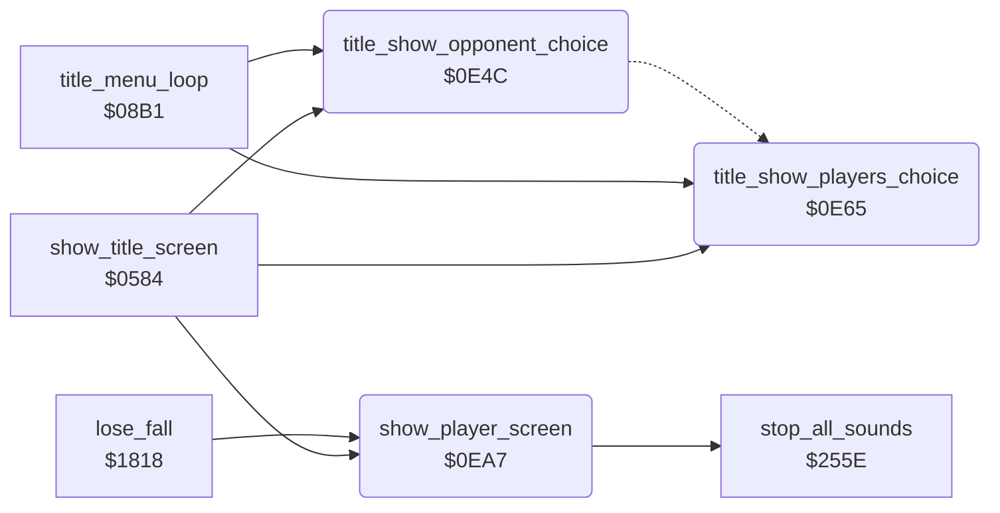

<!-- Generated by c64-docs from knowledge revision 20261023T151738.098-ndlxeh and .c64-re-tools/local/generated/src/source-map.json. Do not edit: change the knowledge, generate the source again, then run docs.ts generate. -->
# game/title_player_screens.asm: Title option highlights and the PLAYER n screen

Range `$0E4C-$0F71`. Source: [game/title_player_screens.asm](../../../../src/game/title_player_screens.asm). Index: [the reference](../../index.md).

## Call graph

A solid arrow is a call, a thick arrow a table entry, a dotted arrow a jump. Rounded nodes are in this file.

## Names

### [`title_show_opponent_choice`](../../../../src/game/title_player_screens.asm#L10) `$0E4C`

*routine*

Title screen, F5 (COMPUTER / OPPONENT) option. Toggles bit 6 of the 20 characters of the option text on screen row 14 (columns 16-35), which switches each character between its normal and its inverted form, except character $4D. Then draws the end caps of the highlight box for the current value of option_yamo_player2: 0 boxes COMPUTER, 1 boxes OPPONENT. Called by show_title_screen and when F5 toggles the option. Changes A, X.

- **Called from:** [`show_title_screen`](title_demo_start.md#show_title_screen) [`$06BA`](../../../../src/game/title_demo_start.asm#L227), [`title_menu_loop`](title_menu.md#title_menu_loop) [`$0913`](../../../../src/game/title_menu.asm#L66)
- **Jumps to:** [`title_draw_option_box`](title_player_screens.md#title_draw_option_box)
- **Reads:** [`game_screen+576`](../../memory-map.md#game_screen), [`option_yamo_player2`](options_and_patterns.md#option_yamo_player2)
- **Writes:** [`game_screen+576`](../../memory-map.md#game_screen)
- **Refers to:** [`game_screen`](../../memory-map.md#game_screen)

### [`title_opponent_toggle_loop`](../../../../src/game/title_player_screens.asm#L12) `$0E4E`

*label*

- **Jumped to from:** [`title_show_opponent_choice`](title_player_screens.md#title_show_opponent_choice) [`$0E5B`](../../../../src/game/title_player_screens.asm#L20)

### [`title_opponent_toggle_next`](../../../../src/game/title_player_screens.asm#L18) `$0E5A`

*label*

- **Jumped to from:** [`title_show_opponent_choice`](title_player_screens.md#title_show_opponent_choice) [`$0E53`](../../../../src/game/title_player_screens.asm#L15)

### [`title_show_players_choice`](../../../../src/game/title_player_screens.asm#L27) `$0E65`

*routine*

Title screen, F3 (1 PLAYER / 2 PLAYERS) option. Toggles bit 6 of the 20 characters of the option text on screen row 12 (columns 16-35), except character $4D, then draws the end caps of the highlight box for option_two_players: 0 boxes 1 PLAYER, 1 boxes 2 PLAYERS. Changes A, X.

- **Called from:** [`show_title_screen`](title_demo_start.md#show_title_screen) [`$06B2`](../../../../src/game/title_demo_start.asm#L222), [`title_menu_loop`](title_menu.md#title_menu_loop) [`$0937`](../../../../src/game/title_menu.asm#L86)
- **Reads:** [`game_screen+496`](../../memory-map.md#game_screen), [`option_two_players`](options_and_patterns.md#option_two_players)
- **Writes:** [`game_screen+496`](../../memory-map.md#game_screen), [`game_screen+495`](../../memory-map.md#game_screen), [`game_screen+504`](../../memory-map.md#game_screen), [`game_screen+506`](../../memory-map.md#game_screen), [`game_screen+516`](../../memory-map.md#game_screen)
- **Refers to:** [`game_screen`](../../memory-map.md#game_screen)

### [`title_players_toggle_loop`](../../../../src/game/title_player_screens.asm#L29) `$0E67`

*label*

- **Jumped to from:** [`title_show_players_choice`](title_player_screens.md#title_show_players_choice) [`$0E74`](../../../../src/game/title_player_screens.asm#L37)

### [`title_players_toggle_next`](../../../../src/game/title_player_screens.asm#L35) `$0E73`

*label*

- **Jumped to from:** [`title_show_players_choice`](title_player_screens.md#title_show_players_choice) [`$0E6C`](../../../../src/game/title_player_screens.asm#L32)

### [`title_draw_option_box`](../../../../src/game/title_player_screens.asm#L44) `$0E7B`

*label*

Draw the 4 end caps of an option row. Input: Z flag from the option flag, X = screen offset of the row from row 12 (0 or $50). Character $42 = left cap (text_font_keycap_left), $56 = right cap (text_font_keycap_right), $40 = inverted blank, $00 = blank; columns 15, 24, 26 and 36. Flag 0 puts the box around the first choice.

- **Jumped to from:** [`title_show_opponent_choice`](title_player_screens.md#title_show_opponent_choice) [`$0E62`](../../../../src/game/title_player_screens.asm#L23)

### [`title_draw_option_box_second`](../../../../src/game/title_player_screens.asm#L55) `$0E92`

*label*

flag 1: box around the second choice

- **Jumped to from:** [`title_show_players_choice`](title_player_screens.md#title_show_players_choice) [`$0E7B`](../../../../src/game/title_player_screens.asm#L45)

### [`show_player_screen`](../../../../src/game/title_player_screens.asm#L71) `$0EA7`

*routine*

Show the PLAYER 1 / PLAYER 2 screen before a turn. Blanks the display, turns the sprites off, sets a blue border and background, fills the whole screen page game_screen-$8FFF with the blank logo character $DC, silences the sound, patches the big digit of current_player into player_banner_top/bottom and copies the banner to screen rows 7 and 8 (column 12). Then installs irq_player_screen (raster line $63) in irq_vector, shows the screen and waits 64 frames (128 in a two-player game) on frame_countdown. The 24-bit busy counter player_screen_wait ends the wait if the interrupt stops. Called by start_new_game and by lose_fall.

- **Called from:** [`show_title_screen`](title_demo_start.md#show_title_screen) [`$0738`](../../../../src/game/title_demo_start.asm#L300), [`lose_fall`](lose_fall_game_over.md#lose_fall) [`$184B`](../../../../src/game/lose_fall_game_over.asm#L41)
- **Calls:** [`stop_all_sounds`](../sfx/sound_request.md#stop_all_sounds)
- **Reads:** [`SCROLY`](../../memory-map.md#SCROLY), [`current_player`](../../memory-map.md#current_player), [`player_banner_digit_top`](../graphics/banners.md#player_banner_digit_top), [`player_banner_digit_bottom`](../graphics/banners.md#player_banner_digit_bottom), [`player_banner_top`](../graphics/banners.md#player_banner_top), [`player_banner_bottom`](../graphics/banners.md#player_banner_bottom), [`option_two_players`](options_and_patterns.md#option_two_players), [`frame_countdown`](../../memory-map.md#frame_countdown), [`player_screen_wait`](../../memory-map.md#player_screen_wait), [`player_screen_wait+1`](../../memory-map.md#player_screen_wait), [`player_screen_wait+2`](../../memory-map.md#player_screen_wait)
- **Writes:** [`SCROLY`](../../memory-map.md#SCROLY), [`SPENA`](../../memory-map.md#SPENA), [`EXTCOL`](../../memory-map.md#EXTCOL), [`BGCOL0`](../../memory-map.md#BGCOL0), [`game_screen`](../../memory-map.md#game_screen), [`game_screen+256`](../../memory-map.md#game_screen), [`game_screen+512`](../../memory-map.md#game_screen), [`game_screen+768`](../../memory-map.md#game_screen), [`player_banner_top+14`](../graphics/banners.md#player_banner_top), [`player_banner_bottom+14`](../graphics/banners.md#player_banner_bottom), [`game_screen+292`](../../memory-map.md#game_screen), [`game_screen+332`](../../memory-map.md#game_screen), [`irq_vector`](cold_start.md#irq_vector), [`irq_vector_hi`](cold_start.md#irq_vector_hi), [`IRQMSK`](../../memory-map.md#IRQMSK), [`VICIRQ`](../../memory-map.md#VICIRQ), [`RASTER`](../../memory-map.md#RASTER), [`VMCSB`](../../memory-map.md#VMCSB), [`SCROLX`](../../memory-map.md#SCROLX), [`player_screen_wait`](../../memory-map.md#player_screen_wait), [`player_screen_wait+1`](../../memory-map.md#player_screen_wait), [`player_screen_wait+2`](../../memory-map.md#player_screen_wait), [`frame_countdown`](../../memory-map.md#frame_countdown)
- **Refers to:** [`player_banner_top`](../graphics/banners.md#player_banner_top), [`player_banner_bottom`](../graphics/banners.md#player_banner_bottom), [`game_screen`](../../memory-map.md#game_screen), [`irq_player_screen`](../irq/screen_raster_irqs.md#irq_player_screen), [`player_screen_wait`](../../memory-map.md#player_screen_wait)

### [`show_player_clear_loop`](../../../../src/game/title_player_screens.asm#L84) `$0EC1`

*label*

- **Jumped to from:** [`show_player_screen`](title_player_screens.md#show_player_screen) [`$0ECE`](../../../../src/game/title_player_screens.asm#L90)

### [`show_player_digit_loop`](../../../../src/game/title_player_screens.asm#L97) `$0ED9`

*label*

- **Jumped to from:** [`show_player_screen`](title_player_screens.md#show_player_screen) [`$0EE9`](../../../../src/game/title_player_screens.asm#L105)

### [`show_player_text_loop`](../../../../src/game/title_player_screens.asm#L108) `$0EED`

*label*

- **Jumped to from:** [`show_player_screen`](title_player_screens.md#show_player_screen) [`$0EFE`](../../../../src/game/title_player_screens.asm#L116)

### [`show_player_wait_loop`](../../../../src/game/title_player_screens.asm#L150) `$0F47`

*label*

- **Jumped to from:** [`show_player_screen`](title_player_screens.md#show_player_screen) [`$0F43`](../../../../src/game/title_player_screens.asm#L147), [`show_player_screen`](title_player_screens.md#show_player_screen) [`$0F6F`](../../../../src/game/title_player_screens.asm#L174)

### [`show_player_wait_borrow_mid`](../../../../src/game/title_player_screens.asm#L158) `$0F54`

*label*

- **Jumped to from:** [`show_player_screen`](title_player_screens.md#show_player_screen) [`$0F4D`](../../../../src/game/title_player_screens.asm#L155)

### [`show_player_wait_borrow_high`](../../../../src/game/title_player_screens.asm#L164) `$0F5F`

*label*

- **Jumped to from:** [`show_player_screen`](title_player_screens.md#show_player_screen) [`$0F56`](../../../../src/game/title_player_screens.asm#L160)

### [`show_player_wait_test`](../../../../src/game/title_player_screens.asm#L170) `$0F69`

*label*

- **Jumped to from:** [`show_player_screen`](title_player_screens.md#show_player_screen) [`$0F51`](../../../../src/game/title_player_screens.asm#L157), [`show_player_screen`](title_player_screens.md#show_player_screen) [`$0F5C`](../../../../src/game/title_player_screens.asm#L163), [`show_player_screen`](title_player_screens.md#show_player_screen) [`$0F61`](../../../../src/game/title_player_screens.asm#L166)

### [`show_player_done`](../../../../src/game/title_player_screens.asm#L175) `$0F71`

*label*

- **Jumped to from:** [`show_player_screen`](title_player_screens.md#show_player_screen) [`$0F49`](../../../../src/game/title_player_screens.asm#L152)
