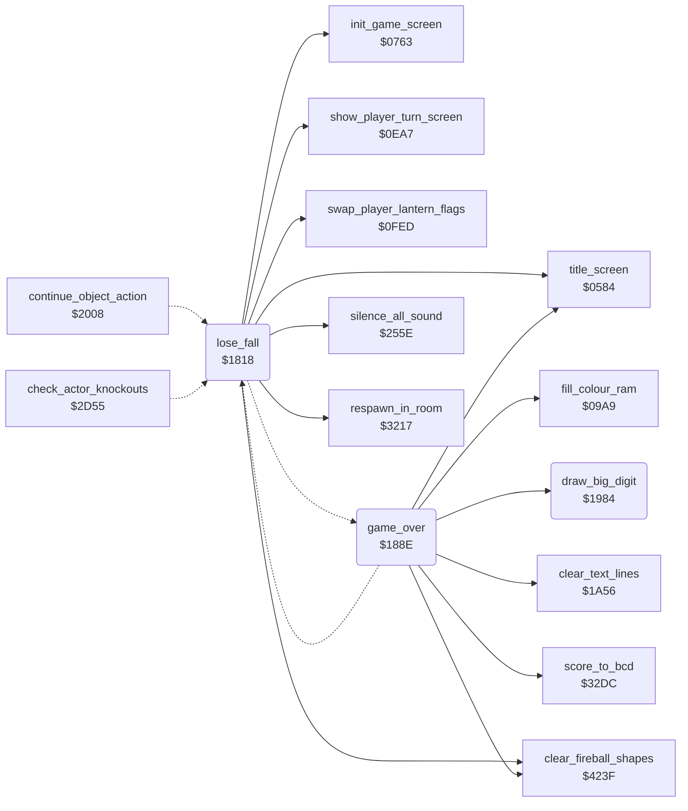

<!-- Generated by c64-docs from knowledge revision 20261016T170255.379-vv114c and src/source-map.json. Do not edit: change the knowledge, generate the source again, then run generate.ts. -->
# game_over.asm: Loss of a fall, change of player and game-over screen

Range `$1818-$199E`. Source: [game_over.asm](../../../src/game_over.asm). Index: [the reference](../index.md).

## Call graph

A solid arrow is a call, a thick arrow a table entry, a dotted arrow a jump. Rounded nodes are in this file.

## Names

### [`lose_fall`](../../../src/game_over.asm#L6) `$1818`

*routine*

Bruce has fallen: in demo mode restarts via $0584. Otherwise decrements falls_left; at -1 goes to game_over, else (with two players) changes player, shows the player-up screen and re-enters the room through $3217.

- **Jumped to from:** [`continue_object_action`](object_actions.md#continue_object_action) [`$217A`](../../../src/object_actions.asm#L200), [`check_actor_knockouts`](actor_checks.md#check_actor_knockouts) [`$2D79`](../../../src/actor_checks.asm#L31)
- **Calls:** [`silence_all_sound`](sound_effects.md#silence_all_sound), [`title_screen`](title.md#title_screen), [`clear_fireball_shapes`](fireballs.md#clear_fireball_shapes), [`show_player_turn_screen`](player_turn.md#show_player_turn_screen), [`swap_player_lantern_flags`](game_vars.md#swap_player_lantern_flags), [`init_game_screen`](game_setup.md#init_game_screen), [`respawn_in_room`](room_entry_traps.md#respawn_in_room)
- **Jumps to:** [`game_over`](game_over.md#game_over)
- **Reads:** [`game_playing`](../variables.md#game_playing), [`falls_left`](../variables.md#falls_left), [`two_player_mode`](variables.md#two_player_mode), [`other_player_state`](variables.md#other_player_state), [`current_player`](../variables.md#current_player), [`SCROLY`](../variables.md#SCROLY), [`score+1`](../variables.md#score), [`score+2`](../variables.md#score), [`other_player_state+26`](variables.md#other_player_state), [`other_player_state+27`](variables.md#other_player_state), [`next_extra_life_score+1`](variables.md#next_extra_life_score), [`next_extra_life_score+2`](variables.md#next_extra_life_score), [`other_next_extra_life_score+1`](variables.md#other_next_extra_life_score), [`other_next_extra_life_score+2`](variables.md#other_next_extra_life_score), [`current_room`](../variables.md#current_room)
- **Writes:** [`title_music_countdown`](title_menu.md#title_music_countdown), [`falls_left`](../variables.md#falls_left), [`actor_energy`](../variables.md#actor_energy), [`actor_energy+1`](../variables.md#actor_energy), [`actor_energy+2`](../variables.md#actor_energy), [`enemy_entry_x`](../variables.md#enemy_entry_x), [`enemy_entry_x+1`](../variables.md#enemy_entry_x), [`current_player`](../variables.md#current_player), [`SCROLY`](../variables.md#SCROLY), [`other_player_state+26`](variables.md#other_player_state), [`other_player_state+27`](variables.md#other_player_state), [`score+1`](../variables.md#score), [`score+2`](../variables.md#score), [`next_extra_life_score+1`](variables.md#next_extra_life_score), [`next_extra_life_score+2`](variables.md#next_extra_life_score), [`other_next_extra_life_score+1`](variables.md#other_next_extra_life_score), [`other_next_extra_life_score+2`](variables.md#other_next_extra_life_score)
- **Refers to:** [`actor_energy`](../variables.md#actor_energy), [`enemy_entry_x`](../variables.md#enemy_entry_x)

### [`next_player_turn`](../../../src/game_over.asm#L15) `$182A`

*label*

- **Jumped to from:** [`game_over`](game_over.md#game_over) [`$1976`](../../../src/game_over.asm#L177)

### [`show_next_turn_screen`](../../../src/game_over.asm#L31) `$184B`

*label*

- **Jumped to from:** [`lose_fall`](game_over.md#lose_fall) [`$183E`](../../../src/game_over.asm#L25), [`lose_fall`](game_over.md#lose_fall) [`$1843`](../../../src/game_over.asm#L27)

### [`swap_player_block_loop`](../../../src/game_over.asm#L42) `$1862`

*label*

Two players: exchanges zero page $28-$43 (falls, room, lantern counters, game_cycle, score) with other_player_state, then the lantern record states and the extra-life thresholds.

- **Jumped to from:** [`lose_fall`](game_over.md#lose_fall) [`$186E`](../../../src/game_over.asm#L49)

### [`swap_extra_life_loop`](../../../src/game_over.asm#L52) `$1875`

*label*

- **Jumped to from:** [`lose_fall`](game_over.md#lose_fall) [`$1884`](../../../src/game_over.asm#L60)

### [`respawn_after_fall`](../../../src/game_over.asm#L62) `$1886`

*label*

Re-initialises the game screen and Bruce, then respawns him in current_room (after a swap, the room of the new player).

- **Jumped to from:** [`lose_fall`](game_over.md#lose_fall) [`$1859`](../../../src/game_over.asm#L37), [`lose_fall`](game_over.md#lose_fall) [`$185E`](../../../src/game_over.asm#L39)

### [`game_over`](../../../src/game_over.asm#L67) `$188E`

*routine*

Game-over screen: clears text lines, installs irq_split_top, draws the two strings at $42CD/$42DF, the player name from $4A5D/$4A6D and the score in big digits, waits $FE frames, then either continues with the other player or waits $40 frames and goes to $0584.

- **Jumped to from:** [`lose_fall`](game_over.md#lose_fall) [`$1828`](../../../src/game_over.asm#L14)
- **Calls:** [`clear_fireball_shapes`](fireballs.md#clear_fireball_shapes), [`clear_text_lines`](status.md#clear_text_lines), [`fill_colour_ram`](title_menu.md#fill_colour_ram), [`score_to_bcd`](score_bcd_regsave.md#score_to_bcd), [`draw_big_digit`](game_over.md#draw_big_digit), [`title_screen`](title.md#title_screen)
- **Jumps to:** [`next_player_turn`](game_over.md#next_player_turn)
- **Reads:** [`SCROLY`](../variables.md#SCROLY), [`game_over_logo_top+16`](variables.md#game_over_logo_top), [`game_over_logo_top+17`](variables.md#game_over_logo_top), [`game_over_logo_bottom+16`](variables.md#game_over_logo_bottom), [`game_over_logo_bottom+17`](variables.md#game_over_logo_bottom), [`current_player`](../variables.md#current_player), [`room_atari_colour_records+1`](room_tables.md#room_atari_colour_records), [`room_atari_colour_records+5`](room_tables.md#room_atari_colour_records), [`player_banner_top+14`](room_tables.md#player_banner_top), [`player_banner_top+15`](room_tables.md#player_banner_top), [`player_banner_bottom+14`](room_tables.md#player_banner_bottom), [`player_banner_bottom+15`](room_tables.md#player_banner_bottom), [`bcd_conv_digits+1`](variables.md#bcd_conv_digits), [`bcd_conv_digits+2`](variables.md#bcd_conv_digits), [`frame_countdown`](../variables.md#frame_countdown), [`two_player_mode`](variables.md#two_player_mode), [`other_player_state`](variables.md#other_player_state)
- **Writes:** [`SCROLY`](../variables.md#SCROLY), [`SPENA`](../variables.md#SPENA), [`irq_chain_vector`](init.md#irq_chain_vector), [`irq_vector_hi`](init.md#irq_vector_hi), [`IRQMSK`](../variables.md#IRQMSK), [`VICIRQ`](../variables.md#VICIRQ), [`RASTER`](../variables.md#RASTER), [`EXTCOL`](../variables.md#EXTCOL), [`BGCOL0`](../variables.md#BGCOL0), [`BGCOL1`](../variables.md#BGCOL1), [`BGCOL2`](../variables.md#BGCOL2), [`SCROLX`](../variables.md#SCROLX), [`ld99e+66`](../variables.md#ld99e), [`ld99e+67`](../variables.md#ld99e), [`lda00+224`](../variables.md#lda00), [`lda00+225`](../variables.md#lda00), [`screen_ram`](vic_bank2.md#screen_ram), [`screen_ram+1`](vic_bank2.md#screen_ram), [`screen_ram+144`](vic_bank2.md#screen_ram), [`screen_ram+145`](vic_bank2.md#screen_ram), [`screen_ram+67`](vic_bank2.md#screen_ram), [`screen_ram+68`](vic_bank2.md#screen_ram), [`screen_ram+107`](vic_bank2.md#screen_ram), [`screen_ram+108`](vic_bank2.md#screen_ram), [`player_banner_top+14`](room_tables.md#player_banner_top), [`exit2_room+12`](room_tables.md#exit2_room), [`player_banner_bottom+14`](room_tables.md#player_banner_bottom), [`exit3_room+8`](room_tables.md#exit3_room), [`screen_ram+226`](vic_bank2.md#screen_ram), [`screen_ram+227`](vic_bank2.md#screen_ram), [`screen_ram+266`](vic_bank2.md#screen_ram), [`screen_ram+267`](vic_bank2.md#screen_ram), [`work_ptr_a`](../variables.md#work_ptr_a), [`work_ptr_b`](../variables.md#work_ptr_b), [`work_ptr_a+1`](../variables.md#work_ptr_a), [`work_ptr_b+1`](../variables.md#work_ptr_b), [`frame_countdown`](../variables.md#frame_countdown)
- **Refers to:** [`irq_split_top`](raster_irq_screens.md#irq_split_top), [`screen_ram`](vic_bank2.md#screen_ram), [`player_banner_top`](room_tables.md#player_banner_top), [`player_banner_bottom`](room_tables.md#player_banner_bottom), [`work_ptr_a`](../variables.md#work_ptr_a), [`work_ptr_b`](../variables.md#work_ptr_b)

### [`game_over_wait_loop`](../../../src/game_over.asm#L169) `$1968`

*label*

- **Jumped to from:** [`game_over`](game_over.md#game_over) [`$196A`](../../../src/game_over.asm#L171)

### [`game_over_final_wait`](../../../src/game_over.asm#L178) `$1979`

*label*

- **Jumped to from:** [`game_over`](game_over.md#game_over) [`$196F`](../../../src/game_over.asm#L173), [`game_over`](game_over.md#game_over) [`$1974`](../../../src/game_over.asm#L176)

### [`draw_big_digit`](../../../src/game_over.asm#L186) `$1984`

*routine*

Draws digit A (low nibble) as a 2x2 block of characters $B4+4*digit.. at ($04),Y/($06),Y and advances Y by one.

- **Called from:** [`game_over`](game_over.md#game_over) [`$1949`](../../../src/game_over.asm#L154), [`game_over`](game_over.md#game_over) [`$1952`](../../../src/game_over.asm#L158)
- **Reads:** [`work_ptr_a`](../variables.md#work_ptr_a), [`work_ptr_b`](../variables.md#work_ptr_b)
- **Refers to:** [`charset_src_0+433`](room_charset_src.md#charset_src_0)
