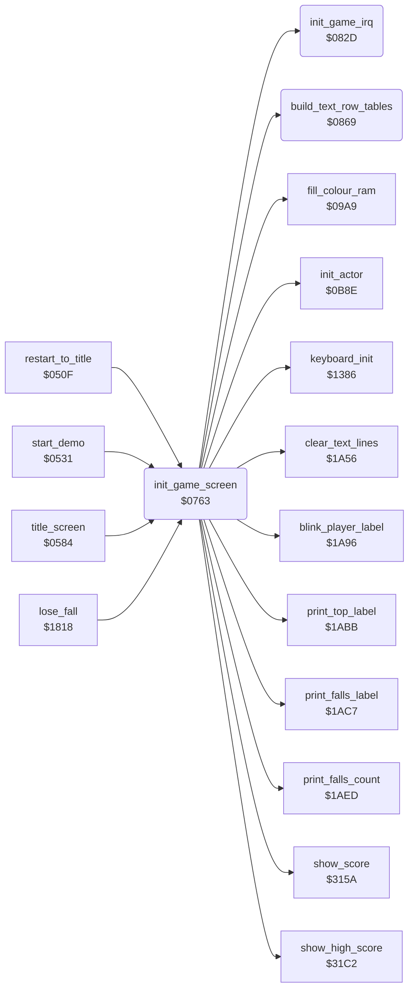

<!-- Generated by c64-docs from knowledge revision 20261016T170255.379-vv114c and src/source-map.json. Do not edit: change the knowledge, generate the source again, then run generate.ts. -->
# game_setup.asm: Game screen and interrupt setup

Range `$0763-$08B0`. Source: [game_setup.asm](../../../src/game_setup.asm). Index: [the reference](../index.md).

## Call graph

A solid arrow is a call, a thick arrow a table entry, a dotted arrow a jump. Rounded nodes are in this file.

## Names

### [`init_game_screen`](../../../src/game_setup.asm#L6) `$0763`

*routine*

Sets up the in-game display: game IRQ, keyboard, text row address tables, colour RAM, VIC bank 2 with screen $8C00, sprite pointers and data, colours, the status line, then initialises actor 0 (Bruce Lee) through init_actor.

- **Called from:** [`restart_to_title`](restart.md#restart_to_title) [`$052B`](../../../src/restart.asm#L21), [`start_demo`](restart.md#start_demo) [`$0553`](../../../src/restart.asm#L40), [`title_screen`](title.md#title_screen) [`$0749`](../../../src/title.asm#L209), [`lose_fall`](game_over.md#lose_fall) [`$1886`](../../../src/game_over.asm#L63)
- **Calls:** [`init_game_irq`](game_setup.md#init_game_irq), [`keyboard_init`](keyboard.md#keyboard_init), [`build_text_row_tables`](game_setup.md#build_text_row_tables), [`clear_text_lines`](status.md#clear_text_lines), [`fill_colour_ram`](title_menu.md#fill_colour_ram), [`show_score`](score.md#show_score), [`show_high_score`](score.md#show_high_score), [`blink_player_label`](status.md#blink_player_label), [`print_top_label`](status.md#print_top_label), [`print_falls_label`](status.md#print_falls_label), [`print_falls_count`](status.md#print_falls_count), [`init_actor`](actors.md#init_actor)
- **Reads:** [`initial_vic_colours+2`](room_colours.md#initial_vic_colours), [`initial_vic_colours+3`](room_colours.md#initial_vic_colours)
- **Writes:** [`enemy_entry_x`](../variables.md#enemy_entry_x), [`enemy_entry_x+1`](../variables.md#enemy_entry_x), [`last_key`](../variables.md#last_key), [`text_row_top_lo`](variables.md#text_row_top_lo), [`text_row_bottom_lo`](variables.md#text_row_bottom_lo), [`text_row_bottom_lo+1`](variables.md#text_row_bottom_lo), [`text_row_top_hi`](variables.md#text_row_top_hi), [`text_row_bottom_hi`](variables.md#text_row_bottom_hi), [`text_row_bottom_hi+1`](variables.md#text_row_bottom_hi), [`ld800+38`](../variables.md#ld800), [`ld800+39`](../variables.md#ld800), [`ld828+38`](../variables.md#ld828), [`ld828+39`](../variables.md#ld828), [`screen_ram+38`](vic_bank2.md#screen_ram), [`screen_ram+39`](vic_bank2.md#screen_ram), [`screen_ram+118`](vic_bank2.md#screen_ram), [`screen_ram+119`](vic_bank2.md#screen_ram), [`charset_src_0+30`](room_charset_src.md#charset_src_0), [`title_charset+294`](vic_bank2.md#title_charset), [`sprite_blocks`](vic_bank2.md#sprite_blocks), [`sprite_blocks+1`](vic_bank2.md#sprite_blocks), [`sprite_blocks+256`](vic_bank2.md#sprite_blocks), [`sprite_blocks+257`](vic_bank2.md#sprite_blocks), [`sprite_blocks+384`](vic_bank2.md#sprite_blocks), [`sprite_blocks+385`](vic_bank2.md#sprite_blocks), [`BGCOL1`](../variables.md#BGCOL1), [`BGCOL2`](../variables.md#BGCOL2), [`CI2PRA`](../variables.md#CI2PRA), [`VMCSB`](../variables.md#VMCSB), [`room_charset_d018`](../variables.md#room_charset_d018), [`SCROLX`](../variables.md#SCROLX), [`SPENA`](../variables.md#SPENA), [`YXPAND`](../variables.md#YXPAND), [`SPBGPR`](../variables.md#SPBGPR), [`SPMC`](../variables.md#SPMC), [`XXPAND`](../variables.md#XXPAND), [`player_tag_blink_timer`](variables.md#player_tag_blink_timer), [`scroll_timer`](../variables.md#scroll_timer), [`scroll_moves`](../variables.md#scroll_moves), [`sprite_owner+3`](actor_vars.md#sprite_owner) and 1 more
- **Refers to:** [`enemy_entry_x`](../variables.md#enemy_entry_x), [`text_row_bottom_lo`](variables.md#text_row_bottom_lo), [`text_row_bottom_hi`](variables.md#text_row_bottom_hi), [`screen_ram`](vic_bank2.md#screen_ram), [`title_charset`](vic_bank2.md#title_charset), [`sprite_blocks`](vic_bank2.md#sprite_blocks)

### [`init_game_irq`](../../../src/game_setup.asm#L97) `$082D`

*routine*

Disables the CIA interrupts, sets irq_vector to the game raster IRQ at $48C1 on line $FB, and starts SID voice 3 as a noise source.

- **Called from:** [`init_game_screen`](game_setup.md#init_game_screen) [`$0769`](../../../src/game_setup.asm#L10)
- **Reads:** [`CI2ICR`](../variables.md#CI2ICR), [`CIAICR`](../variables.md#CIAICR), [`SCROLY`](../variables.md#SCROLY)
- **Writes:** [`CI2ICR`](../variables.md#CI2ICR), [`CIAICR`](../variables.md#CIAICR), [`irq_chain_vector`](init.md#irq_chain_vector), [`irq_vector_hi`](init.md#irq_vector_hi), [`IRQMSK`](../variables.md#IRQMSK), [`VICIRQ`](../variables.md#VICIRQ), [`SCROLY`](../variables.md#SCROLY), [`RASTER`](../variables.md#RASTER), [`FRELO3`](../variables.md#FRELO3), [`FREHI3`](../variables.md#FREHI3), [`VCREG3`](../variables.md#VCREG3)
- **Refers to:** [`irq_frame_top`](raster_irq_game.md#irq_frame_top)

### [`build_text_row_tables`](../../../src/game_setup.asm#L124) `$0869`

*routine*

Builds 14 screen addresses 80 bytes apart from A (low) and Y (high) into text_row_top_lo/hi, and the row below each into text_row_bottom_lo/hi, for double-height text lines.

- **Called from:** [`init_game_screen`](game_setup.md#init_game_screen) [`$0777`](../../../src/game_setup.asm#L16)
- **Reads:** [`text_row_top_lo`](variables.md#text_row_top_lo), [`text_row_top_lo+1`](variables.md#text_row_top_lo), [`text_row_top_hi`](variables.md#text_row_top_hi), [`text_row_top_hi+1`](variables.md#text_row_top_hi), [`text_row_bottom_lo`](variables.md#text_row_bottom_lo), [`text_row_bottom_lo+1`](variables.md#text_row_bottom_lo), [`text_row_bottom_hi`](variables.md#text_row_bottom_hi), [`text_row_bottom_hi+1`](variables.md#text_row_bottom_hi)
- **Writes:** [`text_row_top_lo`](variables.md#text_row_top_lo), [`text_row_top_hi`](variables.md#text_row_top_hi), [`text_row_top_lo+1`](variables.md#text_row_top_lo), [`text_row_top_lo+2`](variables.md#text_row_top_lo), [`text_row_top_hi+1`](variables.md#text_row_top_hi), [`text_row_top_hi+2`](variables.md#text_row_top_hi), [`text_row_bottom_lo`](variables.md#text_row_bottom_lo), [`text_row_bottom_hi`](variables.md#text_row_bottom_hi), [`text_row_bottom_lo+1`](variables.md#text_row_bottom_lo), [`text_row_bottom_lo+2`](variables.md#text_row_bottom_lo), [`text_row_bottom_hi+1`](variables.md#text_row_bottom_hi), [`text_row_bottom_hi+2`](variables.md#text_row_bottom_hi)
- **Refers to:** [`text_row_top_lo`](variables.md#text_row_top_lo), [`text_row_top_hi`](variables.md#text_row_top_hi), [`text_row_bottom_lo`](variables.md#text_row_bottom_lo), [`text_row_bottom_hi`](variables.md#text_row_bottom_hi)
